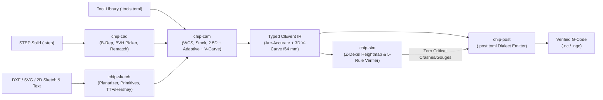
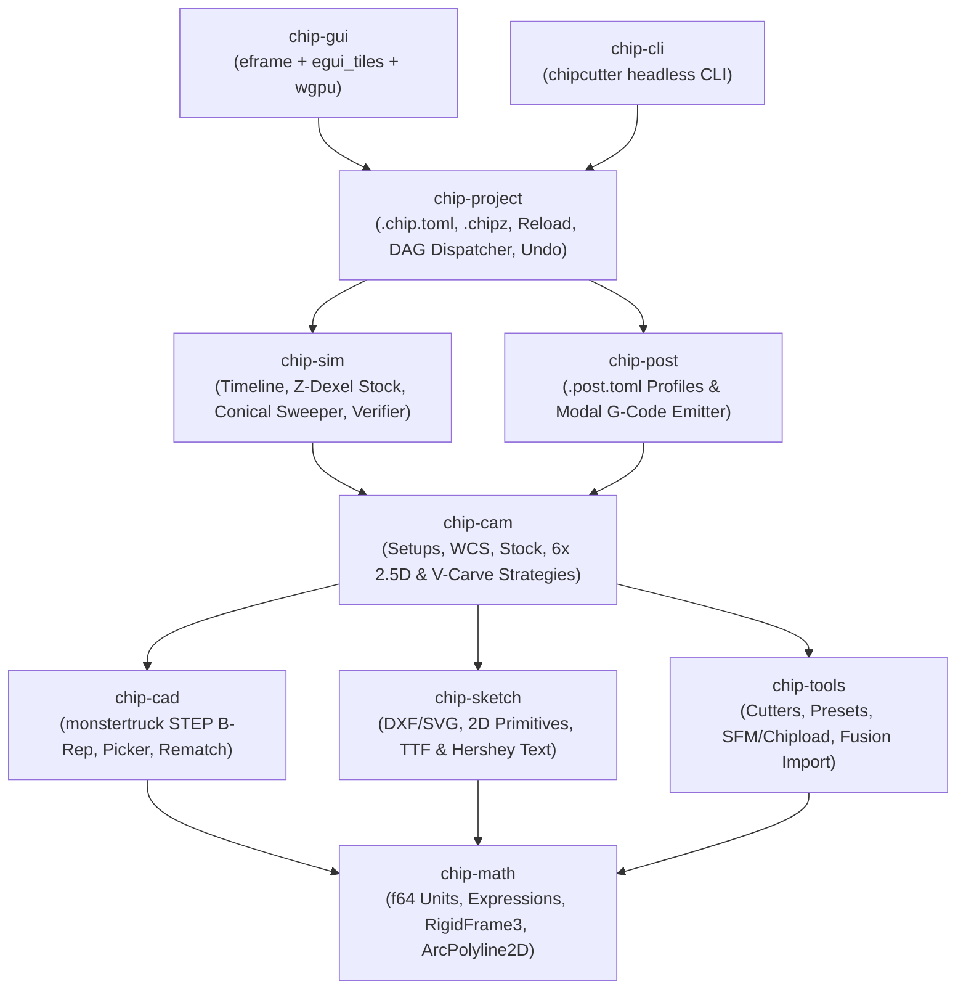

# ChipCutter Architecture

This document summarizes the high-level data pipeline, Cargo workspace crate boundaries, threading model, and 3D GPU rendering passes in **ChipCutter**. Detailed subsystem specifications live in [`specs/`](specs/).

---

## 1. End-to-End CAM Data Pipeline

### Core Architectural Invariants
1. **UI-Agnostic Engine:** `chip-math`, `chip-cad`, `chip-sketch`, `chip-tools`, `chip-cam`, `chip-sim`, `chip-post`, and `chip-project` never depend on `egui`, `eframe`, `egui_tiles`, or `wgpu`. Every operation works identically in the desktop GUI (`chip-gui`) and headless CLI (`chipcutter`).
2. **Canonical `f64` Millimeter Kernel:** All internal coordinates, curve offsets, tolerances, Z-heights, and feedrates (`mm/min`) are stored in `f64` millimeters. Unit conversion happens strictly at input/display boundaries and post-processor emission (`G20` vs `G21`).
3. **True Circular Arc Preservation:** Planar contours, 2D `cavalier_contours` offsets, helical bores, and tangent lead-in/out moves remain exact line + circular arc segments (`ArcPolyline2D` -> `ClEvent::ArcMove`) rather than faceted micro-segments.
4. **Safety-First G-Code Emission:** Both `chipcutter build` and the desktop export workflow run the 2.5D Z-dexel heightmap physical verifier (`chip-sim`) and block G-code emission if any critical rapid crash, target gouge, shank/flute rub, holder collision, or unsafe plunge is detected.
5. **Memory & Panic Safety:** Workspace lints enforce `unsafe_code = "deny"`, `clippy::unwrap_used = "deny"`, and `clippy::expect_used = "deny"` across library and binary crates, with permissive-only dependencies verified by [`deny.toml`](deny.toml).

---

## 2. Cargo Workspace Dependency Graph

### Crate Responsibilities

| Crate | Role |
|---|---|
| [`crates/chip-math`](crates/chip-math) | `f64` millimeter units, machinist expression & fraction parser (`1/4 in`, `tool_d * 0.4`), orthonormal `RigidFrame3`, and `ArcPolyline2D` |
| [`crates/chip-cad`](crates/chip-cad) | `CadKernel` trait, `monstertruck` STEP importer/tessellator, R-tree spatial ray picker, B-Rep adjacency graph, and `GeometricSignature` fuzzy re-matching |
| [`crates/chip-sketch`](crates/chip-sketch) | DXF & SVG importers, gap-healing loop planarizer, parametric 2D primitives (`Rectangle`, `Circle`, `Slot`, `Polygon`, `PointPattern`, `Polyline`), and TrueType (`skrifa`) + Hershey CAM typography |
| [`crates/chip-tools`](crates/chip-tools) | 6 cutter geometries (incl. sharp V-bits), per-material feeds/speeds presets, coupled SFM/chipload & radial chip-thinning math, `.tools.toml` persistence, and Fusion 360 `.json`/`.tools` importer |
| [`crates/chip-cam`](crates/chip-cam) | Multi-Setup WCS & box/cylinder/sketch stock, B-Rep + 2D sketch feature extraction, `cavalier_contours` offsetting & 2D booleans (`RegionSet2D`), `boostvoronoi` medial-axis chains, Facing, 2D Contour (+ tabs), 2D Pocket & 2D Adaptive Clearing, 2.5D Rest Machining, Drill/Helical Bore, Chamfer/Trace, and Two-Stage V-Carving & V-Inlays |
| [`crates/chip-sim`](crates/chip-sim) | Trapezoidal acceleration timeline & cycle-time estimator, analytic cutter/shank/holder radial profiles, closed-form sloped 3D conical V-bit sweeper, 2.5D Z-dexel stock heightmap, and 5-rule collision/gouge verifier |
| [`crates/chip-post`](crates/chip-post) | Typed `ClEvent` IR consumer, modal G-code state machine, quadrant arc & peck-drill expansion, ATC vs. split-file-per-tool partitioning (incl. Two-Tool V-Carve), and `.post.toml` dialect profiles |
| [`crates/chip-project`](crates/chip-project) | Deterministic `.chip.toml` manifest (`schema_version = 1 / 2`), zip-slip-safe `.chipz` portable bundles (STEP + DXF/SVG + TTF/OTF + `.post.toml`), WCS-first associative STEP + face-sketch reload, topological DAG wave `JobDispatcher`, LRU toolpath cache, and `100`-step `< 1 ms` Undo/Redo |
| [`crates/chip-cli`](crates/chip-cli) | Headless `chipcutter` CLI (`inspect`, `import-2d`, `generate-sample-step`, `validate`, `simulate`, `build`, `reload-step`, `bundle`, `tools`) & Phase 1 + Phase 2 golden G-code regression tests |
| [`crates/chip-gui`](crates/chip-gui) | Native desktop CAM application (`eframe` + `egui_tiles` docking + `wgpu` 4x MSAA 3D/2D viewport, `ThemeTokens` Studio Dark & Daylight Light design system, procedural vector icons, two-column Inspector grids, `Ctrl+K` Command Palette, Welcome & Sample Gallery, and `prefs.toml` user preferences) |

---

## 3. Concurrency, DAG Caching, & Undo Model

- **Non-Blocking UI Thread & Zero Idle Clones:** STEP/DXF/SVG loading, tessellation, topological DAG toolpath generation (`Ctrl+G`), and Z-dexel heightmap simulation all execute on background `rayon` workers communicating via `crossbeam-channel` with `Arc<AtomicBool>` cancellation tokens. Per-frame Setup WCS + feature extraction is memoized in `CachedFrameGeo` so idle 60 FPS frames perform zero redundant B-Rep/sketch recomputations or document clones.
- **Content-Addressed Toolpath Cache & DAG Waves:** Each operation computes a deterministic SHA-256 `OperationInputHash` over its CAD revision, `SketchLayer`s, Setup WCS/stock/heights, embedded primary + secondary `clearing_tool` definitions, strategy parameters, and recursive upstream Rest Machining hashes. `JobDispatcher` executes `RestMachiningMode::FromPrecedingOperations` dependencies in topological waves and automatically propagates `Dirty` invalidation to downstream Rest operations when an upstream operation is edited or reordered.
- **Sub-Millisecond Undo / Redo:** `UndoHistory` snapshots lightweight `ProjectDocument` specs out-of-band from heavy B-Rep meshes and GPU buffers; pressing `Ctrl+Z` / `Ctrl+Y` immediately reconciles against `ToolpathCache` to restore cached toolpaths without recalculation.

---

## 4. 3D / 2D `wgpu` Viewport Render Pipeline (`chip-gui`)

`ViewportRenderer` renders into an offscreen `4x MSAA` color + `Depth32Float` target composited into `egui` across six ordered GPU draw stages (followed by `egui` HUD overlays):
1. **Stage 1 — Studio Gradient & Adaptive WCS XY Grid (`bg_pipeline`):** Theme-coupled Studio Dark / Daylight Light background gradient and active Setup XY workplane grid with auto-scaling metric (`mm`) / imperial (`in`) minor and major subdivisions.
2. **Stage 2 — 3D Machined Stock Mesh (`sim_stock_pipeline`):** Live Z-dexel machined stock mesh colored by cutting operation when simulation stock view is active.
3. **Stage 3 — Shaded B-Rep Solids (`solid_pipeline` / `solid_ghost_pipeline`):** Two-sided hemisphere + key-light Blinn-Phong CAD faces with hover/selection/multi-face tinting and optional translucent ghost-part comparison against machined stock.
4. **Stage 4 — Animated 3D Cutter Assembly (`sim_tool_pipeline`):** Revolved 3D flutes, shank, and ER collet/holder positioned at the active timeline scrub point.
5. **Stage 5 — Translucent Stock, Z-Height Planes, & 2D Sketch Fills (`overlay_pipeline`):** Translucent box/cylinder stock, interactive Clearance / Retract / Feed / Top / Bottom Z planes, and hovered/selected 2D `SketchLayer` planar region highlights.
6. **Stage 6 — GPU-Instanced Screen-Space Ribbons (`edge_pipeline`):** Depth-biased B-Rep edges, 2D `SketchLayer` curves/typography/rubber-band previews, WCS triad, 3D chain arrows, holding-tab bridges, and cached `500,000+`-segment GPU-instanced toolpaths (`G0` rapids, `G1` cuts, `G2`/`G3` arcs, helices, and Two-Stage V-Carve clearing + bevel passes)—topped by the Floating Bottom Viewport View HUD, Active Pick & Sketch Guidance HUD, interactive ViewCube, 27-point WCS origin dots, and 2D Snap HUD badges.
