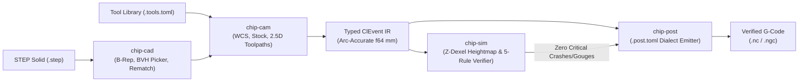
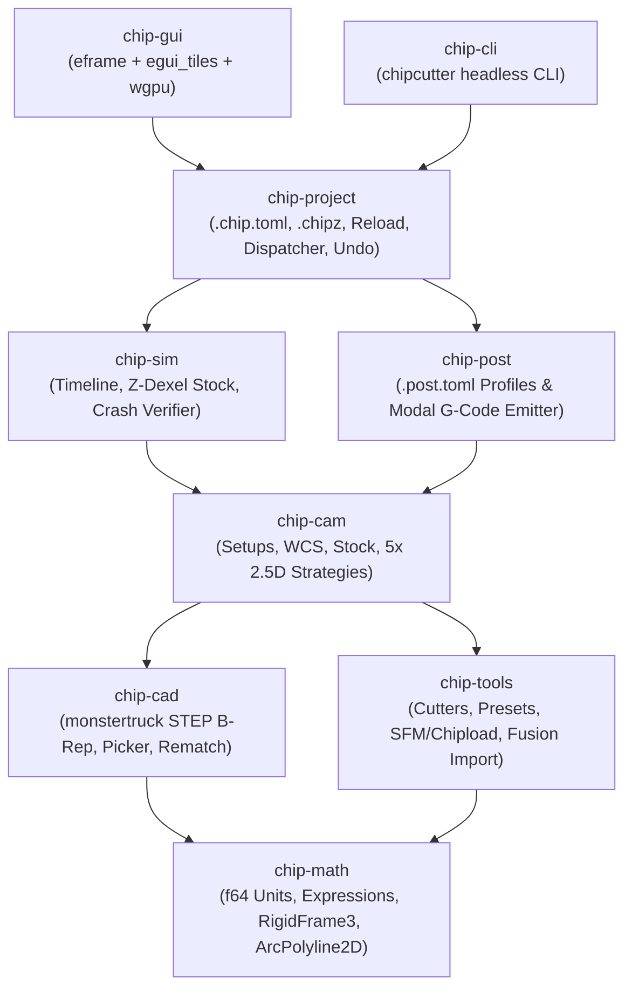

# ChipCutter Architecture

This document summarizes the high-level data pipeline, Cargo workspace crate boundaries, threading model, and 3D GPU rendering passes in **ChipCutter**. Detailed subsystem specifications live in [`specs/`](specs/).

---

## 1. End-to-End CAM Data Pipeline

### Core Architectural Invariants
1. **UI-Agnostic Engine:** `chip-math`, `chip-cad`, `chip-tools`, `chip-cam`, `chip-sim`, `chip-post`, and `chip-project` never depend on `egui`, `eframe`, `egui_tiles`, or `wgpu`. Every operation works identically in the desktop GUI (`chip-gui`) and headless CLI (`chipcutter`).
2. **Canonical `f64` Millimeter Kernel:** All internal coordinates, curve offsets, tolerances, Z-heights, and feedrates (`mm/min`) are stored in `f64` millimeters. Unit conversion happens strictly at input/display boundaries and post-processor emission (`G20` vs `G21`).
3. **True Circular Arc Preservation:** Planar contours, 2D `cavalier_contours` offsets, helical bores, and tangent lead-in/out moves remain exact line + circular arc segments (`ArcPolyline2D` -> `ClEvent::ArcMove`) rather than faceted micro-segments.
4. **Safety-First G-Code Emission:** Both `chipcutter build` and the desktop export workflow run the 2.5D Z-dexel heightmap physical verifier (`chip-sim`) and block G-code emission if any critical rapid crash, target gouge, shank/flute rub, holder collision, or unsafe plunge is detected.
5. **Memory & Panic Safety:** Workspace lints enforce `unsafe_code = "deny"`, `clippy::unwrap_used = "deny"`, and `clippy::expect_used = "deny"` across library and binary crates, with permissive-only dependencies verified by [`deny.toml`](deny.toml).

---

## 2. Cargo Workspace Dependency Graph

### Crate Responsibilities

| Crate | Role |
|---|---|
| [`crates/chip-math`](crates/chip-math) | `f64` millimeter units, machinist expression & fraction parser (`1/4 in`, `tool_d * 0.4`), orthonormal `RigidFrame3`, and `ArcPolyline2D` |
| [`crates/chip-cad`](crates/chip-cad) | `CadKernel` trait, pure-Rust `monstertruck` STEP importer/tessellator, R-tree spatial ray picker, B-Rep adjacency graph, and `GeometricSignature` fuzzy re-matching |
| [`crates/chip-tools`](crates/chip-tools) | 6 cutter geometries, per-material feeds/speeds presets, coupled SFM/chipload & radial chip-thinning math, `.tools.toml` persistence, and Fusion 360 `.json`/`.tools` importer |
| [`crates/chip-cam`](crates/chip-cam) | Multi-Setup WCS & box/cylinder stock, B-Rep feature extraction, Z-height hierarchy, `cavalier_contours` offsetting, Facing, 2D Contour (+ tabs), 2D Pocket (+ islands/open steps), Drill/Helical Bore, and Chamfer/Trace |
| [`crates/chip-sim`](crates/chip-sim) | Trapezoidal acceleration timeline & cycle-time estimator, analytic cutter/shank/holder radial profiles, 2.5D Z-dexel stock heightmap, and 5-rule collision/gouge verifier |
| [`crates/chip-post`](crates/chip-post) | Typed `ClEvent` IR consumer, modal G-code state machine, quadrant arc & peck-drill expansion, ATC vs. split-file-per-tool partitioning, and `.post.toml` dialect profiles |
| [`crates/chip-project`](crates/chip-project) | Deterministic `.chip.toml` manifest, zip-slip-safe `.chipz` portable bundles, WCS-first associative STEP reload re-binding, `rayon` `JobDispatcher`, LRU toolpath cache, and `100`-step `< 1 ms` Undo/Redo |
| [`crates/chip-cli`](crates/chip-cli) | Headless `chipcutter` CLI (`inspect`, `generate-sample-step`, `validate`, `simulate`, `build`, `reload-step`, `bundle`, `tools`) & golden G-code regression tests |
| [`crates/chip-gui`](crates/chip-gui) | Native desktop CAM application (`eframe` + `egui_tiles` docking + `wgpu` 4x MSAA 3D viewport) |

---

## 3. Concurrency, Caching, & Undo Model

- **Non-Blocking UI Thread:** STEP B-Rep loading/tessellation, parallel 2.5D toolpath generation (`Ctrl+G`), and Z-dexel heightmap simulation all execute on background `rayon` workers communicating via `crossbeam-channel` with `Arc<AtomicBool>` cancellation tokens.
- **Content-Addressed Toolpath Cache:** Operations compute a deterministic hash over their geometry bindings, strategy/pass/height parameters, tool geometry, Setup WCS, and CAD revision. Editing one operation invalidates only that operation (`Dirty`) while unaffected operations remain `Clean`.
- **Sub-Millisecond Undo / Redo:** `UndoHistory` snapshots lightweight `ProjectDocument` specs out-of-band from heavy B-Rep meshes and GPU buffers; pressing `Ctrl+Z` immediately reconciles against `ToolpathCache` to restore cached toolpaths without recalculation.

---

## 4. 3D `wgpu` Viewport Render Pipeline (`chip-gui`)

`ViewportRenderer` renders into an offscreen `4x MSAA` color + `Depth32Float` target composited into `egui`:
1. **Pass #1 — Shaded B-Rep Faces:** Two-sided hemisphere + key-light Blinn-Phong shading with hover/selection/multi-face tinting and optional ghost-part translucency.
2. **Pass #2 — Topological B-Rep Edges:** Depth-biased crisp edge wireframes highlighting hovered/selected loops and open chains.
3. **Pass #3 — Setup WCS Grid & Origin Triad:** Active Setup XY workplane grid (`10 mm` minor / `50 mm` major) and RGB XYZ axis triad.
4. **Pass #4 — Translucent Stock & Z-Height Planes:** Wireframe + translucent box/cylinder stock and interactive Clearance / Retract / Top / Bottom Z planes.
5. **Pass #5 — Instanced Toolpaths & Holding Tabs:** Motion-colored `G0` rapid, `G1` cut, `G2`/`G3` arc, lead-in/out, and helix ribbons plus 3D holding-tab markers.
6. **Pass #6 — 3D Machined Stock & Cutter Assembly:** Live Z-dexel machined stock mesh (colored by cutting operation) and revolved 3D flutes + shank + ER collet holder positioned along the active simulation timeline.
