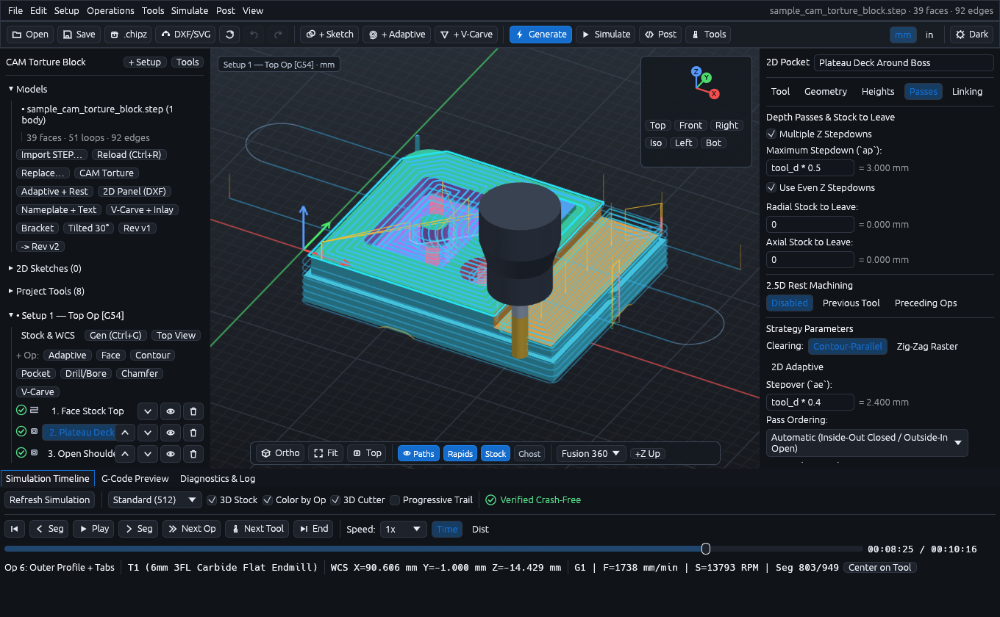

# ChipCutter

**ChipCutter** is an offline desktop 2.5D & V-Carve Computer-Aided Manufacturing (CAM) application (`chip-gui`) and headless CLI (`chipcutter`).

It turns 3D **STEP** B-Rep CAD solids (`AP203` / `AP214` / `AP242`), 2D **DXF / SVG** vector drawings, and parametric 2D sketches & typography into physically verified, arc-accurate (`G2`/`G3`) CNC milling, routing, engraving, and V-inlay G-code—without external CAD build dependencies, cloud accounts, or copyleft libraries.



---

## Highlights

- **STEP B-Rep Kernel & Associative Reload (`Ctrl+R`):**
  - Imports ISO 10303-21 `.step`/`.stp` solids via `monstertruck`, automatically normalizing units (`mm` / `in`) into a canonical `f64` millimeter kernel and classifying analytic planar faces, cylindrical holes/bosses, cones, lines, and circular arcs.
  - Interactive 3D BVH ray-picking of planar faces, closed edge loops, shortest-path open edge chains, coplanar faces, and same-diameter holes with automatic Z-top / Z-bottom inference.
  - **Associative CAD Revision Re-Matching:** Reloading an edited STEP model (`Ctrl+R` or `chipcutter reload-step`) re-binds Setup WCS references first, fuzzy-matches modified/shifted features via `GeometricSignature`, heals open edge chains, marks matched operations `Dirty`, and flags deleted or ambiguous features for 1-click recovery while preserving all tool, feed/speed, height, pass, and holding-tab settings.

- **Multi-Setup WCS & Parametric Machinist Expressions:**
  - Multiple Setups (`G54`–`G59.3`) per project with box or cylindrical stock, B-Rep face/edge WCS orientation alignment (supporting tilted/rotated parts), and an interactive 3D **27-point** stock/model WCS origin picker.
  - Every dimensional input accepts mixed-unit formulas and variables (`1/4 in`, `tool_d * 0.4`, `model_top_z + 10 mm`, `hole_d / 2`).

- **Pure-2D DXF / SVG Vector Import, Parametric Sketches, & Dual-Mode CAM Typography (`chip-sketch`):**
  - **Zero-STEP Pure-2D CNC Jobs & Associative 3D Face Sketches:** Import AutoCAD **DXF** (`LINE`, `ARC`, `CIRCLE`, `LWPOLYLINE` with true bulge arcs, `SPLINE`, `INSERT` blocks) and W3C **SVG** (`path` Béziers/arcs, shapes, `viewBox`, CSS/physical units) with endpoint gap healing (`0.05 mm`) and even-odd island nesting, or author parametric **Rectangles** (with fillets), **Circles**, **Slots**, **Regular Polygons**, **Bolt Circles / Linear Grids**, and **Polylines** directly on Setup XY or any planar 3D STEP face.
  - **Dual-Mode CAM Typography:** TrueType / OpenType (`.ttf`/`.otf`) closed-outline text (`skrifa` + bundled `DejaVuSans-Bold` + custom fonts packed inside `.chipz` `fonts/*`) for pocketing and V-carving, plus built-in **Hershey** single-line stroke fonts (`SimplexSans`, `EngineeringRoman`) for fast 1-pass part-number engraving.

- **Six Arc-Preserving 2.5D & 3D V-Carve Machining Strategies:**
  1. **Facing** — Zig-zag or one-way surfacing across stock XY bounds with pass extension and corner roll arcs.
  2. **2D Contour / Profile** — Exact circular-arc offsetting (`cavalier_contours`), multi-depth stepdowns, helical/linear ramps, horizontal + vertical tangent lead-in/out arcs, rough/finish wall passes, 2.5D Rest Machining, and automatic or click-on-contour rectangular/triangular holding tabs.
  3. **2D Pocket & High-Speed 2D Adaptive Clearing** — Closed pockets with arbitrary islands and open-shoulder air-entry pockets using either contour-parallel/zig-zag clearing OR constant-engagement **2D Adaptive / Trochoidal Clearing** (`optimal_load` `ae`, `both_ways` dynamic Climb/Conventional feed, micro-lift smooth arcs, radial chip-thinning feed boost) plus exact **2.5D Rest Machining** (`FromPreviousTool` & multi-operation `FromPrecedingOperations` DAG waves).
  4. **Drilling & Helical Bore Milling** — Spot, simple drill (`G81`), peck drill (`G83`/`G73`), and multi-pitch helical interpolation + flat-bottom cleanup circle for oversized bores and counterbores.
  5. **Edge Chamfering & 2D Curve Trace** — Exact chamfer-mill tip-offset kinematics (`tip_dia`, included angle, `tip_offset`) for both sharp unmodeled CAD edges and modeled `45°` bevel faces, plus 1-pass centerline curve/Hershey engraving.
  6. **3D Medial-Axis V-Carving, Two-Tool Flat Clearance, & Mated V-Inlays** — Simultaneous 3-axis `(X, Y, Z)` Voronoi medial-axis V-carving (`boostvoronoi`) with razor-sharp 3D corner climbs, optional `flat_depth` clamping with **Two-Stage Flat Endmill Area Clearance** (Stage 1 Flat Endmill Pocket/Adaptive + Stage 2 rest-machined V-Bit bevels & tight corners), and mirrored **Male V-Inlay Plug** generation (`start_depth` engagement + `glue_gap_bottom`).

- **Tool Library & Coupled SFM / Chipload Calculator:**
  - Supports Flat, Ball, Bull-Nose, Chamfer, Face Mill, and Twist Drill geometries with per-material cutting presets (`Aluminum 6061`, `Mild Steel`, `Hardwood`, `Acrylic`, etc.), radial chip-thinning compensation, `.tools.toml` libraries, and a **Fusion 360 `.json` / `.tools` (ZIP)** importer.

- **2.5D Z-Dexel Heightmap Stock Simulation & Mandatory Crash Gate:**
  - Multi-threaded `rayon` toolpath generation (`Ctrl+G`) and `< 1 ms` `100`-step Undo/Redo (`Ctrl+Z` / `Ctrl+Y`).
  - Interactive 3D machined-stock & revolved cutter/shank/holder timeline playback with trapezoidal-acceleration cycle-time estimation.
  - **5-Rule Physical Verifier:** Automatically checks every setup for `G0` rapid-into-stock crashes, target B-Rep part gouges (`> 0.02 mm`), non-cutting shank/flute-length collisions, holder collisions, and non-center-cutting plunges—blocking unsafe G-code export in both CLI and GUI.

- **Configurable TOML Post-Processors & Portable `.chipz` Bundles:**
  - Ships with built-in **Grbl 1.1 / FluidNC** (automatic file-per-tool splitting—including Two-Stage Flat Endmill + V-Bit V-Carve operations—`<= 80`-char line guard, quadrant arc splitting, expanded peck drills), **grblHAL / FluidNC ATC**, and **LinuxCNC (RS274NGC)** (`M6` + `G43 H`, `G64 P`, native canned cycles) profiles in [`posts/`](posts/).
  - Git-diff-friendly `.chip.toml` project manifests (`schema_version = 2`, backward-compatible with `v1`) plus byte-deterministic, self-contained **`.chipz`** portable bundles (`project.chip.toml` + `models/*.step` + `vectors/*.{dxf,svg}` + `fonts/*.{ttf,otf}` + custom `posts/*.post.toml`).

- **Studio Dark / Daylight Light Desktop UX & Persistent Preferences:**
  - Centralized `ThemeTokens` design system with WCAG-verified **Studio Dark** and **Daylight High-Contrast Light** themes (including theme-coupled 3D `wgpu` studio background & WCS grid), zero-dependency procedural HiDPI vector iconography, aligned two-column Inspector property grids, and `fx` scoped-variable expression autocomplete & nudging.
  - **Quick-Start Welcome Overlay & Sample Projects Gallery**, fuzzy **`Ctrl+K` Command Palette**, **`F1` / `?` Keyboard Shortcut Cheat-Sheet**, active 3D/2D viewport pick guidance HUD, drag-and-drop operation reordering, and cross-session **`~/.config/chipcutter/prefs.toml`** persistence.

---

## Quickstart

### 1. Prerequisites
- **Rust `1.85+` stable** (Rust Edition 2024).
- On Linux, install native windowing/Vulkan headers for `chip-gui` (macOS and Windows include Metal / DirectX 12 windowing out of the box—see [**`DEVELOPMENT.md`**](DEVELOPMENT.md) for Ubuntu/Debian, Fedora, Arch, macOS, and Windows setup commands).

### 2. Launch the Desktop CAM Application (`chip-gui`)
```bash
# Launch the desktop CAM workspace (opens the Quick-Start Welcome Overlay on bare launch):
cargo run --release -p chip-gui

# Launch directly into built-in 3D STEP, Pure-2D, Typography, or V-Carve & V-Inlay demos:
cargo run --release -p chip-gui -- --demo-torture
cargo run --release -p chip-gui -- --demo-pure-2d
cargo run --release -p chip-gui -- --demo-nameplate
cargo run --release -p chip-gui -- --demo-vcarve

# Launch in Daylight Light shop-floor theme (theme choice persists in prefs.toml):
cargo run --release -p chip-gui -- --theme light

# Or open an existing .chip.toml project, .chipz bundle, .dxf/.svg vector, or .step model directly:
cargo run --release -p chip-gui -- path/to/part.step
```

#### Essential Desktop Shortcuts
| Shortcut | Action |
|---|---|
| `Ctrl+K` | Open fuzzy **Command Palette** across all actions, views, & sample jobs |
| `F1` / `?` | Open **Keyboard Shortcut & Mouse Reference** cheat-sheet |
| `Ctrl+G` | Generate dirty 2.5D / 3D V-Carve toolpaths on background `rayon` pool |
| `Ctrl+D` / `Del` | Duplicate focused operation / Delete focused operation or sketch entity |
| `Ctrl+Up` / `Ctrl+Down` | Reorder focused operation within its Setup (or drag-and-drop row) |
| `Ctrl+R` | Reload active STEP model & associatively re-match CAM features |
| `Ctrl+O` / `Ctrl+S` | Open (`.chip.toml` / `.chipz`) / Save (`.chip.toml`) project |
| `Ctrl+Z` / `Ctrl+Y` | Instant Undo / Redo (`100` steps) |
| `Space` | Play / Pause 3D simulation timeline scrubbing |
| `P` / `F` | Toggle Orthographic vs. Perspective camera / Fit model to viewport |
| `Esc` | Exit active 3D picking / sketch mode or cancel in-flight generation |

### 3. Headless CLI Workflow (`chipcutter`)
Every CAD, toolpath, simulation, post-processing, associative reload, and bundling feature works headlessly without a GPU or display server:

```bash
# 1. Generate a sample machined STEP solid + seeded 8-operation .chip.toml project
cargo run -p chip-cli -- generate-sample-step /tmp/torture.step --cam-torture --project-out /tmp/torture.chip.toml

# 2. Inspect normalized STEP B-Rep geometry (planes, cylindrical holes, cones, arcs)
cargo run -p chip-cli -- inspect /tmp/torture.step

# 3. Validate project invariants and generate all 2.5D toolpaths
cargo run -p chip-cli -- validate --generate /tmp/torture.chip.toml

# 4. Run headless heightmap stock removal & 5-rule crash/gouge verification
cargo run -p chip-cli -- simulate /tmp/torture.chip.toml --resolution fine --report /tmp/sim_report.json

# 5. Build safety-verified G-code (LinuxCNC single ATC file or Grbl split-by-tool files)
cargo run -p chip-cli -- build /tmp/torture.chip.toml -o /tmp/out_linuxcnc --post linuxcnc
cargo run -p chip-cli -- build /tmp/torture.chip.toml -o /tmp/out_grbl --post grbl

# 6. Pack a self-contained portable .chipz archive (and build directly from it)
cargo run -p chip-cli -- bundle pack /tmp/torture.chip.toml -o /tmp/torture.chipz
cargo run -p chip-cli -- build /tmp/torture.chipz -o /tmp/out_from_bundle --post linuxcnc

# 7. Reload a revised STEP file and associatively re-bind operations
cargo run -p chip-cli -- reload-step /tmp/torture.chip.toml --step /tmp/torture_v2.step -o /tmp/torture_v2.chip.toml

# 8. Inspect & import a 2D DXF or SVG vector drawing into a Pure-2D .chip.toml job
cargo run -p chip-cli -- inspect panel.dxf
cargo run -p chip-cli -- import-2d panel.dxf -o /tmp/panel.chip.toml --thickness 6.0

# 9. Convert a Fusion 360 tool library (.json or .tools) into native .tools.toml
cargo run -p chip-cli -- tools import-fusion shop_tools.json -o shop.tools.toml
```

---

## Workspace Layout

See [**`ARCHITECTURE.md`**](ARCHITECTURE.md) for the end-to-end CAM data pipeline, crate dependency diagrams, concurrency model, and 3D `wgpu` viewport render passes.

All core geometry, CAM, simulation, post-processing, and project persistence crates are strictly **UI-agnostic** (`#![deny(unsafe_code)]`, `clippy::unwrap_used = "deny"`, `clippy::expect_used = "deny"`):

| Path | Description |
|---|---|
| [`crates/chip-math`](crates/chip-math) | Canonical `f64` millimeter types, `RigidFrame3` WCS math, 2D arc polylines, and machinist unit/expression evaluator |
| [`crates/chip-cad`](crates/chip-cad) | `CadKernel` trait, `monstertruck` STEP B-Rep loader/tessellator, R-tree ray picker, topology graph, and `GeometricSignature` reload re-matching |
| [`crates/chip-sketch`](crates/chip-sketch) | DXF & SVG importers, gap-healing planarizer, parametric 2D sketch primitives, and TrueType (`skrifa`) + Hershey CAM typography |
| [`crates/chip-tools`](crates/chip-tools) | 6 cutter geometries (incl. sharp V-bits), material presets, coupled SFM/chipload & chip-thinning math, `.tools.toml` I/O, and Fusion 360 importer |
| [`crates/chip-cam`](crates/chip-cam) | Setups, stock, WCS, `cavalier_contours` offsetting & 2D booleans, `boostvoronoi` medial axis, and all 6 machining strategies (incl. 2D Adaptive, Rest, & Two-Tool V-Carving / V-Inlays) |
| [`crates/chip-sim`](crates/chip-sim) | Trapezoidal motion timeline, revolved cutter profiles/meshes, analytical 3D conical V-bit sweeper, 2.5D Z-dexel stock heightmap, and 5-rule crash/gouge verifier |
| [`crates/chip-post`](crates/chip-post) | Typed `ClEvent` consumer, modal state machine, quadrant arc & peck-drill expansion, and `.post.toml` G-code emitter |
| [`crates/chip-project`](crates/chip-project) | Deterministic `.chip.toml` (`schema_version = 1 / 2`), `.chipz` portable bundles, associative STEP + face-sketch reload, DAG wave `JobDispatcher`, and Undo/Redo |
| [`crates/chip-cli`](crates/chip-cli) | `chipcutter` headless CLI binary and Phase 1 + Phase 2 golden end-to-end G-code snapshot suite |
| [`crates/chip-gui`](crates/chip-gui) | `eframe` + `egui_tiles` + `wgpu` 4x MSAA 3D/2D CAD/CAM desktop application |
| [`posts/`](posts) | Built-in TOML post-processor profiles (`grbl.post.toml`, `grblhal_atc.post.toml`, `linuxcnc.post.toml`) |
| [`specs/`](specs) | Authoritative subsystem architecture & algorithm specifications (`00-overview.md` – `11-sketches-vectors.md`) |
| [`plans/`](plans) | Milestone 1–12 engineering implementation plans (`01-milestone-1-plan.md` – `12-milestone-12-plan.md`) |

---

## Documentation

- [**`ARCHITECTURE.md`**](ARCHITECTURE.md) — End-to-end data pipeline, crate dependency graph, threading/caching model, and 3D render passes
- [**`DEVELOPMENT.md`**](DEVELOPMENT.md) — Platform build prerequisites, native Linux/macOS/Windows setup, and headless CI instructions
- [**`specs/00-overview.md`**](specs/00-overview.md) — Product scope, non-goals, and full specification index (`00` through `11`)
- [**`specs/10-roadmap.md`**](specs/10-roadmap.md) — Completed Phase 1 (`M1`–`M5`), Phase 2 (`M6`–`M9`), & Phase 3 (`M10`–`M12`) milestones, and future phases
- [**`AGENTS.md`**](AGENTS.md) — Architectural invariants and contributor guidelines

---

## Verification & Testing

```bash
# Formatting, strict Clippy lints, and permissive license audit (deny.toml)
cargo fmt --all -- --check
cargo clippy --workspace --all-targets -- -D warnings
cargo deny check

# Full unit, physical heightmap oracle, offscreen wgpu, and golden CLI snapshot suite
cargo test --workspace

# Headless Linux GUI launch + screenshot self-test (using Lavapipe + Xvfb)
WGPU_BACKEND=vulkan xvfb-run -a cargo run -p chip-gui -- --self-test-screenshot /tmp/preview.png
```

---

## License

Licensed under either of:

- **Apache License, Version 2.0** (`http://www.apache.org/licenses/LICENSE-2.0`)
- **MIT License** (`http://opensource.org/licenses/MIT`)

at your option. All third-party dependencies are verified permissive-only via [`deny.toml`](deny.toml) (`cargo deny check licenses`).
