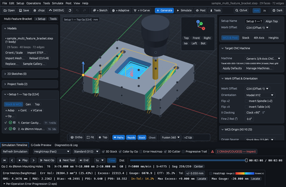
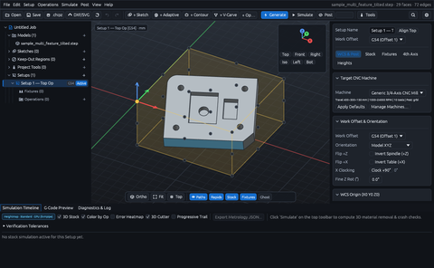
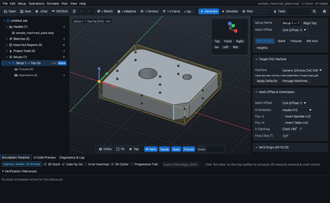
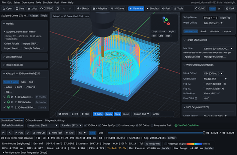
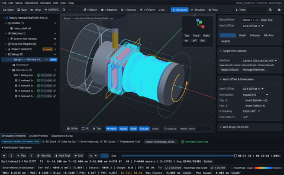

# ChipCutter Sample Projects Gallery

Browse every built-in sample project included in **ChipCutter**. Click any thumbnail or title to open its full-resolution showcase page with geometry/toolpath explanations and—for multi-setup and multi-operation samples—progressive simulation screenshots captured at the exact moment **each Setup and Operation completes**.

> [!TIP]
> You can launch any sample directly from the desktop **Welcome / Sample Projects Gallery** (`File -> Sample Projects Gallery...`) or from your terminal with:
> ```bash
> chip-gui --sample <slug>
> ```

---

## 3D STEP Solids

| Preview | Sample & Overview | Setups / Ops | Launch Flag |
|---|---|---|---|
| [](cam-torture.md) | [**CAM Torture Block**](cam-torture.md)<br>Full-featured 3D STEP benchmark exercising Facing, Pockets + Islands, Open Shoulder, Helical Counterbore, 4x Peck Drills, Outer Profile + Tabs, and 45° Edge Chamfer. | 1 Setup · 8 Ops | `--sample cam-torture` |
| [](thread-mill.md) | [**Threaded Manifold Block (Helical Thread Milling)**](thread-mill.md)<br>`80 × 60 × 20 mm` aluminum manifold showcasing Facing, boss deck clearing, helical pilot boring, internal `M8 × 1.25` & `1/4-20 UNC` threads, and external `M12 × 1.75` boss threading with Tri-Dexel undercut verification. | 1 Setup · 6 Ops | `--sample thread-mill` |
| [](adaptive-rest.md) | [**2D Adaptive Clearing + Rest Machining**](adaptive-rest.md)<br>High-efficiency constant-engagement Ø10 mm trochoidal Adaptive roughing followed by Ø3 mm Rest Machining corner cleanup and Ø6 mm air-entry shoulder clearing. | 1 Setup · 5 Ops | `--sample adaptive-rest` |
| [](multi-feature.md) | [**Prismatic Multi-Feature Bracket**](multi-feature.md)<br>Clean starter 3D STEP bracket demonstrating planar face pocketing and 4x Ø6 mm mounting hole drilling. | 1 Setup · 2 Ops | `--sample multi-feature` |
| [](tilted-bracket.md) | [**30°-Tilted WCS Alignment Bracket**](tilted-bracket.md)<br>Unseeded STEP bracket tilted `30° X / 25° Z` for practicing SE(3) Setup WCS face/edge alignment and tight 27-point stock framing. | 1 Setup · Sandbox | `--sample tilted-bracket` |
| [](revision-v1.md) | [**Associative CAD Revision Reload (v1)**](revision-v1.md)<br>Baseline Revision v1 STEP bracket seeded with 6 operations (Facing, Blind Pocket, Helical Bore, 2x Mounting Holes, Front Chamfer) prior to CAD revision reload. | 1 Setup · 6 Ops | `--sample revision-v1` |
| [](revision-v2.md) | [**Associative CAD Revision Reload (v2)**](revision-v2.md)<br>Revision v2 reload showing fuzzy `GeometricSignature` re-binding of resized/shifted features plus 1-click `NeedsRepick` orphan detection on the deleted hole. | 1 Setup · 6 Ops (1 Repick) | `--sample revision-v2` |
| [](sample-plate.md) | [**CNC Mounting Plate (Blank STEP Sandbox)**](sample-plate.md)<br>Clean unseeded machined STEP mounting plate for practicing interactive 3D face, closed loop, and cylindrical hole picking from scratch. | 1 Setup · Sandbox | `--sample sample-plate` |

---

## 3D Meshes (`STL` / `OBJ`)

| Preview | Sample & Overview | Setups / Ops | Launch Flag |
|---|---|---|---|
| [](mesh-dome.md) | [**Sculpted Dome (Watertight STL Mesh)**](mesh-dome.md)<br>R25 mm hemisphere seated on a `70 × 70 × 8 mm` pedestal machined with 3D Adaptive Roughing, 3D Waterline Semi-Finish, and Ø3 mm 3D Pencil Fillet Cleanup. | 1 Setup · 3 Ops | `--sample mesh-dome` |
| [](mesh-wave.md) | [**Relief Wave (OBJ Mesh Finishing)**](mesh-wave.md)<br>`80 × 60 × 15 mm` sculpted sinusoidal relief showcasing 3D Adaptive Roughing, 45° 3D Parallel Raster Finishing, and 3D Constant-Scallop Finishing. | 1 Setup · 3 Ops | `--sample mesh-wave` |

---

## 4th-Axis Rotary (`A`-Axis)

| Preview | Sample & Overview | Setups / Ops | Launch Flag |
|---|---|---|---|
| [](rotary-shaft.md) | [**Rotary Indexed Shaft (4th-Axis A)**](rotary-shaft.md)<br>`Ø40 × 80 mm` shaft combining continuous `Z+X+A` rotary spiral surfacing over a collar & 3-lobe cam with 4-sided Indexed `3+1` wrenching flats (`0°/90°/180°/270°`). | 1 Setup · 5 Ops | `--sample rotary-shaft` |
| [](rotary-wrap.md) | [**Wrapped Rotary Engraving (`Z+X+A`)**](rotary-wrap.md)<br>Wraps bold TrueType `"CHIP"` V-Carving and a rounded circumferential flute onto a `Ø40 × 80 mm` cylindrical blank for `G93` 4-axis or swapped-axis GRBL rotaries. | 1 Setup · 2 Ops | `--sample rotary-wrap` |
| [](rotary-4axis.md) | [**Simultaneous 4-Axis Helical Flute (`X+Y+Z+A`)**](rotary-4axis.md)<br>`Ø40 × 80 mm` 3-start helical flute shaft machined with simultaneous `X+Y+Z+A` off-centerline auto-tilted roughing and finishing (`G93` inverse-time feed). | 1 Setup · 2 Ops | `--sample rotary-4axis` |

---

## Pure-2D & DXF Vector Jobs

| Preview | Sample & Overview | Setups / Ops | Launch Flag |
|---|---|---|---|
| [](pure-2d.md) | [**Pure-2D CNC Router Front Panel (`.dxf`)**](pure-2d.md)<br>Zero-STEP sheet-stock electronics faceplate imported directly from AutoCAD DXF with mounting holes, bossed display pocket, vent slot cutout, and perimeter tabs. | 1 Setup · 4 Ops | `--sample pure-2d` |

---

## V-Carve & CAM Typography

| Preview | Sample & Overview | Setups / Ops | Launch Flag |
|---|---|---|---|
| [](vcarve.md) | [**V-Carve Sign & Mated Male V-Inlay**](vcarve.md)<br>Two-setup hardwood plaque pairing Setup 1 (`G54`) two-stage Flat + 60° V-Bit sign carving and perimeter cutout with Setup 2 (`G55`) mirrored Male V-Inlay plug generation. | 2 Setups · 4 Ops | `--sample vcarve` |
| [](nameplate.md) | [**Engraved Nameplate (TrueType + Hershey)**](nameplate.md)<br>Parametric R10 filleted plate featuring a 6x Flange Bolt Circle, Ø22 mm gauge window, TrueType outline `"CHIP"` pocketing, 1-pass Hershey serial engraving, and outer tabs. | 1 Setup · 5 Ops | `--sample nameplate` |

---

## Regenerating Gallery Screenshots

Every full-resolution screenshot, `480 px` thumbnail, and per-operation completion capture under `docs/images/samples/` is generated deterministically from the built-in sample loaders:

```bash
./scripts/capture_sample_gallery.sh
```

See also the step-by-step [**ChipCutter Tutorials (`00`–`18`)**](../tutorials/README.md) if you want to build each strategy from scratch.
