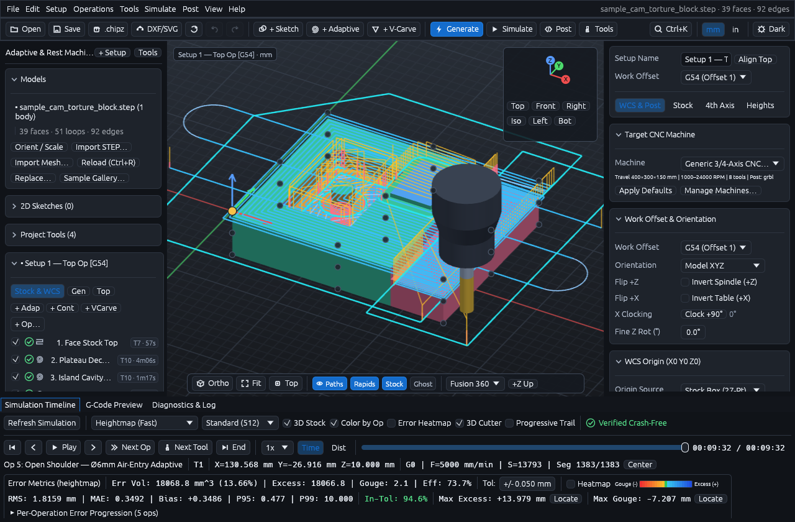
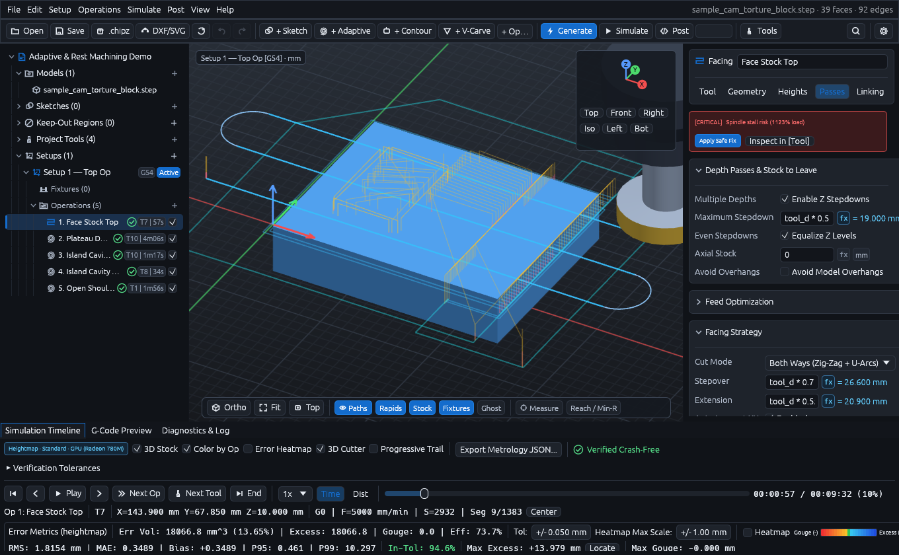
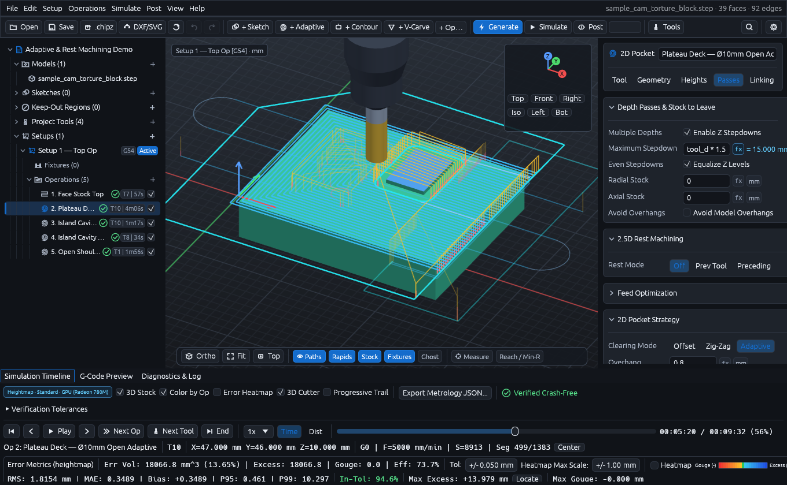
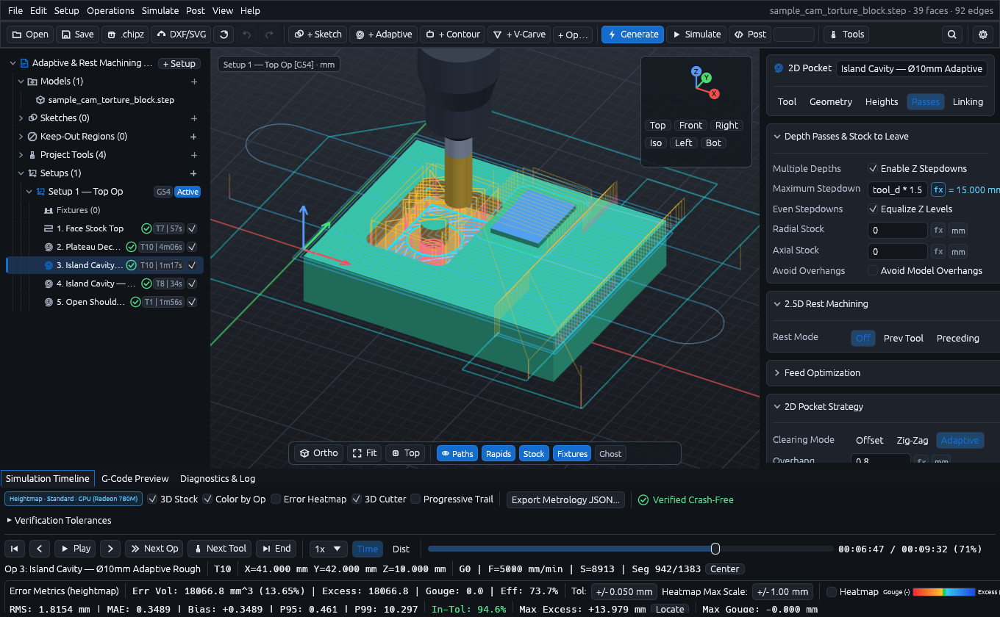
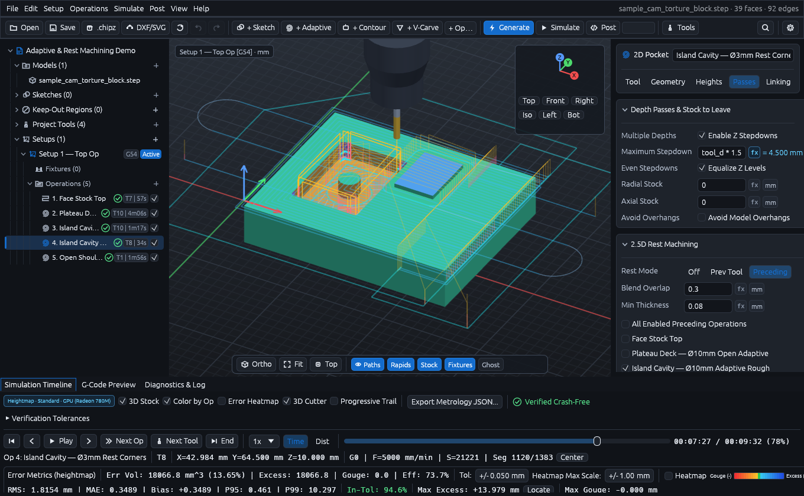
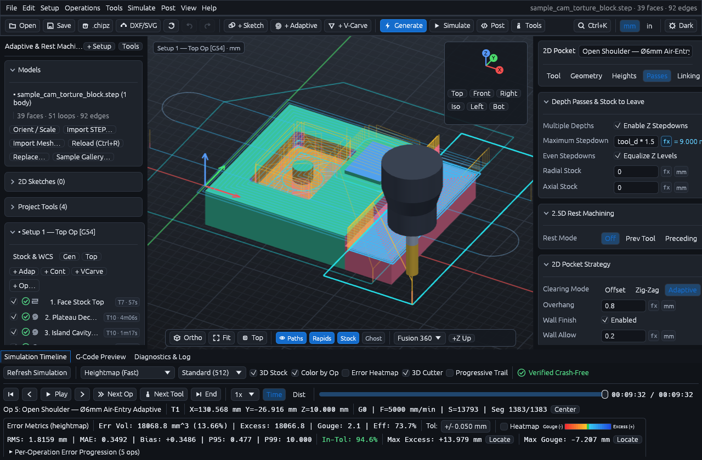

[<- Back to Sample Projects Gallery](README.md)

# 2D Adaptive Clearing + Rest Machining

**Category:** 3D STEP Solid · **Setups:** 1 (`G54`) · **Operations:** 5

```bash
chip-gui --sample adaptive-rest
```



## Overview & What It Demonstrates

This sample showcases **high-efficiency constant-engagement 2D Adaptive / Trochoidal Clearing** paired with **preceding-operation 2.5D Rest Machining**:

- Large-cutter **2D Adaptive** roughing (`Ø10 mm`) removes bulk metal quickly at full axial depth and controlled radial load (`optimal_load`) with smooth micro-lift stay-down links and radial chip-thinning feed compensation.
- A follow-up **Rest Machining** pass with a smaller `Ø3 mm` endmill subtracts the exact swept footprint of the preceding roughing operation and machines **only** the uncut corner fillets—eliminating wasted air cutting.
- Open-boundary adaptive clearing demonstrates automatic outside-stock air entry on the open shoulder step (and `[Geometry]` → `Cutting Area / Machining Boundary` exposes `Pocket Area Mode` boss-clearing and `Open Outer Boundary` controls with live 3D previews).
- Generation and simulation wall-clock runtimes are logged automatically in the **Activity Log** alongside live **Simulation Timeline** verification.

Related step-by-step guide: [Tutorial 05 (2D Adaptive Clearing & 2.5D Rest Machining)](../tutorials/05-adaptive-rest-machining.md).

---

## Progressive Operation-by-Operation Simulation

### Operation 1 — Face Stock Top (`Facing`)
Flattens the raw billet top allowance to establish a clean reference plane.



### Operation 2 — Plateau Deck — Ø10mm Open Adaptive (`2D Adaptive`)
Peels the upper plateau deck around the raised boss from outside the stock perimeter using constant-engagement trochoidal passes.



### Operation 3 — Island Cavity — Ø10mm Adaptive Rough (`2D Adaptive`)
Helically enters and roughs the closed island cavity rapidly with the `Ø10 mm` cutter, intentionally leaving larger corner radii where the `Ø10 mm` tool cannot fit.



### Operation 4 — Island Cavity — Ø3mm Rest Corners (`2D Adaptive Rest`)
Uses `FromPrecedingOperations` rest machining to detect and clear only the tight interior corners left behind by the `Ø10 mm` rougher.



### Operation 5 — Open Shoulder — Ø6mm Air-Entry Adaptive (`2D Adaptive`)
Clears the open shoulder step with a `Ø6 mm` endmill entering from open air outside the boundary.


