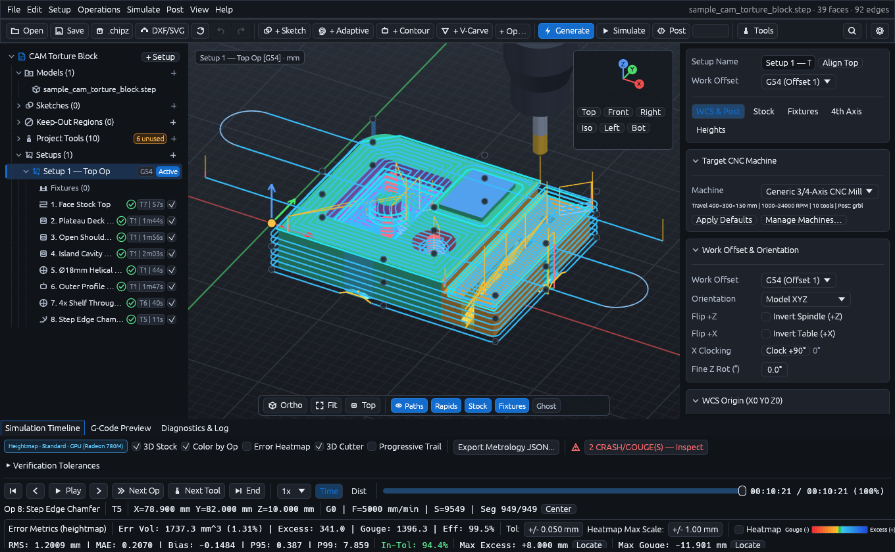
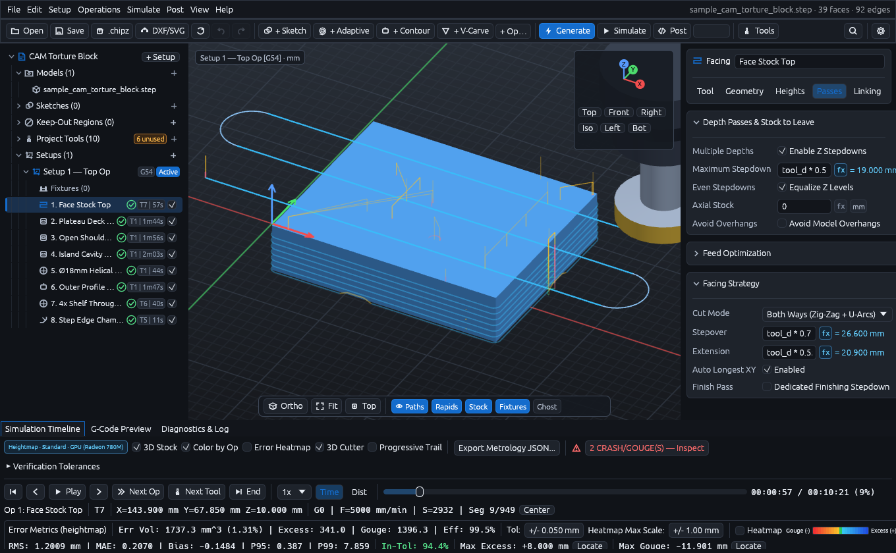
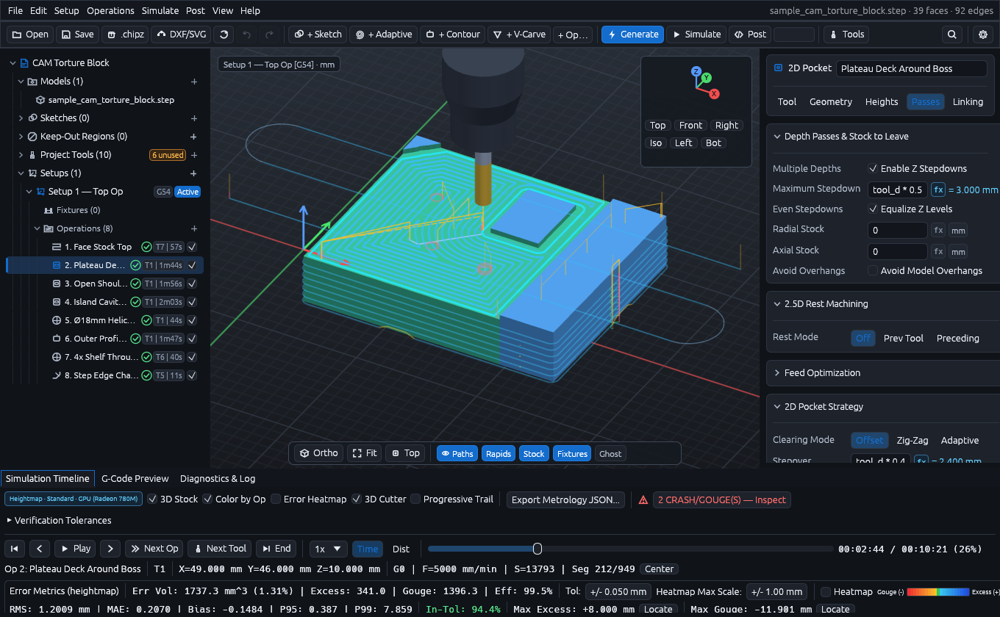
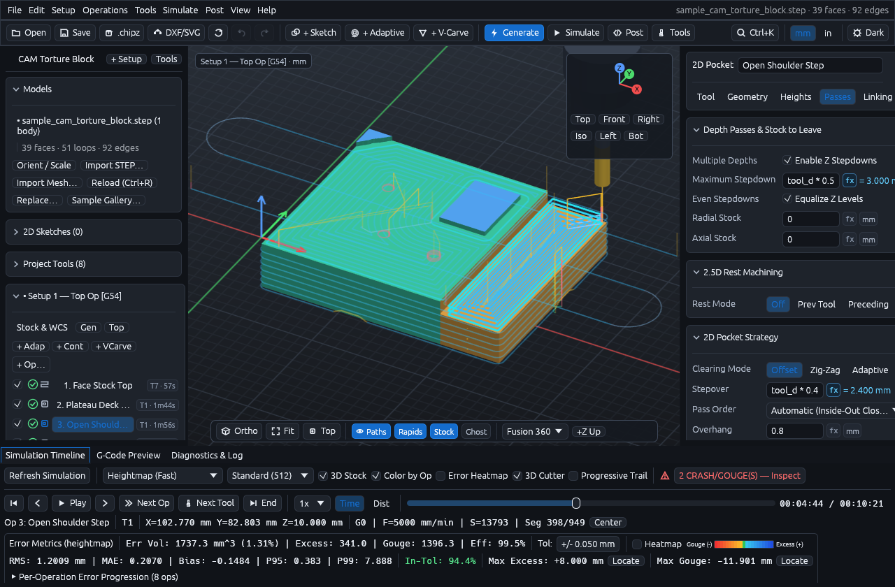
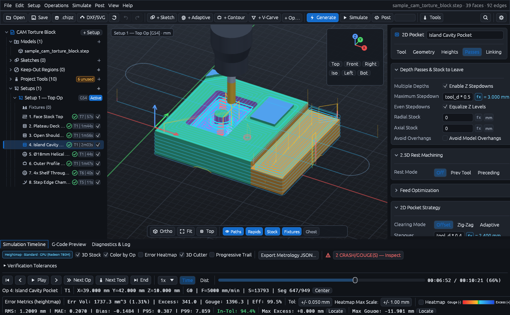
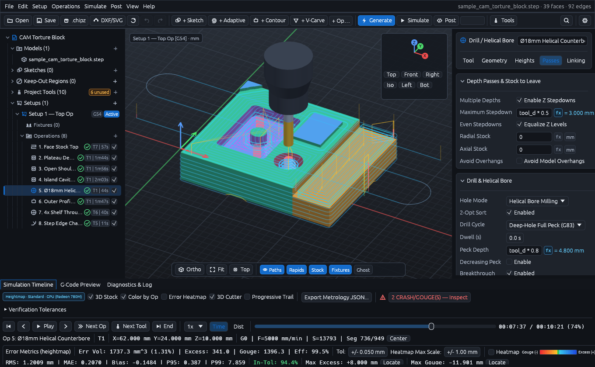
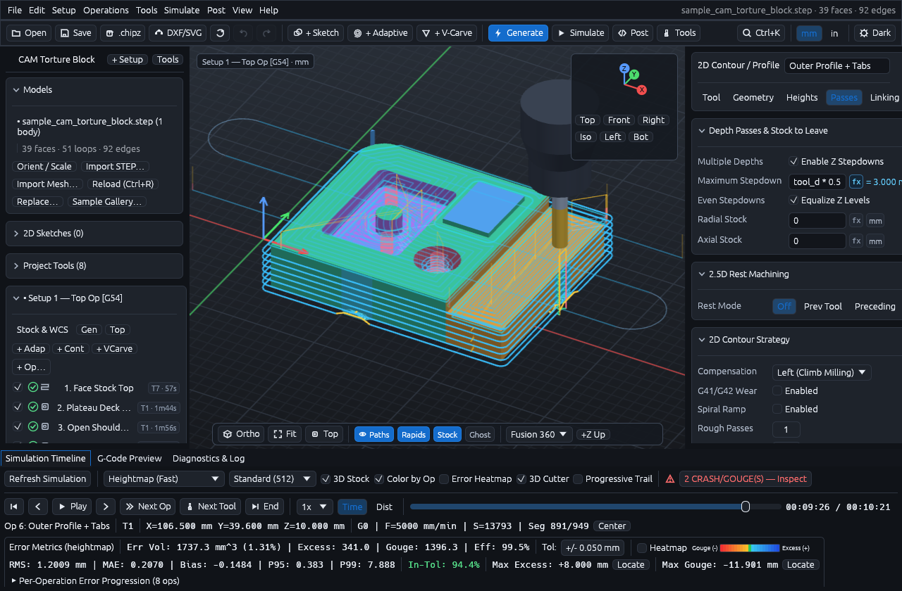
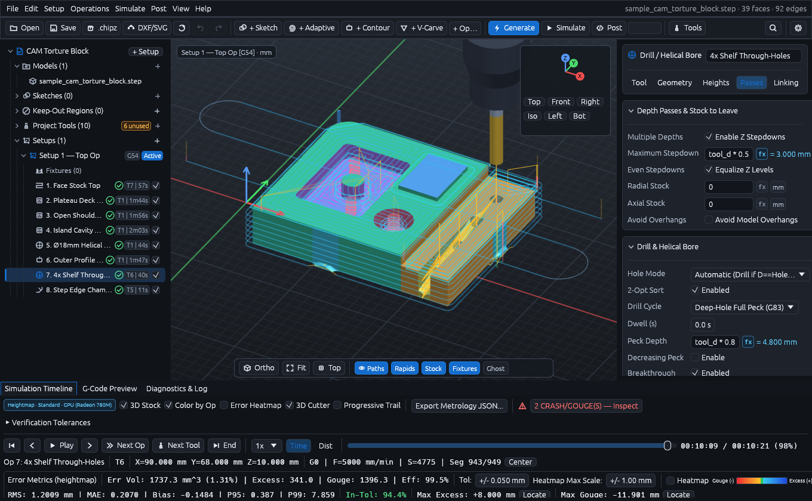
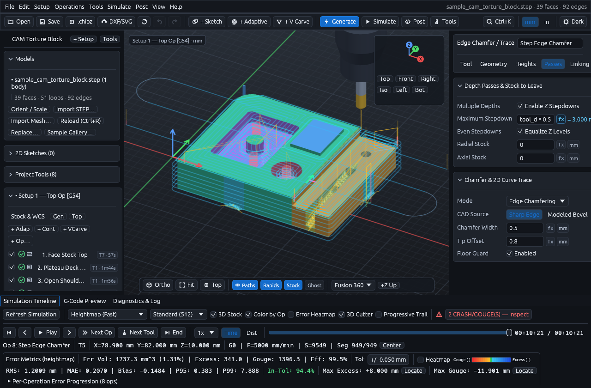

[<- Back to Sample Projects Gallery](README.md)

# CAM Torture Block (8 Operations)

**Category:** 3D STEP Solid · **Setups:** 1 (`G54`) · **Operations:** 8

```bash
chip-gui --sample cam-torture
```



## Overview & What It Demonstrates

The **CAM Torture Block** is ChipCutter's flagship end-to-end 2.5D prismatic STEP benchmark. Starting from a rectangular raw aluminum billet with extra top and side stock allowance, it exercises every core 2.5D milling strategy in a single `G54` Setup:

- **Stock facing** across the top billet allowance.
- **Multi-level pocketing** around a raised boss, an open-shoulder air-entry step, and a closed interior pocket with a central island.
- **Helical bore interpolation** for an oversized `Ø18 mm` counterbore plus **4x through-hole peck drilling**.
- **Outer perimeter profiling with holding tabs** to retain the finished part in the raw blank.
- **45° edge chamfering** along the stepped shoulder with automatic adjacent-floor gouge protection.

Related step-by-step guides: [Tutorial 01 (Facing)](../tutorials/01-facing.md), [Tutorial 02 (2D Contour & Tabs)](../tutorials/02-2d-contour-tabs.md), [Tutorial 03 (2D Pocket)](../tutorials/03-2d-pocket.md), [Tutorial 04 (Drilling & Helical Bore)](../tutorials/04-drilling-helical-bore.md), [Tutorial 06 (Edge Chamfering)](../tutorials/06-chamfer-curve-trace.md), and [Tutorial 17 (Tri-Dexel Simulation & Error Metrics)](../tutorials/17-tridexel-simulation-error-metrics.md).

---

## Progressive Operation-by-Operation Simulation

Each screenshot below is captured at the exact timestamp where the corresponding operation finishes cutting.

### Operation 1 — Face Stock Top (`Facing`)
Surfaces the top raw stock allowance down to the nominal model top datum so all subsequent Z depths reference a flat machined face.



### Operation 2 — Plateau Deck Around Boss (`2D Pocket`)
Clears the upper step deck around the raised central boss down to the intermediate plateau elevation.



### Operation 3 — Open Shoulder Step (`2D Pocket`)
Machines the open-sided lower shelf with automatic overhang extension past the open stock edges for smooth air entry and clean corners.



### Operation 4 — Island Cavity Pocket (`2D Pocket`)
Clears the closed interior pocket using helical ramp entry while leaving the central circular boss island intact.



### Operation 5 — Ø18mm Helical Counterbore (`Drill / Helical Bore`)
Helically interpolates the oversized `Ø18 mm` counterbore using an endmill smaller than the bore diameter, finishing with a flat-bottom circular cleanup pass.



### Operation 6 — Outer Profile + Tabs (`2D Contour`)
Profiles the full exterior perimeter of the torture block down to stock bottom while leaving holding tabs to keep the part securely anchored.



### Operation 7 — 4x Shelf Through-Holes (`Drill / Helical Bore`)
Drills the four mounting through-holes on the lower shelf in 2-opt shortest-path order with tip breakthrough clearance.



### Operation 8 — Step Edge Chamfer (`Chamfer / Trace`)
Breaks the stepped shoulder edge with a tapered chamfer mill using exact tip-offset kinematics and floor-collision checking.


