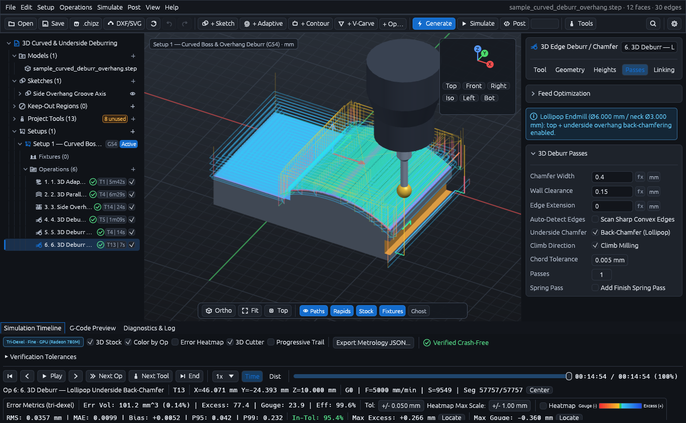
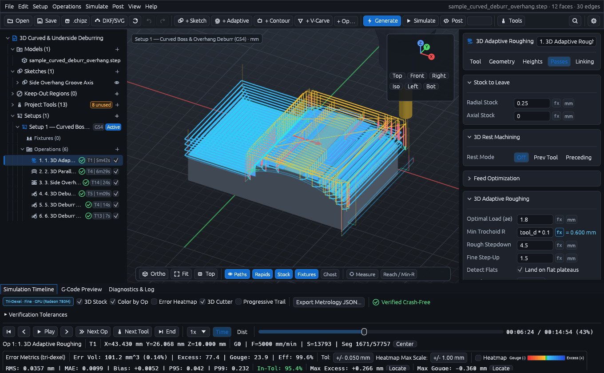
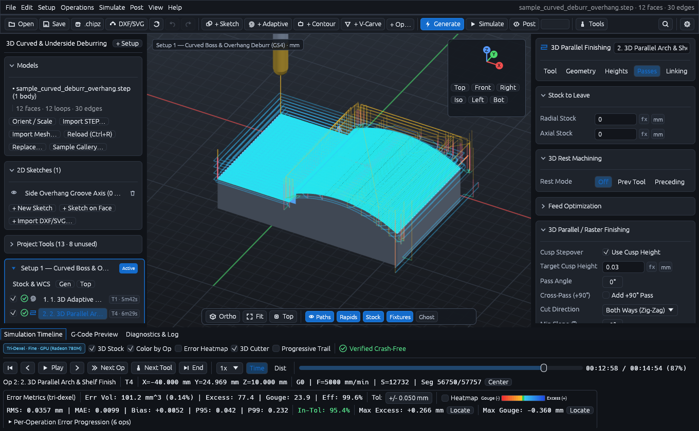
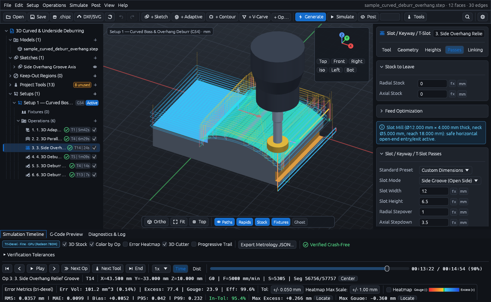
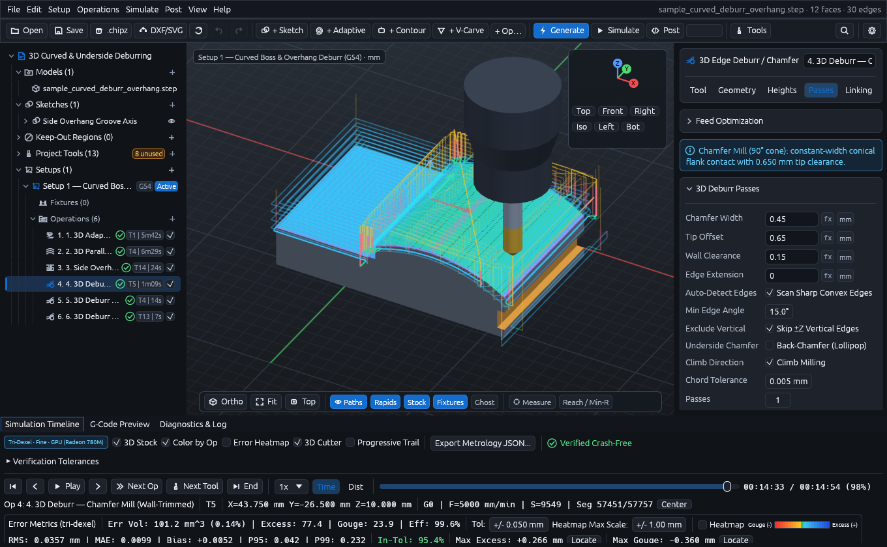
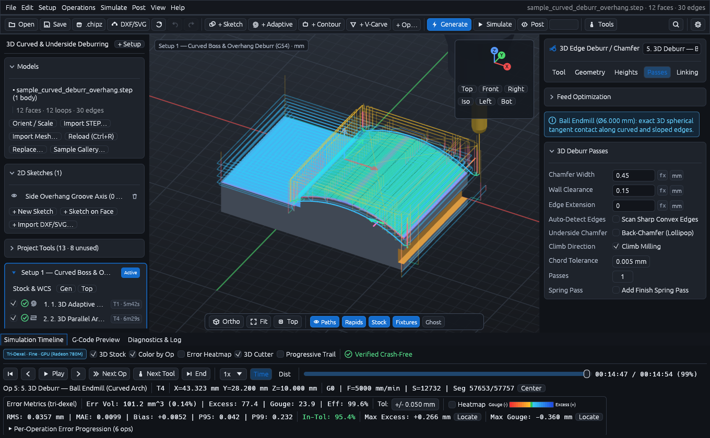
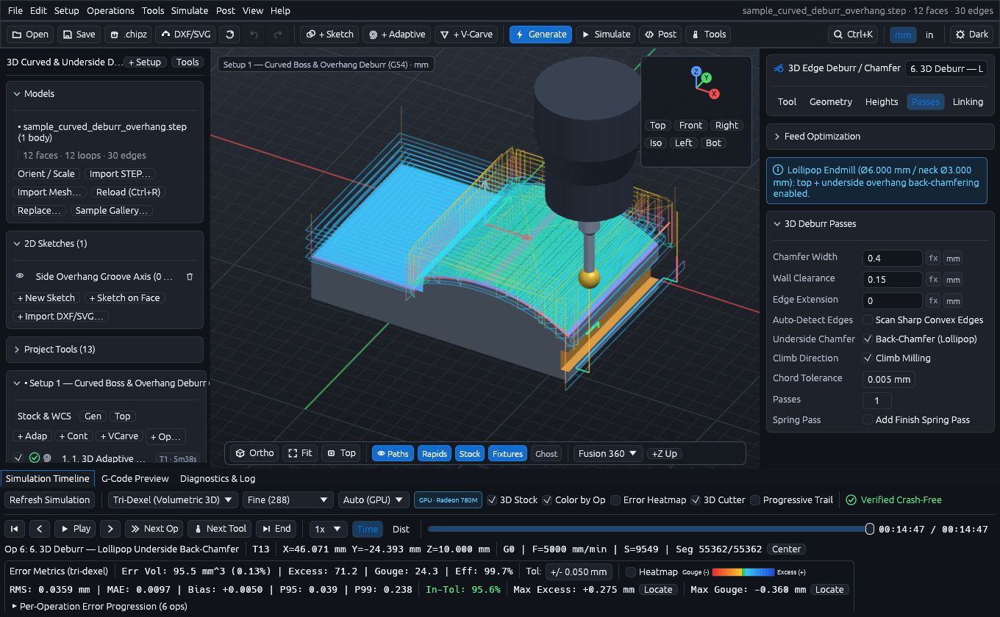

[<- Back to Sample Projects Gallery](README.md)

# 3D Curved Arch & Underside Deburring (3 Cutters)

**Category:** Undercuts & 3D Edge Deburring · **Setups:** 1 (`G54`) · **Operations:** 6

```bash
chip-gui --sample curved-deburr-3d
```



## Overview & What It Demonstrates

This `80 × 50 × 23 mm` sculpted STEP solid—combining a planar stepped shelf (`Z = 14 mm`), a vertical step wall (`X = 35 mm`), a non-planar curved circular-arc arch (`Z = 15..23 mm`), and a `+X` side overhang lip (`Z = 9.5 mm`)—demonstrates **3D Edge Deburring (`Deburr3D`) across all three supported cutter families**:

| Property | Value |
|---|---|
| **Part & Stock** | `80 × 50 × 23 mm` STEP solid with stepped shelf, vertical inside wall, 3D circular-arc arch, and `+X` overhang lip |
| **3D Surfacing & Relief** | Op 1 `3D Adaptive` (`Ø6 mm` Flat) · Op 2 `3D Parallel` (`Ø6 mm` Ball, `0.03 mm` cusp) · Op 3 `Side Overhang Relief Groove` (`Ø12 × 4 mm` Slot Mill) |
| **3D Deburring Cutters** | Op 4 **`90°` Chamfer Mill** (auto-detect + `FlatBvh` wall trim) · Op 5 **`Ø6 mm` Ball Endmill** (curved arch rims) · Op 6 **`Ø6 mm` Lollipop Endmill** (underside back-chamfer) |
| **Simulation Engine** | Volumetric **Tri-Dexel** with smooth **Mesh Skinning** (`Settings → Simulation`, `Ctrl+,`; CPU & GPU compute parity, `0` critical errors, `>= 90%` In-Tol) |

- **Automatic `FlatBvh` Inside-Corner Wall Trimming & `[Geometry]` Boundary Clipping:** When the `90°` Chamfer Mill traces auto-detected edges on the stepped shelf and curved boss, ChipCutter evaluates full cutter/neck/shank clearance against the vertical `X = 35 mm` neighbor wall (trimming back cleanly by `wall_clearance = 0.15 mm` with smooth tangent leads) and lets you constrain `Auto-Detect Edges` via the unified **`[Geometry]` → `Cutting Area / Machining Boundary`** card with live 3D boundary preview (Op 2 `3D Parallel` also uses true projected `Model Silhouette`).
- **Curved Non-Planar 3D Arc Tracking:** Follows true 3D curved B-Rep circular arcs (`chord_tolerance = 0.005 mm`) with simultaneous `X/Y/Z` bisector contact using both `ChamferMill` and `BallEndmill` cutters.
- **Lollipop Underside Back-Chamfering:** Reaches beneath the `+X` overhang lip (`Z = 9.5 mm`) with `allow_underside_back_chamfer = true` to break the underside edge without flipping the part.

Related step-by-step guide: [Tutorial 21 (3D Edge Deburring & Non-Planar Chamfering)](../tutorials/21-3d-edge-deburring-nonplanar-chamfering.md).

---

## Progressive Operation-by-Operation Simulation

### Operation 1 — 3D Adaptive Roughing (`3D Adaptive`)
Bulk-roughs the stepped shelf (`Z = 14.0 mm`) and curved arch contour using the `Ø6 mm` flat endmill (`4.5 mm` roughing / `1.5 mm` fine stepdowns, `0.25 mm` radial finishing stock).



### Operation 2 — 3D Parallel Arch & Shelf Finish (`3D Parallel`)
Finishes the curved cylindrical arch and flat stepped shelf to a smooth `0.03 mm` cusp height using the `Ø6 mm` ball endmill.



### Operation 3 — Side Overhang Relief Groove (`Slot Undercut` — Side Groove)
Clears the `+X` side overhang recess (`Z = 3.0..9.5 mm`) with the `Ø12 × 4 mm` Slot Mill (`BothEndsThrough` entry/exit) to expose the underside overhang lip.



### Operation 4 — 3D Deburr — Chamfer Mill (Wall-Trimmed) (`3D Edge Deburr`)
Auto-detects sharp upper edges (`>= 15°` dihedral, excluding vertical corners) and breaks them by `0.45 mm` with the `90°` Chamfer Mill while `FlatBvh` collision checking automatically stops `0.15 mm` shy of the adjacent vertical step wall.



### Operation 5 — 3D Deburr — Ball Endmill (Curved Arch) (`3D Edge Deburr`)
Explicitly selects the two non-planar 3D circular-arc arch rims (`Y = 0` and `Y = 50 mm`) and traces a smooth simultaneous 3-axis `0.45 mm` edge break using the `Ø6 mm` ball endmill.



### Operation 6 — 3D Deburr — Lollipop Underside Back-Chamfer (`3D Edge Deburr`)
Engages the upper hemisphere of the `Ø6 mm` Lollipop Endmill along the `+X` underside overhang lip (`Z = 9.5 mm`) to cut a crisp `0.4 mm` back-chamfer without refixturing the part.



---

## Headless CLI Verification

```bash
# Generate the starter STEP models & verify GPU Tri-Dexel deburring accuracy
chipcutter generate-sample-step /tmp/sloped_boss.step --tutorial 21-deburr-boss
chipcutter generate-sample-step /tmp/overhang_flange.step --tutorial 21-deburr-flange
chipcutter simulate project.chip.toml --engine tri-dexel --backend gpu --resolution fine --report /tmp/deburr_report.json
chipcutter build project.chip.toml -o /tmp/out_deburr --post linuxcnc
```
