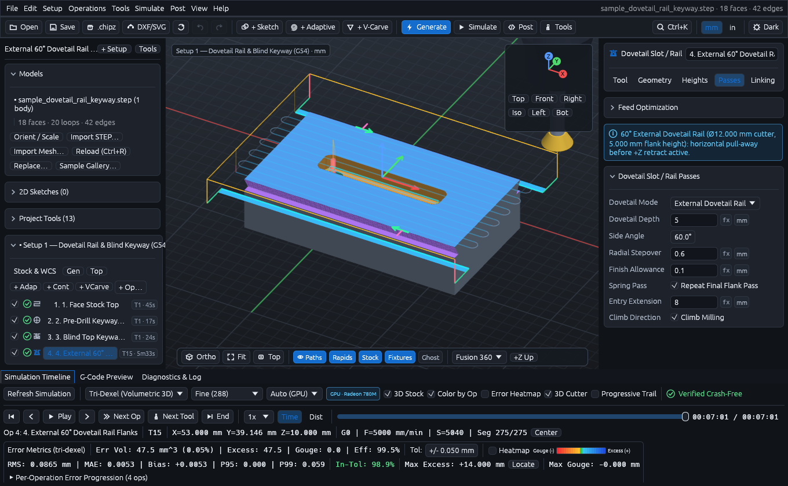
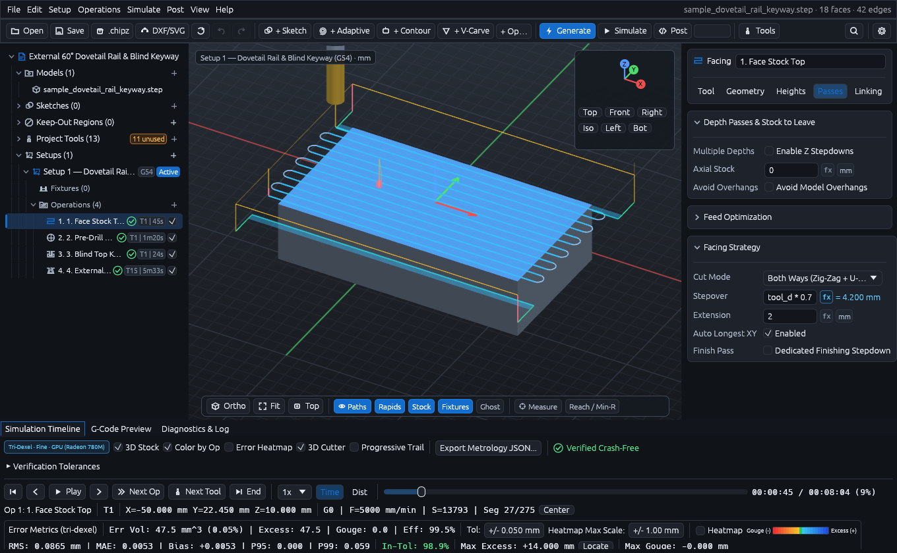
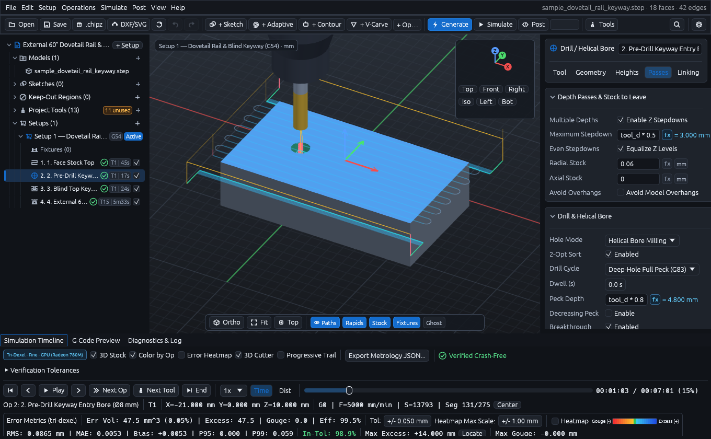
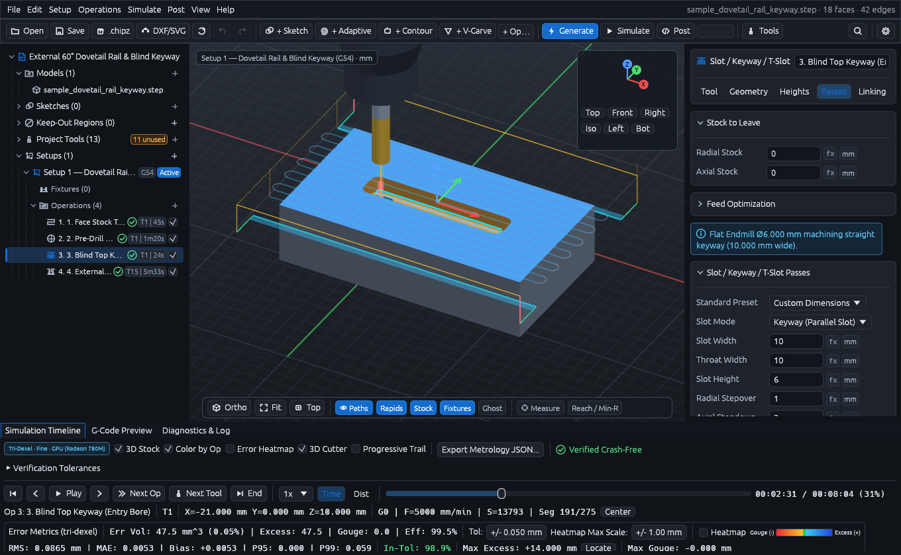

[<- Back to Sample Projects Gallery](README.md)

# External 60° Dovetail Rail & Blind Entry-Bore Keyway

**Category:** Undercuts & 3D Edge Deburring · **Setups:** 1 (`G54`) · **Operations:** 4

```bash
chip-gui --sample dovetail-rail-keyway
```



## Overview & What It Demonstrates

This `90 × 50 × 22 mm` precision linear-slide block (`90 × 50 × 23 mm` raw billet with `1.0 mm` top facing allowance) demonstrates two essential undercut production patterns verified in **Tri-Dexel** simulation:

| Property | Value |
|---|---|
| **Part & Stock** | `90 × 50 × 22 mm` STEP slide block machined from `90 × 50 × 23 mm` billet (`1.0 mm` top allowance) |
| **Features** | Blind `10 × 6 mm` top keyway entered via `Ø8.0 mm` pre-drilled entry bore + dual-flank **External `60°` Dovetail Rail** (`5.0 mm` depth along `-Y` and `+Y`) |
| **Cutters Used** | `Ø6 mm` Flat Endmill (`T1`), `Ø12 mm 60°` Dovetail Cutter |
| **Simulation Engine** | Volumetric **Tri-Dexel** Fine with smooth **Mesh Skinning** (`Settings → Simulation`, `Ctrl+,`; CPU & GPU compute parity, `0` critical errors, `max_gouge <= 0.02 mm`, `>= 90%` In-Tol) |

- **Blind Keyway with `EntryBoreCenter` Lead-In:** Instead of plunging an undercut cutter into solid stock, Op 2 helically bores an `Ø8.0 mm` clearance hole first, and Op 3 (`SlotUndercutMode::Keyway` + `UndercutEntryMode::EntryBoreCenter`) plunges exclusively inside the open bore, machines out along the blind keyway, and returns to the bore centerline before retracting `+Z`.
- **Dual-Flank External Dovetail Rail (`DovetailMode::ExternalRail`):** Machines both opposing `-Y` and `+Y` angled rail flanks in a single operation using progressive `0.6 mm` lateral stepovers, a `0.1 mm` finish pass, and a final spring pass with safe `8.0 mm` open-end extensions.

Related step-by-step guide: [Tutorial 22 (Undercut Milling: Keyways, T-Slots, Dovetails, & Lollipop 3D Undercuts)](../tutorials/22-undercut-tslot-dovetail-lollipop.md).

---

## Progressive Operation-by-Operation Simulation

### Operation 1 — Face Stock Top (`Facing`)
Decks `1.0 mm` off the raw aluminum block (`StockTop -> ModelTop`) using the `Ø6 mm` flat endmill to establish the clean `Z = 22.0 mm` top datum.



### Operation 2 — Pre-Drill Keyway Entry Bore (`Ø8 mm`) (`Drill / Helical Bore`)
Helically interpolates the `Ø8.0 mm` cylindrical entry bore at `(24, 25)` down to `Z = 14.0 mm` using the `Ø6 mm` flat endmill so the blind keyway cutter has a full-depth vertical entry pocket.



### Operation 3 — Blind Top Keyway (`Entry Bore`) (`Slot Undercut` — Keyway)
Enters strictly through the pre-bored `Ø8.0 mm` entry hole (`EntryBoreCenter`), clears the `10.0 mm` wide × `6.0 mm` deep blind keyway in `3.0 mm` Z-levels (`1.0 mm` radial stepover, `0.1 mm` finish pass + spring pass), and returns to the bore before retracting.



### Operation 4 — External 60° Dovetail Rail Flanks (`Dovetail` — External Rail)
Steps progressively inward (`0.6 mm` radial stepover + `0.1 mm` finish + spring pass) along both `-Y` and `+Y` rail edges using the `Ø12 mm 60°` Dovetail Cutter to form crisp, opposing external dovetail slideways.


---

## Headless CLI Verification

```bash
# Run fine Tri-Dexel verification & emit verified LinuxCNC / GRBL G-code
chipcutter simulate project.chip.toml --engine tri-dexel --backend gpu --resolution fine --report /tmp/dovetail_rail_report.json
chipcutter build project.chip.toml -o /tmp/out_dovetail_rail --post linuxcnc
```
