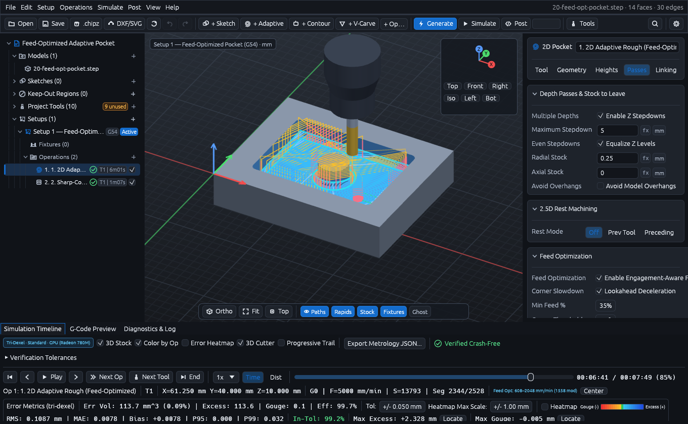
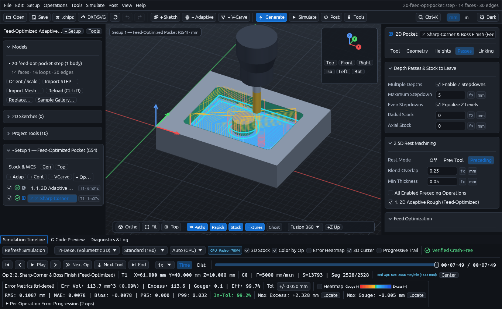

[<- Back to Sample Projects Gallery](README.md)

# Feed-Optimized Adaptive Pocket (Engagement Telemetry)

**Category:** 3D STEP Solids · **Setups:** 1 (`G54`) · **Operations:** 2

```bash
chip-gui --sample feed-opt-pocket
```


## Overview & What It Demonstrates

This `100 × 80 × 20 mm` aluminum block with a `10 mm` deep sharp-corner pocket (`72 × 52 mm`) and raised `Ø16 mm` central island boss showcases ChipCutter's **Engagement-Aware Feedrate Optimization** and live **Simulation Timeline feedrate telemetry**:

| Property | Value |
|---|---|
| **Part & Stock** | `100 × 80 × 20 mm` STEP block (`[14..86] × [14..66] mm` pocket at `Z = 10 mm`, `Ø16 mm` central boss) |
| **Tooling** | `Ø6 mm` Flat Endmill (`T1`) |
| **Feed Optimization** | Corner lookahead deceleration (`min_feed_fraction = 0.35`, `25°` threshold, `3.0 mm` ramp) · Internal-arc centerline scaling · Radial chip-thinning boost (`1.5×` max) |
| **Rest Chaining** | Op 2 chains `FromPrecedingOperations` directly from Op 1's swept stock |

- **Sharp-Corner Lookahead & Internal-Arc Scaling:** Automatically scales centerline feedrate down on concave arcs (`F_center = F_nom · (R_path - R_tool) / R_path`) and ramps smoothly into sharp `90°` pocket corners to prevent radial engagement spikes and chatter.
- **Radial Chip-Thinning Boost:** Boosts feedrate up to `1.5×` during light-engagement (`1.5 mm` optimal load) straight adaptive peels to maintain target chipload and cut cycle time.
- **Modulated Feedrate Telemetry & Simulation Settings:** Inspect live `min / avg / max` modulated cutting feedrates directly inside the **Simulation Timeline**, view wall-clock generation/simulation timings in the **Activity Log**, and configure Engine / Resolution / GPU Backend / smooth **Mesh Skinning** via **`Settings → Simulation`** (`Ctrl+,` or the Simulation Timeline status chip). Verify every modulated `F` word in the G-Code Preview pane.

Related step-by-step guide: [Tutorial 20 (GPU-Accelerated Simulation, Benchmarking, & Feedrate Optimization)](../tutorials/20-gpu-simulation-feed-optimization.md).

---

## Progressive Operation-by-Operation Simulation

### Operation 1 — 2D Adaptive Rough (Feed-Optimized) (`2D Adaptive`)
Bulk-clears the `10 mm` deep pocket around the `Ø16 mm` central island boss in two `5.0 mm` axial stepdowns (`1.5 mm` optimal load, `0.25 mm` radial stock-to-leave) with chip-thinning feed boost on straight passes and corner/arc deceleration.



### Operation 2 — Sharp-Corner & Boss Finish (Feed-Optimized) (`2D Pocket` — Rest)
Uses `FromPrecedingOperations` rest machining to clean the remaining `0.25 mm` finish allowance along the `90°` sharp pocket corners and circular island boss wall while modulating feedrate smoothly through every corner and internal arc.



---

## Headless CLI Verification & GPU Benchmarking

```bash
# Generate the starter STEP solid & run a GPU simulation benchmark
chipcutter generate-sample-step /tmp/feed_opt_pocket.step --tutorial 20-feed-opt
chipcutter simulate project.chip.toml --engine tri-dexel --backend gpu --benchmark --json
chipcutter build project.chip.toml -o /tmp/out_feed_opt --post linuxcnc
```
