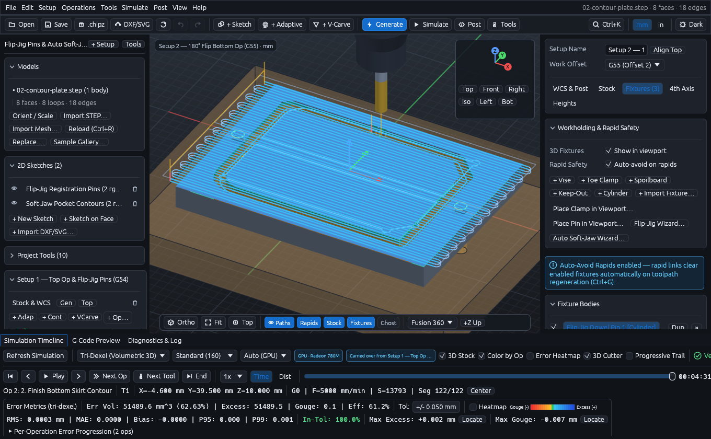
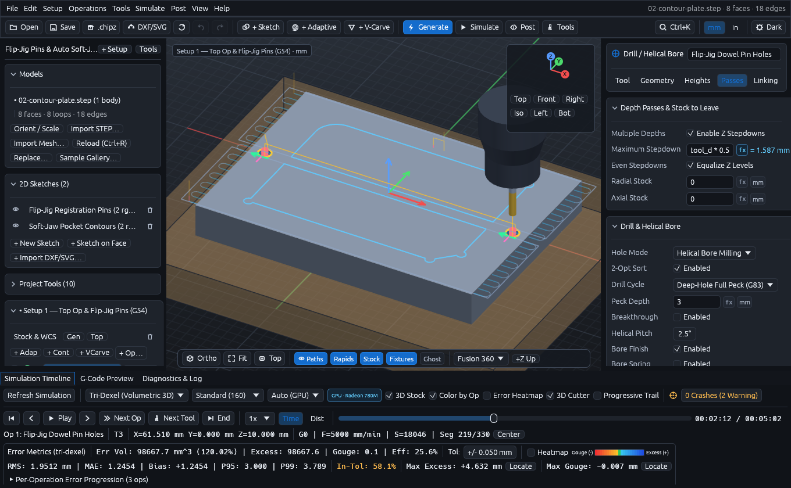
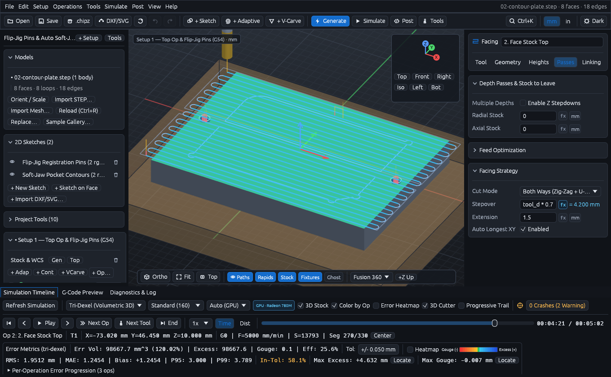
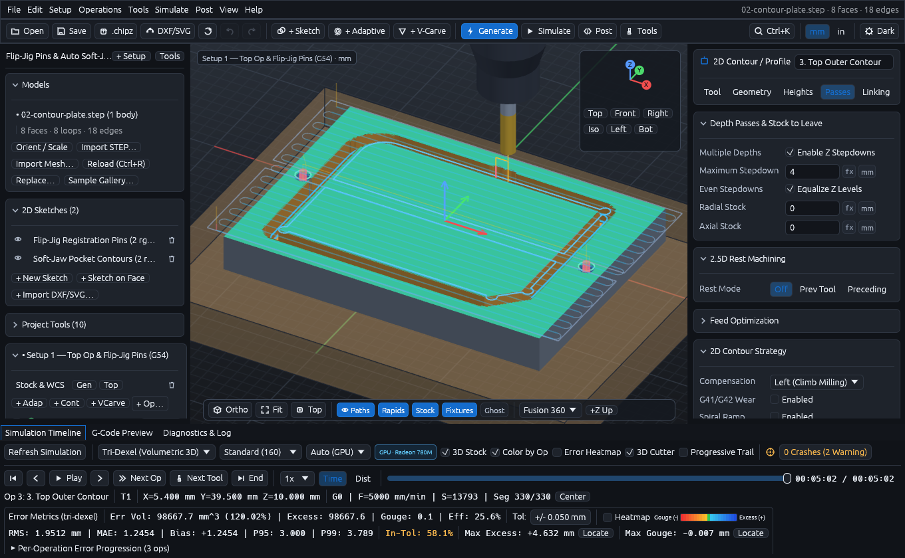
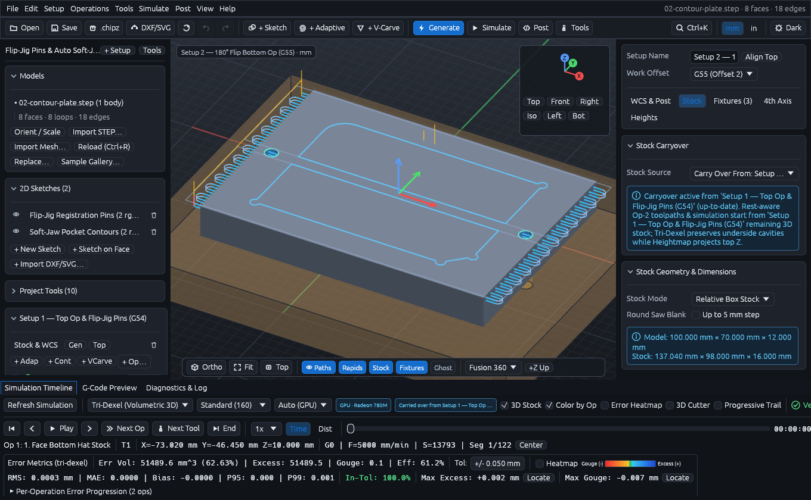
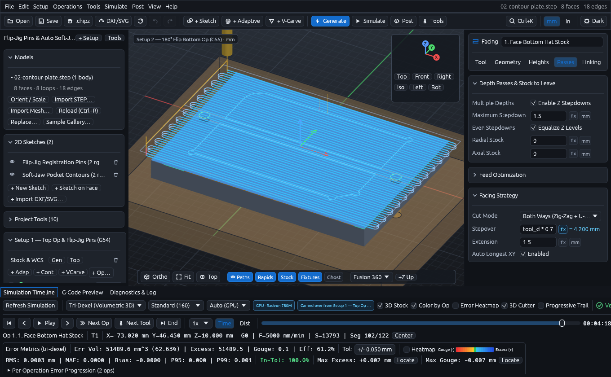
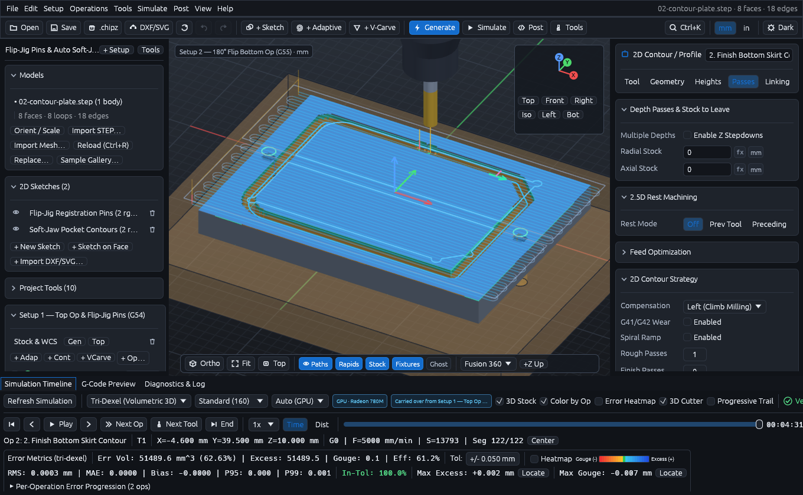
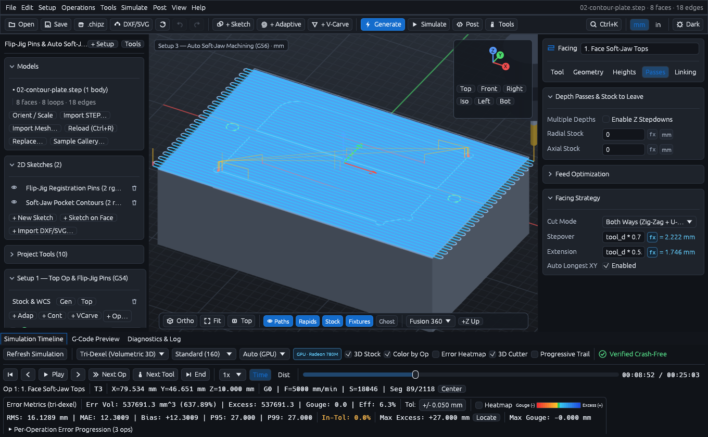
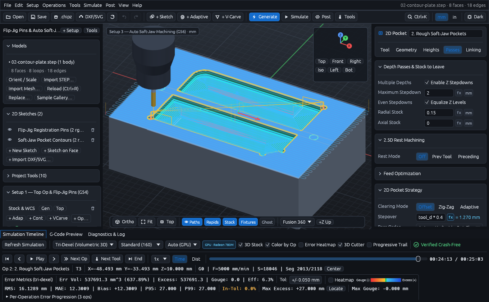
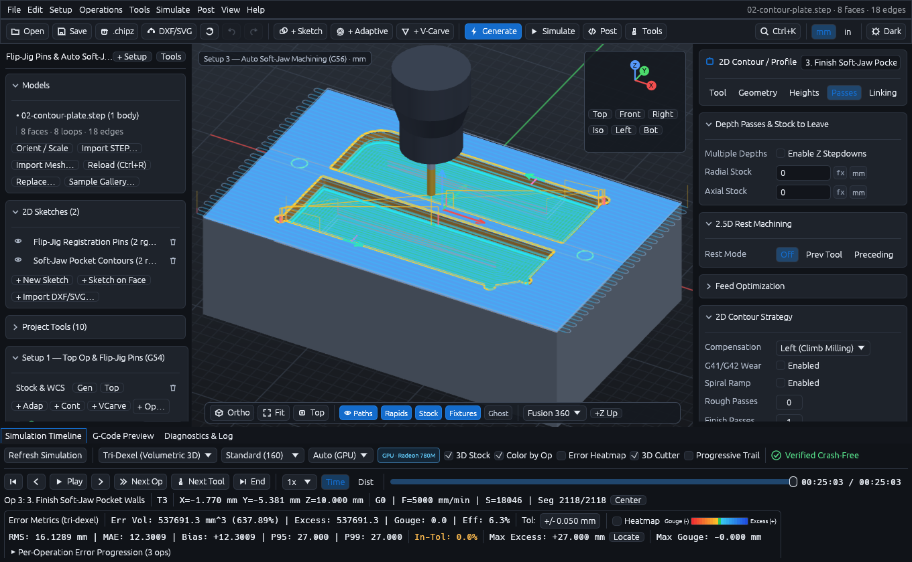

[<- Back to Sample Projects Gallery](README.md)

# Flip-Jig Dowel Pins & Auto Soft-Jaw Setup (`G54`–`G56`)

**Category:** Workholding & Multi-Setup Stock Carryover · **Setups:** 3 (`G54` Op-1 + `G55` Flipped Op-2 + `G56` Auto Soft Jaws) · **Operations:** 8

```bash
chip-gui --sample flip-jig-softjaws
```



## Overview & What It Demonstrates

This three-setup production workholding showcase combines both of ChipCutter's Phase 17 workholding wizards on a `100 × 70 × 12 mm` rounded/chamfered contour plate (`R10` fillet + `45°` bevel):

| Setup | Work Offset | Workholding Fixtures | Operations |
|---|---|---|---|
| **Setup 1 — Top Op & Flip-Jig Pins** | `G54` | `MDF Spoilboard (Setup 1)` | 1. Bore `Ø6 mm` Two-on-Axis Dowel Pins (`+5 mm` Poka-Yoke) · 2. Face Stock Top · 3. Top Outer Contour |
| **Setup 2 — 180° Flip Bottom Op** | `G55` | `MDF Spoilboard (Flipped)` + 2× `CylinderKeepOut` Dowel Pins (`4.5 mm` protrusion) | `t = 0.0` Tri-Dexel Carryover from Setup 1 · 1. Face `3.0 mm` Bottom Hat Stock · 2. Finish Bottom Skirt Contour |
| **Setup 3 — Auto Soft-Jaw Machining** | `G56` | Kurt 6-inch Soft-Jaw Blanks (`152.4 × 45 × 45 mm`, `6 mm` gap, `4 mm` grip) | 1. Face Soft-Jaw Tops · 2. Rough Soft-Jaw Pockets (`0.12 mm` slip fit + `R2 mm` dogbones) · 3. Finish Soft-Jaw Pocket Walls |

- **Two-Sided Flip-Jig Dowel-Pin Wizard (`TwoOnAxis` + Poka-Yoke):** Automatically places symmetric `Ø6.0 mm` dowel-pin registration holes along the `X` flip axis with a `+5.0 mm` poka-yoke asymmetry offset (making backwards re-mounting physically impossible), expands raw stock cleanly, creates the `180°` flipped `G55` setup with `FromPrecedingSetup` stock carryover, and adds protruding `CylinderKeepOut` pin fixtures checked by Rule 6 `FixtureCollision`.
- **Auto Soft-Jaw Generator Wizard:** Projects the exact `f64` clamping-band part silhouette with `0.12 mm` radial slip clearance and automatic `R2.0 mm` internal sharp-corner dogbone reliefs onto paired Kurt 6-inch vise jaws—producing a complete ready-to-cut `G56` machining setup (and optionally exporting watertight 3D-printable `.stl` jaws).

Related step-by-step guide: [Tutorial 19 (Two-Sided Flip Workholding, 3D Fixtures, & Auto Soft Jaws)](../tutorials/19-workholding-flip-jigs-soft-jaws.md).

---

## Progressive Setup & Operation Simulation

### Setup 1 (`G54`) — Operation 1: Bore Flip-Jig Dowel Pins (`Drill / Helical Bore`)
Helically bores the two `Ø6.0 mm` registration pin holes through the stock margin and `10 mm` deep into the MDF spoilboard using the `Ø3.175 mm` flat endmill (`+5.0 mm` poka-yoke offset along the X flip axis).



### Setup 1 (`G54`) — Operation 2: Face Stock Top (`Facing`)
Surfaces `1.0 mm` of top stock allowance down to `ModelTop` using the `Ø6 mm` flat endmill while staying clear of the spoilboard below.



### Setup 1 (`G54`) — Operation 3: Top Outer Contour (`2D Contour`)
Profiles the filleted and beveled outer plate perimeter down to `ModelBottom + 2.0 mm` in `4.0 mm` stepdowns, leaving the `3.0 mm` bottom hat stock and `2.0 mm` skirt intact to hold the part solidly on the spoilboard.



### Setup 2 (`G55`) — `t = 0.0` Carried-Over Flipped Stock (`FromPrecedingSetup`)
With the workpiece flipped `180°` onto the protruding `Ø6.0 mm` dowel pins (`CylinderKeepOut` fixtures), Setup 2 begins at `t = 0.0` with Setup 1's exact Tri-Dexel machined solid carried over.



### Setup 2 (`G55`) — Operation 1: Face Bottom Hat Stock (`Facing`)
Faces off the `3.0 mm` bottom hat stock in two `1.5 mm` stepdowns cleanly above the protruding dowel registration pins.



### Setup 2 (`G55`) — Operation 2: Finish Bottom Skirt Contour (`2D Contour`)
Profiles the remaining `2.0 mm` bottom perimeter skirt flush with Op 1's side wall while automatically avoiding both `CylinderKeepOut` dowel pins.



### Setup 3 (`G56`) — Operation 1: Face Soft-Jaw Tops (`Facing`)
Skims `0.5 mm` across the top of the paired fixed and movable Kurt 6-inch soft-jaw blanks to establish a dead-flat Z datum.



### Setup 3 (`G56`) — Operation 2: Rough Soft-Jaw Pockets (`2D Pocket`)
Roughs the contoured part-matching pockets (`4.0 mm` grip depth, `0.15 mm` radial finish stock, `R2.0 mm` dogbone corner reliefs) across both jaws using the `Ø3.175 mm` flat endmill.



### Setup 3 (`G56`) — Operation 3: Finish Soft-Jaw Pocket Walls (`2D Contour`)
Runs a single climb wall-finishing pass to final `0.12 mm` slip-fit tolerance around both jaw pockets, ready for repeatable vise clamping.



---

## Headless CLI Equivalent

```bash
# Generate flip-jig setups and soft-jaw STL/machining setups from the CLI
chipcutter workholding flip-jig project.chip.toml --axis x --pin-dia 6.0 --poka-yoke 5.0 -o /tmp/flipped.chip.toml
chipcutter workholding soft-jaws project.chip.toml --export-stl /tmp/soft_jaws -o /tmp/with_softjaws.chip.toml
chipcutter simulate /tmp/with_softjaws.chip.toml --all-setups --engine tri-dexel
```
