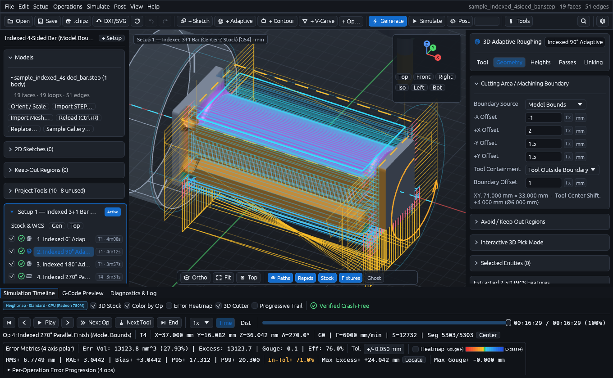
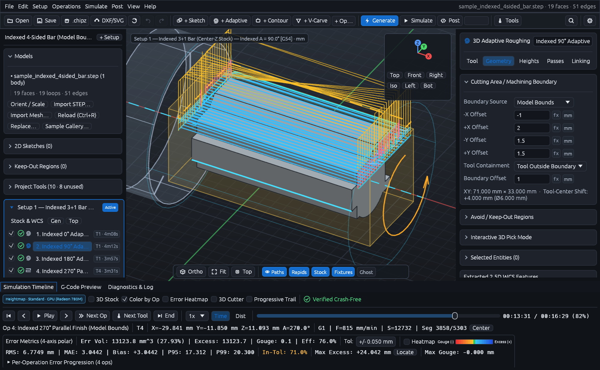
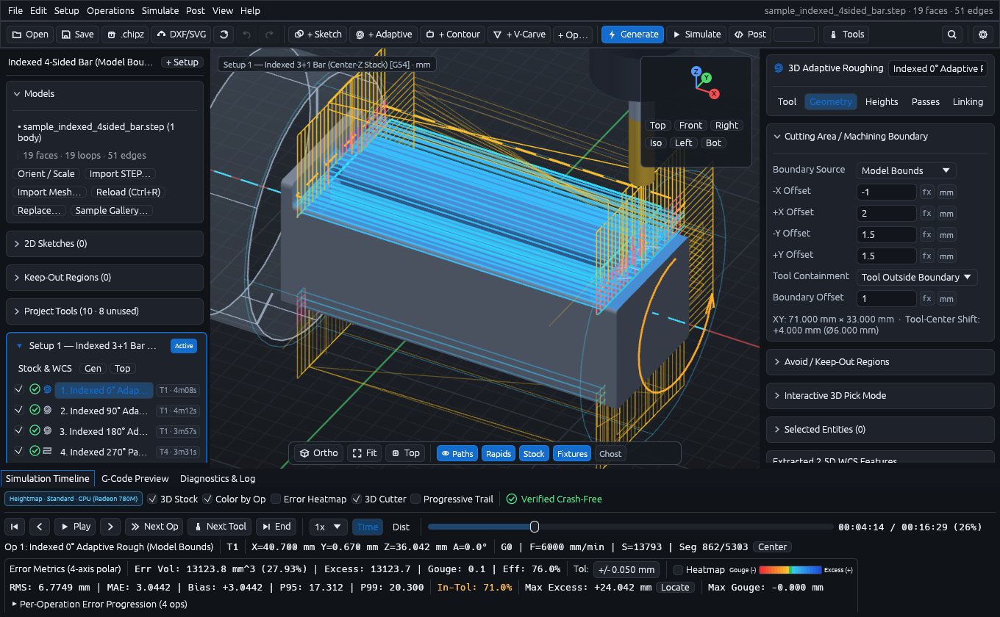
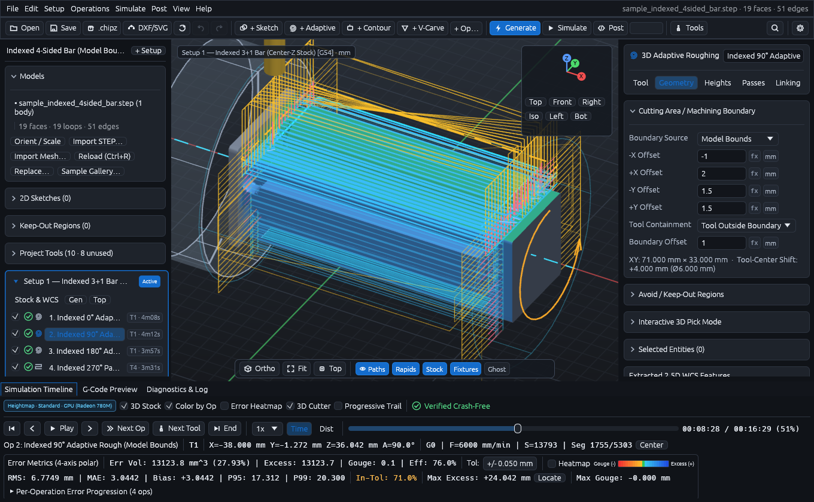
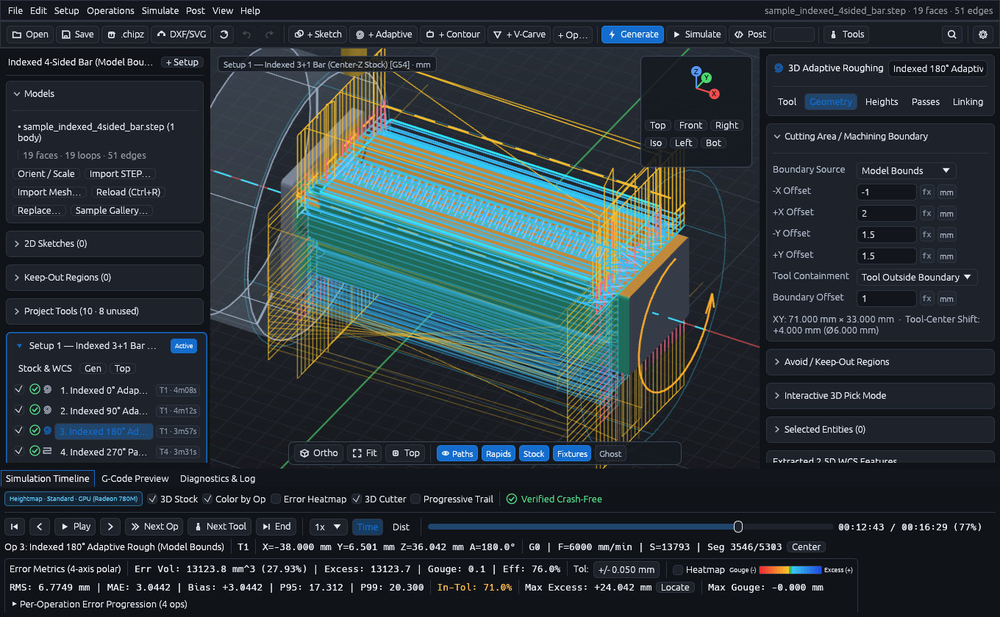
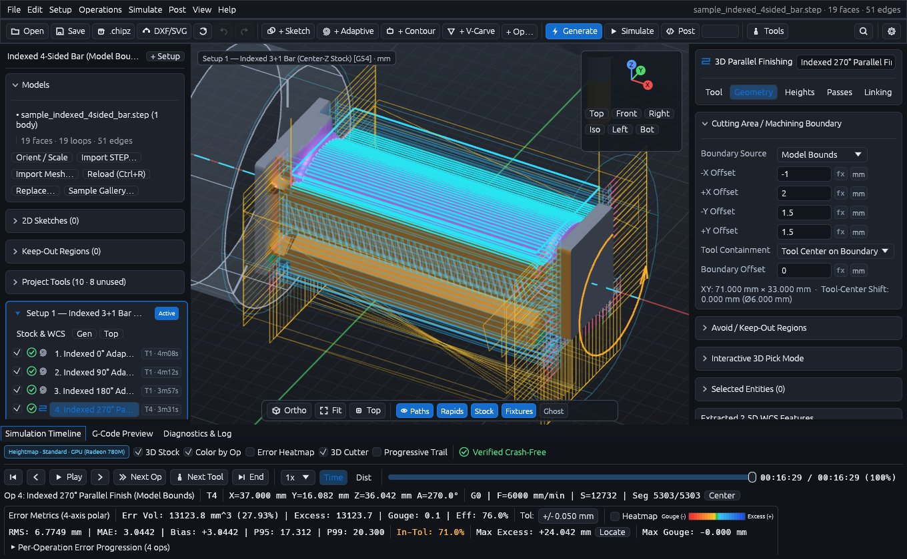

[<- Back to Sample Projects Gallery](README.md)

# Indexed 4-Sided Bar (Model Bounds & Auto-Rotate `3+1`)

**Category:** 4th-Axis Rotary (`A`-Axis) · **Setups:** 1 (`G54` Indexed `3+1` Rotary) · **Operations:** 4

```bash
chip-gui --sample indexed-model-bounds
```



## Overview & What It Demonstrates

This `70 × 30 × 30 mm` 4-sided sculpted STEP bar (`X ∈ [-35, +35]`) sits inside **`Fixed-Size Box Stock`** (`88 × 34 × 34 mm`) with **`FixedBoxZAlign::CenterZ`** (`Centered in Z`) squarely centered on the `X` (`A`) rotary axis and gripped by a `Ø65 × 20 mm` 4th-axis chuck on the `-X` end (`X ∈ [-64, -44]`). Every cardinal face carries an unmistakable distinct 3D feature:

| Operation | Index Angle | Face Geometry | Strategy & `Model Bounds` Per-Side Offsets |
|---|---|---|---|
| **Op 1 — Indexed `0°` Adaptive Rough** | `A = 0°` (`+Z`) | Raised `10 mm` central longitudinal rib + stepped flanking shoulders | `Adaptive3D` (`Ø6 mm` Flat) · `ModelBoundingBox`: `-X = -1.0 mm`, `+X = +2.0 mm`, `-Y = +1.5 mm`, `+Y = +1.5 mm` |
| **Op 2 — Indexed `90°` Adaptive Rough** | `A = 90°` (`+Y`) | Stepped terrace joined by a `45°` longitudinal chamfer bevel | `Adaptive3D` (`Ø6 mm` Flat) · `ModelBoundingBox`: `-X = -1.0 mm`, `+X = +2.0 mm`, `-Y = +1.5 mm`, `+Y = +1.5 mm` |
| **Op 3 — Indexed `180°` Adaptive Rough** | `A = 180°` (`-Z`) | Twin outer rails flanking a `14 mm`-wide recessed U-channel | `Adaptive3D` (`Ø6 mm` Flat) · `ModelBoundingBox`: `-X = -1.0 mm`, `+X = +2.0 mm`, `-Y = +1.5 mm`, `+Y = +1.5 mm` |
| **Op 4 — Indexed `270°` Parallel Finish** | `A = 270°` (`-Y`) | Smooth convex `R12.125 mm` circular-arc dome ridge + flanking lands | `Parallel3D` (`Ø6 mm` Ball, `0.03 mm` cusp) · `ModelBoundingBox`: `-X = -1.0 mm`, `+X = +2.0 mm`, `-Y = +1.5 mm`, `+Y = +1.5 mm` |

- **Fixed-Box `Centered in Z` Alignment (`FixedBoxZAlign::CenterZ`):** Centers the square `88 × 34 × 34 mm` bar stock symmetrically around `Z = 0` on the `A`-axis centerline so all four `0° / 90° / 180° / 270°` setups share an identical `2.0 mm` machining allowance per face.
- **Signed Per-Side `Model Bounds` Offsets (`-X / +X / -Y / +Y`):** Insets `-X` by `-1.0 mm` to keep generous axial clearance from the `-X` chuck jaws while expanding `+X` by `+2.0 mm` and `±Y` by `+1.5 mm` so cutters cleanly clear the free tail end and side shoulders.
- **Automatic `Indexed 3+1` Upright Viewport Rotation:** Clicking any indexed operation automatically rotates the 3D part, square stock wireframe, and live cyan/amber **`Model Bounds`** preview upright to that operation's exact `A`-axis angle (`0°`, `90°`, `180°`, `270°`).

---

## Auto-Rotated `Indexed A = 90.0°` & Live `Model Bounds` Preview (`[Geometry]` Tab)

Selecting **Operation 2 (`Indexed 90°`)** on the **`[Geometry]`** tab automatically rotates the bar, square stock wireframe, and 3D `Model Bounds` boundary overlay upright by `90°`, exposing the stepped `+Y` face and signed `-X / +X / -Y / +Y` offset controls directly in the Inspector.



---

## Progressive Operation-by-Operation Simulation

### Operation 1 — Indexed `0°` Adaptive Rough (`Adaptive3D` · `A = 0°`)
Clears the `2.0 mm` top bar allowance and steps down around the `10 mm` raised central longitudinal rib while keeping `-1.0 mm` inset clearance on the `-X` chuck side.



### Operation 2 — Indexed `90°` Adaptive Rough (`Adaptive3D` · `A = 90°`)
Retracts to radial clearance, rotates the chuck to `A = 90°`, and machines the asymmetric stepped terrace and `45°` longitudinal chamfer bevel.



### Operation 3 — Indexed `180°` Adaptive Rough (`Adaptive3D` · `A = 180°`)
Rotates to `A = 180°` opposite the `0°` rib and clears the `14 mm`-wide recessed U-channel between the twin outer rails.



### Operation 4 — Indexed `270°` Parallel Finish (`Parallel3D` · `A = 270°`)
Rotates to `A = 270°` and sweeps a `Ø6 mm` ball endmill (`0.03 mm` cusp height) across the smooth convex `R12.125 mm` circular-arc dome ridge within the signed `Model Bounds` envelope.


