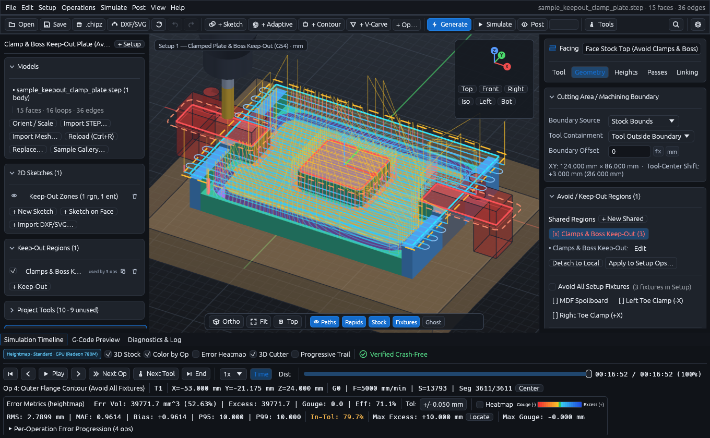
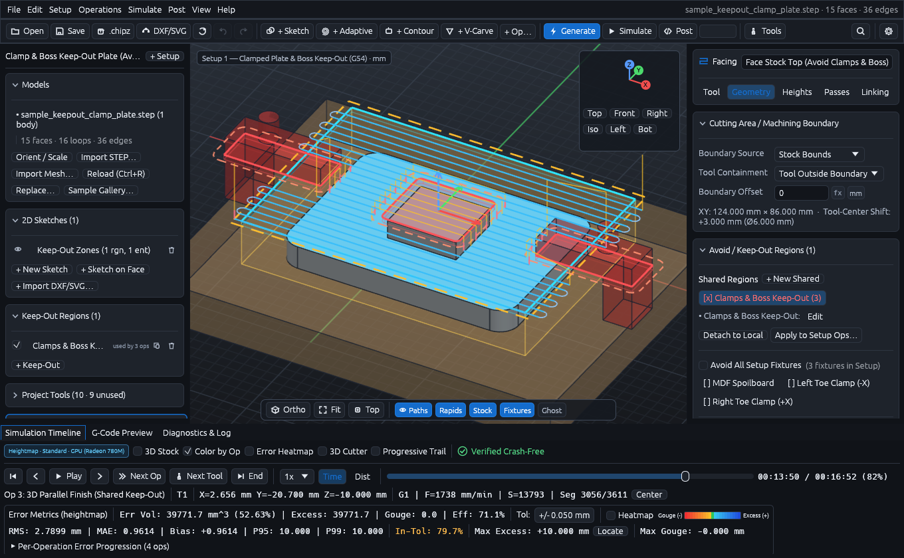
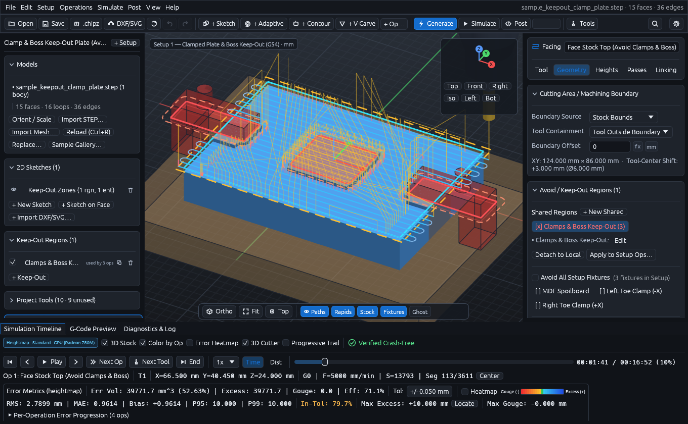
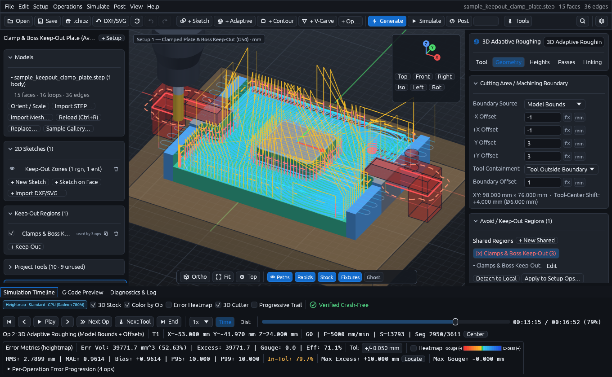
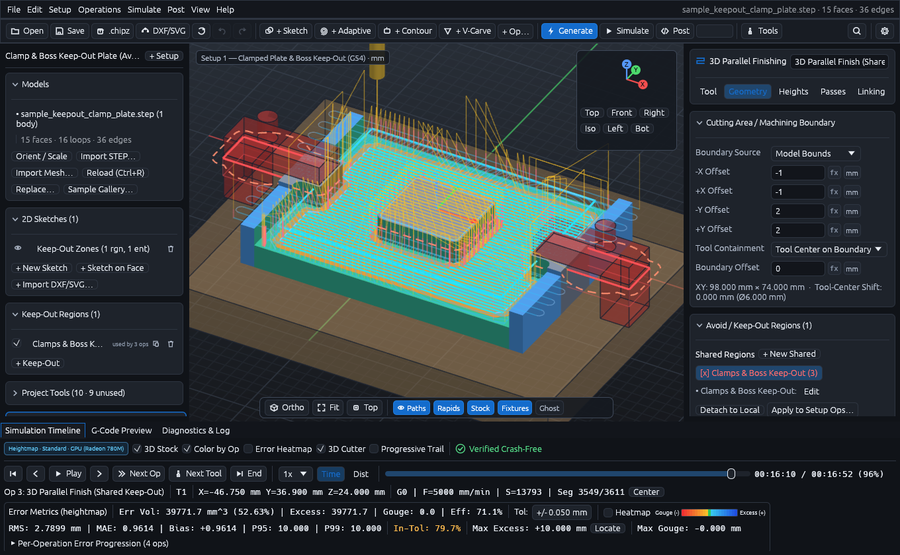
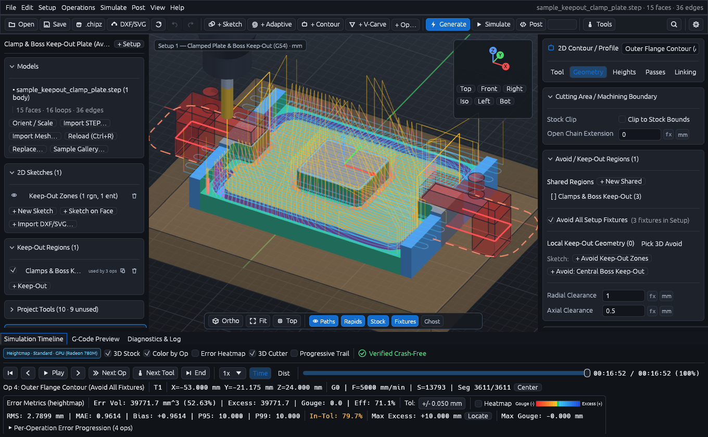

[<- Back to Sample Projects Gallery](README.md)

# Clamp & Boss Keep-Out Plate (Avoid / Keep-Out Regions)

**Category:** Workholding & Multi-Setup Stock Carryover · **Setups:** 1 (`G54` on Spoilboard + 2× Toe Clamps) · **Operations:** 4

```bash
chip-gui --sample keepout-clamps
```



## Overview & What It Demonstrates

This `100 × 70 × 18 mm` filleted aluminum plate (`R8` corners + raised `30 × 26 × 8 mm` central boss) sits on an MDF `Spoilboard` held down by **two `ToeClamp` fixtures** overhanging the `-X` and `+X` stock and flange edges (`nose_overhang = 15 mm`). It exercises ChipCutter's complete Phase 23 **Avoid / Keep-Out Regions** workflow alongside signed **`Model Bounds`** per-side offsets:

| Component / Operation | Strategy & Boundary | Keep-Out Configuration |
|---|---|---|
| **Shared Keep-Out (`avoid_clamps_boss`)** | Reusable `ProjectDocument::avoid_regions` (`Clamps & Boss Keep-Out`) | Bundles both Toe Clamps (`clamp_neg_x`, `clamp_pos_x`) + 2D sketch rectangle (`Keep-Out Zones` around central boss) with `radial_clearance = 1.0 mm` |
| **Op 1 — Face Stock Top** | `Facing` (`StockBox`, `Ø6 mm` Flat) | Linked to shared `"avoid_clamps_boss"` — routes scanlines cleanly around both clamps and the central boss |
| **Op 2 — 3D Adaptive Roughing** | `Adaptive3D` (`ModelBoundingBox`: `-X = -1 mm`, `+X = -1 mm`, `-Y = +3 mm`, `+Y = +3 mm`) | Linked to shared `"avoid_clamps_boss"` — combines signed `Model Bounds` offsets with shared keep-out subtraction |
| **Op 3 — 3D Parallel Finish** | `Parallel3D` (`ModelBoundingBox`: `-X/-X = -1 mm`, `±Y = +2 mm`) | Linked to shared `"avoid_clamps_boss"` (3 operations sharing a single keep-out definition) |
| **Op 4 — Outer Flange Contour** | `Contour2D` (`R8` filleted outer flange loop) | Per-operation **`Avoid All Setup Fixtures`** (`avoid_all_fixtures = true`) — automatically clips around both toe clamps while skipping the spoilboard below |

- **Live 3D Keep-Out Preview (`[Geometry]` → `Avoid / Keep-Out Regions`):** Focusing any operation on its **`[Geometry]`** tab renders translucent coral/red 3D keep-out overlays over both toe clamps and the sketched boss keep-out zone, plus a one-click shared region manager (`Add / Link / Suppress`) so modifying a single keep-out updates every linked operation simultaneously.
- **Zero Collisions Verified:** All 4 operations pass `chip-sim`'s 6-rule safety verifier with `0` `FixtureCollision`, `0` `TargetModelGouge`, and `0` `RapidIntoStock` diagnostics.

---

## Live 3D Keep-Out Overlay (`[Geometry]` Tab)

With simulated stock hidden, the **`[Geometry]`** tab highlights the shared `"Clamps & Boss Keep-Out"` region in coral/red over both overhanging `-X`/`+X` toe clamps and the central boss sketch rectangle, showing exact scanline trimming around every keep-out boundary.



---

## Progressive Operation-by-Operation Simulation

### Operation 1 — Face Stock Top (`Facing` · Shared Keep-Out)
Removes the `2.0 mm` top stock allowance down to `ModelTop` while trimming facing scanlines cleanly around both overhanging toe clamps and the central boss keep-out zone.



### Operation 2 — 3D Adaptive Roughing (`Adaptive3D` · `Model Bounds` + Shared Keep-Out)
Uses `ModelBoundingBox` with explicit signed per-side offsets (`-X = -1.0 mm`, `+X = -1.0 mm` keeping extra margin near the clamped ends; `-Y = +3.0 mm`, `+Y = +3.0 mm` opening clean air entry along the unclamped sides) combined with `"avoid_clamps_boss"` keep-out subtraction to rough down to the `Z = 10 mm` flange deck.



### Operation 3 — 3D Parallel Finish (`Parallel3D` · Shared Keep-Out)
Finishes the flange deck with `0.0 mm` axial/radial stock-to-leave while linked to the exact same `"avoid_clamps_boss"` shared region—demonstrating multi-operation keep-out reuse.



### Operation 4 — Outer Flange Contour (`Contour2D` · `Avoid All Fixtures`)
Profiles the `R8` filleted outer flange perimeter down to `ModelBottom + 0.5 mm` with `avoid_all_fixtures = true`, automatically clipping and retracting cleanly over both toe clamps while leaving the sacrificial MDF spoilboard untouched.


