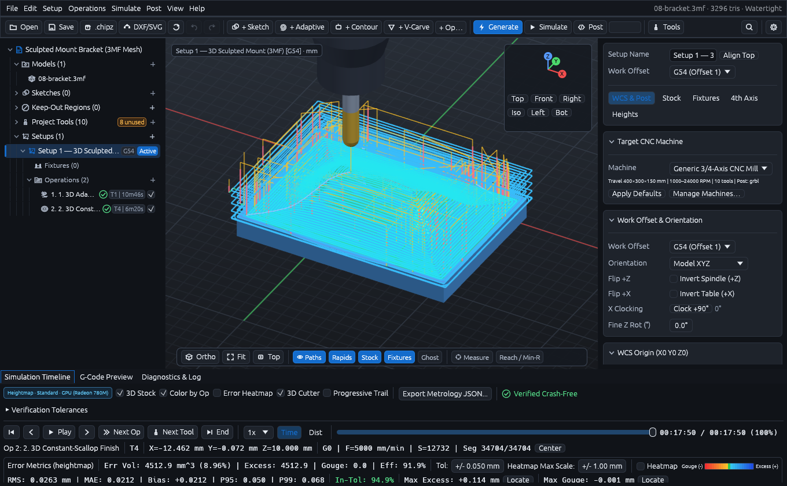
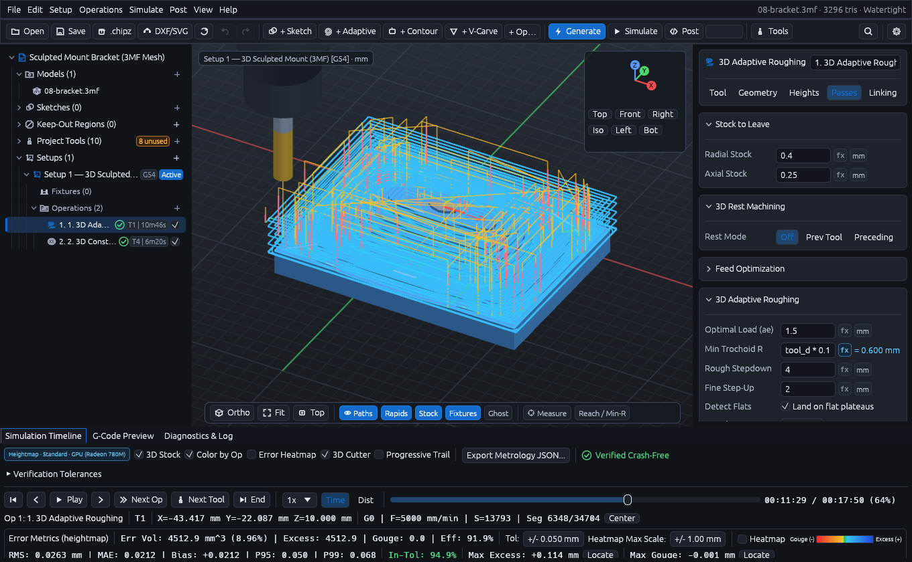
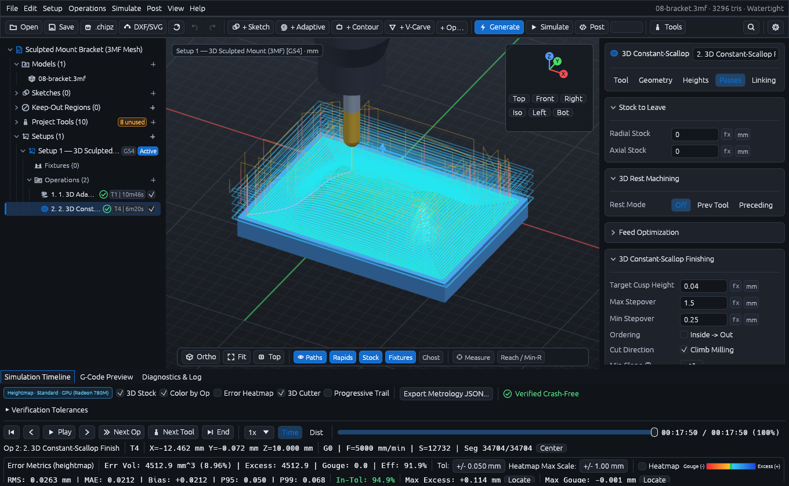

[<- Back to Sample Projects Gallery](README.md)

# Sculpted Mount Bracket (Unit-Aware `3MF` Mesh)

**Category:** 3D Meshes (`STL` / `OBJ` / `3MF`) · **Setups:** 1 (`G54`) · **Operations:** 2

```bash
chip-gui --sample mesh-3mf-bracket
```



## Overview & What It Demonstrates

Unlike unitless `.stl` files, **3MF** packages embed explicit physical units inside their XML manifest. This sample imports a watertight `80 × 56 × 20 mm` millimeter `.3mf` sculpted mounting bracket (`08-bracket.3mf`) with zero manual scaling and machines it cleanly in two 3-axis surface operations:

| Property | Value |
|---|---|
| **Source Mesh** | Watertight millimeter `.3mf` package (`80 × 56 × 20 mm`, `0` open boundary edges) |
| **Stock Setup** | `84 × 60 × 21 mm` raw aluminum billet (`2.0 mm` XY margins, `1.0 mm` top allowance) |
| **Cutters Used** | `Ø6 mm` Flat Endmill (`T1`) for roughing · `Ø6 mm` Ball Endmill (`T4`) for finishing |
| **Verification** | `0` critical errors, `max_gouge <= 0.03 mm`, verified GRBL & LinuxCNC G-code |

- **Automatic Unit-Aware `.3mf` Import:** Reads millimeter dimensions directly from the `.3mf` archive, verifies watertightness and zero open boundary edges, and constructs an exact `f64` `MeshBvh` for analytical drop-cutter & push-cutter surface evaluation.
- **Rough + Constant-Scallop Finish Pair with True `Model Silhouette`:** Pairs fast constant-engagement **3D Adaptive Roughing** (`4.0 mm` rough / `2.0 mm` fine stepdowns, flat detection) with Sethian Eikonal **3D Constant-Scallop Finishing** (`0.04 mm` uniform cusp height) bounded to the true projected **`Model Silhouette`** (`Tool Center`) in **`[Geometry]` → `Cutting Area / Machining Boundary`** with a live 3D boundary preview and smooth **Simulation Mesh Skinning** (`Settings → Simulation`, `Ctrl+,`).

Related step-by-step guides: [Tutorial 08 (3D Adaptive Roughing & 3D Waterline / Z-Level)](../tutorials/08-3d-adaptive-waterline.md) and [Tutorial 09 (3D Surface Finishing: Parallel Raster, Constant-Scallop, & Pencil Cleanup)](../tutorials/09-3d-surface-finishing.md).

---

## Progressive Operation-by-Operation Simulation

### Operation 1 — 3D Adaptive Roughing (`3D Adaptive`)
Bulk-roughs the rectangular billet down to the `Z = 8.0 mm` base flange deck (`ModelTop - 12.0 mm`) using the `Ø6 mm` flat endmill (`1.5 mm` optimal load, `0.4 mm` radial / `0.25 mm` axial stock-to-leave, intermediate flat-step detection).



### Operation 2 — 3D Constant-Scallop Finish (`3D Scallop`)
Finishes the entire sculpted bracket silhouette with the `Ø6 mm` ball endmill using adaptive `0.25–1.5 mm` geodesic iso-contour stepovers to maintain a uniform `0.04 mm` 3D surface cusp height.



---

## Headless CLI Equivalent

```bash
# Generate the starter .3mf package, inspect watertightness/units, & simulate
chipcutter generate-sample-step /tmp/08-bracket.3mf --tutorial 08-bracket-3mf
chipcutter inspect /tmp/08-bracket.3mf
chipcutter import-mesh /tmp/08-bracket.3mf -o /tmp/bracket_3mf.chip.toml
```
