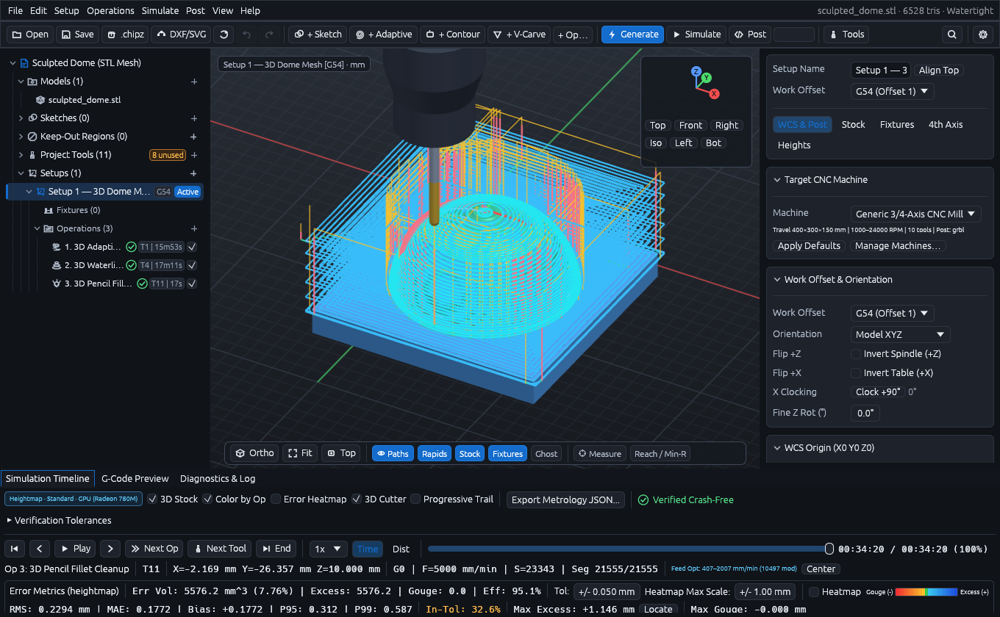
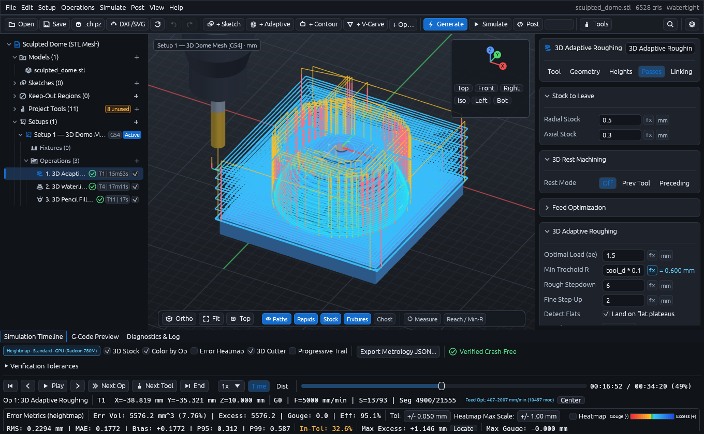
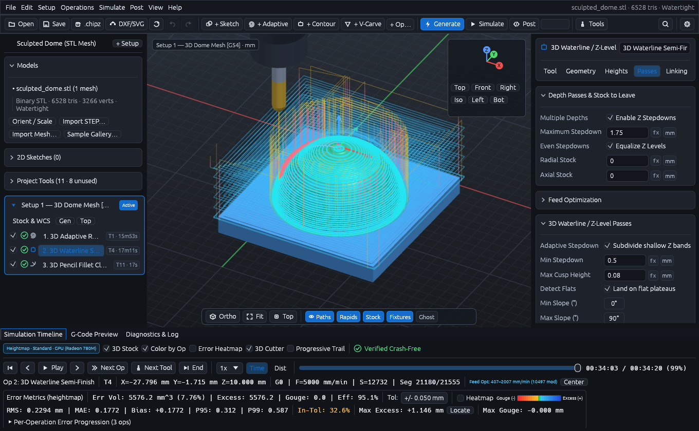
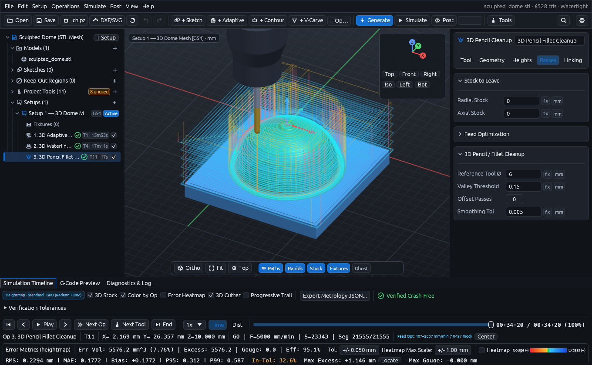

[<- Back to Sample Projects Gallery](README.md)

# Sculpted Dome (Watertight STL Mesh)

**Category:** 3D Mesh (`STL`) · **Setups:** 1 (`G54`) · **Operations:** 3

```bash
chip-gui --sample mesh-dome
```



## Overview & What It Demonstrates

The **Sculpted Dome** demonstrates ChipCutter's 3-axis surface milling pipeline on a watertight STL triangle mesh (`R25 mm` hemisphere seated on a `70 × 70 × 8 mm` pedestal):

- **3D Adaptive Roughing:** Removes bulk raw stock around the hemisphere using constant-engagement trochoidal peels with coarse stepdowns and intermediate fine step-ups to eliminate steep staircase terraces.
- **3D Waterline Semi-Finish:** Traces constant-Z contour levels around the dome using adaptive Z-stepdowns on shallower slopes.
- **3D Pencil Fillet Cleanup:** Automatically detects the concave base fillet crease where the dome meets the flat pedestal using morphological ball-in-ball Minkowski rest residual analysis and cleans it up with a `Ø3 mm` ball endmill.

Related step-by-step guides: [Tutorial 08 (3D Adaptive Roughing & 3D Waterline / Z-Level)](../tutorials/08-3d-adaptive-waterline.md) and [Tutorial 17 (Tri-Dexel Simulation & Error Metrics)](../tutorials/17-tridexel-simulation-error-metrics.md).

---

## Progressive Operation-by-Operation Simulation

### Operation 1 — 3D Adaptive Roughing (`3D Adaptive`)
Bulk-roughs the rectangular billet down to stepped contours around the spherical dome and flat pedestal deck.



### Operation 2 — 3D Waterline Semi-Finish (`3D Waterline`)
Smoothly finishes the steep and curved flanks of the hemisphere with constant-Z contour passes.



### Operation 3 — 3D Pencil Fillet Cleanup (`3D Pencil`)
Traces the concave dome-to-pedestal crease with a smaller `Ø3 mm` ball endmill to remove the residual fillet left by larger cutters.


