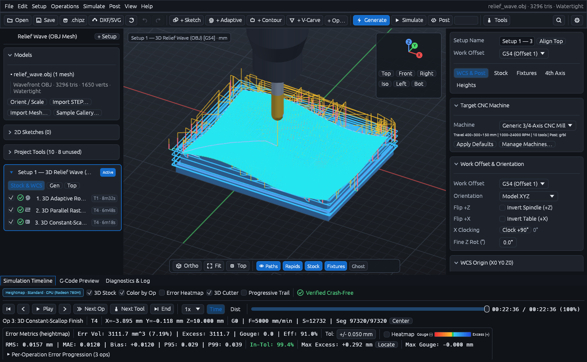
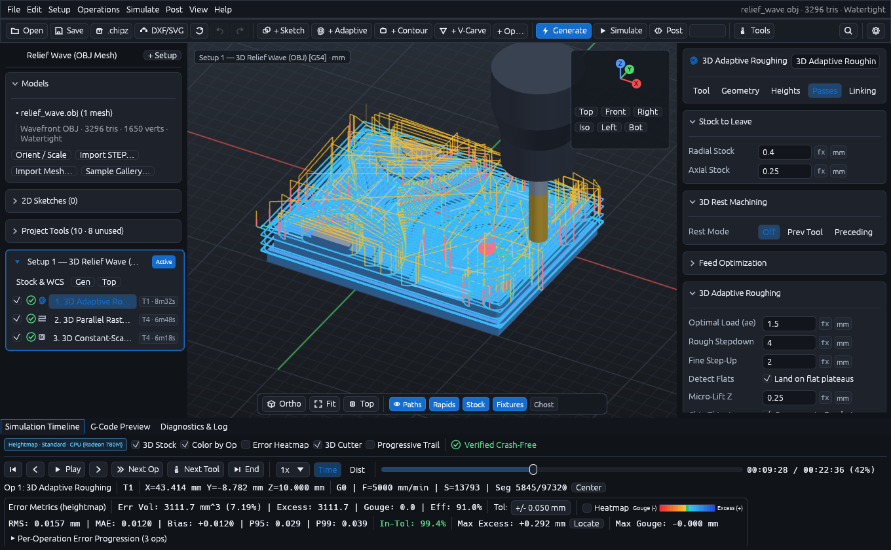
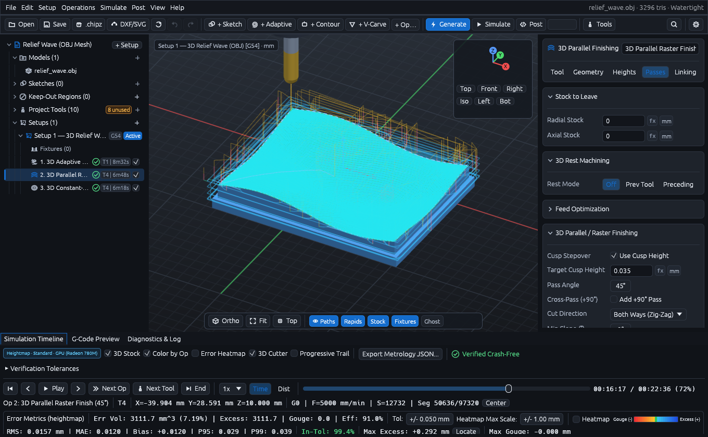
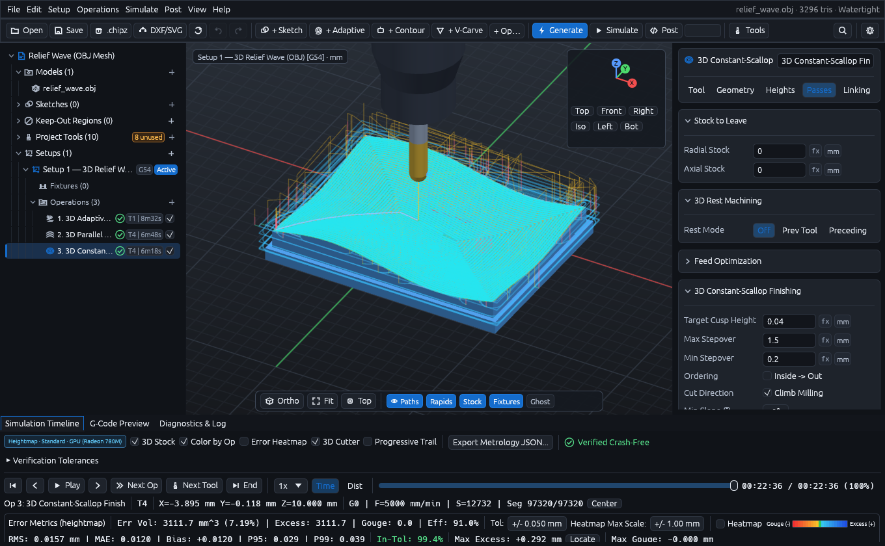

[<- Back to Sample Projects Gallery](README.md)

# Relief Wave (OBJ Mesh Finishing)

**Category:** 3D Mesh (`OBJ`) · **Setups:** 1 (`G54`) · **Operations:** 3

```bash
chip-gui --sample mesh-wave
```



## Overview & What It Demonstrates

The **Relief Wave** (`80 × 60 × 15 mm` sculpted sinusoidal OBJ relief) showcases ChipCutter's 3-axis surface finishing strategies on organic freeform relief geometry:

- **3D Adaptive Roughing:** Clears bulk stock above the undulating wave crests and troughs.
- **3D Parallel Raster Finish (`45°`):** Sweeps ball-endmill scanlines at `45°` across the relief using exact drop-cutter contact elevation.
- **3D Constant-Scallop Finish:** Uses Sethian Fast-Marching Eikonal iso-contours to maintain uniform 3D scallop/cusp height across both shallow crests and steeper troughs.

Related step-by-step guide: [Tutorial 09 (3D Surface Finishing: Parallel Raster, Constant-Scallop, & Pencil Cleanup)](../tutorials/09-3d-surface-finishing.md).

---

## Progressive Operation-by-Operation Simulation

### Operation 1 — 3D Adaptive Roughing (`3D Adaptive`)
Roughs away excess billet stock above the sculpted wave relief.



### Operation 2 — 3D Parallel Raster Finish (45°) (`3D Parallel`)
Machines smooth `45°` raster passes over the wave surface with cusp-controlled stepover.



### Operation 3 — 3D Constant-Scallop Finish (`3D Scallop`)
Completes the relief with constant-cusp 3D iso-contour passes that adapt spacing cleanly to local surface slope.


