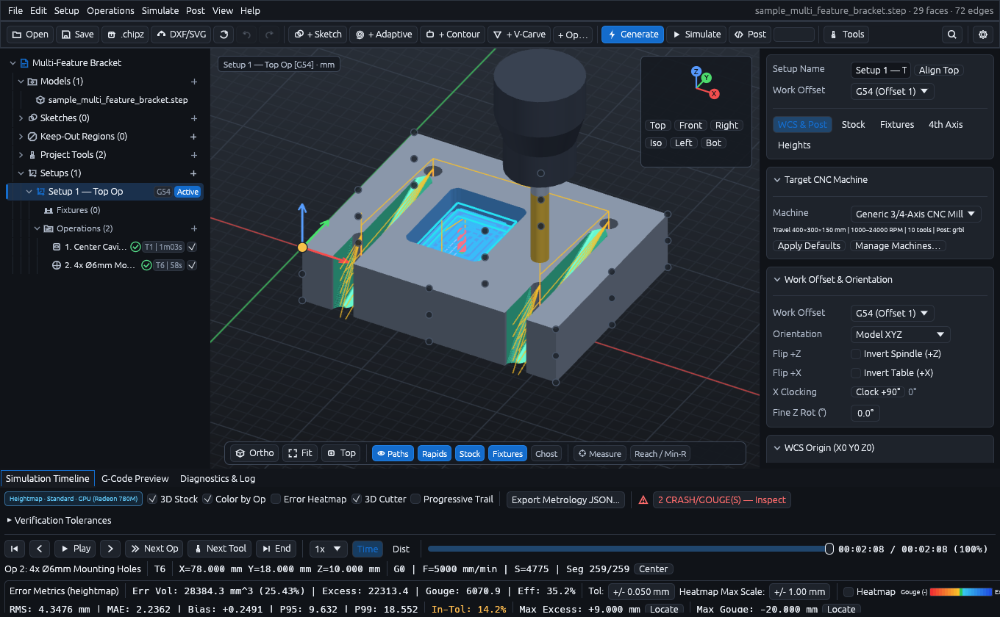
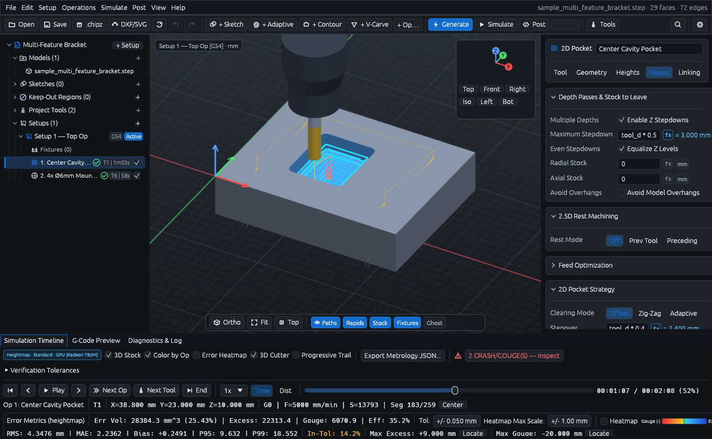
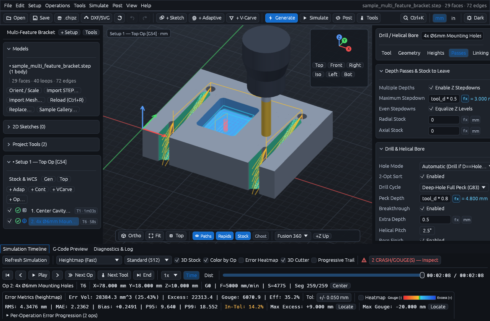

[<- Back to Sample Projects Gallery](README.md)

# Prismatic Multi-Feature Bracket

**Category:** 3D STEP Solid · **Setups:** 1 (`G54`) · **Operations:** 2

```bash
chip-gui --sample multi-feature
```



## Overview & What It Demonstrates

The **Prismatic Multi-Feature Bracket** is a clean, minimal starter 3D STEP assembly ideal for learning ChipCutter's core CAD-to-CAM workflow (**Active Setup** top action bar, `Ctrl+G` generation with Activity Log execution timing, `Settings → Simulation` via `Ctrl+,`, 3D stock simulation, and G-code posting) without the complexity of an 8-operation job:

- **Planar face pocketing** bound directly to the interior pocket floor of the STEP solid (automatic Z-top and Z-bottom inference).
- **Through-hole drilling** on four symmetric `Ø6 mm` corner mounting holes bound to cylindrical B-Rep faces.

Related step-by-step guide: [Tutorial 00 (Getting Started & Workspace Orientation)](../tutorials/00-getting-started.md).

---

## Progressive Operation-by-Operation Simulation

### Operation 1 — Center Cavity Pocket (`2D Pocket`)
Clears the recessed central pocket down to the B-Rep floor elevation with helical entry and wall finishing.



### Operation 2 — 4x Ø6mm Mounting Holes (`Drill / Helical Bore`)
Drills all four corner mounting holes with automatic drill tip breakthrough clearance.


