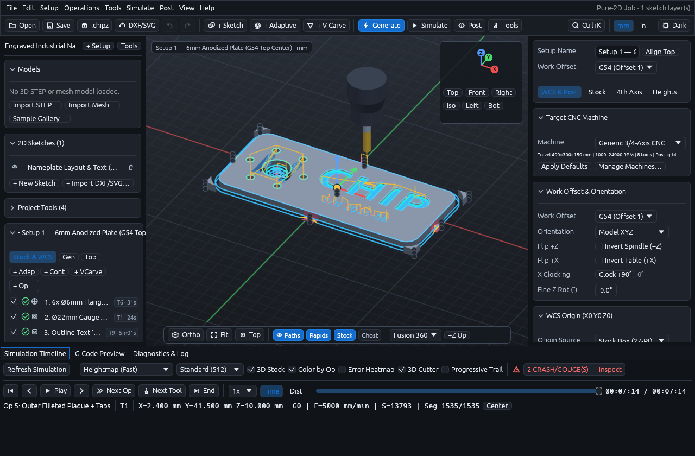
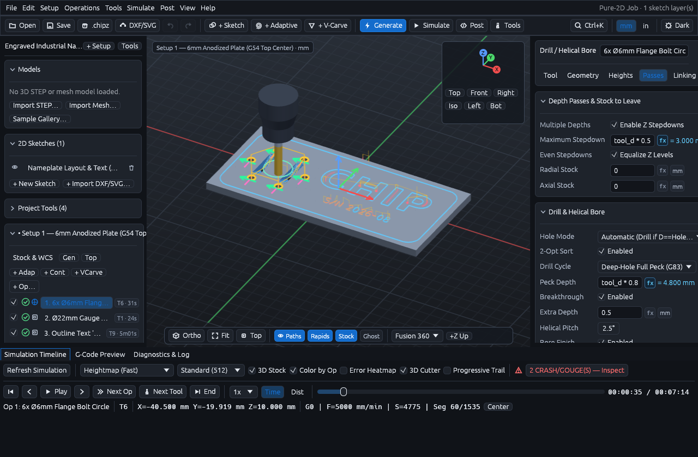
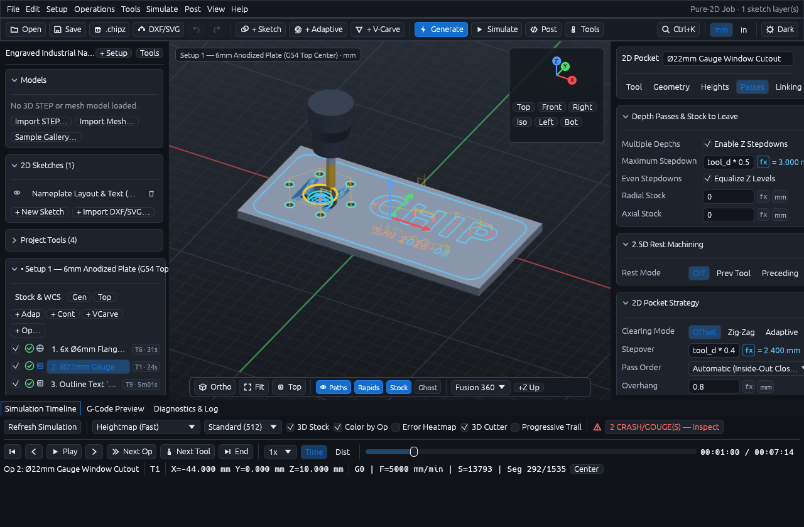
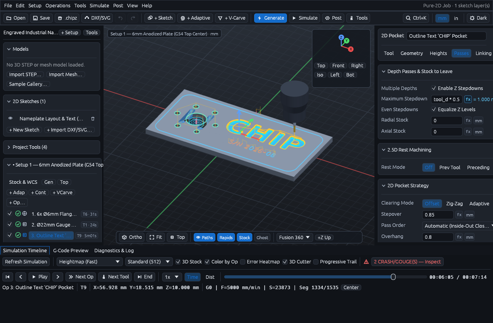
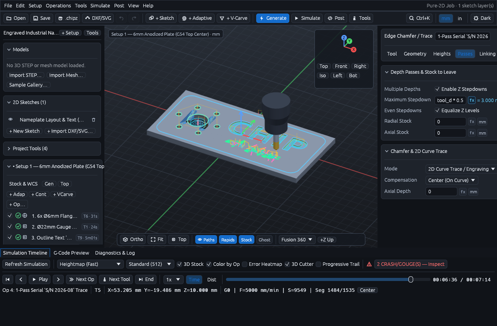
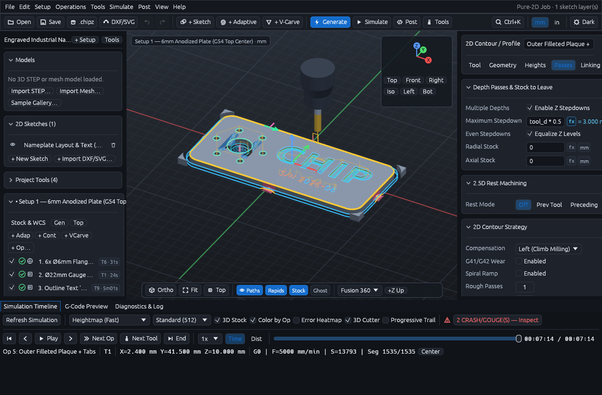

[<- Back to Sample Projects Gallery](README.md)

# Engraved Nameplate (TrueType + Hershey)

**Category:** V-Carve & CAM Typography · **Setups:** 1 (`G54`) · **Operations:** 5

```bash
cargo run --release -p chip-gui -- --sample nameplate
```



## Overview & What It Demonstrates

This Pure-2D sample exercises ChipCutter's **parametric 2D sketch engine** and **dual-mode CAM typography** on a filleted aluminum/acrylic instrument nameplate:

- **Parametric sketch primitives:** `R10` filleted outer plaque, `6x` Flange Bolt Circle pattern, and `Ø22 mm` circular gauge window—all editable via expressions.
- **TrueType outline typography (`DejaVu Sans Bold`):** Converts `"CHIP"` into closed vector outlines with counter-islands (e.g., inside `P`) for crisp shallow pocketing.
- **Hershey single-stroke engraving:** Converts `"S/N 2026-08"` into open centerline strokes machined in a single fast trace pass.

Related step-by-step guide: [Tutorial 06 (Edge Chamfering & 2D Curve Trace / Engraving)](../tutorials/06-chamfer-curve-trace.md).

---

## Progressive Operation-by-Operation Simulation

### Operation 1 — 6x Ø6mm Flange Bolt Circle (`Drill / Helical Bore`)
Drills the parametric 6-hole bolt circle around the central gauge aperture.



### Operation 2 — Ø22mm Gauge Window Cutout (`2D Pocket`)
Clears the central `Ø22 mm` through-aperture for the instrument bezel.



### Operation 3 — Outline Text 'CHIP' Pocket (`2D Pocket`)
Pockets the recessed TrueType outline lettering while preserving internal glyph counter-islands.



### Operation 4 — 1-Pass Serial 'S/N 2026-08' Trace (`Chamfer / Curve Trace`)
Engraves the single-stroke Hershey serial number along exact stroke centerlines in a single Z pass.



### Operation 5 — Outer Filleted Plaque + Tabs (`2D Contour`)
Profiles the filleted exterior nameplate perimeter with holding tabs.


