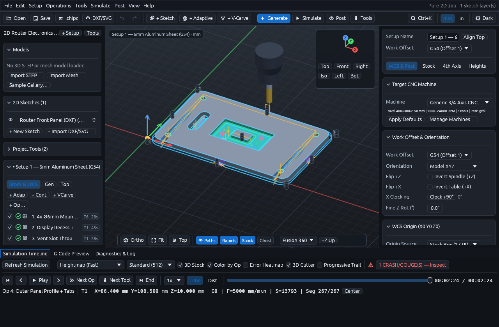
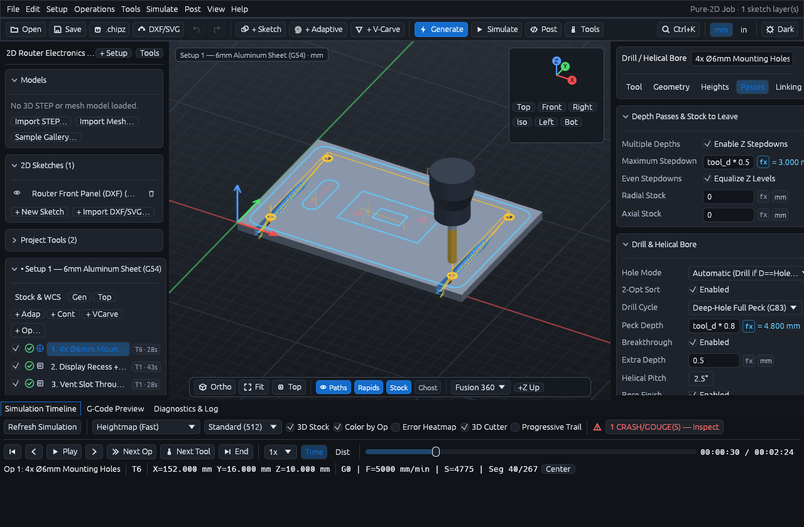
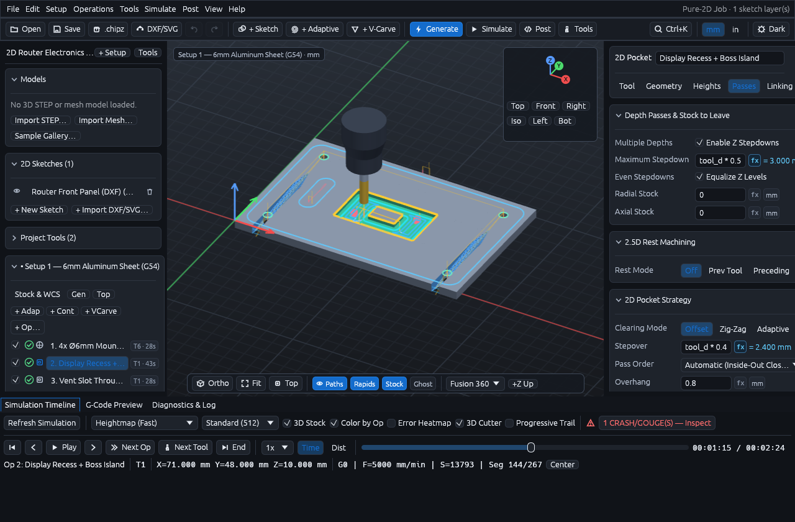
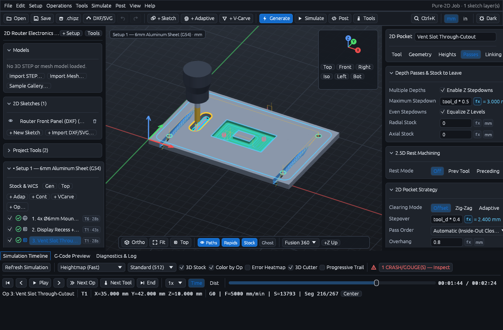
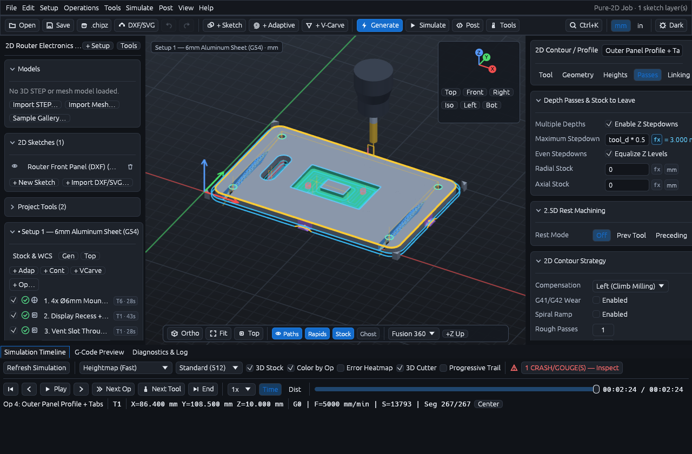

[<- Back to Sample Projects Gallery](README.md)

# Pure-2D CNC Router Front Panel (`.dxf`)

**Category:** Pure-2D & DXF · **Setups:** 1 (`G54`) · **Operations:** 4

```bash
cargo run --release -p chip-gui -- --sample pure-2d
```



## Overview & What It Demonstrates

ChipCutter does not require a 3D STEP model to machine flat sheet stock. This sample demonstrates a **zero-STEP Pure-2D CNC router job** built directly from an imported multi-layer AutoCAD **DXF** drawing (`OUTLINE`, `HOLES`, `POCKETS`, `CUTOUTS`) on virtual sheet stock:

- **Sub-layer batch selection** automatically maps DXF layers to CAM operations.
- **Even-odd nested island detection** identifies the interior boss inside the display pocket recess without manual chaining.
- **Holding tabs** retain the finished electronics faceplate inside the sheet blank during the final outer cutout.

Related step-by-step guide: [Tutorial 13 (Pure-2D DXF / SVG Vector Import & Portable `.chipz` Bundles)](../tutorials/13-pure2d-dxf-svg-workflow.md).

---

## Progressive Operation-by-Operation Simulation

### Operation 1 — 4x Ø6mm Mounting Holes (`Drill / Helical Bore`)
Drills the four corner mounting holes extracted from the DXF `HOLES` sub-layer.



### Operation 2 — Display Recess + Boss Island (`2D Pocket`)
Pockets the recessed display bay while automatically leaving the nested interior boss island standing proud.



### Operation 3 — Vent Slot Through-Cutout (`2D Pocket`)
Machines the through-slot ventilation cutout cleanly through the full sheet thickness.



### Operation 4 — Outer Panel Profile + Tabs (`2D Contour`)
Cuts the final exterior faceplate profile through the sheet while leaving holding tabs to keep the panel secure until removal.


