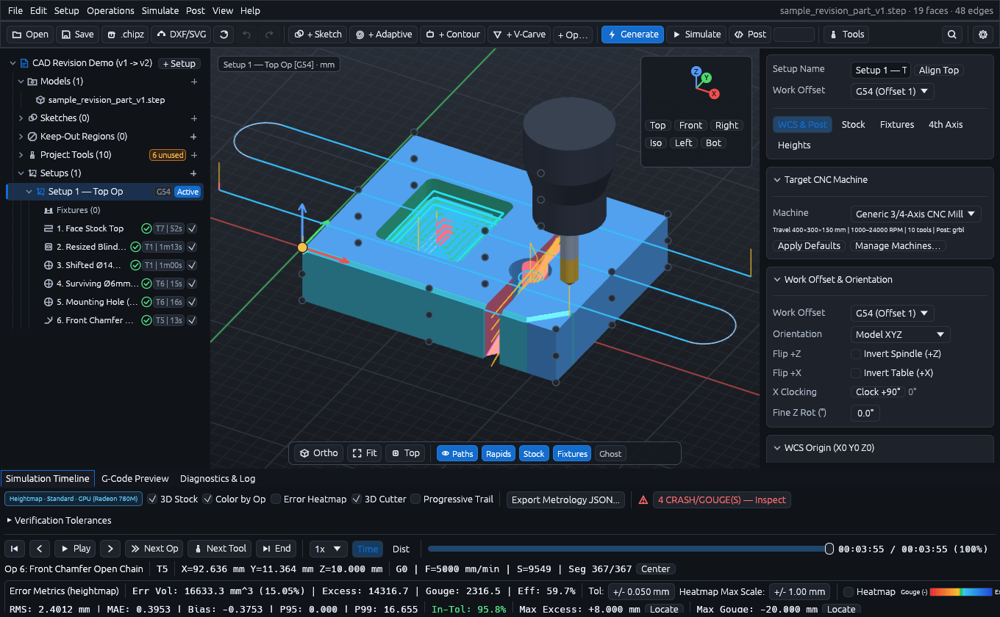
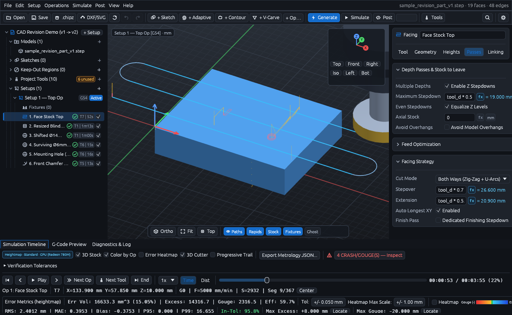
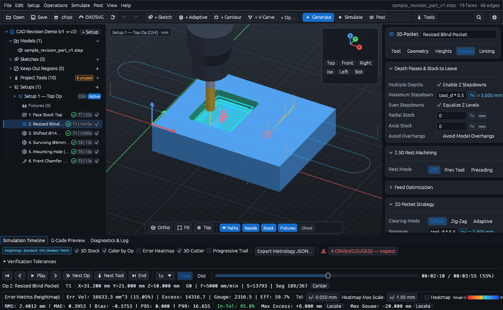
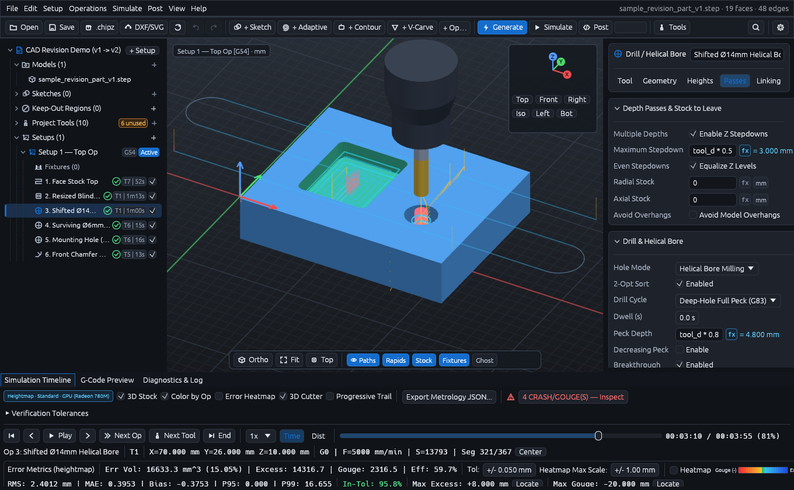
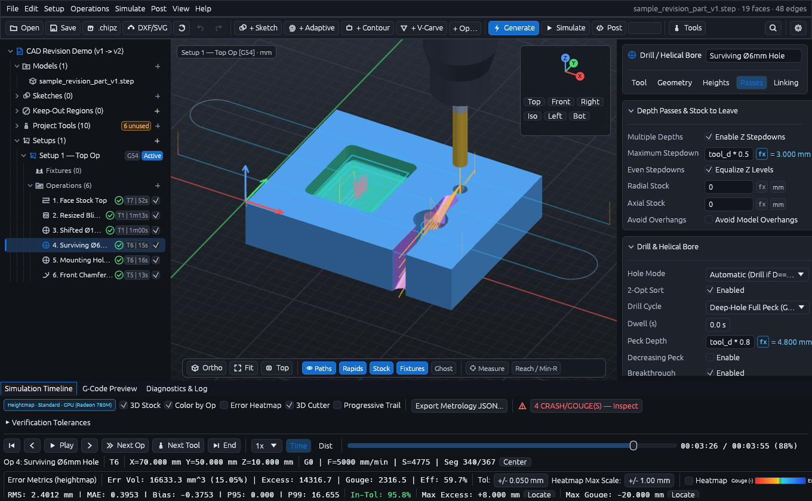
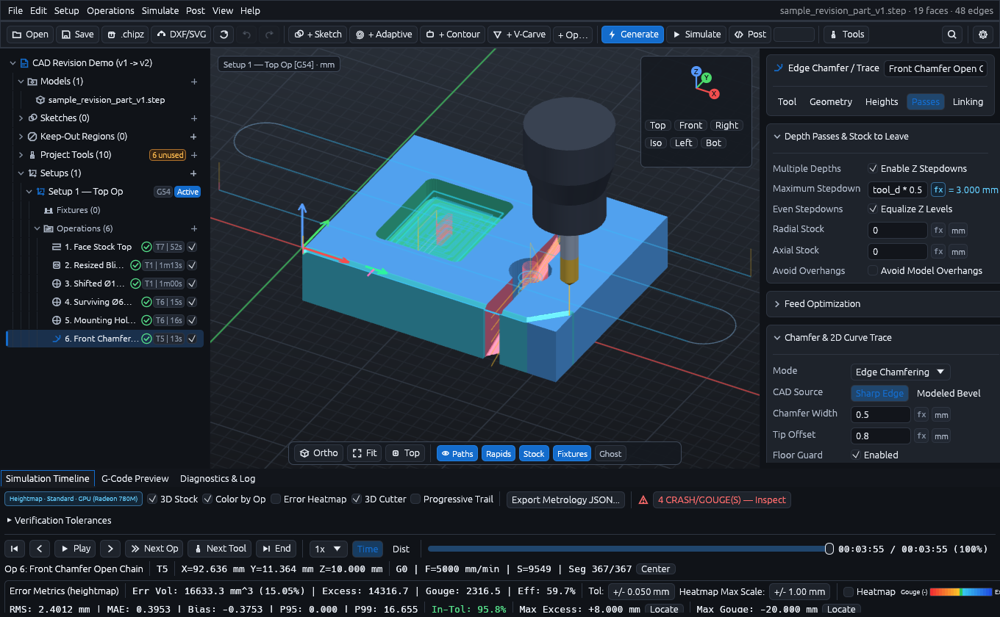

[<- Back to Sample Projects Gallery](README.md)

# Associative CAD Revision Reload (v1)

**Category:** 3D STEP Solid · **Setups:** 1 (`G54`) · **Operations:** 6

```bash
chip-gui --sample revision-v1
```



## Overview & What It Demonstrates

**Associative CAD Revision v1** is the baseline STEP bracket in ChipCutter's associative revision-reload pair (`revision-v1` -> [`revision-v2`](revision-v2.md)). It contains 6 operations bound to B-Rep planar faces, cylindrical holes, and open edge chains using persistent `GeometricSignature` descriptors:

- Facing across the stock top.
- A blind rectangular pocket (which gets resized in v2).
- A `Ø14 mm` helical bore (which shifts in XY in v2).
- Two `Ø6 mm` mounting holes—one that survives in v2 and one that is intentionally deleted in v2 to demonstrate orphan detection.
- An open-chain front edge chamfer.

Related step-by-step guide: [Tutorial 14 (Associative STEP Revision Reload & Re-Pick Recovery)](../tutorials/14-associative-step-reload.md).

---

## Progressive Operation-by-Operation Simulation

### Operation 1 — Face Stock Top (`Facing`)
Surfaces the raw billet top allowance flat.



### Operation 2 — Resized Blind Pocket (`2D Pocket`)
Machines the baseline Revision v1 blind rectangular pocket.



### Operation 3 — Shifted Ø14mm Helical Bore (`Drill / Helical Bore`)
Helically interpolates the `Ø14 mm` bore at its Revision v1 coordinates.



### Operation 4 — Surviving Ø6mm Hole (`Drill / Helical Bore`)
Drills the first `Ø6 mm` mounting hole (retained across Revision v2).



### Operation 5 — Mounting Hole (Deleted in v2) (`Drill / Helical Bore`)
Drills the second `Ø6 mm` mounting hole that exists in Revision v1 and will be removed in Revision v2.


### Operation 6 — Front Chamfer Open Chain (`Chamfer / Curve Trace`)
Chamfers the open front edge chain along the top front face.


