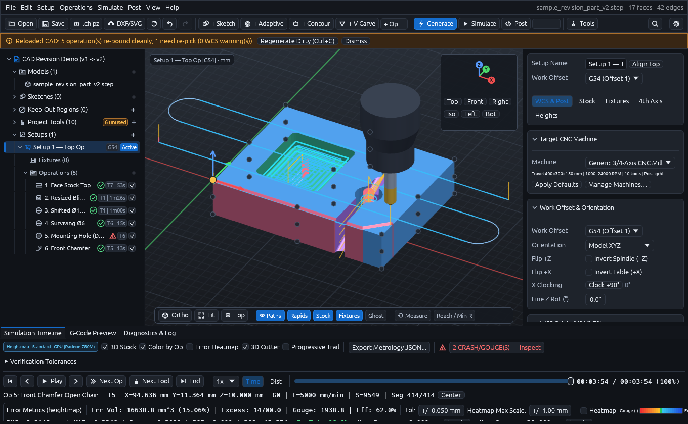
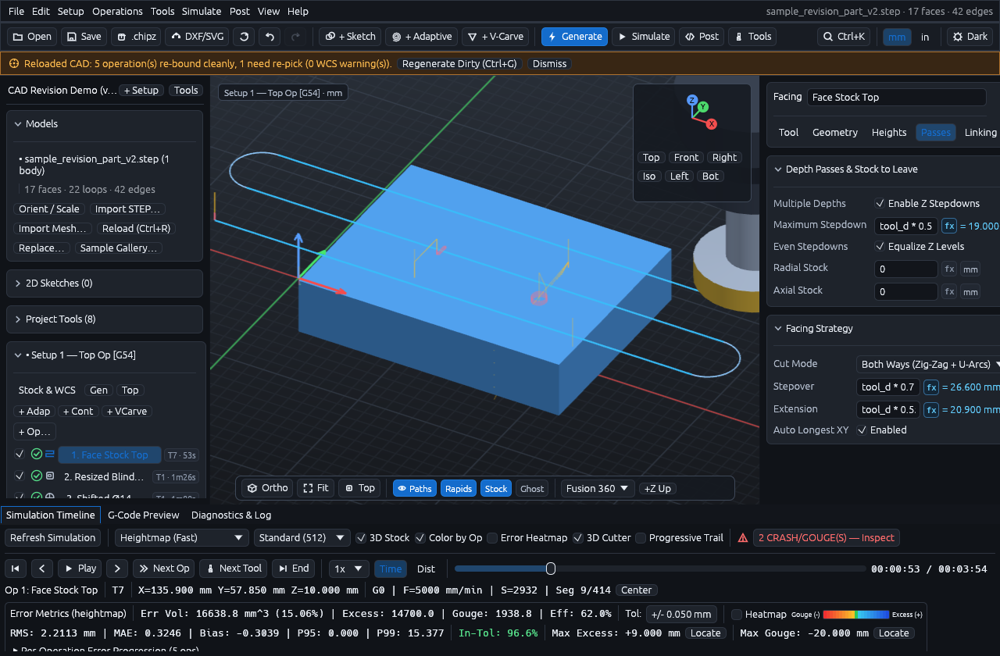
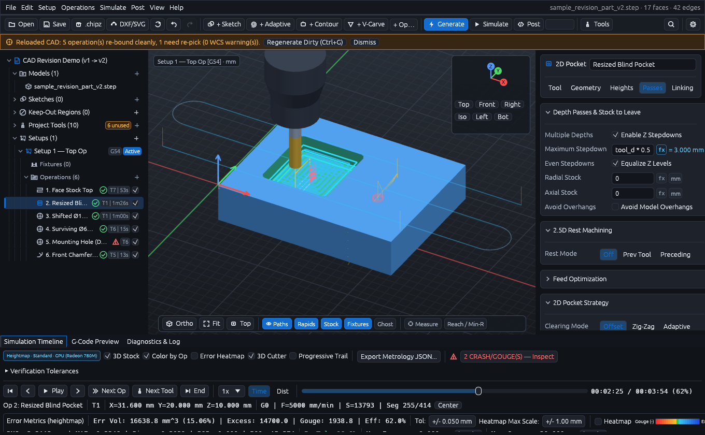
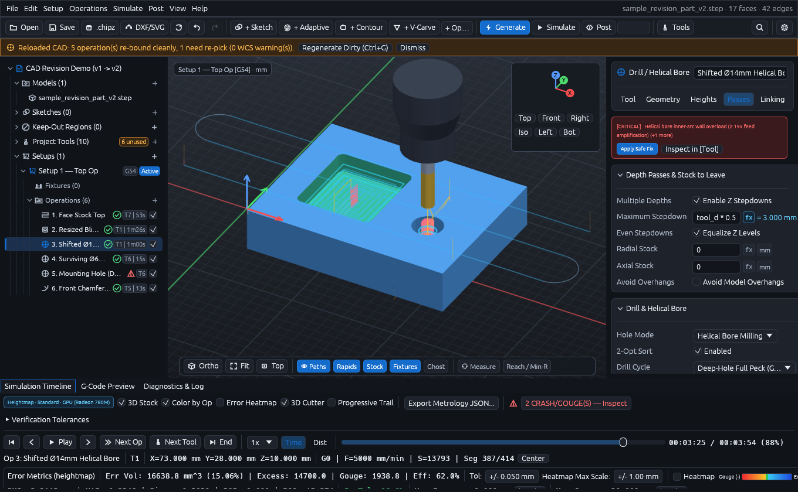
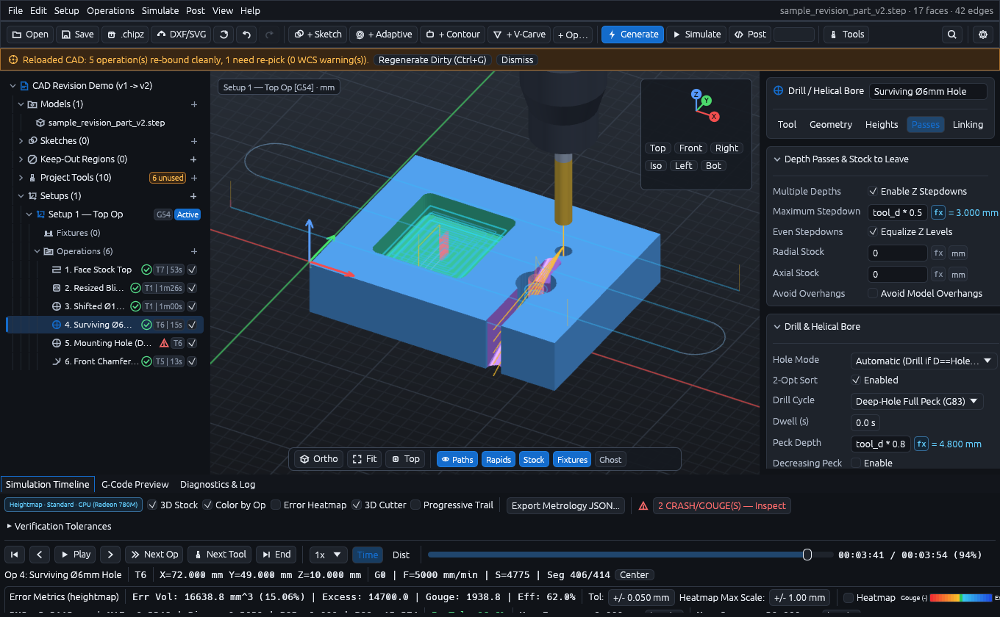
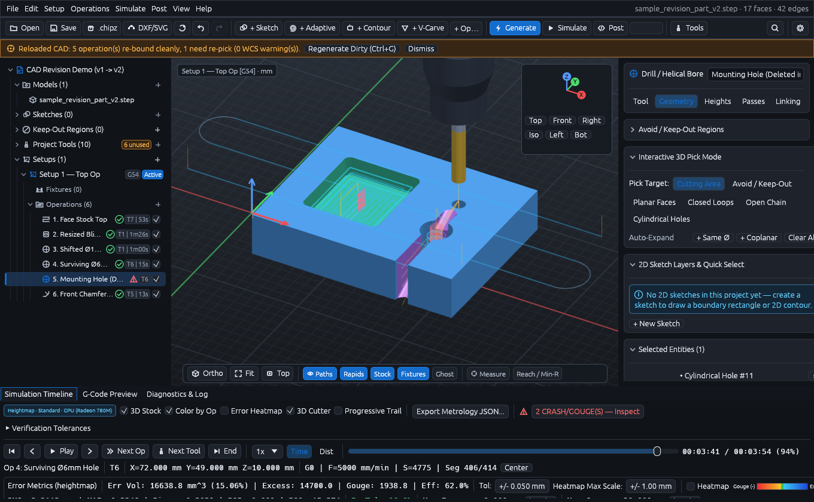
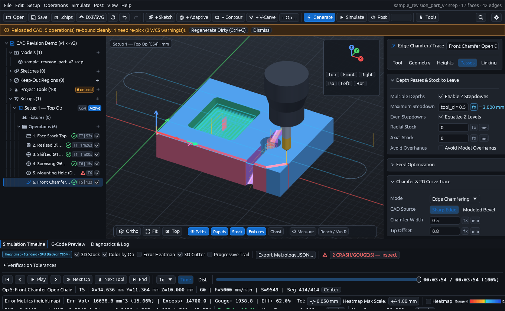

[<- Back to Sample Projects Gallery](README.md)

# Associative CAD Revision Reload (v2)

**Category:** 3D STEP Solid · **Setups:** 1 (`G54`) · **Operations:** 6 (5 Rebound + 1 `NeedsRepick`)

```bash
chip-gui --sample revision-v2
```



## Overview & What It Demonstrates

**Associative CAD Revision v2** executes an automatic associative reload of the [`revision-v1`](revision-v1.md) CAM project onto the revised v2 STEP solid:

- **Automatic fuzzy re-binding:** The resized blind pocket, shifted `Ø14 mm` bore, surviving `Ø6 mm` hole, and healed front chamfer open chain all automatically re-bind to the new B-Rep topology while preserving tools, feeds/speeds, heights, and passes.
- **Explicit orphan detection (`NeedsRepick`):** Operation 5 (*Mounting Hole (Deleted in v2)*) cleanly detects that its target hole no longer exists in v2, displays a clear warning banner with a 1-click **`Clear Orphaned & Re-Pick in 3D`** recovery action, and skips generating invalid cuts rather than silently drilling into solid metal.

Related step-by-step guide: [Tutorial 14 (Associative STEP Revision Reload & Re-Pick Recovery)](../tutorials/14-associative-step-reload.md).

---

## Progressive Operation-by-Operation Simulation

### Operation 1 — Face Stock Top (`Facing`)
Re-generates across the updated Revision v2 stock footprint (`92 × 70 mm`).



### Operation 2 — Resized Blind Pocket (`2D Pocket`)
Automatically adapts its pocket boundary to the resized Revision v2 pocket geometry without manual re-selection.



### Operation 3 — Shifted Ø14mm Helical Bore (`Drill / Helical Bore`)
Tracks the shifted `Ø14 mm` bore centerline cleanly via `GeometricSignature` matching.



### Operation 4 — Surviving Ø6mm Hole (`Drill / Helical Bore`)
Re-binds and drills the surviving `Ø6 mm` mounting hole at its updated Revision v2 location.



### Operation 5 — Mounting Hole (Deleted in v2) (`NeedsRepick` Orphan Detection)
Flagged cleanly in the CAM Browser and Operation Inspector (`CAD Feature Needs Re-Pick`) because the hole was deleted in Revision v2; simulation safely omits it rather than gouging.



### Operation 6 — Front Chamfer Open Chain (`Chamfer / Curve Trace`)
Automatically heals and extends the front edge open chain across the wider Revision v2 bracket.


