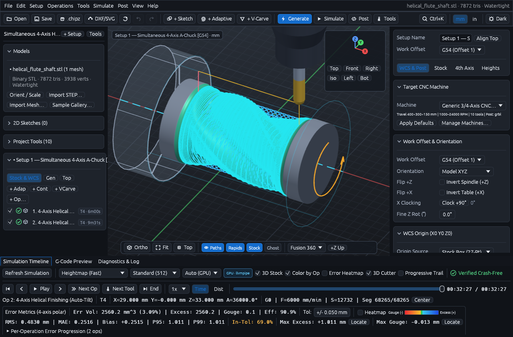
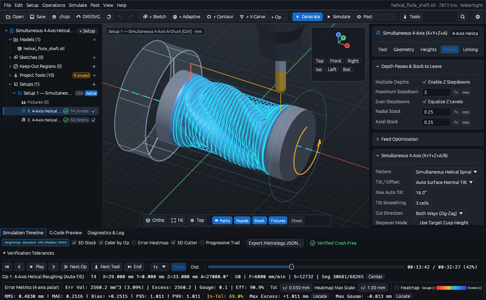
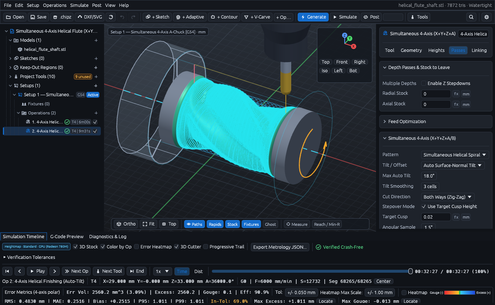

[<- Back to Sample Projects Gallery](README.md)

# Simultaneous 4-Axis Helical Flute (`X+Y+Z+A`)

**Category:** 4th-Axis Rotary (`A`-Axis) · **Setups:** 1 (`G54` Simultaneous 4-Axis) · **Operations:** 2

```bash
chip-gui --sample rotary-4axis
```



## Overview & What It Demonstrates

This `Ø40 × 80 mm` 3-start helical flute shaft exercises ChipCutter's **Simultaneous 4-Axis (`X+Y+Z+A`)** milling engine:

- **Off-Centerline Auto Surface-Normal Tilt:** Unlike centerline-locked `Z+X+A` rotary surfacing, simultaneous 4-axis mode shifts the cutter laterally in `Y` while coordinating `A`-axis rotation so the cutter axis aligns cleanly with sloped helical flute walls without flank gouging.
- **4th-Axis Rotary Cutting Area (`-U / +U`) & Chuck Guard Preview:** Both operations configure `Start Margin (-U) = 11 mm` and `End Margin (+U) = 11 mm` in **`[Geometry]` → `4th-Axis Rotary Cutting Area (-U / +U)`**, displaying a live 3D cylindrical sector overlay, `-U`/`+U` endcap rings, and automatic rotary chuck-guard keep-out plane directly in the viewport.
- **Full `G93` Inverse-Time Feedrates & Polar Verification:** Verified against the 3D shaft mesh and rotary chuck in polar `CylindricalStock` simulation (with smooth **Simulation Mesh Skinning** via `Settings → Simulation`, `Ctrl+,`) before emitting `linuxcnc_4axis` / `grblhal_4axis` G-code.

Related step-by-step guide: [Tutorial 12 (Simultaneous 4-Axis Milling)](../tutorials/12-simultaneous-4axis-milling.md).

---

## Progressive Operation-by-Operation Simulation

### Operation 1 — 4-Axis Helical Roughing (Auto-Tilt) (`Simultaneous 4-Axis`)
Roughs out the deep 3-start helical flute channels with coordinated multi-depth `X+Y+Z+A` passes leaving finishing allowance.



### Operation 2 — 4-Axis Helical Finishing (Auto-Tilt) (`Simultaneous 4-Axis`)
Finishes the helical flute floors and twisted walls to final net shape with fine angular and axial pitch.


