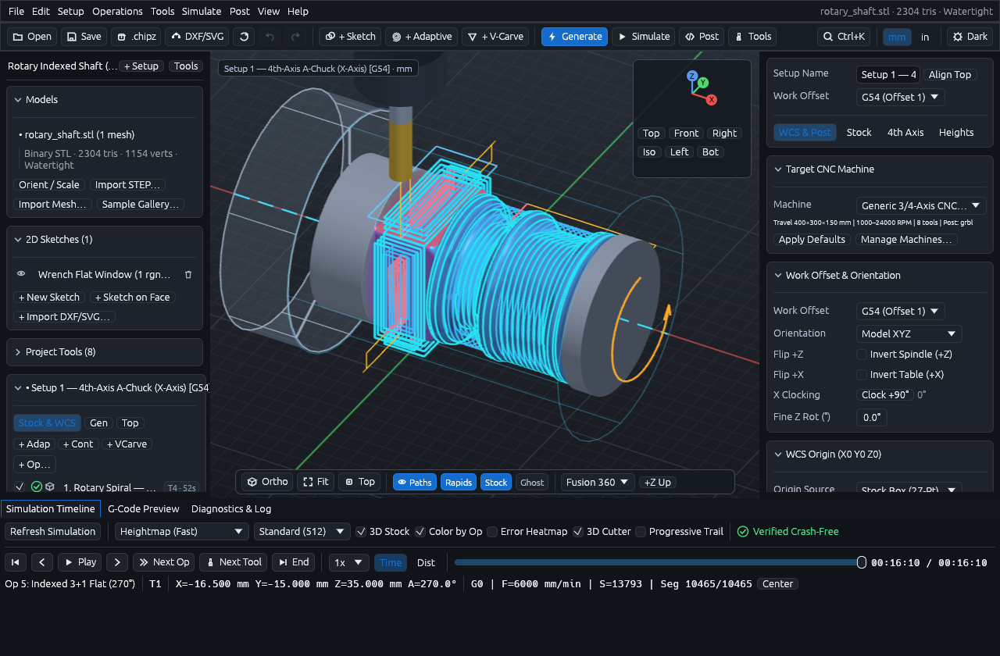
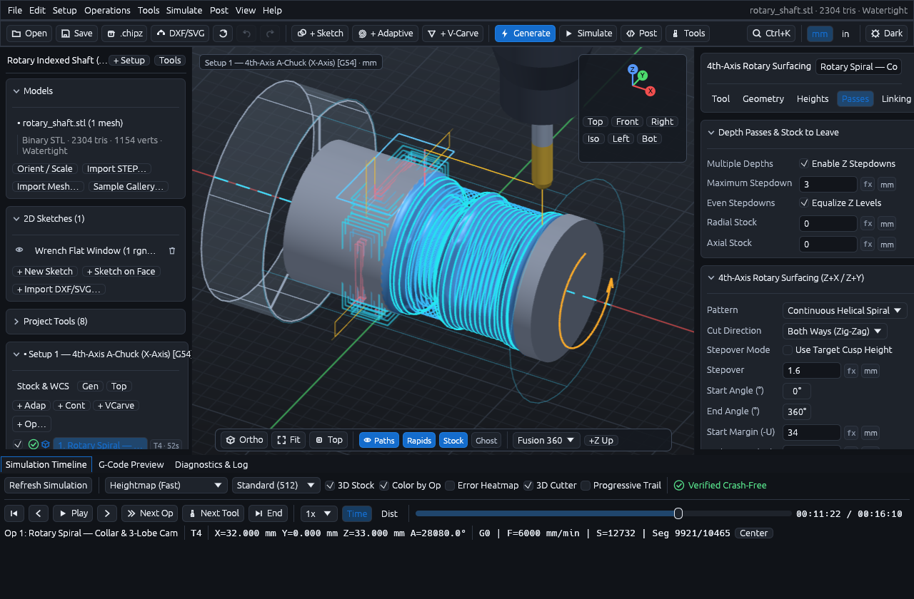
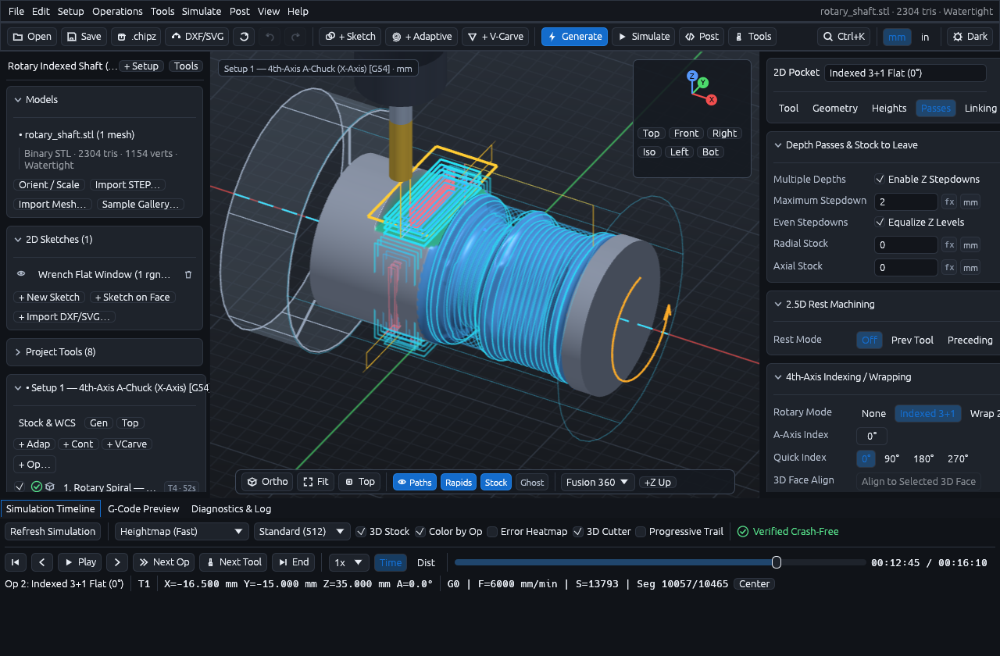
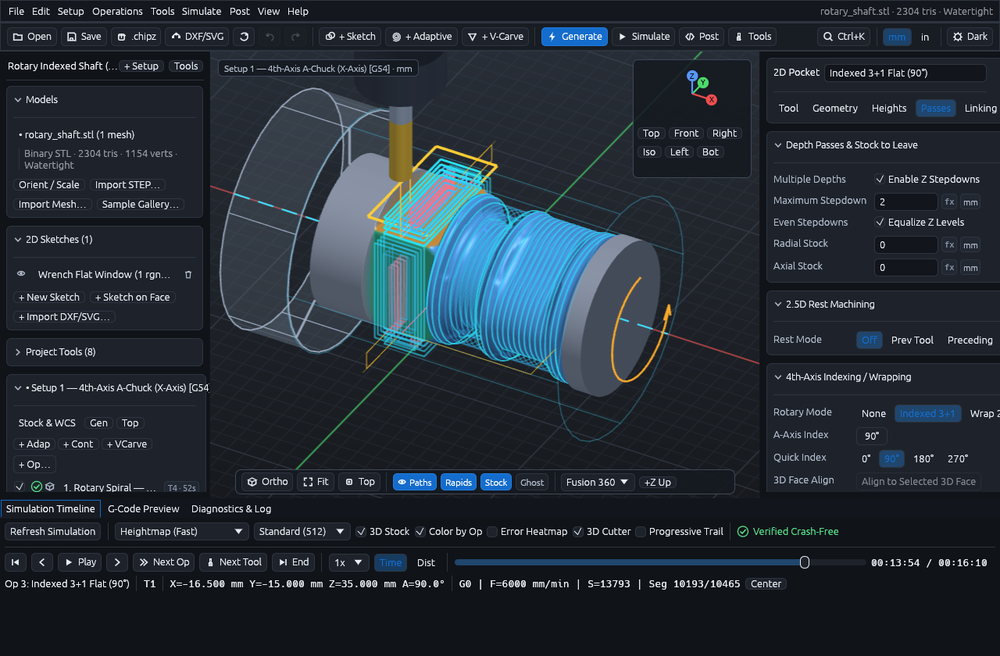
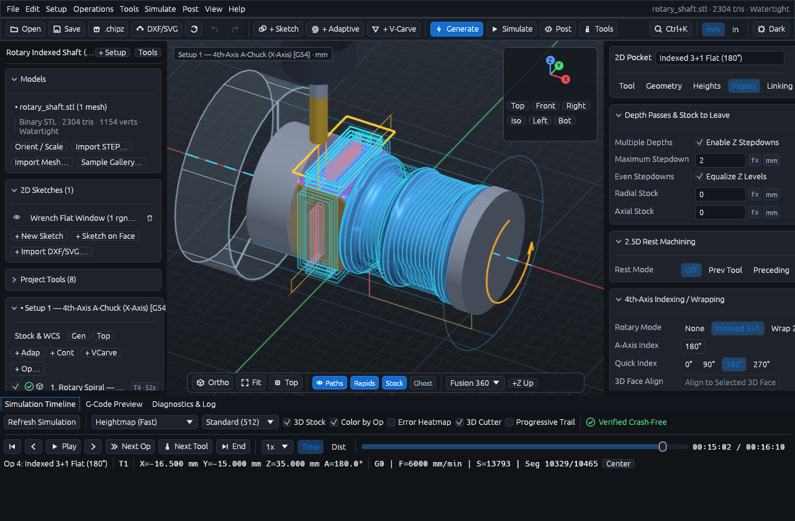
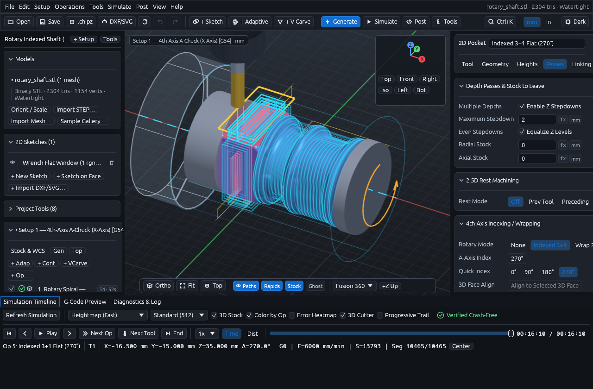

[<- Back to Sample Projects Gallery](README.md)

# Rotary Indexed Shaft (4th-Axis `A`)

**Category:** 4th-Axis Rotary (`A`-Axis) · **Setups:** 1 (`G54` Rotary) · **Operations:** 5

```bash
cargo run --release -p chip-gui -- --sample rotary-shaft
```



## Overview & What It Demonstrates

This `Ø40 × 80 mm` cylindrical shaft combines **continuous 4th-axis rotary surfacing (`Z+X+A`)** with **4-sided Indexed `3+1` multi-face milling** in a single rotary Setup with polar `CylindricalStock` simulation and rotary chuck collision verification:

- **Continuous Spiral Surfacing:** Uses a `Ø6 mm` ball endmill locked to centerline (`Y = 0`) to continuously turn the grooved collar and eccentric 3-lobe cam profile while rotating the `A`-axis.
- **Indexed `3+1` Wrenching Flats (`0°`, `90°`, `180°`, `270°`):** Rotates the chuck at safe clearance radius to each cardinal angle and pockets a crisp wrenching flat on all four sides of the shaft.

Related step-by-step guides: [Tutorial 10 (4th-Axis Rotary Wrapping & Continuous Surfacing)](../tutorials/10-rotary-wrapping-surfacing.md) and [Tutorial 11 (Indexed `3+1` Multi-Face Milling)](../tutorials/11-indexed-3plus1-milling.md).

---

## Progressive Operation-by-Operation Simulation

### Operation 1 — Rotary Spiral — Collar & 3-Lobe Cam (`4th-Axis Rotary Surfacing`)
Continuously spirals along the bar stock to sculpt the circular collar groove and asymmetric 3-lobe cam profile.



### Operation 2 — Indexed 3+1 Flat (0°) (`2D Pocket @ A0°`)
Indexes the 4th axis to `A = 0°` and pockets the first square wrenching flat on the top face.



### Operation 3 — Indexed 3+1 Flat (90°) (`2D Pocket @ A90°`)
Retracts to radial clearance, rotates to `A = 90°`, and pockets the second wrenching flat.



### Operation 4 — Indexed 3+1 Flat (180°) (`2D Pocket @ A180°`)
Rotates to `A = 180°` and pockets the third wrenching flat opposite `0°`.



### Operation 5 — Indexed 3+1 Flat (270°) (`2D Pocket @ A270°`)
Rotates to `A = 270°` and finishes the fourth wrenching flat to complete the square drive section.


