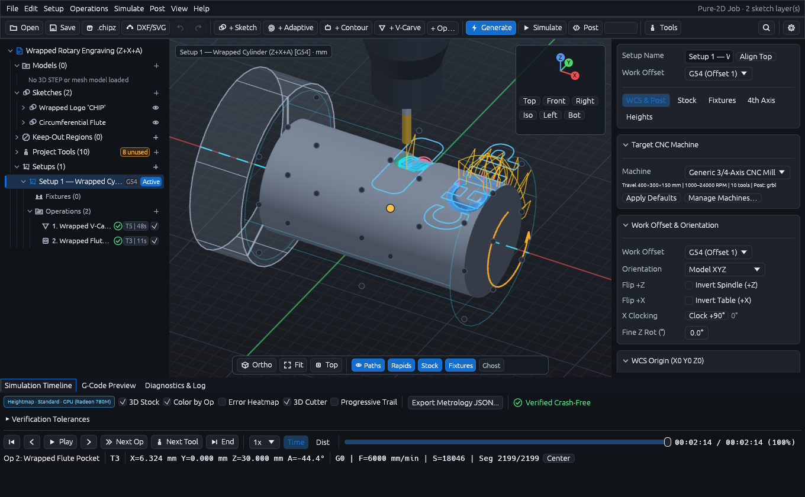
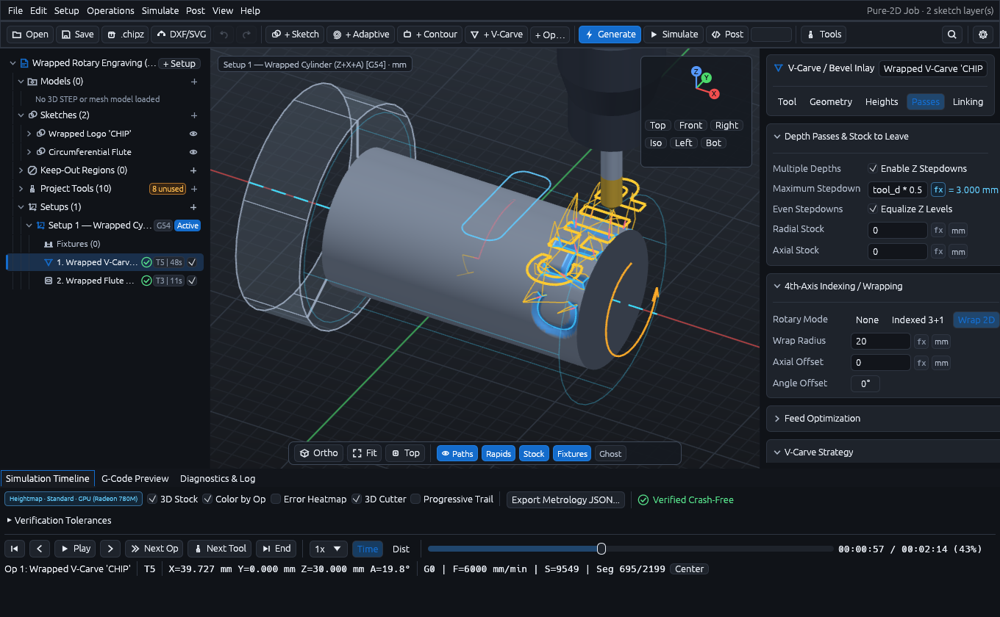
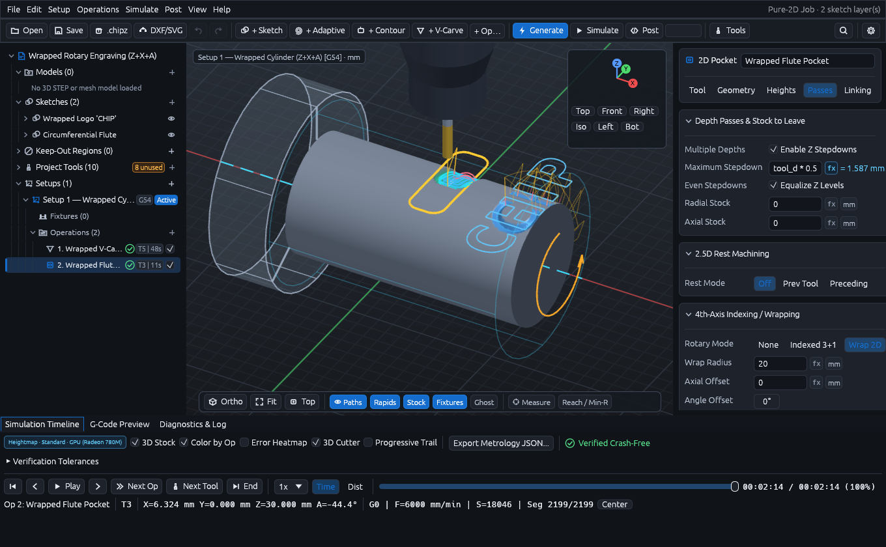

[<- Back to Sample Projects Gallery](README.md)

# Wrapped Rotary Engraving (`Z+X+A`)

**Category:** 4th-Axis Rotary (`A`-Axis) · **Setups:** 1 (`G54` Rotary) · **Operations:** 2

```bash
chip-gui --sample rotary-wrap
```



## Overview & What It Demonstrates

**Wrapped Rotary Engraving** maps flat 2D sketch geometry and TrueType typography directly onto the outer cylindrical surface of a `Ø40 × 80 mm` round bar (`WrapCylinder` mode) with strict cross-axis centerline locking (`Y = 0`):

- Works seamlessly with both true 4-axis **`G93` inverse-time** controllers (`linuxcnc_4axis`, `grblhal_4axis`) and 3-axis swapped-axis rotary routers (`grbl_rotary_wrap`).
- Combines wrapped **3D Medial-Axis V-Carving** of bold `"CHIP"` lettering with a wrapped circumferential **2D Pocket** flute.

Related step-by-step guide: [Tutorial 10 (4th-Axis Rotary Wrapping & Continuous Surfacing)](../tutorials/10-rotary-wrapping-surfacing.md).

---

## Progressive Operation-by-Operation Simulation

### Operation 1 — Wrapped V-Carve 'CHIP' (`3D V-Carve Wrapped`)
Wraps the TrueType `"CHIP"` medial-axis V-carve toolpath around the cylinder circumference with true radial Z plunge depth.



### Operation 2 — Wrapped Flute Pocket (`2D Pocket Wrapped`)
Machines a rounded circumferential groove around the opposite band of the cylindrical blank.


