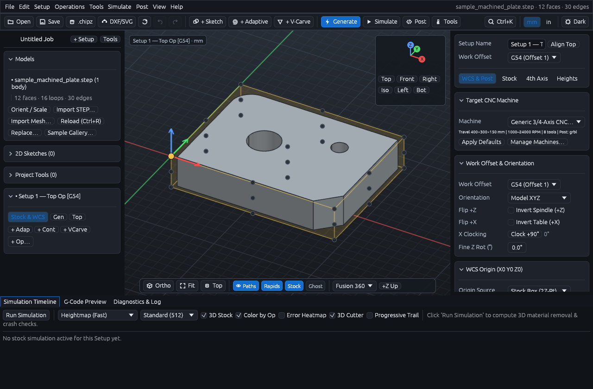

[<- Back to Sample Projects Gallery](README.md)

# CNC Mounting Plate (Blank STEP Sandbox)

**Category:** 3D STEP Solid · **Setups:** 1 (`G54`) · **Operations:** Sandbox (0 pre-seeded ops)

```bash
cargo run --release -p chip-gui -- --sample sample-plate
```



## Overview & What It Demonstrates

The **CNC Mounting Plate** is a clean, unseeded 3D STEP sandbox built specifically for practicing interactive CAM programming from scratch:

- **Zero clutter:** Starts with an empty `G54` Setup and no pre-seeded operations so you can practice selecting tools, picking planar pocket floors, expanding `+ Same Ø` cylindrical hole patterns, chaining outer contour loops, and configuring holding tabs yourself.
- **Analytic B-Rep picking:** Every planar face, closed edge loop, and cylindrical hole responds instantly to 3D viewport hover and click picking with automatic Z-top and Z-bottom inference.

Related step-by-step guide: [Tutorial 00 (Getting Started & Workspace Orientation)](../tutorials/00-getting-started.md).
