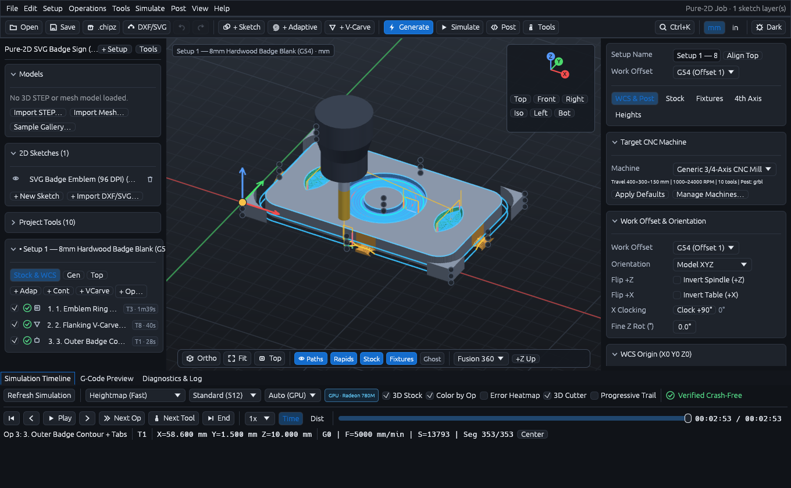
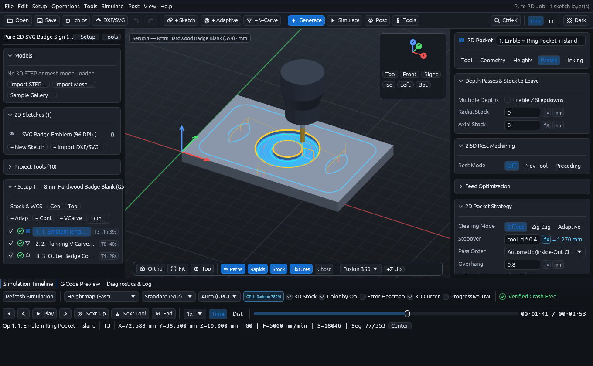
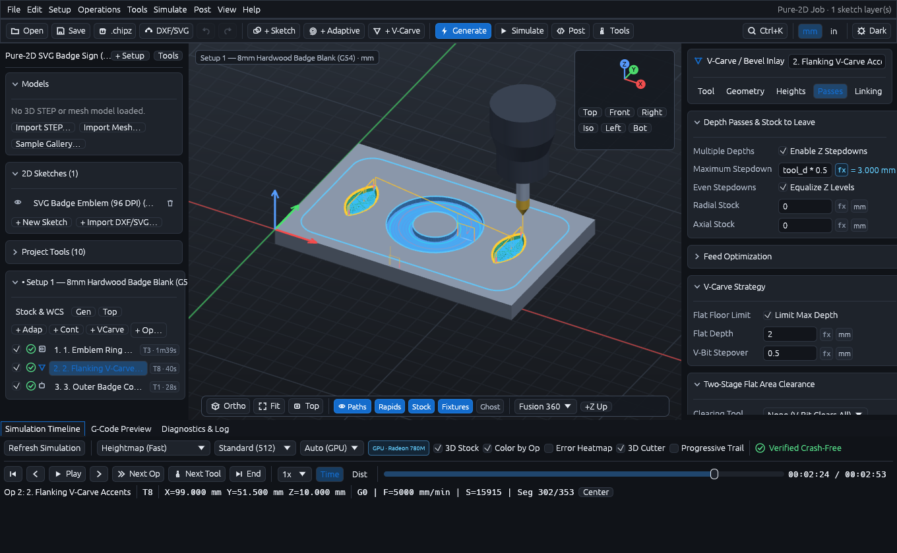
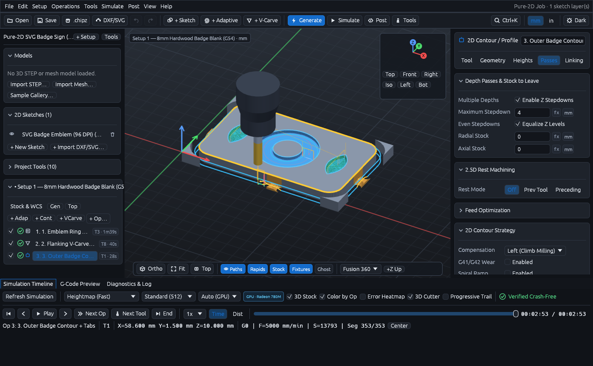

[<- Back to Sample Projects Gallery](README.md)

# Pure-2D SVG Badge Sign (`96 DPI` Bézier Biarcs)

**Category:** Pure-2D & DXF / SVG · **Setups:** 1 (`G54`) · **Operations:** 3

```bash
chip-gui --sample svg-badge
```



## Overview & What It Demonstrates

This zero-STEP Pure-2D router/engraving project imports W3C **SVG** vector artwork (`13-badge-logo.svg`, `96 DPI`) directly onto an `8.0 mm` hardwood sheet blank and converts every cubic Bézier curve into exact circular **biarcs** so CNC controllers receive smooth `G2`/`G3` moves instead of faceted polyline chords:

| Property | Value |
|---|---|
| **Source Artwork** | `96 DPI` W3C `.svg` (`EMBLEM_POCKET`, `VCARVE_ACCENT`, `OUTLINE` sub-layers) on `8.0 mm` hardwood sheet stock (`6 mm` side margin) |
| **Arc Preservation** | Cubic Bézier curves fitted to exact `ArcPolyline2D` biarcs -> true `G2`/`G3` arc G-code in GRBL & LinuxCNC |
| **Cutters Used** | `Ø3.175 mm` (`1/8"`) Flat Endmill, `60°` V-Bit, `Ø6 mm` Flat Endmill |
| **Island Nesting** | Automatic even-odd counter-island preservation inside the annular emblem pocket |

- **Sub-Layer Batch Mapping:** Maps imported SVG groups (`EMBLEM_POCKET`, `VCARVE_ACCENT`, `OUTLINE`) straight to 2D Pocket, 3D V-Carve, and 2D Contour + Tabs operations with zero manual contour re-selection.
- **Smooth `G2`/`G3` Biarcs:** Both the annular badge ring pocket and the `R10`-filleted outer badge contour emit native circular arc moves on GRBL and LinuxCNC posts.

Related step-by-step guide: [Tutorial 13 (Pure-2D DXF / SVG Vector Import & Portable `.chipz` Bundles)](../tutorials/13-pure2d-dxf-svg-workflow.md).

---

## Progressive Operation-by-Operation Simulation

### Operation 1 — Emblem Ring Pocket + Island (`2D Pocket`)
Pockets the recessed annular emblem ring `2.5 mm` deep using the `Ø3.175 mm` flat endmill while automatically preserving the nested interior circular counter-island.



### Operation 2 — Flanking V-Carve Accents (`3D V-Carve`)
Carves the flanking decorative SVG accents with the `60°` V-bit using 3D medial-axis corner climbs for razor-sharp points.



### Operation 3 — Outer Badge Contour + Tabs (`2D Contour`)
Profiles the curved outer badge border through the full `8.0 mm` sheet in `4.0 mm` stepdowns with the `Ø6 mm` flat endmill while leaving `25°` triangular ramped holding tabs to secure the finished sign.



---

## Headless CLI Equivalent

```bash
# Generate the starter .svg artwork, import into a Pure-2D job, & build verified G-code
chipcutter generate-sample-step /tmp/13-badge-logo.svg --tutorial 13-pure2d-svg
chipcutter inspect /tmp/13-badge-logo.svg
chipcutter import-2d /tmp/13-badge-logo.svg -o /tmp/svg_badge.chip.toml --thickness 8.0 --svg-dpi 96
```
