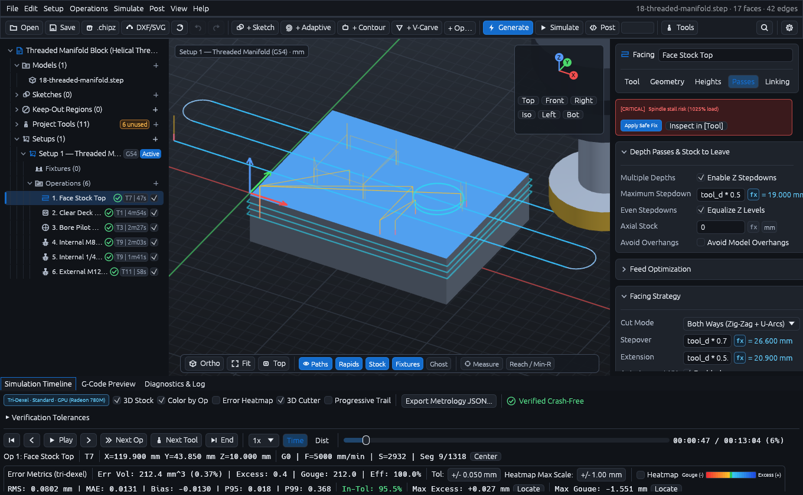
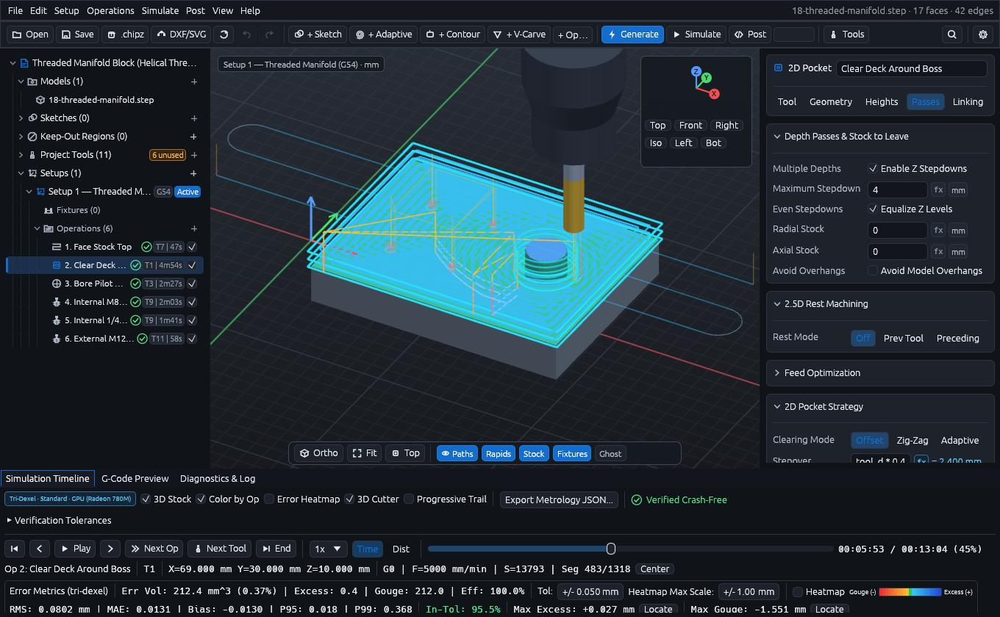
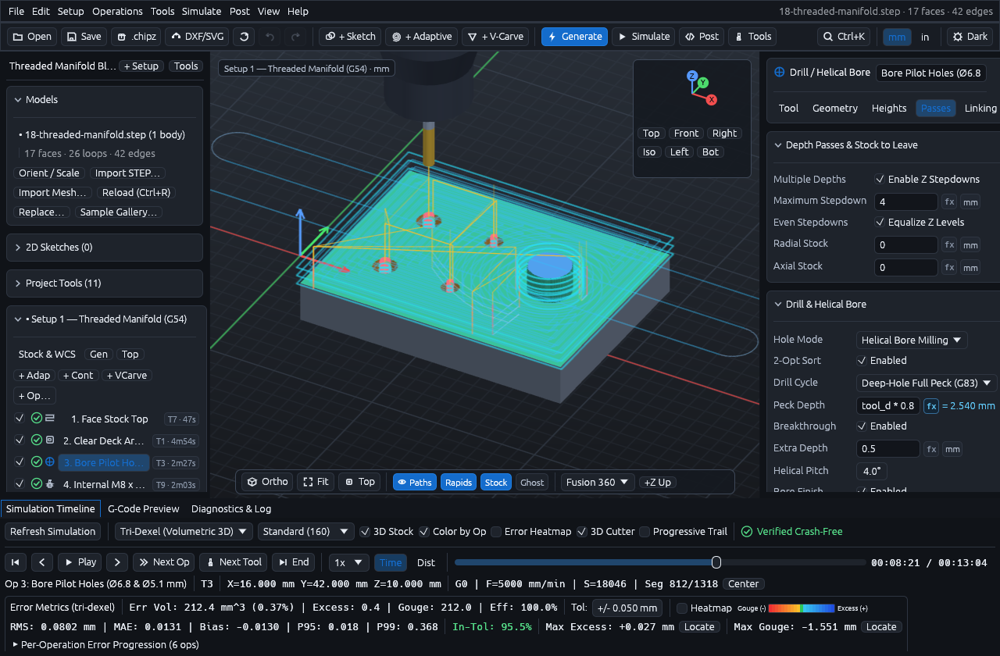
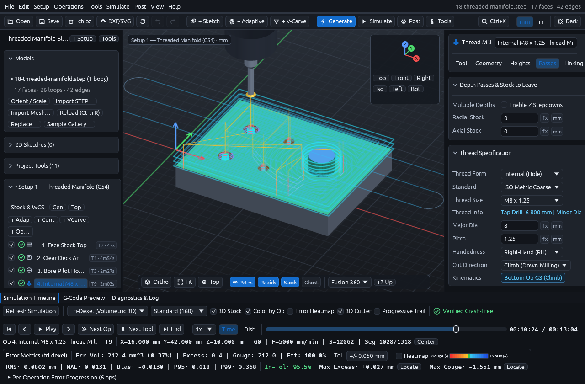
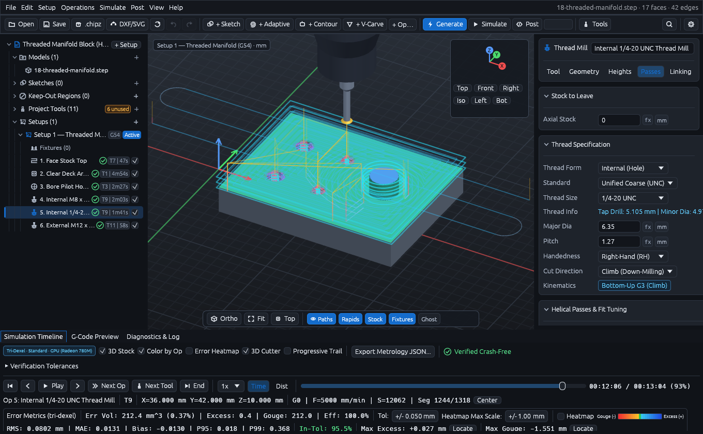
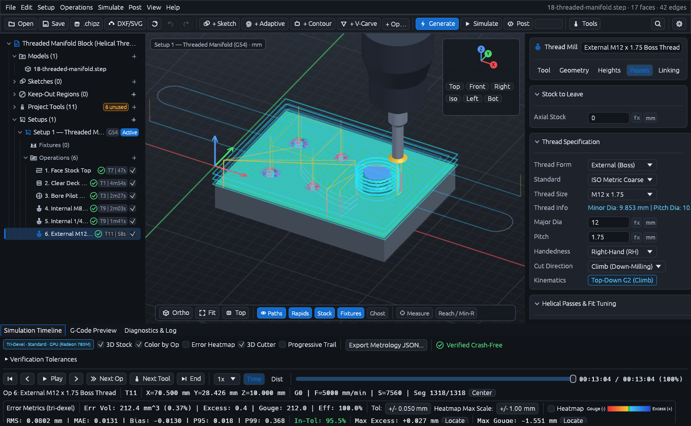

[<- Back to Sample Projects Gallery](README.md)

# Threaded Manifold Block (Helical Thread Milling)

**Category:** 3D STEP Solids · **Setups:** 1 (`G54`) · **Operations:** 6

```bash
chip-gui --sample thread-mill
```


## Overview & What It Demonstrates

This `80 × 60 × 20 mm` aluminum manifold block showcases ChipCutter's complete **Helical Thread Milling** workflow from raw rectangular billet to verified internal and external threads:

- **Built-In ISO Metric & Unified Presets:** Combines internal **`M8 × 1.25`** (`Ø6.80 mm` pilot), internal **`1/4-20 UNC`** (`Ø5.11 mm` pilot), and external **`M12 × 1.75`** threading around a proud `Ø12.0 mm` circular boss in one `G54` setup.
- **Automatic Climb Kinematics & Centerline Feed Compensation:** Emits **Bottom-Up `G3` (Climb)** helical passes with centerline tangent arc-in/out for internal right-hand bores, **Top-Down `G2` (Climb)** passes with external tangent leads for the circular boss, equal-area radial roughing passes, spring passes, and automatic arc-curvature feedrate compensation.
- **True 3D Undercut Verification:** Verified crash-free in both fast Heightmap and **Tri-Dexel (Volumetric 3D)** simulation with smooth **Simulation Mesh Skinning** (configured in **`Settings → Simulation`** via `Ctrl+,` or the Simulation Timeline status chip), displaying real helical undercut grooves and checking relieved-neck tool clearance.

Related step-by-step guide: [Tutorial 18 (Helical Thread Milling)](../tutorials/18-thread-milling.md).

---

## Progressive Operation-by-Operation Simulation

### Operation 1 — Face Stock Top (`Facing`)
Decks `1.0 mm` off the top of the `80 × 60 × 21 mm` aluminum billet using the `Ø38 mm` 3-insert face mill (`T7`) to establish a clean `Z = 20.0 mm` datum flush with the top of the circular boss.



### Operation 2 — Clear Deck Around Boss (`2D Pocket`)
Clears the open manifold deck from `Z = 20.0 mm` down to `Z = 12.0 mm` using the `Ø6 mm` flat endmill (`T1`), leaving the proud `Ø12.0 mm × 8.0 mm` circular hose-fitting boss standing at net dimension.



### Operation 3 — Bore Pilot Holes (`Drill / Bore` — Helical Bore)
Helically bores both `Ø6.80 mm` (`M8 × 1.25` tap drill) and `Ø5.11 mm` (`1/4-20 UNC` `#7` tap drill) through-holes to exact nominal pilot diameter in a single operation using the `1/8 in` flat endmill (`T3`).



### Operation 4 — Internal `M8 × 1.25` Thread Mill (`Helical Thread Mill`)
Cuts two internal `M8 × 1.25` right-hand threads using the `Ø4.75 mm` single-point `60°` thread mill (`T9`) with bottom-up climb (`G3`) helical interpolation, `2` equal-area radial passes, and `1` spring pass.



### Operation 5 — Internal `1/4-20 UNC` Thread Mill (`Helical Thread Mill`)
Reuses the same `Ø4.75 mm` single-point thread mill (`T9`) to cut two internal `1/4-20 UNC` right-hand threads (`Pitch = 1.270 mm`) inside the `Ø5.11 mm` pilot bores with bottom-up climb (`G3`) passes and centerline feed compensation.



### Operation 6 — External `M12 × 1.75` Boss Thread (`Helical Thread Mill`)
Cuts external `M12 × 1.75` threads around the proud `Ø12.0 mm` circular boss using the `Ø8.0 mm` single-point `60°` thread mill (`T11`) with top-down climb (`G2`) helical interpolation, smooth `90°` external tangent arc-in/arc-out transitions, and `1.0 mm` axial deck relief.


