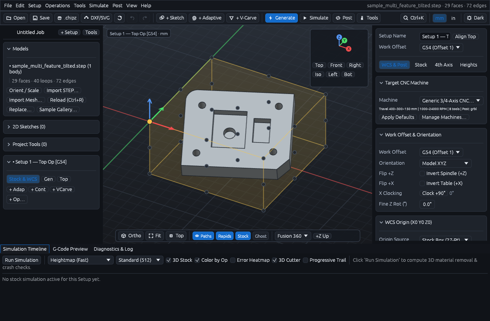

[<- Back to Sample Projects Gallery](README.md)

# 30°-Tilted WCS Alignment Bracket

**Category:** 3D STEP Solid · **Setups:** 1 (`G54`) · **Operations:** Sandbox (0 pre-seeded ops)

```bash
cargo run --release -p chip-gui -- --sample tilted-bracket
```



## Overview & What It Demonstrates

Imported CAD parts frequently arrive exported in an assembly coordinate system rather than flat on your CNC vise parallels. This unseeded STEP sandbox loads a prismatic bracket tilted **`30°` around X and `25°` around Z** so you can practice **Setup WCS SE(3) alignment** and **Model Transform** workflows:

- **Setup WCS Alignment (`Setup -> WCS & Post`):** Switch **Orientation** to **`Select Z & X Axes`** or **`Select XY Plane`**, click the tilted top face to snap `+Z` perpendicular to the part, click a straight side edge for `+X`, and watch the translucent raw stock bounding box snap tightly around the aligned bracket.
- **27-Point Origin Datum Picker:** Click any of the 27 stock/model anchor dots (top corners, mid-edges, top center, or vise-jaw bottom corners) to place `X0 Y0 Z0` right where your edge finder or touch probe zeros on the mill.
- **Non-Destructive Model Transform (`Models -> Lay Flat on Clicked Face...`):** Alternatively, lay the solid flat in world coordinates while keeping associative `Ctrl+R` reload intact.

Related step-by-step guide: [Tutorial 16 (Rotating, Laying Flat, Scaling, & Moving STEP & STL Models)](../tutorials/16-model-orientation-positioning.md).
