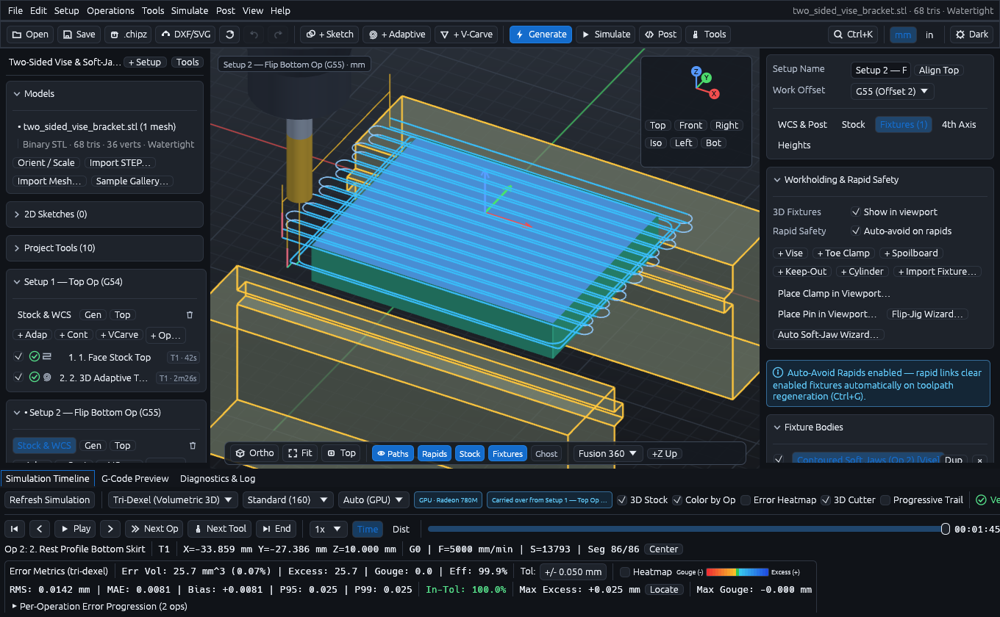
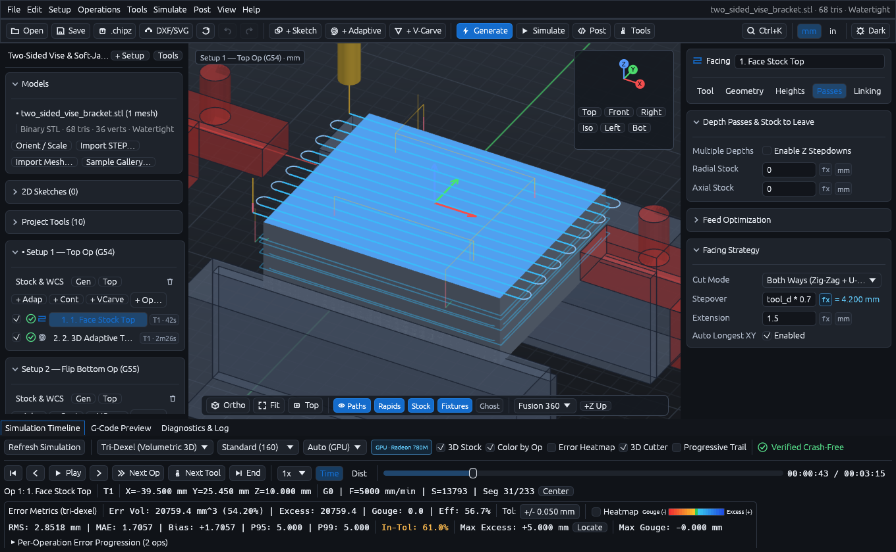
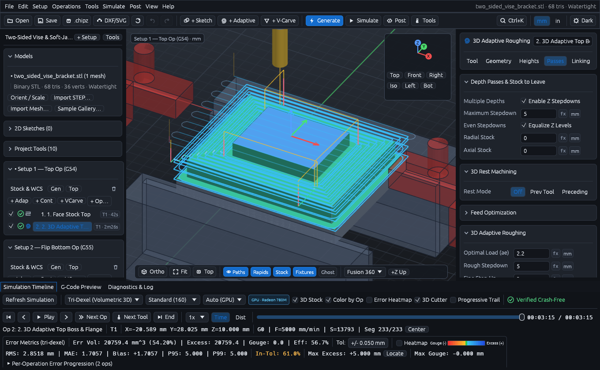
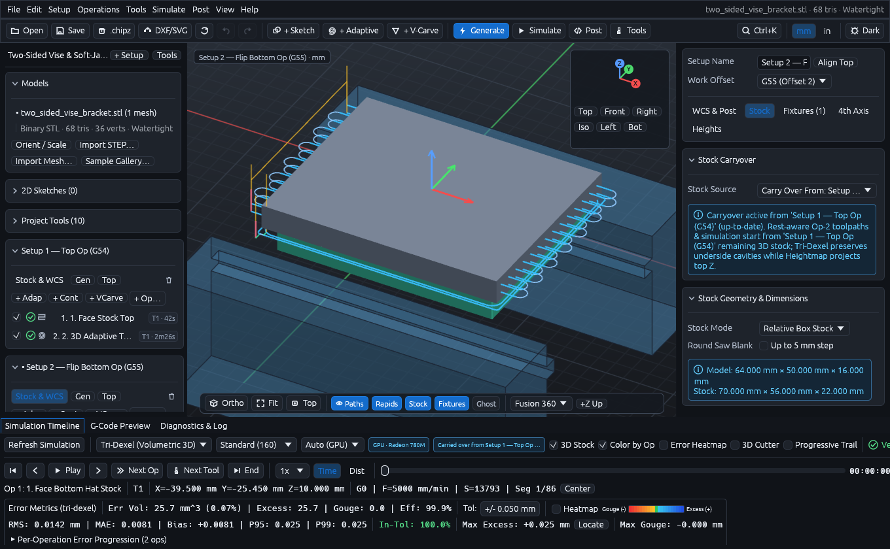
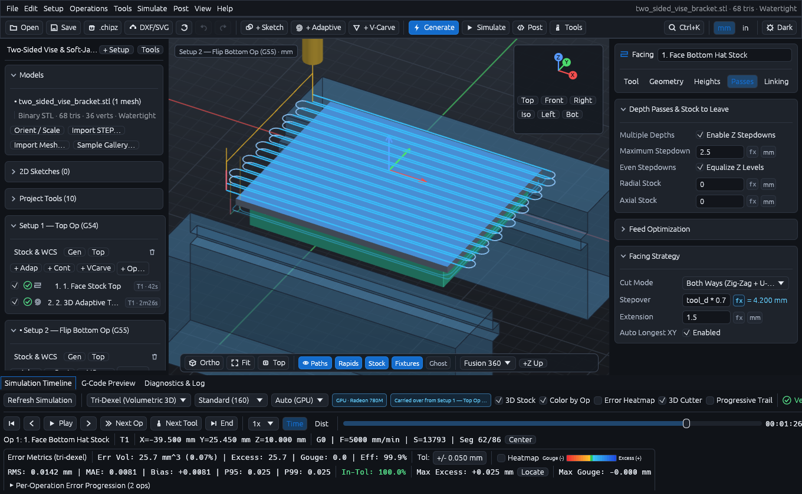
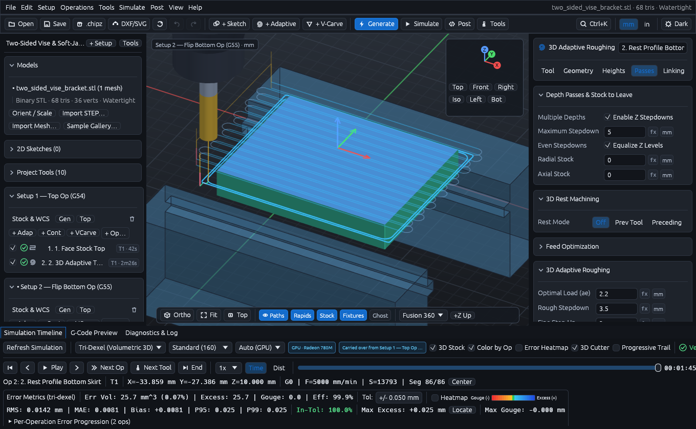

[<- Back to Sample Projects Gallery](README.md)

# Two-Sided Vise & Soft-Jaw Bracket (`G54` -> `G55`)

**Category:** Workholding & Multi-Setup Stock Carryover · **Setups:** 2 (`G54` Top Op + `G55` Flipped Bottom Op) · **Operations:** 4

```bash
chip-gui --sample two-sided-vise
```



## Overview & What It Demonstrates

This two-setup shop-floor workholding showcase machines a watertight `64 × 50 × 16 mm` stepped aluminum bracket (`64 × 50 × 10 mm` lower flange + centered `36 × 28 × 6 mm` upper boss) from a `70 × 56 × 22 mm` raw billet (`1.0 mm` top facing allowance, `5.0 mm` bottom hat stock) with **full 3D fixture collision verification** and **multi-setup Tri-Dexel stock carryover**:

| Property | Setup 1 — Top Op (`G54`) | Setup 2 — Flip Bottom Op (`G55`) |
|---|---|---|
| **Workholding Fixtures** | `Machinist Vise + Parallels` (`4.5 mm` grip) + 2× `End Toe Clamps` (`+X` / `-X` with `14 mm` stud towers) | `Contoured Soft Jaws (Op 2)` (`4.0 mm` step shelf, `7.0 mm` grip) |
| **Stock Source** | Raw `70 × 56 × 22 mm` billet | **Carried Over from Setup 1** (`180°` flip around WCS X) |
| **Tooling** | `Ø6 mm` Flat Endmill (`T1`) | `Ø6 mm` Flat Endmill (`T1`) |
| **Safety & Avoidance** | **Auto-Avoid Fixtures on Rapids** + Rule 6 `FixtureCollision` (`0` crashes) | Rest-aware skirt clearing skips already-machined Op-1 air (`0` crashes) |

- **Automatic Safe-Rapid Lifting (`Auto-Avoid Fixtures`):** Setup 1 automatically inspects every `G0` rapid and stay-down link against the vise jaws and tall toe-clamp studs (accounting for flute, shank, and holder clearance) and lifts safely over hardware without altering cutting passes.
- **Exact Volumetric Stock Carryover (`G54` -> `G55`):** Setup 2 initializes at `t = 0.0` from Setup 1's exact flipped Tri-Dexel solid rather than a fresh rectangular billet—so Op 2.2 clears only the remaining `2.0 mm` bottom flange skirt without air-cutting finished Op-1 walls or colliding with the stepped soft jaws.

Related step-by-step guide: [Tutorial 19 (Two-Sided Flip Workholding, 3D Fixtures, & Auto Soft Jaws)](../tutorials/19-workholding-flip-jigs-soft-jaws.md).

---

## Progressive Setup & Operation Simulation

### Setup 1 (`G54`) — Operation 1: Face Stock Top (`Facing`)
Decks `1.0 mm` off the top of the raw billet down to `ModelTop` using the `Ø6 mm` flat endmill (`T1`) while held in the machinist vise + parallels flanked by both end toe clamps.



### Setup 1 (`G54`) — Operation 2: 3D Adaptive Top Boss & Flange (`3D Adaptive`)
Machines the upper centered boss and flange step down to `ModelBottom + 2.0 mm` (leaving a clean `2.0 mm` safety skirt above the `5.0 mm` vise-gripped hat stock) with automatic safe-rapid lifts over the end toe clamps.



### Setup 2 (`G55`) — `t = 0.0` Carried-Over Stock (`FromPrecedingSetup`)
After flipping the workpiece `180°` around WCS X into the contoured stepped soft jaws, Setup 2 starts at `t = 0.0` with Setup 1's real machined Tri-Dexel solid inverted—showing the `5.0 mm` bottom hat stock standing proud on top while the finished Op-1 boss sits nested inside the jaws.



### Setup 2 (`G55`) — Operation 1: Face Bottom Hat Stock (`Facing`)
Removes the `5.0 mm` bottom hat stock in two `2.5 mm` stepdowns cleanly down to the flipped `ModelTop` datum.



### Setup 2 (`G55`) — Operation 2: Rest Profile Bottom Skirt (`3D Adaptive`)
Uses the carried-over Tri-Dexel solid to clear strictly the remaining `2.0 mm` flange skirt around the perimeter, skipping the `14 mm` already finished in Setup 1 and staying safely clear of the stepped soft jaws below.



---

## Headless CLI Verification

```bash
# Inspect fixtures and verify multi-setup Tri-Dexel carryover + Rule 6 FixtureCollision
chipcutter workholding list project.chip.toml
chipcutter simulate project.chip.toml --all-setups --engine tri-dexel --report /tmp/two_sided_report.json
chipcutter build project.chip.toml -o /tmp/out_two_sided --post linuxcnc
```
