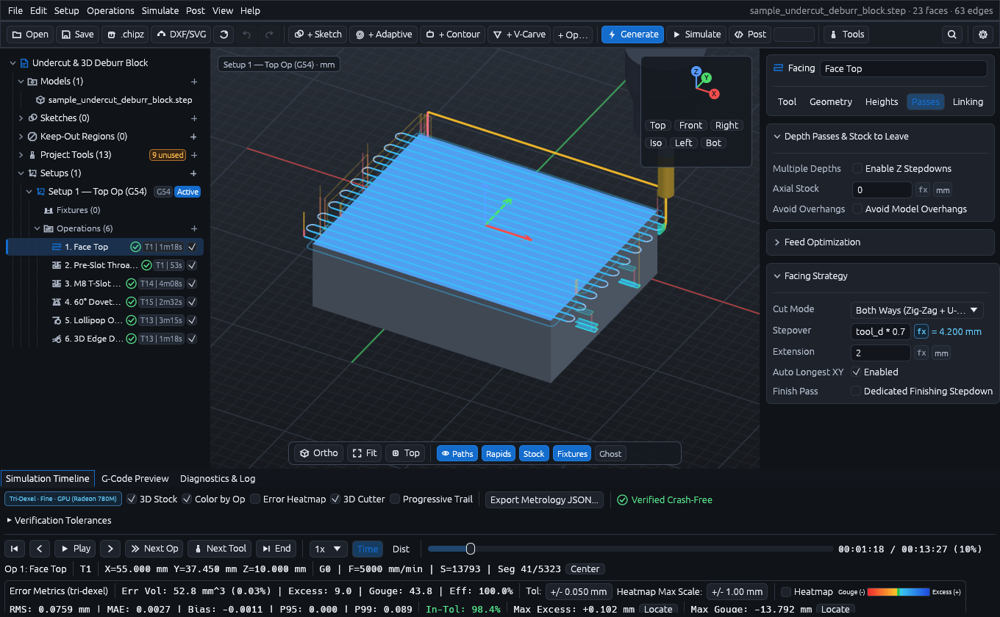
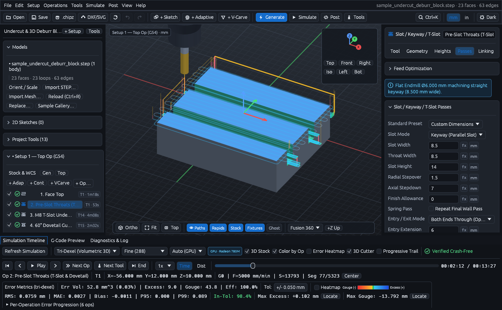
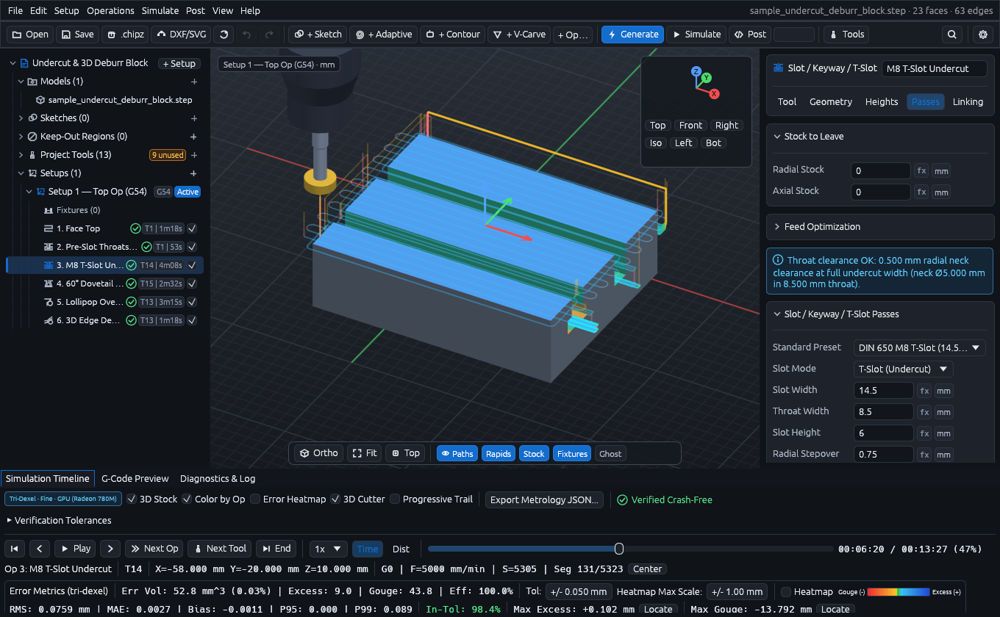
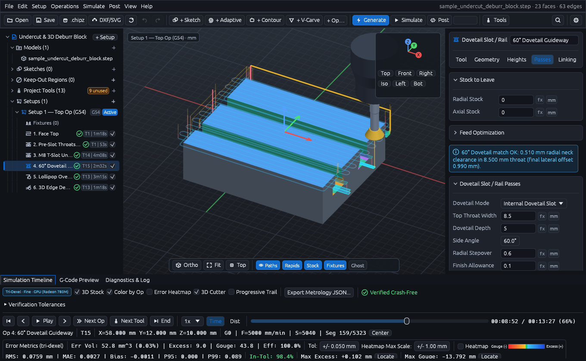
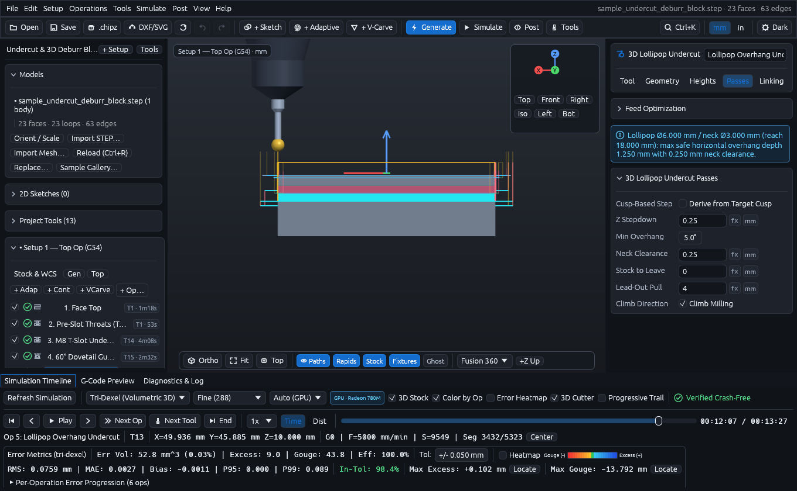
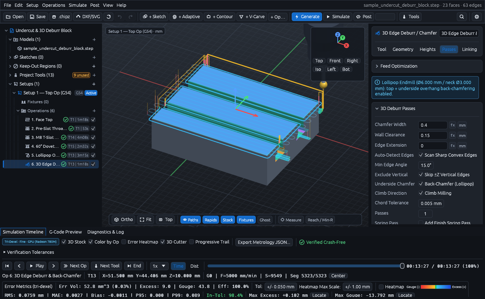

[<- Back to Sample Projects Gallery](README.md)

# Undercut & 3D Deburr Block (T-Slot, Dovetail, Lollipop)

**Category:** Undercuts & 3D Edge Deburring · **Setups:** 1 (`G54`) · **Operations:** 6

```bash
chip-gui --sample undercut-deburr
```


## Overview & What It Demonstrates

This `100 × 80 × 28 mm` aluminum manifold/fixture block exercises ChipCutter's entire **undercut milling and 3D edge deburring** suite in a single crash-free `G54` Setup verified in volumetric **Tri-Dexel** simulation:

| Property | Value |
|---|---|
| **Part & Stock** | `100 × 80 × 28 mm` STEP block machined from `100 × 80 × 29 mm` raw billet (`1.0 mm` top facing allowance) |
| **Undercut Features** | DIN 650 **M8 T-Slot** (`Y = 20 mm`), **`60°` Dovetail Guideway** (`Y = 52 mm`), **`+Y` Concave Overhang Groove** (`Z = 19.8..24.5 mm`) |
| **Cutters Used** | `Ø6 mm` Flat Endmill, `Ø12 × 4 mm` Slot/T-Slot Mill, `Ø12 mm 60°` Dovetail Cutter, `Ø6 mm` Lollipop Endmill |
| **Simulation Engine** | Volumetric **Tri-Dexel** with smooth **Mesh Skinning** (`Settings → Simulation`, `Ctrl+,`; CPU & GPU compute parity, `0` critical errors, `>= 98%` In-Tol) |

- **Mandatory Throat Pre-Clearing:** Clears both `8.5 mm` vertical throats down to `Z = 14.0 mm` with a flat endmill before any relieved-neck undercut tool enters—preventing shank/neck crashes and ensuring realistic chip evacuation.
- **True 3D Undercut Strategies & `[Geometry]` Boundary Controls:** Combines `SlotUndercut` (DIN 650 M8 T-Slot preset with spring pass), `Dovetail` (progressive lateral stepovers to `60°` flanks), `Undercut3D` (upper-hemisphere Lollipop overhang finishing with automatic neck-ceiling clipping), and `Deburr3D` (auto-detected top edges plus underside overhang back-chamfering)—both `Undercut3D` and `Deburr3D` expose the unified **`[Geometry]` → `Cutting Area / Machining Boundary`** card with live 3D boundary previews.

Related step-by-step guides: [Tutorial 22 (Undercut Milling: Keyways, T-Slots, Dovetails, & Lollipop 3D Undercuts)](../tutorials/22-undercut-tslot-dovetail-lollipop.md) and [Tutorial 21 (3D Edge Deburring & Non-Planar Chamfering)](../tutorials/21-3d-edge-deburring-nonplanar-chamfering.md).

---

## Progressive Operation-by-Operation Simulation

### Operation 1 — Face Top (`Facing`)
Decks `1.0 mm` off the raw aluminum block (`StockTop -> ModelTop`) using the `Ø6 mm` flat endmill to establish the clean `Z = 28.0 mm` top datum.



### Operation 2 — Pre-Slot Throats (T-Slot & Dovetail) (`Slot Undercut` — Keyway)
Clears both `8.5 mm` wide vertical throats down to `Z = 14.0 mm` in two `7.0 mm` axial levels (`BothEndsThrough` entry/exit) so the subsequent T-slot and dovetail cutters can enter horizontally through open air.



### Operation 3 — M8 T-Slot Undercut (`Slot Undercut` — DIN 650 M8)
Cuts the `14.5 mm` wide lower T-slot cavity using the relieved-neck `Ø12 × 4 mm` Slot Mill (`0.75 mm` radial stepover, `0.15 mm` finish allowance, and `1` spring pass), always exiting horizontally past stock bounds before retracting `+Z`.



### Operation 4 — 60° Dovetail Guideway (`Dovetail` — Internal Slot)
Stepped lateral roughing (`0.6 mm` stepover) plus a `0.1 mm` finish pass and spring pass with the `Ø12 mm 60°` Dovetail Cutter forms the symmetric internal dovetail guideway flanks without exceeding relieved-neck clearance.



### Operation 5 — Lollipop Overhang Undercut (`3D Undercut` — Lollipop)
Uses the upper hemisphere of the `Ø6 mm` Lollipop Endmill (`0.25 mm` Z-stepdowns, `0.25 mm` neck clearance) to machine the concave `+Y` side overhang groove cleanly below the upper lip (viewed from the `+Y` back side).



### Operation 6 — 3D Edge Deburr & Back-Chamfer (`3D Edge Deburr`)
Auto-detects all sharp top perimeter, slot-throat, and underside overhang lip edges (`>= 15°` dihedral, excluding vertical corners) and breaks them with a uniform `0.4 mm` chamfer using the `Ø6 mm` Lollipop Endmill.



---

## Headless CLI Verification

```bash
# Generate the matching starter STEP solid & verify Tri-Dexel undercut metrology
chipcutter generate-sample-step /tmp/undercut_block.step --tutorial 22-undercut-block
chipcutter simulate project.chip.toml --engine tri-dexel --backend gpu --resolution fine --report /tmp/undercut_report.json
chipcutter build project.chip.toml -o /tmp/out_undercut --post linuxcnc
```
