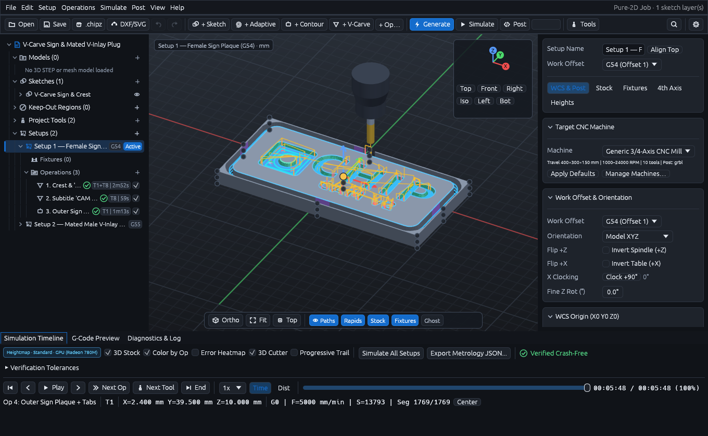
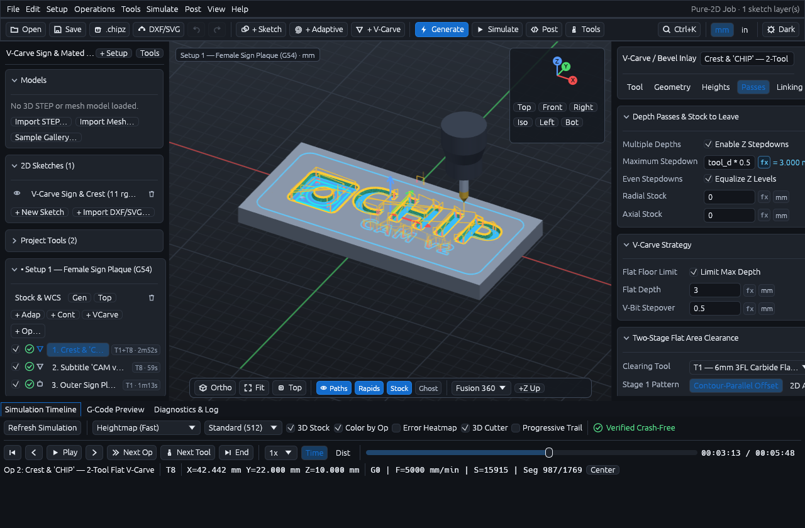
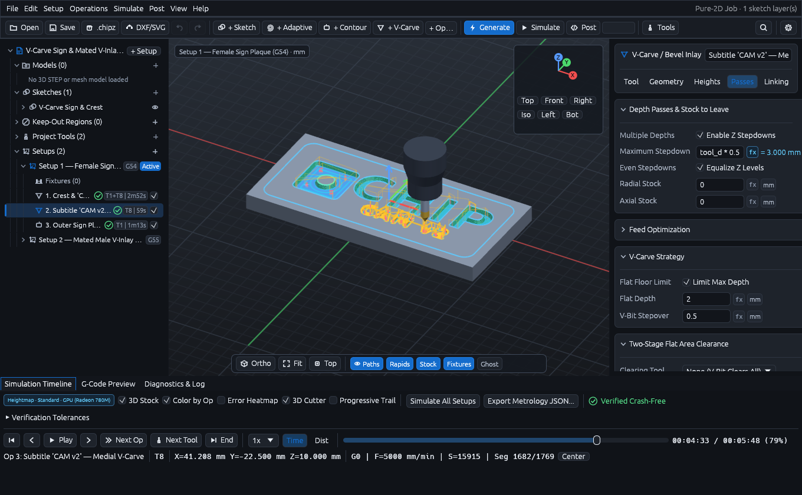
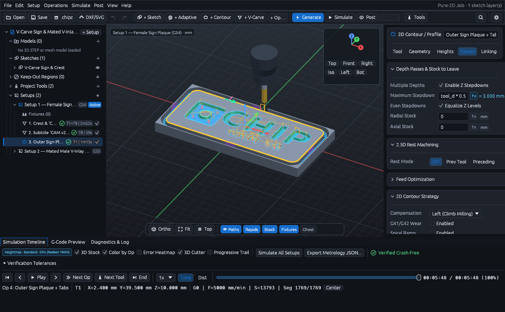
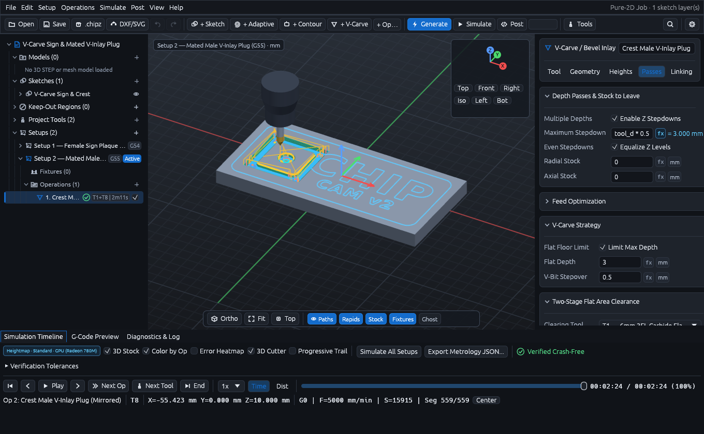

[<- Back to Sample Projects Gallery](README.md)

# V-Carve Sign & Mated Male V-Inlay

**Category:** V-Carve & CAM Typography · **Setups:** 2 (`G54` Female Sign Plaque + `G55` Male V-Inlay Plug) · **Operations:** 4

```bash
chip-gui --sample vcarve
```



## Overview & What It Demonstrates

This two-setup woodworking / hardwood sign sample demonstrates ChipCutter's **3D Medial-Axis V-Carving**, **Two-Stage Flat Area Clearance**, and **Mated Male V-Inlay Plug** generation:

- **Setup 1 (`G54` — Female Sign Plaque):**
  - Uses a `Ø6 mm` flat endmill for Stage 1 bulk flat-floor pocketing inside wide strokes, followed by a `60°` V-bit for Stage 2 razor-sharp 3D medial-axis bevels and corner climbs.
  - Carves full-depth variable-Z medial-axis subtitle text (`"CAM v2"`) and cuts the outer filleted sign plaque with triangular ramped holding tabs.
- **Setup 2 (`G55` — Mated Male V-Inlay Plug):**
  - Switch the **Active Setup** (`Active` badge in the CAM Browser) to `G55` to inspect and simulate the mirrored plug: automatically mirrors the crest and lettering across X and offsets the bevel engagement (`start_depth = 2.0 mm`, `glue_gap_bottom = 1.0 mm`) to machine a contrasting hardwood plug that glues seamlessly into the Setup 1 female cavity.

Related step-by-step guide: [Tutorial 07 (3D V-Carving, Two-Tool Flat Clearance, & Mated V-Inlays)](../tutorials/07-vcarve-inlays.md).

---

## Progressive Setup & Operation Simulation

### Setup 1 (`G54`) — Operation 1: Crest & 'CHIP' — 2-Tool Flat V-Carve (`3D V-Carve`)
Runs Stage 1 flat endmill area clearance at `d_flat` followed by Stage 2 `60°` V-bit beveling and sharp 3D corner climbs.



### Setup 1 (`G54`) — Operation 2: Subtitle 'CAM v2' — Medial V-Carve (`3D V-Carve`)
Carves the smaller subtitle text via pure Voronoi medial-axis 3D bisectors where depth varies naturally with stroke width.



### Setup 1 (`G54`) — Operation 3: Outer Sign Plaque + Tabs (`2D Contour`)
Profiles the filleted exterior sign border with triangular ramped holding tabs that break away cleanly.



### Setup 2 (`G55`) — Operation 1: Crest Male V-Inlay Plug (Mirrored) (`3D V-Carve Male Inlay`)
Machines the mirrored contrasting-wood Male V-Inlay plug with proud beveled walls and glue/saw-kerf clearance ready for press-fit gluing into Setup 1.


