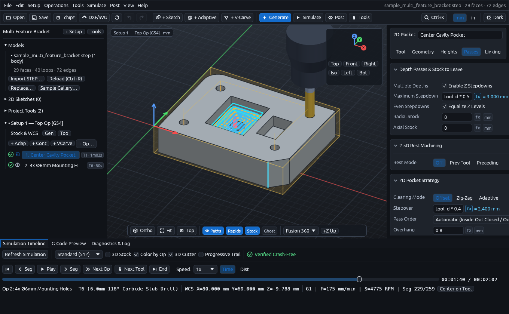
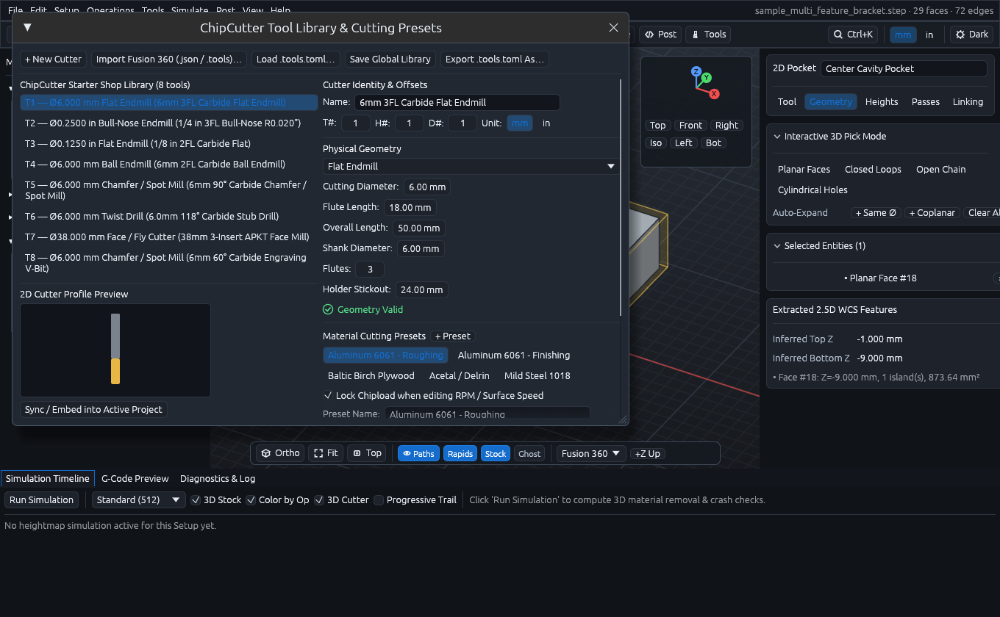
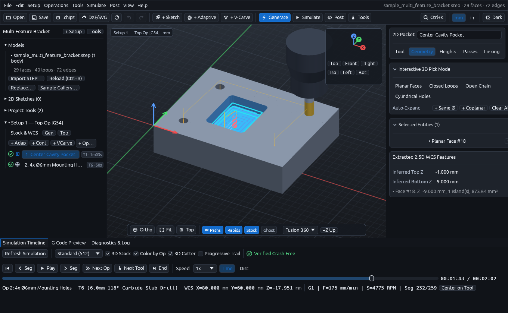

# Tutorial 00 — Getting Started & Workspace Orientation

## 1. Goal & What You'll Learn

By the end of this walkthrough, you will know how to:

- Launch **ChipCutter** and open a built-in starter sample or your own `.step`, `.dxf`, or `.svg` file.
- Navigate the 3D/2D `wgpu` viewport, camera presets, and dockable workspace panes.
- Configure a **Setup's Stock, Work Coordinate System (`G54` WCS), and Z-height planes**.
- Inspect cutters, material presets, and **parametric machinist expressions** (`tool_d * 0.4`, `1/4 in`).
- Generate toolpaths (`Ctrl+G`), verify material removal and collision safety in **3D Simulation**, and export **GRBL** or **LinuxCNC** G-code.
- Reproduce the exact same build pipeline headlessly with the `chipcutter` CLI.

---

## 2. Launching ChipCutter & Opening a Starter Job

Start the desktop CAM workspace from the repository root:

```bash
cargo run --release -p chip-gui
```

On a fresh launch with no file argument, ChipCutter opens the **Welcome to ChipCutter** quick-start overlay:


From the Welcome Overlay you can:
- **Open Project or Portable Bundle…** (`Ctrl+O`) to load an existing `.chip.toml` or self-contained `.chipz` archive.
- **Import 3D STEP Solid…** to load an ISO 10303-21 `.step` / `.stp` model and initialize a `G54` Setup.
- **Import 2D DXF / SVG Artwork…** to preview physical scale, heal micro-gaps, and start a Pure-2D job.
- **New Pure-2D Parametric Sketch** to design directly on blank sheet stock without an external CAD file.
- **Browse Sample Projects Gallery…** to explore ready-to-machine 3D STEP, Adaptive + Rest, Typography, and V-Carve jobs.

> [!TIP]
> You can switch between **Studio Dark** and **Daylight Light** themes at any time using the top-right **Dark / Light** toggle (or `--theme light` on launch). Your preference persists automatically in `~/.config/chipcutter/prefs.toml`.

Click **Browse Sample Projects Gallery…** (or `Help → Sample Projects Gallery…` at any time):


Use the category pills (`All Samples`, `3D STEP Solids`, `Pure-2D & DXF`, `V-Carve & Text`) or the search box to filter demos. For this orientation guide, select **Prismatic Multi-Feature Bracket** and click **Open Sample** (or launch it directly with `cargo run --release -p chip-gui -- --sample multi-feature`).

---

## 3. Workspace Anatomy & Viewport Navigation

Once **Prismatic Multi-Feature Bracket** (`90 × 70 × 20 mm`) is loaded and generated (`Ctrl+G`), the workspace is organized into four dockable zones plus a single-row top toolbar:



### Workspace Regions

1. **Top Menu & Single-Row Workflow Toolbar:**
   - Left cluster: `Open`, `Save`, `.chipz` portable export, `DXF/SVG` import, `Reload`, and Undo/Redo (`Ctrl+Z` / `Ctrl+Y`).
   - Middle cluster: Quick-add `+ Sketch`, `+ Adaptive`, `+ V-Carve`, plus primary workflow actions **`Generate`** (`Ctrl+G`), **`Simulate`**, **`Post`**, and **`Tools`**.
   - Right cluster: **`Ctrl+K` Command Palette**, Display Units (`mm` / `in`), and Theme toggle (`Dark` / `Light`).
2. **CAM Browser (Left Pane):**
   - **Models:** Loaded STEP body summary (`29 faces · 40 loops · 72 edges`) with `Import STEP…`, `Reload (Ctrl+R)`, `Replace…`, and `Sample Gallery…`.
   - **2D Sketches:** Parametric or imported 2D vector layers.
   - **Project Tools:** Tools embedded in this `.chip.toml` project.
   - **Setup 1 — Top Op [G54]:** Stock & WCS node followed by ordered machining operations (`1. Center Cavity Pocket`, `2. 4x Ø6mm Mounting Holes`), each displaying a status badge, strategy icon, tool badge (`T1`, `T6`), and estimated cycle time.
3. **3D / 2D CAD Viewport (Center Pane):**
   - **ViewCube (Top-Right):** Click `Top`, `Front`, `Right`, `Iso`, `Left`, or `Bot` to snap the camera.
   - **Floating View HUD (Bottom-Center):** Toggle `Ortho`/`Persp` (`P`), `Fit` (`F`), `Top`, layer visibility (`Paths`, `Rapids`, `Stock`, `Ghost`), mouse preset (`Fusion 360`, `SolidWorks`, `FreeCAD/Blender`), and orbit mode (`+Z Up` Turntable vs. Free Trackball).
4. **Inspector (Right Pane):** Context-sensitive two-column property cards for whichever Setup, Operation, or 2D Sketch is focused in the Browser.
5. **Bottom Docked Tabs:** Switch between **`Simulation Timeline`**, **`G-Code Preview`**, and **`Diagnostics & Log`**.

### Essential Keyboard & Mouse Shortcuts

| Shortcut | Action |
|---|---|
| `Ctrl+K` | Open fuzzy **Command Palette** (search any action, view, or sample) |
| `F1` / `?` | Open **Keyboard Shortcuts & Mouse Reference** cheat-sheet |
| `Ctrl+G` | Generate all `Dirty` toolpaths on background worker threads |
| `Space` | Play / Pause 3D Simulation timeline playback |
| `P` / `F` | Toggle Orthographic vs. Perspective / Fit scene to viewport |
| `Ctrl+Z` / `Ctrl+Y` | Instant Undo / Redo (`100` steps) |
| `Ctrl+Up` / `Ctrl+Down` | Reorder focused operation inside its Setup |
| `Ctrl+D` / `Del` | Duplicate or delete focused operation / sketch entity |
| `Esc` | Exit active 3D pick or sketch drawing mode / cancel background jobs |

---

## 4. Configuring Setup Stock, WCS Origin, & Safe Heights

In the CAM Browser, click **`Stock & WCS`** under `Setup 1 — Top Op [G54]` to open the **Setup Inspector**:


The Setup Inspector has three tabs:

- **`WCS & Post`:**
  - **Work Offset:** Select `G54` through `G59.3`.
  - **Orientation Mode:** Keep `Model XYZ` for upright parts, or use `Z & X` / `XY Plane` to align tilted STEP models directly to B-Rep faces and edges.
  - **WCS Origin (`X0 Y0 Z0`):** Toggle **Interactive 27-pt overlay** to display clickable corner/edge/center anchor dots on the stock or model (here anchored at **Top Front-Left**, matching the RGB XYZ triad in the viewport).
- **`Stock`:** Choose Box (relative to model bounds with optional side/top/bottom allowances, or fixed dimensions) or Cylindrical stock. The translucent gold wireframe in the viewport updates live.
- **`Heights`:** Define Setup-level safe retract planes. ChipCutter enforces the physical safety ordering:
  ```text
  Clearance Z  >=  Retract Z  >=  Feed Z  >=  Top Z  >=  Bottom Z
  ```
  Invalid height inversions are flagged explicitly and blocked before toolpath generation.

---

## 5. Exploring the Tool Library & Parametric Expressions

Click **`Tools`** in the top toolbar (or `Tools → Open Tool Library…`) to open **ChipCutter Tool Library & Cutting Presets**:



ChipCutter ships with an 8-cutter **Starter Shop Library** stored in your user config directory (`default.tools.toml`), and you can also import existing **Fusion 360 `.json` / `.tools`** libraries:

| Tool # | Geometry | Starter Cutter |
|---|---|---|
| `T1` | Flat Endmill | `6mm 3FL Carbide Flat Endmill` |
| `T2` | Bull-Nose Endmill | `1/4 in 3FL Bull-Nose R0.020"` |
| `T3` | Flat Endmill | `1/8 in 2FL Carbide Flat` |
| `T4` | Ball Endmill | `6mm 2FL Carbide Ball Endmill` |
| `T5` | Chamfer / Spot Mill | `6mm 90° Carbide Chamfer / Spot Mill` |
| `T6` | Twist Drill | `6.0mm 118° Carbide Stub Drill` |
| `T7` | Face / Fly Cutter | `38mm 3-Insert APKT Face Mill` |
| `T8` | Chamfer / V-Bit | `6mm 60° Carbide Engraving V-Bit` |

Each tool stores physical geometry (diameter, flute length, overall length, shank diameter, flute count, holder stickout) used by the crash verifier, plus per-material cutting presets (`Aluminum 6061`, `Baltic Birch Plywood`, `Acetal / Delrin`, `Mild Steel 1018`) with **Lock Chipload** coupling between RPM, surface speed (SFM/m/min), and feedrate.

### Parametric Machinist Expressions (`fx`)

Any dimensional input in Setup or Operation Inspectors accepts unit conversions, fractions, and live scoped variables (shown with an `fx` pill, as seen in the right Inspector of Step 3):

- `tool_d * 0.5` → automatically resolves to `3.000 mm` for a `6 mm` cutter and updates if you swap cutters.
- `tool_d * 0.4` → `40%` radial stepover (`2.400 mm`).
- `1/4 in` → converts cleanly to `6.350 mm`.
- `model_top_z + 10 mm` → keeps clearance planes anchored relative to part geometry.

---

## 6. Generating Toolpaths (`Ctrl+G`) & Running 3D Simulation

ChipCutter uses **explicit regeneration**: editing a parameter, tool, setup, or selection updates the document immediately (with `< 1 ms` Undo/Redo) and marks affected operations **`Dirty`** (amber refresh badge) without freezing the UI.

1. Press **`Ctrl+G`** (or click **`Generate`** in the toolbar) to compute all dirty operations in parallel on background `rayon` workers. Clean operations turn emerald (**✓**) and display their estimated cycle times.
2. Click **`Simulate`** in the toolbar (or switch to the **`Simulation Timeline`** bottom tab) to run the 2.5D Z-dexel heightmap material-removal simulation and 5-rule physical crash/gouge verifier:



Inside **Simulation Timeline**:
- Toggle **`3D Stock`** to inspect the live machined heightmap mesh, **`Color by Op`** to distinguish each tool/strategy, **`3D Cutter`** to display the revolved flutes/shank/holder assembly, and **`Progressive Trail`** to draw toolpaths up to the active scrub position.
- Press **`Space`** or drag the timeline scrubber (`00:01:43 / 00:02:02`) to step through cuts (`< Seg`, `> Seg`, `>> Next Op`, `Next Tool`).
- Confirm the green **`Verified Crash-Free`** badge before posting. The 5-rule verifier checks for:
  1. `G0` rapid moves into uncut stock,
  2. Target B-Rep part gouges (`> 0.02 mm`),
  3. Non-cutting shank or flute-length rubs,
  4. Tool-holder collisions, and
  5. Unsafe vertical plunges with non-center-cutting tools.

---

## 7. Previewing & Exporting Verified G-Code

Click **`Post`** in the toolbar (or select the **`G-Code Preview`** bottom tab):


1. Choose your controller profile from **Post Profile**:
   - **`GRBL 1.1 / FluidNC (Split by Tool)`** — automatically splits multi-tool jobs into separate `.nc` files per tool (e.g., `..._01_T1_...nc` and `..._02_T6_...nc`), expands canned drill cycles, splits full-circle arcs into quadrants, and enforces the `<= 80`-character GRBL line-length limit.
   - **`grblHAL / FluidNC ATC`** — single file with `M6` tool changes.
   - **`LinuxCNC (RS274NGC)`** — single `.ngc` file with `M6` + `G43 H`, `G64 P` path blending, and native canned drilling cycles (`G81`/`G83`/`G73`).
2. Confirm the **`Sim Verified (0 Crashes)`** safety gate badge. ChipCutter blocks export if any critical crash or gouge is present.
3. Click **`Export G-Code…`** to write the `.nc` / `.ngc` files to disk.

---

## 8. Headless CLI Equivalent (`chipcutter`)

Every step above works identically from the terminal without a GPU or display server—useful for scripted builds or verifying projects in CI:

```bash
# 1. Generate the multi-feature STEP bracket + a seeded .chip.toml project
cargo run -p chip-cli -- generate-sample-step /tmp/bracket.step --multi-feature \
  --project-out /tmp/bracket.chip.toml

# 2. Inspect exact B-Rep geometry (bounding box, planar faces, cylindrical holes, arcs)
cargo run -p chip-cli -- inspect /tmp/bracket.step

# 3. Validate Setup/WCS/Heights and generate all 2.5D toolpaths in parallel
cargo run -p chip-cli -- validate --generate /tmp/bracket.chip.toml

# 4. Run 2.5D Z-dexel heightmap stock removal & 5-rule crash/gouge verification
cargo run -p chip-cli -- simulate /tmp/bracket.chip.toml --resolution standard \
  --report /tmp/sim_report.json

# 5. Build safety-verified G-code for GRBL (split by tool) and LinuxCNC (single ATC file)
cargo run -p chip-cli -- build /tmp/bracket.chip.toml -o /tmp/out_grbl --post grbl
cargo run -p chip-cli -- build /tmp/bracket.chip.toml -o /tmp/out_linuxcnc --post linuxcnc
```

---

## Next Steps

- Return to the [**Tutorials Index**](README.md) to browse the full toolpath strategy curriculum.
- Ready to dive into your first dedicated cutting strategy? Continue with **Facing**, **2D Contour & Holding Tabs**, **2D Pocket**, and **Drilling & Helical Bore Milling** as they are added in Milestone 14.
