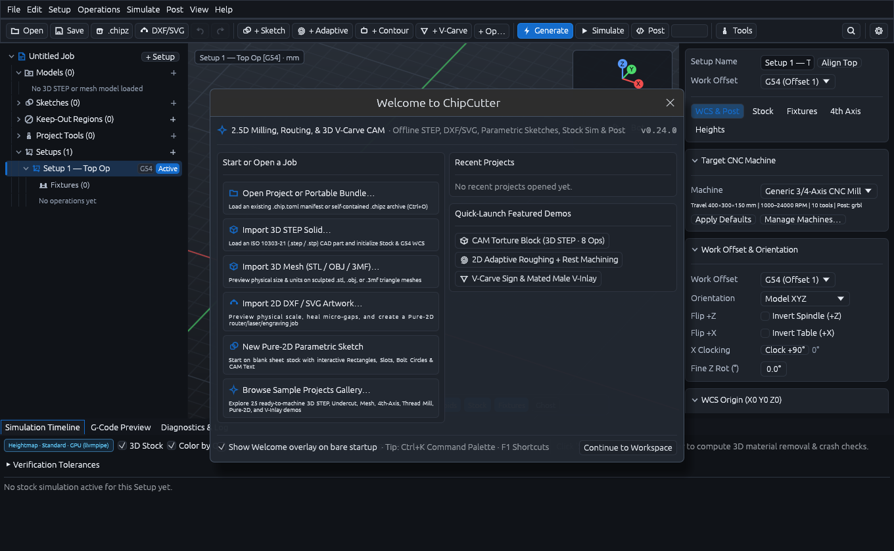
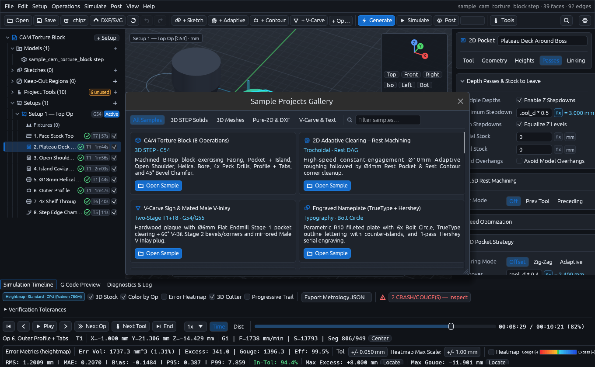
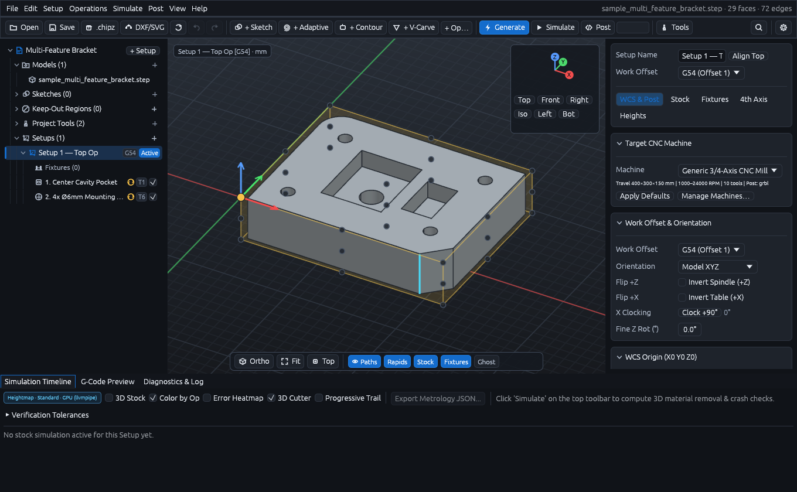
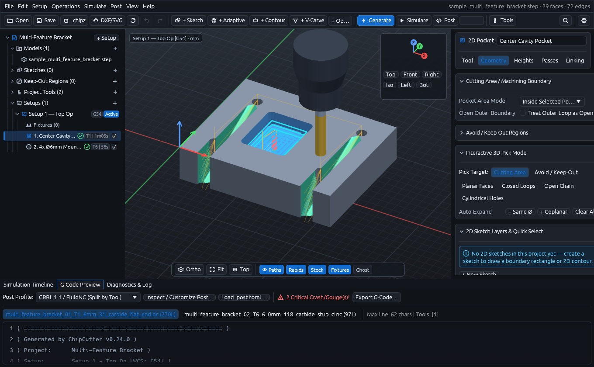

# Tutorial 00 — Getting Started & Workspace Orientation

## 1. Goal & What You'll Learn

By the end of this walkthrough, you will know how to:

- Launch **ChipCutter** and open a built-in starter sample or your own `.step`, `.dxf`, or `.svg` file.
- Navigate the 3D/2D `wgpu` viewport, camera presets, and dockable workspace panes.
- Configure a **Setup's Stock, Work Coordinate System (`G54` WCS), and Z-height planes**.
- Inspect cutters, material presets, and **parametric machinist expressions** (`tool_d * 0.4`, `1/4 in`).
- Generate toolpaths (`Ctrl+G`), verify material removal and collision safety in **3D Simulation**, and export **GRBL** or **LinuxCNC** G-code.
- Reproduce the exact same build pipeline headlessly with the `chipcutter` CLI.

---

## 2. Launching ChipCutter & Opening a Starter Job

Open **ChipCutter** from your application launcher (Start Menu on Windows, `ChipCutter.app` in Applications on macOS, or your desktop menu on Linux), or launch it from a terminal:

```bash
chip-gui
```

*(On Linux Flatpak, run `flatpak run io.github.rk29.ChipCutter`—see the [Tutorials Prerequisites](README.md#prerequisites) for platform install details.)*

On a fresh launch with no file argument, ChipCutter opens the **Welcome to ChipCutter** quick-start overlay:



From the **Start or Open a Job** card on the left side of the **Welcome to ChipCutter** overlay you can:
- **Open Project or Portable Bundle…** (`Ctrl+O`) to load an existing `.chip.toml` or self-contained `.chipz` archive.
- **Import 3D STEP Solid…** to load an ISO 10303-21 `.step` / `.stp` model and initialize a `G54` Setup.
- **Import 3D Mesh (STL / OBJ / 3MF)…** to preview physical units and watertightness on sculpted triangle meshes.
- **Import 2D DXF / SVG Artwork…** to preview physical scale, heal micro-gaps, and start a Pure-2D job.
- **New Pure-2D Parametric Sketch** to design directly on blank sheet stock without an external CAD file.
- **Browse Sample Projects Gallery…** to explore ready-to-machine 3D STEP, 3D Mesh, Rotary, Adaptive + Rest, Typography, and V-Carve jobs.

> [!TIP]
> You can switch between **Studio Dark** and **Daylight Light** themes (or change default **`mm`** / **`in`** units) at any time via **`Edit → Settings…`** (**`Ctrl+,`**, or click the far-right **Settings gear** icon on the **top toolbar**) → **`General & Appearance`** → **`Workspace Theme`** (or pass `--theme light` on launch). Your preference persists automatically in `~/.config/chipcutter/prefs.toml`.

Click **Browse Sample Projects Gallery…** on the Welcome Overlay (or open **`Help → Sample Projects Gallery…`** / **`File → Sample Projects Gallery…`** in the **top menu bar** at any time):



Use the category filter tabs along the top of the **Sample Projects Gallery** window (**`All Samples`**, **`3D STEP Solids`**, **`3D Meshes`**, **`Pure-2D & DXF`**, **`V-Carve & Text`**) or the **`Filter samples…`** search box to filter demos. For this orientation guide, find the **Prismatic Multi-Feature Bracket** card and click **`Open Sample`** (or launch it directly with `chip-gui --sample multi-feature`).

---

## 3. Workspace Anatomy & Viewport Navigation

Once **Prismatic Multi-Feature Bracket** (`90 × 70 × 20 mm`) is loaded and generated (`Ctrl+G`), the workspace is organized into four dockable zones plus a single-row top toolbar:


### Workspace Regions

1. **Top Menu Bar & Single-Row Top Toolbar:**
   - **Top menu bar:** **`File`**, **`Edit`**, **`Setup`**, **`Operations`**, **`Simulate`**, **`Post`**, **`View`**, and **`Help`**, with the active model/job summary on the right.
   - **Top toolbar (left cluster):** **`Open`** (`Ctrl+O`), **`Save`** (`Ctrl+S`), **`.chipz`**, **`DXF/SVG`**, the icon-only **Reload** button (visible when a 3D model is loaded, `Ctrl+R`), and icon-only Undo/Redo buttons (`Ctrl+Z` / `Ctrl+Y`).
   - **Top toolbar (operation & workflow clusters):** Quick-add buttons **`+ Sketch`**, **`+ Adaptive`**, **`+ Contour`**, **`+ V-Carve`**, and **`+ Op…`** (which add directly to the currently **`Active`** Setup), primary workflow buttons **`Generate`** (`Ctrl+G`), **`Simulate`**, and **`Post`** (with live **`Cancel`** buttons and a unified compact progress bar next to them), plus the single **`Tools`** button.
   - **Top toolbar (right cluster):** Icon-only **Command Palette** search button (`Ctrl+K`) and **Settings** gear button (`Ctrl+,`), opening the unified **Settings** window (`General & Appearance` for Theme & Display Units, `Viewport & Navigation` for Mouse Preset & Orbit Mode, `Simulation` for Engine/Detail Level/Compute Backend/Mesh Skinning, and `Machine Defaults`).
2. **CAM Browser — Project Tree View (Left Pane):**
   - **Project root (`<Project Name>`):** Click to open **Project Properties** in the right Inspector, click **`+ Setup`** to add a new clamping Setup, or right-click for quick creation, import, and **Expand All / Collapse All** actions.
   - **`Models (N)` folder:** Lists loaded STEP solids, 3D meshes, and imported fixture models (click any model row to open the **Model Transform Inspector**; use the **`+`** or right-click menu to **Import STEP…**, **Import Mesh…**, **Reload (Ctrl+R)**, **Replace…**, or open the **Sample Gallery…**).
   - **`Sketches (N)` folder:** Parametric or imported 2D vector layers (collapsed when empty; expand any sketch to view and reorder its child entities; use **`+`** or right-click for **New 2D Sketch (Setup XY)**, **New 2D Sketch on 3D Face…**, and **Import DXF / SVG…**).
   - **`Keep-Out Regions (N)` folder:** Project-level reusable **`SharedAvoidRegion`** definitions (collapsed when empty; click any region to edit it in the right Inspector with live coral/red 3D overlays).
   - **`Project Tools (N)` folder:** Tools embedded in this `.chip.toml` project (collapsed by default with an `N unused` pill; use **`+`** with live filtering to embed tools from the active machine or remove unused tools, and click any tool row to inspect its geometry & operation usages).
   - **`Setups (N)` folder:** Lists clamping Setups (e.g., **`Setup 1 — Top Op`** with `G54` and **`Active`** badges; click any Setup row to activate and inspect it, or hover/right-click for **Generate Setup**, **Align View to Setup Top**, **Add Operation**, and **Add Fixture**), nested **`Fixtures (N)`** nodes, and ordered machining operations (`1. Center Cavity Pocket`, `2. 4x Ø6mm Mounting Holes`) with procedural strategy icons, status badges, tool/cycle-time pills (`T1 | 1m42s`), and drag-and-drop reordering.
3. **3D CAD Viewport (Center Pane):**
   - **ViewCube (top-right corner):** Click **`Top`**, **`Front`**, **`Right`**, **`Iso`**, **`Left`**, or **`Bot`** (or the `X`/`Y`/`Z` axis tips) to snap the camera.
   - **Floating View HUD (bottom-center):** Toggle **`Ortho`** / **`Persp`** (`P`), **`Fit`** (`F`), **`Top`**, and layer visibility pills (**`Paths`**, **`Rapids`**, **`Stock`**, **`Fixtures`**, **`Ghost`**). Configure your **`Mouse Preset`** (`Fusion 360`, `SolidWorks`, `FreeCAD / Blender`) and **`Orbit Mode`** (`Turntable (+Z Up)` vs. `Free Trackball`) under **`Edit → Settings…` → `Viewport & Navigation`** (`Ctrl+,`).
4. **Inspector (Right Pane):** Selection-driven two-column property cards for whichever tree node or CAD entity is focused (**Project**, **Model**, **2D Sketch / Entity**, **Keep-Out Region**, **Project Tool**, **Setup / Fixture**, **Operation**, or **B-Rep Entity**).
5. **Bottom Docked Pane:** Tabbed workspace area switching between **`Simulation Timeline`**, **`G-Code Preview`**, and **`Diagnostics & Log`**.

### Essential Keyboard & Mouse Shortcuts

| Shortcut | Action |
|---|---|
| `Ctrl+K` | Open fuzzy **Command Palette** (search any action, view, or sample) |
| `Ctrl+,` | Open unified **Settings & Preferences** (Theme, Units, Navigation, Simulation, Machine Defaults) |
| `F1` / `?` | Open **Keyboard Shortcuts & Mouse Reference** cheat-sheet |
| `Ctrl+G` | Generate all `Dirty` toolpaths on background worker threads |
| `Space` | Play / Pause 3D Simulation timeline playback |
| `P` / `F` | Toggle Orthographic vs. Perspective / Fit scene to viewport |
| `Ctrl+Z` / `Ctrl+Y` | Instant Undo / Redo (`100` steps) |
| `Up`/`Down`/`Left`/`Right` | Navigate and expand/collapse rows in the Project Tree View |
| `F2` | Inline-rename the focused Setup, Operation, Sketch, Entity, Keep-Out, or Fixture |
| `Ctrl+Up` / `Ctrl+Down` | Reorder focused operation inside its Setup |
| `Ctrl+D` / `Del` | Duplicate or delete focused operation / sketch entity |
| `Esc` | Exit active 3D pick or sketch drawing mode / cancel in-flight generation or simulation |

---

## 4. Configuring Setup Stock, WCS Origin, & Safe Heights

In the left **CAM Browser**, click **`Setup 1 — Top Op`** under **`Setups`** to open the **Setup Inspector** in the right **Inspector** pane:



The Setup Inspector has five tabs along the top of the right **Inspector** pane:

- **`WCS & Post`:**
  - **`Target CNC Machine`** card: Choose the target **`Machine`** profile, click **`Apply Machine Defaults`**, or open **`Manage Machines…`**.
  - **`Work Offset & Orientation`** card: Choose **`Work Offset`** (`G54 (Offset 1)` through `G59.3 (Offset 9)`), and keep **`Orientation Mode`** on **`Model XYZ`** for upright parts (or switch to **`Z & X`** / **`XY Plane`** to align tilted STEP models directly to B-Rep faces and edges).
  - **`WCS Origin (X0 Y0 Z0)`** card: Choose **`Origin Reference`** (**`Stock 27-Pt`**, **`Model 27-Pt`**, or **`CAD Feature`**). In 27-point mode, check **`Interactive 27-pt overlay`** (`3D Viewport Dots`) to display clickable anchor dots on the stock or model, or pick directly from **`Z Level:`** (**`Top`**, **`Mid-Z`**, **`Bottom`**) and the 3×3 XY grid (here **`Top Front-Left`**, matching the RGB XYZ triad in the viewport).
  - **`Post-Processor & Output`** card: Select the Setup's default **`Post Profile`**.
- **`Stock`:** Under **`Stock Geometry & Dimensions`**, choose **`Stock Mode`** (**`Relative Box Stock`**, **`Fixed-Size Box Stock`**, **`Relative Cylindrical Stock`**, or **`Fixed Cylindrical Stock`**), then tune margins under **`Stock Offsets`**. The translucent gold wireframe in the **3D CAD Viewport** updates live.
- **`Fixtures`:** Add vises, toe clamps, spoilboards, keep-out zones, or imported 3D fixture meshes and enable automatic rapid-lift avoidance (covered in Tutorial 19).
- **`4th Axis`:** Configure **`Rotary Mode`** (**`Disabled (3-Axis)`**, **`2-Linear + Rotary (Z+X / Z+Y)`**, **`Indexed 3+1 Positioning`**, or **`Simultaneous 4-Axis (X+Y+Z+R)`**), rotary axis, chuck keep-out dimensions, and clearance radius (covered in Tutorials 10–12).
- **`Heights`:** Under **`Safe Z Clearance & Retract`**, define Setup-level **`Clearance Datum`** / **`Clearance Offset`** and **`Retract Datum`** / **`Retract Offset`** planes. ChipCutter enforces the physical safety ordering:
  ```text
  Clearance Z  >=  Retract Z  >=  Feed Z  >=  Top Z  >=  Bottom Z
  ```
  Invalid height inversions are flagged explicitly and blocked before toolpath generation.

---

## 5. Exploring the Tool Library & Parametric Expressions

Click **`Tools`** in the **top toolbar** (or click **`Edit…`** next to **`Active Cutter`** on any operation's **`Tool`** tab) to open the **ChipCutter Tool Library & Cutting Presets** window:


Inside any operation's **`Tool`** tab, the **`Active Cutter`** dropdown automatically groups compatible cutters under **`Project Tools`** and **`Machine Library (auto-embeds)`** (with an inline **`Search tools…`** filter when more than 6 compatible cutters are available). You can also manage embedded project cutters directly under **`Project Tools`** in the left **CAM Browser** (use its **`+`** or right-click menu to add tools or remove unused ones, and click any tool row to inspect it).

ChipCutter ships with an 8-cutter **Starter Shop Library** stored in your user config directory (`default.tools.toml`), and you can also import existing **Fusion 360 `.json` / `.tools`** libraries:

| Tool # | Geometry | Starter Cutter |
|---|---|---|
| `T1` | Flat Endmill | `6mm 3FL Carbide Flat Endmill` |
| `T2` | Bull-Nose Endmill | `1/4 in 3FL Bull-Nose R0.020"` |
| `T3` | Flat Endmill | `1/8 in 2FL Carbide Flat` |
| `T4` | Ball Endmill | `6mm 2FL Carbide Ball Endmill` |
| `T5` | Chamfer / Spot Mill | `6mm 90° Carbide Chamfer / Spot Mill` |
| `T6` | Twist Drill | `6.0mm 118° Carbide Stub Drill` |
| `T7` | Face / Fly Cutter | `38mm 3-Insert APKT Face Mill` |
| `T8` | Chamfer / V-Bit | `6mm 60° Carbide Engraving V-Bit` |

Each tool stores physical geometry (diameter, flute length, overall length, shank diameter, flute count, holder stickout) used by the crash verifier, plus per-material cutting presets (`Aluminum 6061`, `Baltic Birch Plywood`, `Acetal / Delrin`, `Mild Steel 1018`) with **`Lock Chipload when editing RPM / Surface Speed`** coupling between RPM, surface speed (SFM/m/min), and feedrate.

### Parametric Machinist Expressions (`fx`)

Any dimensional input in Setup or Operation Inspectors accepts unit conversions, fractions, and live scoped variables (shown with an `fx` pill, as seen in the right Inspector of Step 3):

- `tool_d * 0.5` → automatically resolves to `3.000 mm` for a `6 mm` cutter and updates if you swap cutters.
- `tool_d * 0.4` → `40%` radial stepover (`2.400 mm`).
- `1/4 in` → converts cleanly to `6.350 mm`.
- `model_top_z + 10 mm` → keeps clearance planes anchored relative to part geometry.

---

## 6. Generating Toolpaths (`Ctrl+G`) & Running 3D Simulation

ChipCutter uses **explicit regeneration**: editing a parameter, tool, setup, or selection updates the document immediately (with `< 1 ms` Undo/Redo) and marks affected operations **`Dirty`** (amber refresh badge) without freezing the UI.

1. Press **`Ctrl+G`** (or click **`Generate`** in the **top toolbar**) to compute all dirty operations in parallel on background `rayon` workers (progress appears in the compact top-toolbar progress bar; press **`Esc`** or click **`Cancel`** to abort). Clean operations turn emerald (**✓**) in the left **CAM Browser**, display their estimated cycle times, and log both wall-clock execution time and estimated CNC cycle time in **`Diagnostics & Log`** (e.g., `Generated 'Center Cavity Pocket' in 142ms (… passes, est. cycle …s, …)`).
2. Click **`Simulate`** in the **top toolbar** (or **`Simulate → Run / Refresh Simulation`** in the **top menu bar**), which focuses the bottom **`Simulation Timeline`** tab, tracks progress in the top-toolbar progress bar (`Esc` to cancel), and runs volumetric stock-removal simulation and 6-rule physical crash/gouge/fixture verification (logging wall-clock runtime alongside simulated cycle time in **`Diagnostics & Log`**):


Inside the bottom **`Simulation Timeline`** tab (transport controls appear once simulation finishes):
- Click the compact status chip on the far left of the **`Simulation Timeline`** bar (e.g., `Heightmap · Standard · GPU (…)`) — or open **`Edit → Settings…` → `Simulation`** (`Ctrl+,`) — to configure **`Simulation Engine`** (`Heightmap (Fast)` vs. `Tri-Dexel (Volumetric 3D)`), **`Detail Level`** (`Standard`, `Fine`, `Ultra`), **`Compute Backend`** (`Auto`, `GPU`, `CPU`), and **`Smooth Skinned Surfaces (Mesh Skinning)`**.
- Toggle **`3D Stock`** to inspect the live machined stock solid, **`Color by Op`** to distinguish each tool/strategy, **`Error Heatmap`** for stock-vs-target deviation coloring, **`3D Cutter`** to display the revolved flutes/shank/holder assembly, and **`Progressive Trail`** to draw toolpaths up to the active scrub position.
- Press **`Space`** or drag the timeline scrubber (`00:01:43 / 00:02:02`) to step through cuts using the transport buttons (**Skip-Start**, **Step Backward** (`Left Arrow`), **`Play`** / **`Pause`**, **Step Forward** (`Right Arrow`), **`Next Op`**, **`Next Tool`**, and **`End`**).
- Confirm the green **`Verified Crash-Free`** badge before posting. The 6-rule verifier checks for:
  1. `G0` rapid moves into uncut stock,
  2. Target B-Rep part gouges (`> 0.02 mm`),
  3. Non-cutting shank or flute-length rubs,
  4. Tool-holder collisions,
  5. Unsafe vertical plunges with non-center-cutting tools, and
  6. Workholding fixture / chuck collisions.

---

## 7. Previewing & Exporting Verified G-Code

Click **`Post`** in the **top toolbar** (or select the **`G-Code Preview`** tab in the bottom pane):



1. Choose your controller profile from the **`Post Profile:`** dropdown at the top-left of **`G-Code Preview`**:
   - **`GRBL 1.1 / FluidNC (Split by Tool)`** — automatically splits multi-tool jobs into separate `.nc` files per tool (e.g., `..._01_T1_...nc` and `..._02_T6_...nc`), expands canned drill cycles, splits full-circle arcs into quadrants, and enforces the `<= 80`-character GRBL line-length limit.
   - **`grblHAL / FluidNC (ATC / M6 Macro)`** — single file with `M6` tool changes.
   - **`LinuxCNC (RS274NGC)`** — single `.ngc` file with `M6` + `G43 H`, `G64 P` path blending, and native canned drilling cycles (`G81`/`G83`/`G73`).
2. Confirm the **`Sim Verified (0 Crashes)`** safety gate badge in the **`G-Code Preview`** top bar. ChipCutter blocks export if any critical crash or gouge is present.
3. Click **`Export G-Code…`** in the **`G-Code Preview`** top bar (or **`Post → Export G-Code (.nc / .ngc)…`** in the **top menu bar**) to write the `.nc` / `.ngc` files to disk.

---

## 8. Headless CLI Equivalent (`chipcutter`)

Every step above works identically from the terminal without a GPU or display server—useful for scripted builds or verifying projects in CI:

```bash
# 1. Generate the multi-feature STEP bracket + a seeded .chip.toml project
chipcutter generate-sample-step /tmp/bracket.step --multi-feature \
  --project-out /tmp/bracket.chip.toml

# 2. Inspect exact B-Rep geometry (bounding box, planar faces, cylindrical holes, arcs)
chipcutter inspect /tmp/bracket.step

# 3. Validate Setup/WCS/Heights and generate all 2.5D toolpaths in parallel
chipcutter validate --generate /tmp/bracket.chip.toml

# 4. Run 2.5D Z-dexel heightmap stock removal & 5-rule crash/gouge verification
chipcutter simulate /tmp/bracket.chip.toml --resolution standard \
  --report /tmp/sim_report.json

# 5. Build safety-verified G-code for GRBL (split by tool) and LinuxCNC (single ATC file)
chipcutter build /tmp/bracket.chip.toml -o /tmp/out_grbl --post grbl
chipcutter build /tmp/bracket.chip.toml -o /tmp/out_linuxcnc --post linuxcnc
```

---

## Next Steps

- **Next:** [Tutorial 01 — Facing (Stock Surfacing)](01-facing.md)
- **Index:** [Tutorials Index](README.md) — browse all Core 2.5D Milling tutorials (**Facing**, **2D Contour & Holding Tabs**, **2D Pocket**, and **Drilling & Helical Bore Milling**).
