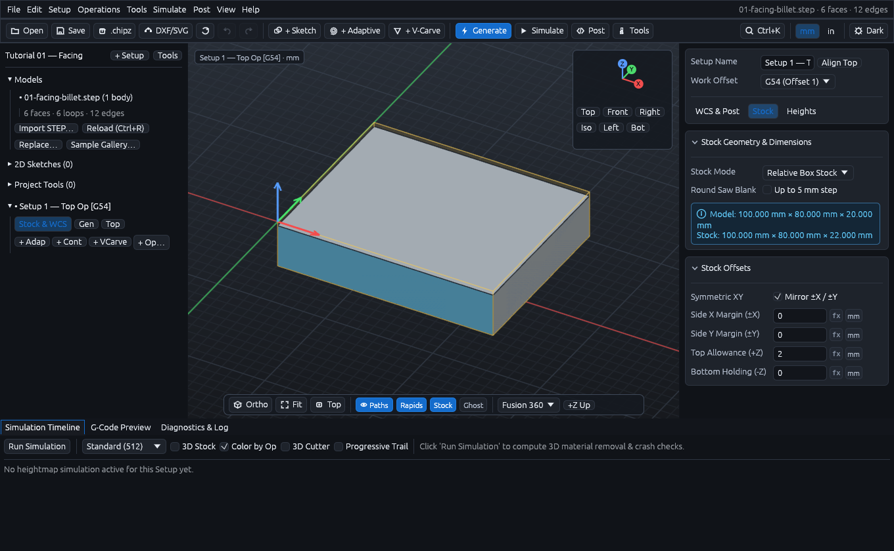
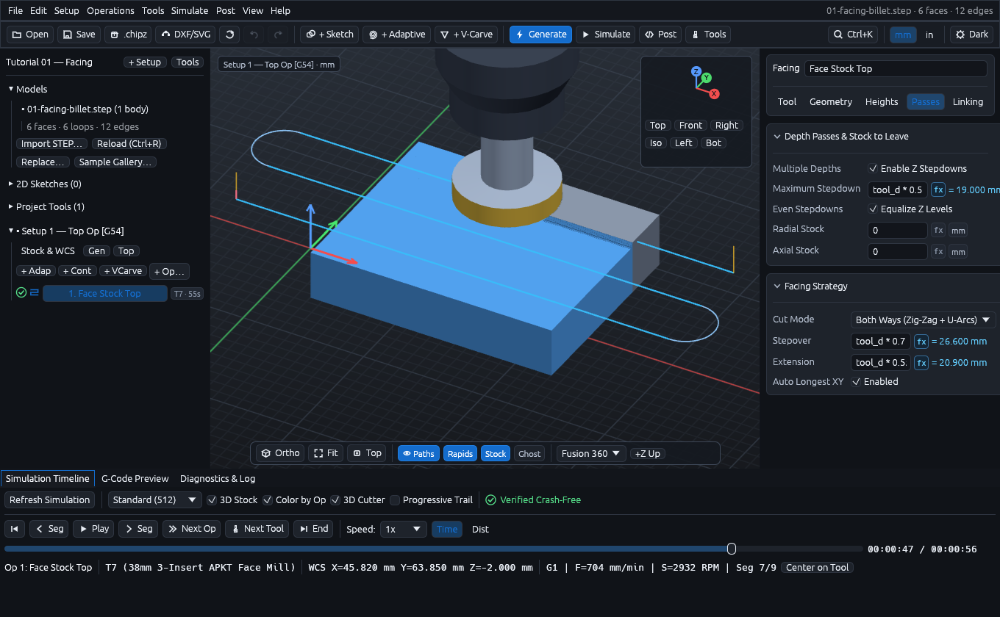
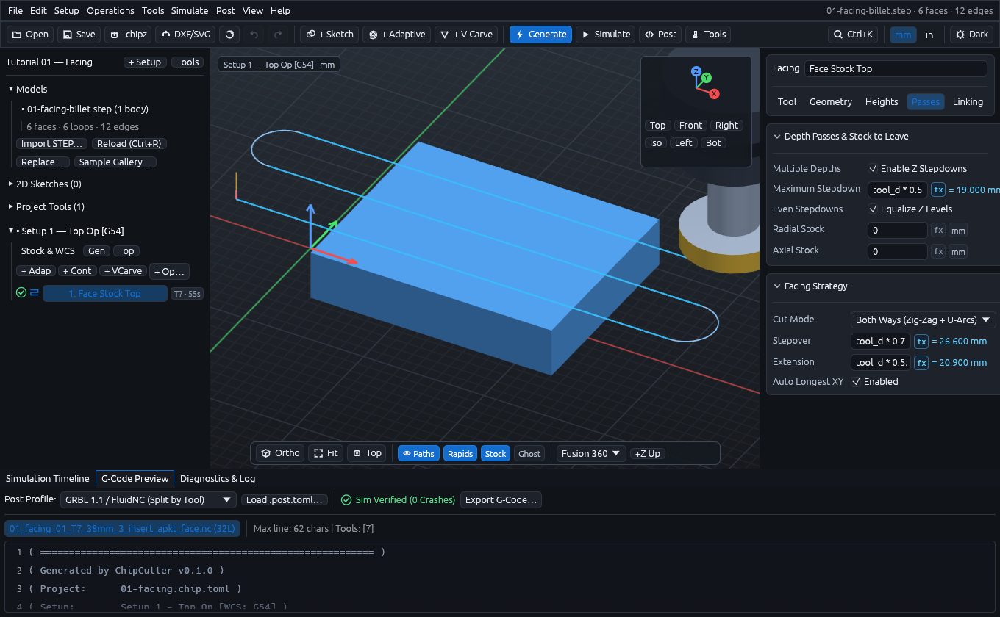

# Tutorial 01 — Facing (Stock Surfacing)

## 1. Goal & What You'll Learn

**Facing** machines the rough top surface of raw billet stock flat and parallel to the Setup XY plane (`ModelTop`), establishing a clean, accurate datum before any pockets, holes, or contours are cut.

In this tutorial you will start from an **empty project**, import a minimal rectangular billet (`100 × 80 × 20 mm`), and learn how to:

- Configure **Stock Top Allowance (`+Z`)** above the part so there is material to deck off.
- Add a single **Facing** operation and select a multi-insert **Face Mill** (`T7`) or flat endmill (`T1`).
- Tune **Cut Mode** (`Both Ways (Zig-Zag + U-Arcs)` vs. `One-Way`), **Stepover**, **Extension**, and **Auto Longest XY** orientation.
- Verify the `Stock Top → Model Top` Z-height range, inspect the decked billet in **3D Simulation**, and export verified **GRBL** or **LinuxCNC** G-code.

---

## 2. Prerequisites & Starter Model

Start with an **empty project** and load the minimal billet STEP file included with this tutorial ([`01-facing-billet.step`](assets/01-facing-billet.step) — a plain `100 × 80 × 20 mm` block with 6 planar faces and no extra features):

- **From the Welcome Overlay or Menu:** Launch `cargo run --release -p chip-gui`, click **Import 3D STEP Solid…** (or **`File → Import STEP…`**), and select `docs/tutorials/assets/01-facing-billet.step`.
- **Or open directly from the terminal:**
  ```bash
  cargo run --release -p chip-gui -- docs/tutorials/assets/01-facing-billet.step
  ```

---

## 3. Step-by-Step GUI Walkthrough

### Step 1 — Set Stock Top Allowance (`Setup → Stock`)

1. In the left **CAM Browser**, click **`Stock & WCS`** under `Setup 1 — Top Op [G54]`.
2. Switch to the **`Stock`** tab in the right **Inspector**.
3. Set **`Side X Margin (±X)`** = `0 mm`, **`Side Y Margin (±Y)`** = `0 mm`, and **`Top Allowance (+Z)`** = `2 mm` so your raw stock measures `100 × 80 × 22 mm` (`2.0 mm` of material above the `20 mm` finished billet):



> [!TIP]
> If your raw billet is already ground to exact finished thickness (`Top Allowance (+Z) = 0 mm`), you can skip Facing—never set `Bottom Height` below `Model Top` or you will undersize the entire part.

### Step 2 — Add a Facing Operation & Configure Passes (`Op 1 → Passes`)

1. Click **`Operations → Facing`** (or **`+ Op… → Facing`** in the CAM Browser) to add **`1. Face Stock Top`**.
2. Open the **`Tool`** tab and select **`T7 — 38mm 3-Insert APKT Face Mill`** (or pick `T1` 6mm Flat Endmill if your spindle/router does not accept a face mill).
3. Switch to the **`Passes`** tab and press **`Ctrl+G`** to generate the toolpath:


Notice how the facing passes automatically align along the longest stock axis (**`Auto Longest XY`**), extend cleanly past the billet edges (**`Extension = tool_d * 0.55`** = `20.900 mm`) so the cutter enters and exits in air, and connect adjacent passes with smooth U-turn arcs (`G2`/`G3`).

### Step 3 — Verify Facing Z Heights (`Op 1 → Heights`)

Switch to the **`Heights`** tab to confirm the vertical cutting span and safety planes:


- **Top Height:** Automatically resolves to `Stock Top` (`Z = 0.000 mm` in WCS when WCS origin is at `Top Front-Left`).
- **Bottom Height:** Automatically resolves to `Model Top` (`Z = -2.000 mm` in WCS), stopping exactly on the finished top face of the billet.
- **Multiple Depths:** If your stock top allowance exceeds the cutter's safe axial depth of cut (`ap`), lower **`Maximum Stepdown`** in **`Passes`** (e.g., `1.0 mm`) so the `2.0 mm` allowance is removed across two clean `1.0 mm` Z passes.

---

## 4. Key Parameters Reference

| Parameter | Location | Purpose & Recommended Starting Values |
|---|---|---|
| **Cut Mode** | `Passes → Facing Strategy` | **`Both Ways (Zig-Zag + U-Arcs)`** alternates climb/conventional passes with smooth U-turn arcs for fastest cycle time; **`One-Way`** retracts and cuts every pass in the same direction for a uniform surface finish. |
| **Stepover** | `Passes → Facing Strategy` | Radial width of cut (`ae`). Defaults to **`tool_d * 0.7`** (`26.600 mm` for `T7`); use `tool_d * 0.6`–`tool_d * 0.75` for face mills and `tool_d * 0.6` for flat endmills. |
| **Extension** | `Passes → Facing Strategy` | Distance the tool center overruns each end of the stock (defaults to **`tool_d * 0.55`** = `20.900 mm` for `T7`) so the cutter enters from air and leaves no uncut corner crescents. |
| **Auto Longest XY** | `Passes → Facing Strategy` | Automatically orients passes along the longest XY stock axis to minimize reversals; disable to enter a custom **`Pass Angle`** (degrees). |
| **Maximum Stepdown** | `Passes → Depth Passes` | Splits deep top allowances into safe Z levels (e.g., `0.5–1.5 mm` per pass depending on machine rigidity). |

---

## 5. Generate (`Ctrl+G`) & 3D Simulation Verification

1. Press **`Ctrl+G`** (or click **`Generate`**) and confirm the emerald **✓** badge on **`1. Face Stock Top`**.
2. Click **`Simulate`** (or open the **`Simulation Timeline`** bottom tab) with **`3D Stock`** and **`3D Cutter`** enabled, and scrub across the facing pass:



Verify:
- The green **`Verified Crash-Free`** badge confirms zero rapid collisions or target gouges.
- The full `100 × 80 mm` top face is decked cleanly down by `2.0 mm` with no leftover corner steps.

---

## 6. Post-Processing (GRBL & LinuxCNC)

Switch to the **`G-Code Preview`** bottom tab to inspect the generated program:



- With **`GRBL 1.1 / FluidNC (Split by Tool)`**, ChipCutter emits a single clean `.nc` program for `T7` with `<= 80`-character lines and exact `G2`/`G3` U-turn arcs.
- With **`LinuxCNC (RS274NGC)`** or **`grblHAL / FluidNC ATC`**, the program opens with `T7 M6 G43 H7` tool-length compensation.

---

## 7. Headless CLI Equivalent (`chipcutter`)

Generate the minimal facing billet and project, validate, simulate, and post-process headlessly:

```bash
# 1. Generate the minimal 100x80x20mm facing billet + 1-operation .chip.toml project
cargo run -p chip-cli -- generate-sample-step /tmp/01-facing-billet.step --tutorial 01-facing \
  --project-out /tmp/01-facing.chip.toml

# 2. Validate parameters & generate the facing toolpath
cargo run -p chip-cli -- validate --generate /tmp/01-facing.chip.toml

# 3. Verify zero crashes/gouges via 2.5D Z-dexel heightmap simulation
cargo run -p chip-cli -- simulate /tmp/01-facing.chip.toml --resolution standard

# 4. Build GRBL and LinuxCNC G-code
cargo run -p chip-cli -- build /tmp/01-facing.chip.toml -o /tmp/facing_grbl --post grbl
cargo run -p chip-cli -- build /tmp/01-facing.chip.toml -o /tmp/facing_linuxcnc --post linuxcnc
```

---

## Next Steps

- **Previous:** [Tutorial 00 — Getting Started & Workspace Orientation](00-getting-started.md)
- **Next:** [Tutorial 02 — 2D Contour / Profile & Holding Tabs](02-2d-contour-tabs.md)
- **Index:** [All Tutorials](README.md)
