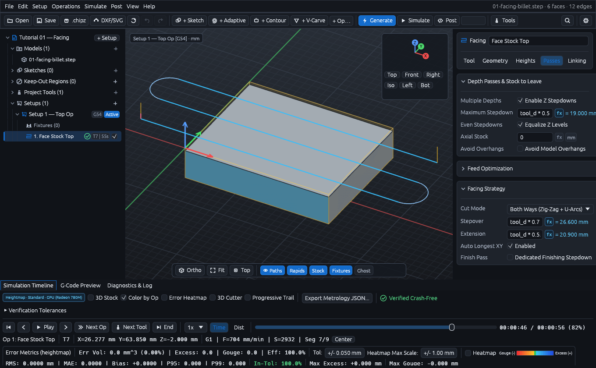
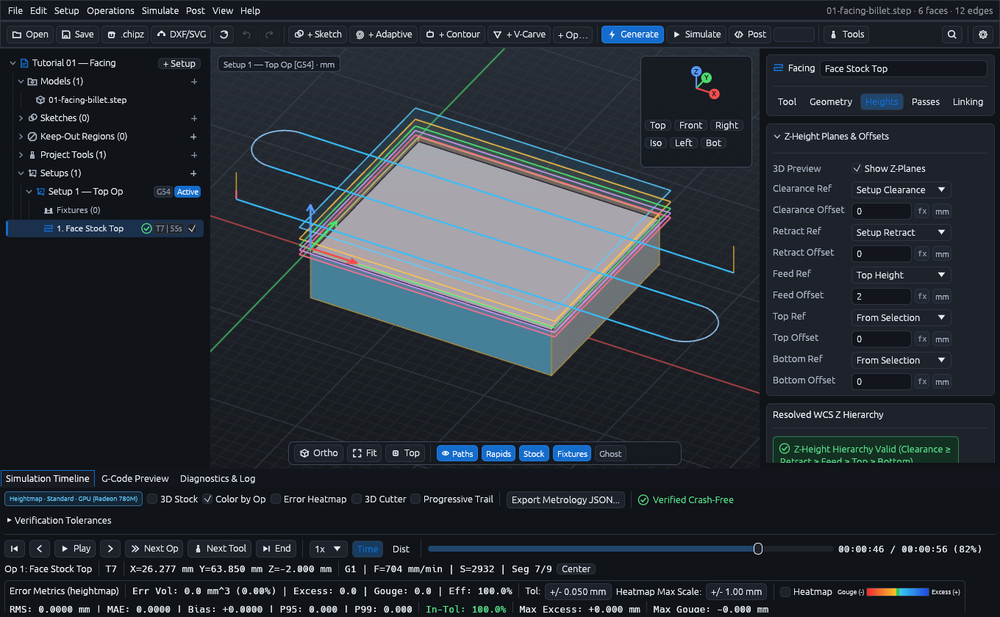

# Tutorial 01 — Facing (Stock Surfacing)

## 1. Goal & What You'll Learn

**Facing** machines the rough top surface of raw billet stock flat and parallel to the Setup XY plane (`ModelTop`), establishing a clean, accurate datum before any pockets, holes, or contours are cut.

In this tutorial you will start from an **empty project**, import a minimal rectangular billet (`100 × 80 × 20 mm`), and learn how to:

- Configure **Stock Top Allowance (`+Z`)** above the part so there is material to deck off.
- Add a single **Facing** operation and select a multi-insert **Face Mill** (`T7`) or flat endmill (`T1`).
- Constrain the facing area with **`Cutting Area / Machining Boundary`** in **`Geometry`** (**`Stock Bounds`**, true projected **`Model Silhouette`**, or **`Selected Regions`** with exact polygon & raised-island clipping, **`Tool Containment`**, and signed **`Boundary Offset`**) plus live 3D boundary previews.
- Tune **`Cut Mode`** (`Both Ways (Zig-Zag + U-Arcs)` vs. `One Way (Climb)` / `One Way (Conventional)`), **`Stepover`**, **`Extension`**, **`Auto Longest XY`** orientation, and an optional **`Finish Pass`** (`Dedicated Finishing Stepdown`).
- Verify the `Stock Top → Model Top` Z-height range, inspect the decked billet in **3D Simulation**, and export verified **GRBL** or **LinuxCNC** G-code.

---

## 2. Prerequisites & Starter Model

Start with an **empty project** and load the minimal billet STEP file included with this tutorial ([`01-facing-billet.step`](assets/01-facing-billet.step) — a plain `100 × 80 × 20 mm` block with 6 planar faces and no extra features):

- **From the Welcome Overlay or Menu:** Launch ChipCutter (`chip-gui`), click **`Import 3D STEP Solid…`** in the **Welcome to ChipCutter** overlay (or **`File → Import STEP Model…`** in the **top menu bar**, or the **`+`** / right-click menu on **`Models`** in the left **CAM Browser** → **`Import STEP…`**), and select `docs/tutorials/assets/01-facing-billet.step`.
- **Or open directly from the terminal:**
  ```bash
  chip-gui docs/tutorials/assets/01-facing-billet.step
  ```

---

## 3. Step-by-Step GUI Walkthrough

### Step 1 — Set Stock Top Allowance (`Setup → Stock`)

1. In the left **CAM Browser**, click **`Setup 1 — Top Op`** under **`Setups`**.
2. Switch to the **`Stock`** tab in the right **Inspector**.
3. Under the **`Stock Offsets`** card, confirm **`Symmetric XY`** (`Mirror ±X / ±Y`) is checked so the symmetric margin fields are shown, then set **`Side X Margin (±X)`** = `0 mm`, **`Side Y Margin (±Y)`** = `0 mm`, and **`Top Allowance (+Z)`** = `2 mm` so your raw stock measures `100 × 80 × 22 mm` (`2.0 mm` of material above the `20 mm` finished billet):


> [!TIP]
> If your raw billet is already ground to exact finished thickness (`Top Allowance (+Z) = 0 mm`), you can skip Facing—never set `Bottom Ref` below `Model Top` or you will undersize the entire part.

### Step 2 — Add a Facing Operation, Verify Cutting Area, & Configure Passes (`Op 1 → Geometry / Passes`)

1. With `Setup 1` showing its **`Active`** badge in the left **CAM Browser**, click **`+ Op… → Facing`** in the **top toolbar** (or **`Operations → + Facing`** in the **top menu bar**) to add **`1. Facing 1`**.
2. In the right **Inspector**, open the **`Tool`** tab, expand the **`Active Cutter`** dropdown under **`Cutter & Material Preset`**, and select **`T7 — 38mm 3-Insert APKT Face Mill`** (or pick `T1 — 6mm 3FL Carbide Flat Endmill` if your spindle/router does not accept a face mill).
3. *(Optional)* Open the **`Geometry`** tab to inspect **`Cutting Area / Machining Boundary`** and its live 3D boundary preview in the viewport:
   - Leave **`Boundary Source`** on **`Stock Bounds`** (default) to face the entire raw billet.
   - On stepped parts or irregular castings, switch **`Boundary Source`** to **`Model Silhouette`** (true projected outer silhouette) or **`Selected Regions`** (pick planar faces or closed 2D contours—ChipCutter clips facing passes cleanly to exact polygons and around raised islands, and reveals **`Island Radial Stock`** under **`Passes → Depth Passes & Stock to Leave`**). You can also fine-tune **`Tool Containment`** and signed **`Boundary Offset`** (`+` expands outward, `-` insets inward).
4. Switch to the **`Passes`** tab in the right **Inspector** and press **`Ctrl+G`** (or click **`Generate`** in the **top toolbar**) to generate the toolpath:



Notice how the facing passes under **`Facing Strategy`** automatically align along the longest stock axis (**`Auto Longest XY`** checked), extend cleanly past the billet edges (**`Extension = tool_d * 0.55`** = `20.900 mm`) so the cutter enters and exits in air, and connect adjacent passes with smooth U-turn arcs (`G2`/`G3`). To reserve a light final skim pass at `Bottom Z` for a mirror finish, check **`Finish Pass`** (`Dedicated Finishing Stepdown`) to reveal **`Finish Stepdown`** (e.g., `0.25 mm`).

### Step 3 — Verify Facing Z Heights (`Op 1 → Heights`)

Switch to the **`Heights`** tab in the right **Inspector** to confirm the vertical cutting span and safety planes under **`Z-Height Planes & Offsets`** and **`Resolved WCS Z Hierarchy`**:



- **`Top Ref`:** Automatically resolves to **`Stock Top`** (`Top Z = 0.000 mm` in WCS when WCS origin is at `Top Front-Left`).
- **`Bottom Ref`:** Automatically resolves to **`Model Top`** (`Bottom Z = -2.000 mm` in WCS), stopping exactly on the finished top face of the billet.
- **`Multiple Depths`:** If your stock top allowance exceeds the cutter's safe axial depth of cut (`ap`), return to the **`Passes`** tab, ensure **`Multiple Depths`** (`Enable Z Stepdowns`) is checked under **`Depth Passes & Stock to Leave`** so **`Maximum Stepdown`** is displayed, and lower **`Maximum Stepdown`** (e.g., `1.0 mm`) so the `2.0 mm` allowance is removed across two clean `1.0 mm` Z passes.

---

## 4. Key Parameters Reference

| Parameter | Location | Purpose & Recommended Starting Values |
|---|---|---|
| **`Boundary Source`**, **`Tool Containment`**, & **`Boundary Offset`** | `Right Inspector → Geometry → Cutting Area / Machining Boundary` | Defaults to **`Stock Bounds`**; switch to projected **`Model Silhouette`** or **`Selected Regions`** (with exact polygon & raised-island clipping) and tune **`Tool Containment`** + signed **`Boundary Offset`** with live 3D viewport preview. |
| **`Cut Mode`** | `Right Inspector → Passes → Facing Strategy` | **`Both Ways (Zig-Zag + U-Arcs)`** alternates climb/conventional passes with smooth U-turn arcs for fastest cycle time; **`One Way (Climb)`** or **`One Way (Conventional)`** retracts and cuts every pass in the same direction for a uniform surface finish. |
| **`Stepover`** | `Right Inspector → Passes → Facing Strategy` | Radial width of cut (`ae`). Defaults to **`tool_d * 0.7`** (`26.600 mm` for `T7`); use `tool_d * 0.6`–`tool_d * 0.75` for face mills and `tool_d * 0.6` for flat endmills. |
| **`Extension`** | `Right Inspector → Passes → Facing Strategy` | Distance the tool center overruns each end of the stock (defaults to **`tool_d * 0.55`** = `20.900 mm` for `T7`) so the cutter enters from air and leaves no uncut corner crescents. |
| **`Auto Longest XY`** / **`Pass Angle`** | `Right Inspector → Passes → Facing Strategy` | Automatically orients passes along the longest XY stock axis to minimize reversals; uncheck **`Auto Longest XY`** (`Enabled`) to reveal **`Pass Angle`** (degrees). |
| **`Finish Pass`** / **`Finish Stepdown`** | `Right Inspector → Passes → Facing Strategy` | Check **`Finish Pass`** (`Dedicated Finishing Stepdown`) to reveal **`Finish Stepdown`** (`0.15–0.30 mm`) and reserve a light final axial skim cut at `Bottom Z`. |
| **`Multiple Depths`** / **`Maximum Stepdown`** | `Right Inspector → Passes → Depth Passes & Stock to Leave` | Check **`Multiple Depths`** (`Enable Z Stepdowns`) to reveal **`Maximum Stepdown`** and split deep top allowances into safe Z levels (e.g., `0.5–1.5 mm` per pass depending on machine rigidity). When facing **`Selected Regions`**, **`Island Radial Stock`** also appears here to leave clearance around raised islands. |

---

## 5. Generate (`Ctrl+G`) & 3D Simulation Verification

1. Press **`Ctrl+G`** (or click **`Generate`** in the **top toolbar**) and confirm the emerald **✓** badge on the operation in the left **CAM Browser** (the bottom **`Diagnostics & Log`** Activity Log reports both wall-clock generation time and estimated CNC cycle time).
2. Click **`Simulate`** in the **top toolbar** (which switches to the bottom **`Simulation Timeline`** tab and runs simulation), confirm **`3D Stock`** and **`3D Cutter`** are checked in the **`Simulation Timeline`** top bar, and scrub across the facing pass:


Verify:
- The green **`Verified Crash-Free`** badge in **`Simulation Timeline`** confirms zero rapid collisions or target gouges.
- The full `100 × 80 mm` top face is decked cleanly down by `2.0 mm` with no leftover corner steps.

---

## 6. Post-Processing (GRBL & LinuxCNC)

Click **`Post`** in the **top toolbar** (or select the **`G-Code Preview`** tab in the bottom pane) and choose your controller from **`Post Profile:`**:


- With **`GRBL 1.1 / FluidNC (Split by Tool)`**, ChipCutter emits a single clean `.nc` program for `T7` with `<= 80`-character lines and exact `G2`/`G3` U-turn arcs.
- With **`LinuxCNC (RS274NGC)`** or **`grblHAL / FluidNC (ATC / M6 Macro)`**, the program opens with `T7 M6 G43 H7` tool-length compensation.

---

## 7. Headless CLI Equivalent (`chipcutter`)

Generate the minimal facing billet and project, validate, simulate, and post-process headlessly:

```bash
# 1. Generate the minimal 100x80x20mm facing billet + 1-operation .chip.toml project
chipcutter generate-sample-step /tmp/01-facing-billet.step --tutorial 01-facing \
  --project-out /tmp/01-facing.chip.toml

# 2. Validate parameters & generate the facing toolpath
chipcutter validate --generate /tmp/01-facing.chip.toml

# 3. Verify zero crashes/gouges via 2.5D Z-dexel heightmap simulation
chipcutter simulate /tmp/01-facing.chip.toml --resolution standard

# 4. Build GRBL and LinuxCNC G-code
chipcutter build /tmp/01-facing.chip.toml -o /tmp/facing_grbl --post grbl
chipcutter build /tmp/01-facing.chip.toml -o /tmp/facing_linuxcnc --post linuxcnc
```

---

## Next Steps

- **Previous:** [Tutorial 00 — Getting Started & Workspace Orientation](00-getting-started.md)
- **Next:** [Tutorial 02 — 2D Contour / Profile & Holding Tabs](02-2d-contour-tabs.md)
- **Index:** [All Tutorials](README.md)
