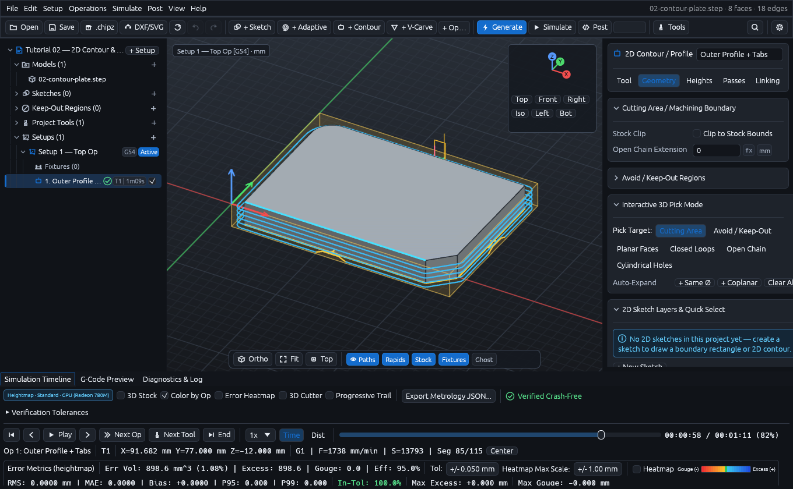
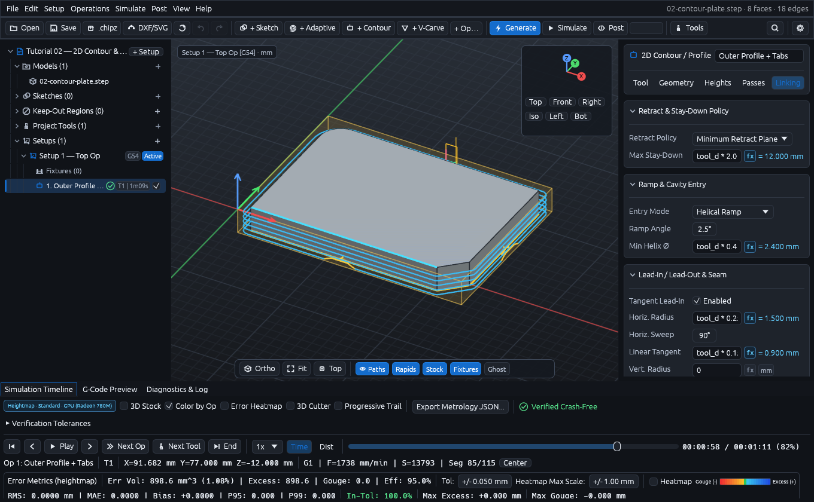
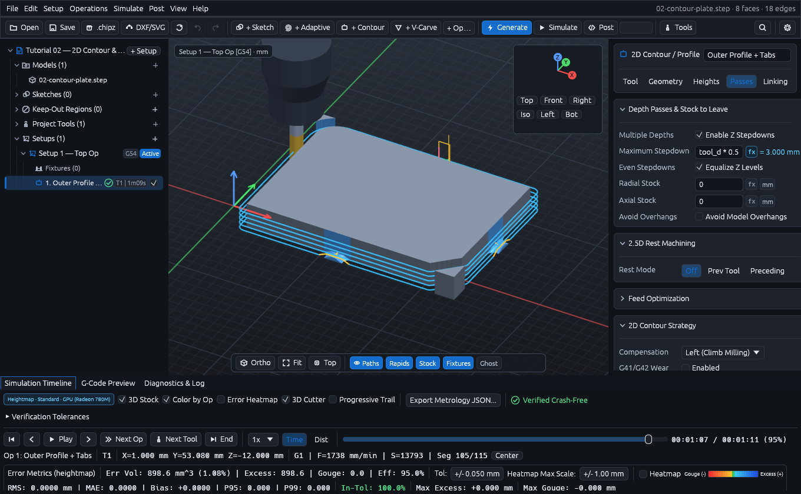
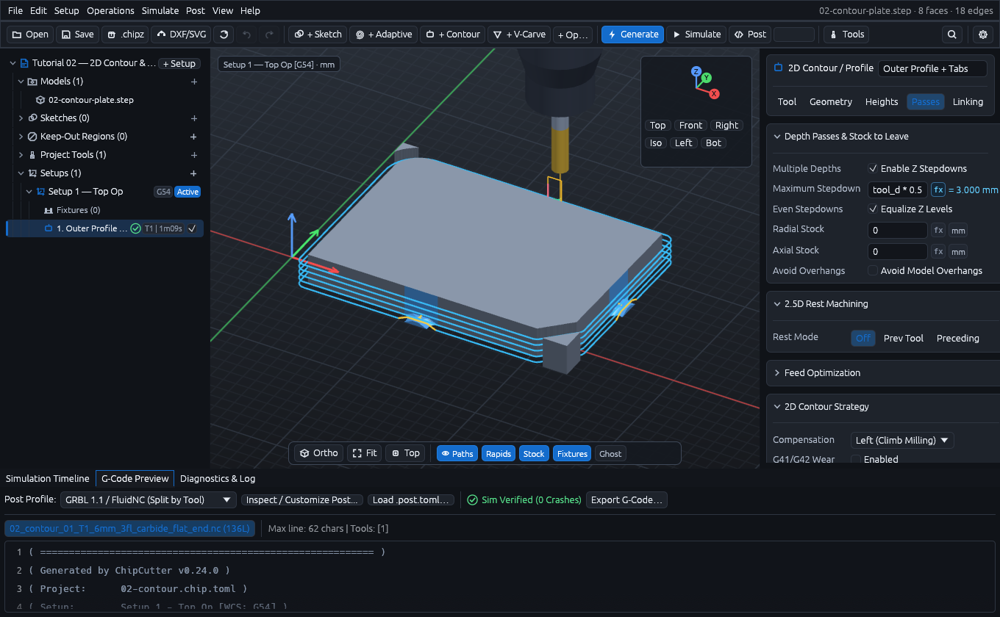

# Tutorial 02 — 2D Contour / Profile & Holding Tabs

## 1. Goal & What You'll Learn

**2D Contour** machines along closed outer profiles, internal cutouts, or open edge chains at one or more Z stepdowns—with exact circular-arc (`G2`/`G3`) offsetting, entry ramps, tangent lead-in/out arcs, rough/finish wall passes, and **holding tabs** that keep cut-out parts from flying loose on the final breakthrough pass.

In this tutorial you will start from an **empty project**, import a minimal mounting plate (`100 × 70 × 12 mm` with one `R10 mm` rounded corner and one `45°` corner chamfer), and learn how to:

- Configure surrounding stock margins (`±4 mm`) around a profile cutout.
- Pick a closed outer contour loop (or open edge chain) and control cut side and direction.
- Configure **`Compensation`** (`Left (Climb Milling)`, `Right (Conventional)`, `Center (On Curve)`), multiple Z stepdowns, **`Rough Passes`** / **`Finish Passes`**, and **`Triangular`** or **`Rectangular`** **`Holding Tabs`** (`Automatic` or `Manual` 3D placement).
- Set up **`Helical Ramp`** / **`Linear Profile Ramp`** entries and horizontal **`Tangent Lead-In`** / **`Lead-Out`** arcs to avoid vertical witness marks on finished walls.

---

## 2. Prerequisites & Starter Model

Start with an **empty project** and load the minimal contour plate included with this tutorial ([`02-contour-plate.step`](assets/02-contour-plate.step) — a clean `100 × 70 × 12 mm` plate with an `R10` arc corner, a `45°` chamfer corner, and no extra pockets or holes):

- **From the Welcome Overlay or Menu:** Launch ChipCutter (`chip-gui`), click **`Import 3D STEP Solid…`** in the **Welcome to ChipCutter** overlay (or **`File → Import STEP Model…`** in the **top menu bar**, or the **`+`** / right-click menu on **`Models`** in the left **CAM Browser** → **`Import STEP…`**), and select `docs/tutorials/assets/02-contour-plate.step`.
- **Or open directly from the terminal:**
  ```bash
  chip-gui docs/tutorials/assets/02-contour-plate.step
  ```

---

## 3. Step-by-Step GUI Walkthrough

### Step 1 — Set Stock Margin & Pick the Outer Contour Loop (`Op 1 → Geometry`)

1. In the left **CAM Browser**, click **`Setup 1`** under **`Setups`**, switch to the **`Stock`** tab in the right **Inspector**, and under **`Stock Offsets`** (with **`Symmetric XY`** / `Mirror ±X / ±Y` checked) set **`Side X Margin (±X)`** = `4 mm`, **`Side Y Margin (±Y)`** = `4 mm`, and **`Top Allowance (+Z)`** = `0 mm` so the `100 × 70 × 12 mm` plate sits cleanly inside a `108 × 78 × 12 mm` raw blank.
2. With `Setup 1` **`Active`** in the left **CAM Browser**, click **`+ Contour`** in the **top toolbar** (or **`Operations → + 2D Contour / Profile`** in the **top menu bar**). In the right **Inspector**, open the **`Tool`** tab and select **`T1 — 6mm 3FL Carbide Flat Endmill`** in the **`Active Cutter`** dropdown under **`Cutter & Material Preset`**.
3. Open the **`Geometry`** tab in the right **Inspector**, confirm **`Closed Loops`** is selected under **`Interactive 3D Pick Mode`**, and click the bottom outer perimeter loop of the plate in the center **3D CAD Viewport** (so `Bottom Z` automatically snaps to `Model Bottom`):



- Use **`Open Chain`** instead of **`Closed Loops`** (in **`Interactive 3D Pick Mode`**) whenever you only want to machine part of a perimeter (click the start edge, then the end edge in the **3D CAD Viewport** to auto-trace the shortest connected path).
- The **`Cutting Area / Machining Boundary`** card at the top of **`Geometry`** also provides **`Stock Clip`** (**`Clip to Stock Bounds`**) to trim contour passes inside Setup Stock XY bounds and **`Open Chain Extension`** to extend open 2D profile starts and ends tangentially past stock edges.
- If a loop offsets onto the wrong side of the wall, click **`Flip Side`** or **`Rev`** on that item's row inside the **`Selected Entities`** card in the right **Inspector**.

### Step 2 — Configure Stepdowns, Wall Finishing, & Holding Tabs (`Op 1 → Passes`)

Switch to the **`Passes`** tab in the right **Inspector** to inspect **`Depth Passes & Stock to Leave`**, **`2D Contour Strategy`**, and **`Holding Tabs`**:


1. **`Depth Passes & Stock to Leave`:** Keep **`Multiple Depths`** (`Enable Z Stepdowns`) checked so **`Maximum Stepdown`** (`tool_d * 0.5` = `3.000 mm`) and **`Even Stepdowns`** (`Equalize Z Levels`) are displayed (giving 4 equal `3.0 mm` passes across the `12 mm` plate), or check **`Spiral Ramp`** (`Enabled`) under **`2D Contour Strategy`** for a continuous helical descent around the perimeter.
2. **`2D Contour Strategy` (Rough & Finish Wall Passes):** Increase **`Finish Passes`** to `1` first so **`Finish Step`** and **`Spring Pass`** (`Enabled`) appear below it, then set a light **`Finish Step`** (`0.15–0.25 mm`) and optionally check **`Spring Pass`** for tight external tolerances. *(Similarly, **`Rough Step`** appears only when **`Rough Passes`** is set greater than `1`.)*
3. **`Holding Tabs`:** Scroll to the **`Holding Tabs`** card and check **`Holding Tabs`** (`Enabled`) first so the tab controls become visible:
   - Under **`Tab Profile`**, choose **`Triangular`** (which displays **`Ramp Angle`**, default `25°`) for smooth 3D ramped bridges without vertical stop marks, or **`Rectangular`** for compact vertical hop-overs.
   - Set **`Tab Width`** (bridge length along the perimeter) and **`Tab Height`** (bridge thickness above `Bottom Z`).
   - Under **`Placement`**, choose **`Automatic`** to reveal **`By Spacing`** (`Enabled`)—leave **`By Spacing`** unchecked to set **`Tab Count`**, or check **`By Spacing`** to reveal **`Tab Spacing`**. Alternatively, click **`Manual`** to activate 3D tab placement immediately (use **`Stop 3D Tab Picking`** / **`Pick Tab Points in 3D Viewport`** below the grid to toggle clicking tabs on straight edges in the **3D CAD Viewport**).

> [!TIP]
> The exact same **2D Contour + Holding Tabs** workflow works on **Pure-2D DXF / SVG** sheet jobs (**`Import 2D DXF / SVG Artwork…`** on the Welcome Overlay or `--sample pure-2d`)—just select the outer vector loop and set **`Bottom Ref`** = **`Stock Bottom`** in the **`Heights`** tab (`Z-Height Planes & Offsets`).

### Step 3 — Tune Entry Ramps & Lead-In / Lead-Out Arcs (`Op 1 → Linking`)

Switch to the **`Linking`** tab in the right **Inspector** to control how the cutter enters and leaves each Z level:



- **`Ramp & Cavity Entry` card:** Keep **`Entry Mode`** on **`Helical Ramp`** or **`Linear Profile Ramp`** with **`Ramp Angle`** = `2.5°` so the endmill eases into each depth level without vertical shock loading.
- **`Lead-In / Lead-Out & Seam` card:** Keep **`Tangent Lead-In`** (`Enabled`) checked so **`Horiz. Radius`** (`tool_d * 0.25`), **`Horiz. Sweep`** (`90°`), **`Linear Tangent`**, **`Vert. Radius`**, and **`Lead-Out`** (`Mirror Lead-In`) remain visible and active, sweeping smoothly onto and off the finished wall instead of leaving a plunge witness mark.

---

## 4. Key Parameters Reference

| Parameter | Location | Purpose & Recommended Starting Values |
|---|---|---|
| **`Stock Clip`** & **`Open Chain Extension`** | `Right Inspector → Geometry → Cutting Area / Machining Boundary` | Check **`Clip to Stock Bounds`** to keep contour passes trimmed inside Setup Stock XY bounds; set **`Open Chain Extension`** to tangentially lead open chains past stock edges. |
| **`Compensation`** | `Right Inspector → Passes → 2D Contour Strategy` | **`Left (Climb Milling)`** is standard on rigid CNC machines for best surface finish; **`Right (Conventional)`** reduces grab on flexible setups; **`Center (On Curve)`** cuts directly on the curve. |
| **`G41/G42 Wear`** | `Right Inspector → Passes → 2D Contour Strategy` | Emits controller cutter-radius wear compensation metadata when dialing in tight outside dimensions at the machine. |
| **`Spiral Ramp`** | `Right Inspector → Passes → 2D Contour Strategy` | Ramps continuously around closed contours down to `Bottom Z`, eliminating discrete Z-step witness lines. |
| **`Rough Passes`** / **`Finish Passes`** | `Right Inspector → Passes → 2D Contour Strategy` | Set **`Rough Passes`** `> 1` to reveal **`Rough Step`** for wide stock margins; set **`Finish Passes`** `> 0` to reveal **`Finish Step`** (`0.1–0.25 mm`) and **`Spring Pass`** (`Enabled`). |
| **`Tab Profile`** & **`Ramp Angle`** | `Right Inspector → Passes → Holding Tabs` | Shown after checking **`Holding Tabs`** (`Enabled`). **`Triangular`** reveals **`Ramp Angle`** (`20°–30°`) for smooth XY motion; **`Rectangular`** minimizes tab footprint. |
| **`Tab Width`** / **`Tab Height`** | `Right Inspector → Passes → Holding Tabs` | Typical sheet/plate tabs: **`6–10 mm`** wide × **`1.5–2.5 mm`** tall in wood/plastic; **`3–5 mm`** wide × **`0.8–1.5 mm`** tall in aluminum. |
| **`Entry Mode`** & **`Ramp Angle`** | `Right Inspector → Linking → Ramp & Cavity Entry` | Use **`Helical Ramp`** or **`Linear Profile Ramp`** at **`2°–3°`** in metal and **`5°–10°`** in wood/plastics. |

---

## 5. Generate (`Ctrl+G`) & 3D Simulation Verification

Press **`Ctrl+G`** (or click **`Generate`** in the **top toolbar**; **`Diagnostics & Log`** records wall-clock generation time alongside estimated CNC cycle time) and click **`Simulate`** in the **top toolbar** (which opens the bottom **`Simulation Timeline`** tab), scrubbing near completion (`95%`):



Verify in the **3D CAD Viewport** machined stock:
- Both the `R10 mm` rounded corner and the `45°` corner chamfer are cleanly cut to full `12 mm` depth.
- The **triangular holding tabs** visibly bridge the finished plate to the surrounding waste stock, and **`Verified Crash-Free`** in **`Simulation Timeline`** reports zero rapid crashes or part gouges.

---

## 6. Post-Processing (GRBL & LinuxCNC)

Click **`Post`** in the **top toolbar** (or select the bottom **`G-Code Preview`** tab):



- The `R10 mm` rounded corner and tangent lead-in/out moves emit exact **`G2` / `G3`** circular arcs (split into quadrants automatically on **GRBL 1.1 / FluidNC**).
- Triangular holding tabs emit smooth 3-axis `(X, Y, Z)` ramped moves up and over each bridge.

---

## 7. Headless CLI Equivalent (`chipcutter`)

Generate the minimal contour plate and project, validate, simulate, and post-process headlessly:

```bash
# 1. Generate the minimal 100x70x12mm contour plate + 1-operation .chip.toml project
chipcutter generate-sample-step /tmp/02-contour-plate.step --tutorial 02-contour \
  --project-out /tmp/02-contour.chip.toml

# 2. Validate, generate toolpath, and verify zero crashes/gouges
chipcutter validate --generate /tmp/02-contour.chip.toml
chipcutter simulate /tmp/02-contour.chip.toml --resolution standard

# 3. Post-process for GRBL and LinuxCNC
chipcutter build /tmp/02-contour.chip.toml -o /tmp/contour_grbl --post grbl
chipcutter build /tmp/02-contour.chip.toml -o /tmp/contour_linuxcnc --post linuxcnc
```

---

## Next Steps

- **Previous:** [Tutorial 01 — Facing (Stock Surfacing)](01-facing.md)
- **Next:** [Tutorial 03 — 2D Pocket (Multi-Island & Open-Shoulder)](03-2d-pocket.md)
- **Index:** [All Tutorials](README.md)
