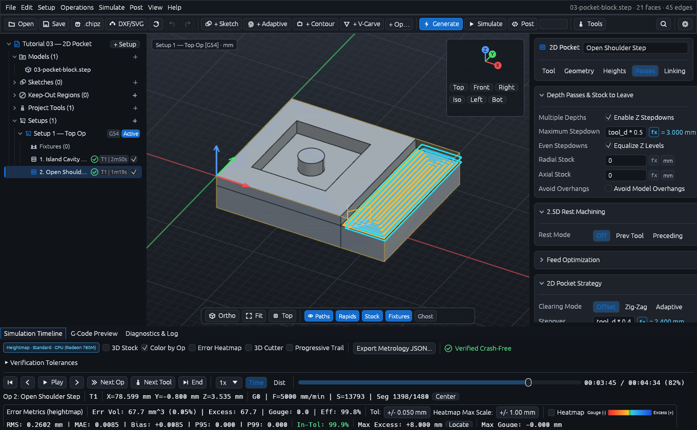

# Tutorial 03 — 2D Pocket (Multi-Island & Open-Shoulder)

## 1. Goal & What You'll Learn

**2D Pocket** clears flat-bottomed cavities and open-sided ledges down to a target floor Z—automatically preserving any raised **islands / bosses** inside a closed cavity and expanding toolpaths into open air along open pocket boundaries.

In this tutorial you will start from an **empty project**, import a minimal pocket block (`100 × 80 × 20 mm` with one closed island cavity and one open-shoulder step), and learn how to:

- Pick a planar pocket floor and verify automatically extracted **Top Z**, **Bottom Z**, and **Island** boundaries.
- Compare **Contour-Parallel (`Offset`)** vs. **`Zig-Zag`** clearing modes and **`Inside -> Out`** vs. **`Outside -> In`** pass ordering.
- Clear an **open-shoulder ledge** cleanly using **`Overhang`** air-entry expansion so no uncut corner cusps remain.
- Configure **`Radial Stock`** (`wall`) and **`Axial Stock`** (`floor`) allowances plus a dedicated **`Wall Finish`** pass for accurate pocket dimensions.

---

## 2. Prerequisites & Starter Model

Start with an **empty project** and load the minimal pocket block included with this tutorial ([`03-pocket-block.step`](assets/03-pocket-block.step) — a pre-squared `100 × 80 × 20 mm` block containing only a closed pocket with a raised `Ø14 mm` central island on the left and an open-shoulder step shelf on the right):

- **From the Welcome Overlay or Menu:** Launch ChipCutter (`chip-gui`), click **`Import 3D STEP Solid…`** in the **Welcome to ChipCutter** overlay (or **`File → Import STEP Model…`** in the **top menu bar**, or the **`+`** / right-click menu on **`Models`** in the left **CAM Browser** → **`Import STEP…`**), and select `docs/tutorials/assets/03-pocket-block.step`.
- **Or open directly from the terminal:**
  ```bash
  chip-gui docs/tutorials/assets/03-pocket-block.step
  ```

In the left **CAM Browser**, click **`Setup 1`** under **`Setups`**, open the **`Stock`** tab in the right **Inspector**, and under **`Stock Offsets`** (with **`Symmetric XY`** / `Mirror ±X / ±Y` checked) set **`Side X Margin (±X)`** = `0 mm`, **`Side Y Margin (±Y)`** = `0 mm`, and **`Top Allowance (+Z)`** = `0 mm` to represent pre-squared `100 × 80 × 20 mm` stock.

---

## 3. Step-by-Step GUI Walkthrough

### Step 1 — Select the Closed Multi-Island Pocket Floor (`Op 1 → Geometry`)

1. With `Setup 1` **`Active`** in the left **CAM Browser**, click **`+ Op… → 2D Pocket`** in the **top toolbar** (or **`Operations → + 2D Pocket`** in the **top menu bar**). In the right **Inspector**, open the **`Tool`** tab and select **`T1 — 6mm 3FL Carbide Flat Endmill`** in the **`Active Cutter`** dropdown under **`Cutter & Material Preset`**.
2. Switch to the **`Geometry`** tab in the right **Inspector**:
   - Under **`Cutting Area / Machining Boundary`** at the top of **`Geometry`**, leave **`Pocket Area Mode`** on **`Inside Selected Pockets`** (when machining raised bosses/islands out of raw stock instead of an enclosed cavity, switch to **`Clear Outside Selected Bosses to Stock`** to preview the Setup Stock XY envelope live in 3D and clear everything around the selected faces/contours from open air; for 2D sketches or closed loops, you can also check **`Open Outer Boundary`** / **`Treat Outer Loop as Open Air`**).
   - Confirm **`Planar Faces`** is selected under **`Interactive 3D Pick Mode`**, and click the recessed pocket floor around the central `Ø14 mm` cylinder in the center **3D CAD Viewport**:


Check the **`Extracted 2.5D WCS Features`** card at the bottom of the **`Geometry`** tab in the right **Inspector**:
- ChipCutter automatically infers **`Inferred Top Z = 0.000 mm`**, **`Inferred Bottom Z = -8.000 mm`** (`8 mm` deep pocket), and **`1 island(s)`** for the raised central cylinder—automatically routing clearing rings around the boss without gouging it.

### Step 2 — Configure Pocket Clearing Mode, Stepover, & Stock-to-Leave (`Op 1 → Passes`)

Switch to the **`Passes`** tab in the right **Inspector** to inspect **`Depth Passes & Stock to Leave`** and **`2D Pocket Strategy`**:


1. **`Depth Passes & Stock to Leave` card:**
   - Keep **`Multiple Depths`** (`Enable Z Stepdowns`) checked so **`Maximum Stepdown`** (`tool_d * 0.5` = `3.000 mm`) and **`Even Stepdowns`** (`Equalize Z Levels`) are displayed.
   - To rough first and leave material for a separate finishing operation, enter non-zero **`Radial Stock`** (wall allowance, e.g., `0.25 mm`) and **`Axial Stock`** (floor allowance, e.g., `0.15 mm`). Leave both at `0` for direct-to-size machining.
2. **`2D Pocket Strategy` card:**
   - **`Clearing Mode`:** Keep **`Offset`** (contour-parallel arc-preserving rings) to follow cavity walls and islands smoothly, or pick **`Zig-Zag`** (which reveals **`Raster Angle`**) to clear wide rectangular pockets rapidly with parallel raster passes. **`Stepover`** and **`Pass Order`** are displayed in both **`Offset`** and **`Zig-Zag`** modes. *(Constant-engagement **`Adaptive`** clearing is covered in Tutorial 05.)*
   - **`Stepover`:** Start at **`tool_d * 0.4`** (`2.400 mm` for a `6 mm` endmill).
   - **`Pass Order`:** Keep **`Automatic (Inside-Out Closed / Outside-In Open)`** so closed cavities helically enter the interior and step outward, while open ledges enter cleanly from outside air.
   - **`Wall Finish`:** Keep **`Wall Finish`** (`Enabled`) checked so **`Wall Allow`** is displayed, and set **`Wall Allow`** (`0.15 mm`) to run a clean final contour pass around every pocket wall and island.

### Step 3 — Add an Open-Shoulder Pocket (`Op 2 → Passes`)

1. Add a second **`2D Pocket`** operation via **`+ Op… → 2D Pocket`** in the **top toolbar** (or **`Operations → + 2D Pocket`** in the **top menu bar**) using the same **`T1 — 6mm 3FL Carbide Flat Endmill`** in the **`Tool`** tab.
2. In the right **Inspector** **`Geometry`** tab, confirm **`Planar Faces`** is selected under **`Interactive 3D Pick Mode`** and click the lowered right-hand step shelf (`6 mm` deep) in the **3D CAD Viewport**.
3. Switch to the **`Passes`** tab in the right **Inspector** and press **`Ctrl+G`** (or click **`Generate`** in the **top toolbar**):



Because three sides of the step face open air, ChipCutter classifies them as **open boundaries** and expands the clearing region outward by the cutter radius plus **`Overhang`** (`0.8 mm` default, under **`2D Pocket Strategy`**). This lets the endmill enter smoothly from outside the billet (no helical plunge required!) and cleanly sweep past the vertical shoulder corners without leaving leftover material cusps.

---

## 4. Key Parameters Reference

| Parameter | Location | Purpose & Recommended Starting Values |
|---|---|---|
| **`Pocket Area Mode`** & **`Open Outer Boundary`** | `Right Inspector → Geometry → Cutting Area / Machining Boundary` | **`Inside Selected Pockets`** clears enclosed cavities (with optional **`Treat Outer Loop as Open Air`** for 2D sketches/closed loops); **`Clear Outside Selected Bosses to Stock`** leaves selected faces/contours standing as bosses and clears surrounding stock out to Setup Stock XY bounds with a live 3D stock-envelope preview. |
| **`Clearing Mode`** | `Right Inspector → Passes → 2D Pocket Strategy` | **`Offset`** (smooth arc-preserving contour-parallel rings around walls & islands) or **`Zig-Zag`** (fast parallel raster; selecting **`Zig-Zag`** reveals **`Raster Angle`**). |
| **`Stepover`** | `Right Inspector → Passes → 2D Pocket Strategy` | Radial width of cut (`ae`, shown in **`Offset`** and **`Zig-Zag`** modes). Typical range: **`tool_d * 0.35`**–**`tool_d * 0.5`** in aluminum/hardwood; reduce to `tool_d * 0.25` in steel. |
| **`Pass Order`** | `Right Inspector → Passes → 2D Pocket Strategy` | Shown in **`Offset`** and **`Zig-Zag`** modes. Keep **`Automatic (Inside-Out Closed / Outside-In Open)`** so closed pockets clear **`Inside -> Out`** from a helical entry and open shoulders clear **`Outside -> In`** from air. |
| **`Overhang`** | `Right Inspector → Passes → 2D Pocket Strategy` | Extra clearance past open pocket edges (`0.5–1.5 mm`) for clean air entry and zero corner cusps. |
| **`Radial Stock`** / **`Axial Stock`** | `Right Inspector → Passes → Depth Passes & Stock to Leave` | Uncut material left on vertical walls (**`Radial Stock`**) and horizontal floors (**`Axial Stock`**) for a dedicated finishing pass. |
| **`Wall Finish`** & **`Wall Allow`** | `Right Inspector → Passes → 2D Pocket Strategy` | Check **`Wall Finish`** (`Enabled`) to reveal **`Wall Allow`** (`0.1–0.25 mm`) and run a final light perimeter pass around pocket walls and islands. |
| **`Entry Mode`** & **`Ramp Angle`** | `Right Inspector → Linking → Ramp & Cavity Entry` | Closed cavities default to **`Helical Ramp`** (`2°–3°`) so flat endmills never plunge vertically into solid metal. |

> [!WARNING]
> **Check Inner Corner Radii:** A `6 mm` (`R3.0 mm`) endmill leaves an `R3.0 mm` fillet in square pocket corners. Follow up with a smaller cutter using **2.5D Rest Machining** (Tutorial 05) whenever sharper internal corners are required.

---

## 5. Generate (`Ctrl+G`) & 3D Simulation Verification

Press **`Ctrl+G`** (or click **`Generate`** in the **top toolbar**; **`Diagnostics & Log`** logs both wall-clock generation duration and estimated CNC cycle time) and click **`Simulate`** in the **top toolbar** (opening the bottom **`Simulation Timeline`** tab), scrubbing near completion (`95%`):


Verify in the **3D CAD Viewport** machined stock:
- The closed cavity is cleared cleanly to `-8.0 mm` while the **`Ø14 mm` raised central island** stays crisp and untouched.
- The **Open Shoulder Step** clears cleanly to `-6.0 mm` with smooth air entry, and **`Verified Crash-Free`** in **`Simulation Timeline`** reports zero crashes or gouges.

---

## 6. Post-Processing (GRBL & LinuxCNC)

Click **`Post`** in the **top toolbar** (or select the bottom **`G-Code Preview`** tab) to inspect the single-tool (`T1`) pocket program:
- Offset rings around the circular island remain exact **`G2` / `G3`** arc commands—minimizing file size and keeping motion smooth on GRBL/FluidNC and LinuxCNC.
- Helical cavity entries emit smooth multi-turn helical `G2`/`G3` moves with simultaneous `Z` descent.

---

## 7. Headless CLI Equivalent (`chipcutter`)

Generate the minimal pocket block and 2-operation project, validate, simulate, and post-process headlessly:

```bash
# 1. Generate the minimal 100x80x20mm pocket block + 2-operation .chip.toml project
chipcutter generate-sample-step /tmp/03-pocket-block.step --tutorial 03-pocket \
  --project-out /tmp/03-pocket.chip.toml

# 2. Validate, generate toolpaths, and verify zero crashes/gouges
chipcutter validate --generate /tmp/03-pocket.chip.toml
chipcutter simulate /tmp/03-pocket.chip.toml --resolution standard

# 3. Post-process for GRBL and LinuxCNC
chipcutter build /tmp/03-pocket.chip.toml -o /tmp/pocket_grbl --post grbl
chipcutter build /tmp/03-pocket.chip.toml -o /tmp/pocket_linuxcnc --post linuxcnc
```

---

## Next Steps

- **Previous:** [Tutorial 02 — 2D Contour / Profile & Holding Tabs](02-2d-contour-tabs.md)
- **Next:** [Tutorial 04 — Drilling & Helical Bore Milling](04-drilling-helical-bore.md)
- **Index:** [All Tutorials](README.md)
