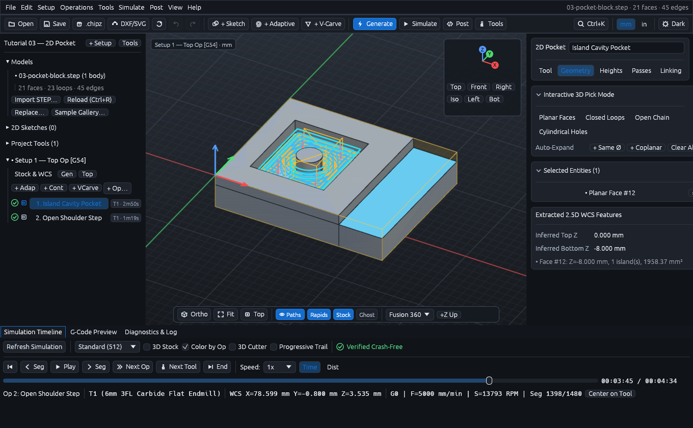
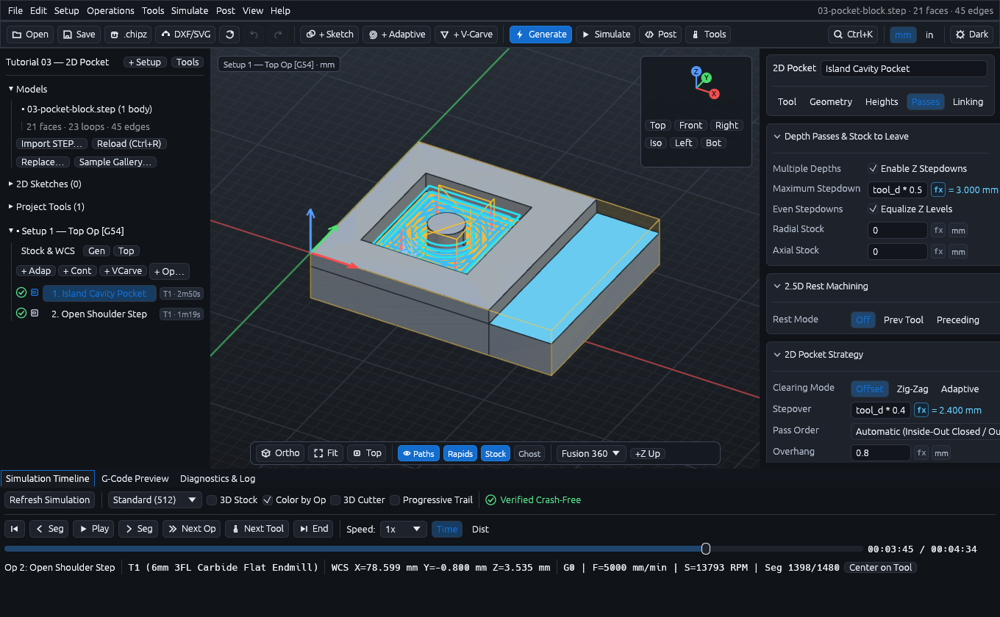
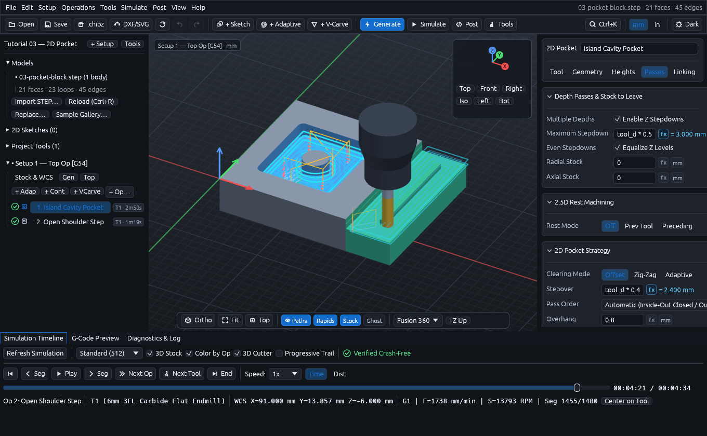

# Tutorial 03 — 2D Pocket (Multi-Island & Open-Shoulder)

## 1. Goal & What You'll Learn

**2D Pocket** clears flat-bottomed cavities and open-sided ledges down to a target floor Z—automatically preserving any raised **islands / bosses** inside a closed cavity and expanding toolpaths into open air along open pocket boundaries.

In this tutorial you will start from an **empty project**, import a minimal pocket block (`100 × 80 × 20 mm` with one closed island cavity and one open-shoulder step), and learn how to:

- Pick a planar pocket floor and verify automatically extracted **Top Z**, **Bottom Z**, and **Island** boundaries.
- Compare **Contour-Parallel (`Offset`)** vs. **`Zig-Zag`** clearing modes and **`Inside-Out`** vs. **`Outside-In`** pass ordering.
- Clear an **open-shoulder ledge** cleanly using **Overhang** air-entry expansion so no uncut corner cusps remain.
- Configure **Radial Stock** (`wall`) and **Axial Stock** (`floor`) allowances plus a dedicated **Wall Finish** pass for accurate pocket dimensions.

---

## 2. Prerequisites & Starter Model

Start with an **empty project** and load the minimal pocket block included with this tutorial ([`03-pocket-block.step`](assets/03-pocket-block.step) — a pre-squared `100 × 80 × 20 mm` block containing only a closed pocket with a raised `Ø14 mm` central island on the left and an open-shoulder step shelf on the right):

- **From the Welcome Overlay or Menu:** Launch `cargo run --release -p chip-gui`, click **Import 3D STEP Solid…**, and select `docs/tutorials/assets/03-pocket-block.step`.
- **Or open directly from the terminal:**
  ```bash
  cargo run --release -p chip-gui -- docs/tutorials/assets/03-pocket-block.step
  ```

In **`Stock & WCS → Stock`**, set **`Side X/Y Margin`** = `0 mm` and **`Top Allowance (+Z)`** = `0 mm` to represent pre-squared `100 × 80 × 20 mm` stock.

---

## 3. Step-by-Step GUI Walkthrough

### Step 1 — Select the Closed Multi-Island Pocket Floor (`Op 1 → Geometry`)

1. Add a 2D Pocket operation via **`Operations → 2D Pocket`** (or **`+ Op… → 2D Pocket`**) and select **`T1 — 6mm 3FL Carbide Flat Endmill`** in the **`Tool`** tab.
2. Switch to the **`Geometry`** tab, click **`Planar Faces`**, and click the recessed pocket floor around the central `Ø14 mm` cylinder:



Check the **Extracted 2.5D WCS Features** summary in the Inspector:
- ChipCutter automatically infers **`Inferred Top Z = 0.000 mm`**, **`Inferred Bottom Z = -8.000 mm`** (`8 mm` deep pocket), and **`1 island(s)`** for the raised central cylinder—automatically routing clearing rings around the boss without gouging it.

### Step 2 — Configure Pocket Clearing Mode, Stepover, & Stock-to-Leave (`Op 1 → Passes`)

Switch to the **`Passes`** tab to inspect **Depth Passes & Stock to Leave** and **2D Pocket Strategy**:



1. **Depth Passes & Stock to Leave:**
   - Enable **`Multiple Depths`** (`Maximum Stepdown = tool_d * 0.5` = `3.000 mm`) with **`Equalize Z Levels`**.
   - To rough first and leave material for a separate finishing operation, enter non-zero **`Radial Stock`** (wall allowance, e.g., `0.25 mm`) and **`Axial Stock`** (floor allowance, e.g., `0.15 mm`). Leave both at `0` for direct-to-size machining.
2. **2D Pocket Strategy:**
   - **Clearing Mode:** **`Offset`** (contour-parallel arc-preserving rings) follows cavity walls and islands smoothly; **`Zig-Zag`** clears wide rectangular pockets rapidly with parallel raster passes. *(Constant-engagement **`Adaptive`** clearing is covered in Tutorial 05.)*
   - **Stepover:** Start at **`tool_d * 0.4`** (`2.400 mm` for a `6 mm` endmill).
   - **Pass Order:** Keep **`Automatic (Inside-Out Closed / Outside-In Open)`** so closed cavities helically enter the interior and step outward, while open ledges enter cleanly from outside air.
   - **Wall Finish:** Enable **`Wall Finish`** with a small **`Wall Allow`** (`0.15 mm`) to run a clean final contour pass around every pocket wall and island.

### Step 3 — Add an Open-Shoulder Pocket (`Op 2 → Passes`)

1. Add a second **`2D Pocket`** operation (**`2. Open Shoulder Step`**) using the same `T1` 6mm Flat Endmill.
2. In **`Geometry`**, click **`Planar Faces`** and select the lowered right-hand step shelf (`6 mm` deep).
3. Switch to **`Passes`** and press **`Ctrl+G`**:


Because three sides of the step face open air, ChipCutter classifies them as **open boundaries** and expands the clearing region outward by the cutter radius plus **`Overhang`** (`0.8 mm` default). This lets the endmill enter smoothly from outside the billet (no helical plunge required!) and cleanly sweep past the vertical shoulder corners without leaving leftover material cusps.

---

## 4. Key Parameters Reference

| Parameter | Location | Purpose & Recommended Starting Values |
|---|---|---|
| **Clearing Mode** | `Passes → 2D Pocket Strategy` | **`Offset`** (smooth arc-preserving contour-parallel rings around walls & islands) or **`Zig-Zag`** (fast parallel raster with customizable **`Raster Angle`**). |
| **Stepover** | `Passes → 2D Pocket Strategy` | Radial width of cut (`ae`). Typical range: **`tool_d * 0.35`**–**`tool_d * 0.5`** in aluminum/hardwood; reduce to `tool_d * 0.25` in steel. |
| **Pass Order** | `Passes → 2D Pocket Strategy` | Keep **`Automatic`** so closed pockets clear **Inside-Out** from a helical entry and open shoulders clear **Outside-In** from air. |
| **Overhang** | `Passes → 2D Pocket Strategy` | Extra clearance past open pocket edges (`0.5–1.5 mm`) for clean air entry and zero corner cusps. |
| **Radial / Axial Stock** | `Passes → Depth Passes & Stock to Leave` | Uncut material left on vertical walls (`Radial Stock`) and horizontal floors (`Axial Stock`) for a dedicated finishing pass. |
| **Wall Finish & Wall Allow** | `Passes → 2D Pocket Strategy` | Runs a final light perimeter pass (`0.1–0.25 mm`) around pocket walls and islands for improved finish and dimensional accuracy. |
| **Entry Mode & Ramp Angle** | `Linking → Ramp & Cavity Entry` | Closed cavities default to **`Helical Ramp`** (`2°–3°`) so flat endmills never plunge vertically into solid metal. |

> [!WARNING]
> **Check Inner Corner Radii:** A `6 mm` (`R3.0 mm`) endmill leaves an `R3.0 mm` fillet in square pocket corners. Follow up with a smaller cutter using **2.5D Rest Machining** (Tutorial 05) whenever sharper internal corners are required.

---

## 5. Generate (`Ctrl+G`) & 3D Simulation Verification

Press **`Ctrl+G`** and open **`Simulation Timeline`** (`Simulate`), scrubbing near completion (`95%`):



Verify in the 3D machined stock:
- The closed cavity is cleared cleanly to `-8.0 mm` while the **`Ø14 mm` raised central island** stays crisp and untouched.
- The **Open Shoulder Step** clears cleanly to `-6.0 mm` with smooth air entry, and **`Verified Crash-Free`** reports zero crashes or gouges.

---

## 6. Post-Processing (GRBL & LinuxCNC)

Open **`G-Code Preview`** to inspect the single-tool (`T1`) pocket program:
- Offset rings around the circular island remain exact **`G2` / `G3`** arc commands—minimizing file size and keeping motion smooth on GRBL/FluidNC and LinuxCNC.
- Helical cavity entries emit smooth multi-turn helical `G2`/`G3` moves with simultaneous `Z` descent.

---

## 7. Headless CLI Equivalent (`chipcutter`)

Generate the minimal pocket block and 2-operation project, validate, simulate, and post-process headlessly:

```bash
# 1. Generate the minimal 100x80x20mm pocket block + 2-operation .chip.toml project
cargo run -p chip-cli -- generate-sample-step /tmp/03-pocket-block.step --tutorial 03-pocket \
  --project-out /tmp/03-pocket.chip.toml

# 2. Validate, generate toolpaths, and verify zero crashes/gouges
cargo run -p chip-cli -- validate --generate /tmp/03-pocket.chip.toml
cargo run -p chip-cli -- simulate /tmp/03-pocket.chip.toml --resolution standard

# 3. Post-process for GRBL and LinuxCNC
cargo run -p chip-cli -- build /tmp/03-pocket.chip.toml -o /tmp/pocket_grbl --post grbl
cargo run -p chip-cli -- build /tmp/03-pocket.chip.toml -o /tmp/pocket_linuxcnc --post linuxcnc
```

---

## Next Steps

- **Previous:** [Tutorial 02 — 2D Contour / Profile & Holding Tabs](02-2d-contour-tabs.md)
- **Next:** [Tutorial 04 — Drilling & Helical Bore Milling](04-drilling-helical-bore.md)
- **Index:** [All Tutorials](README.md)
