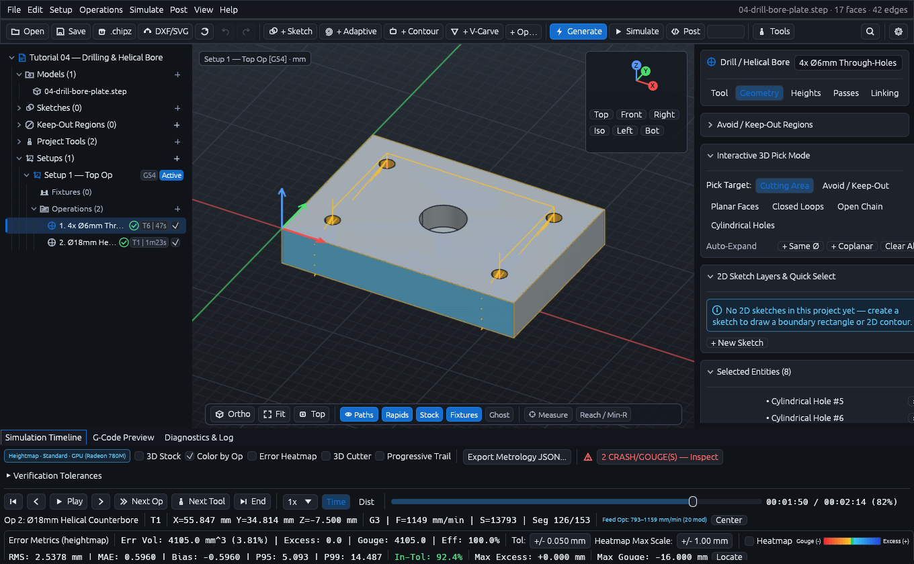
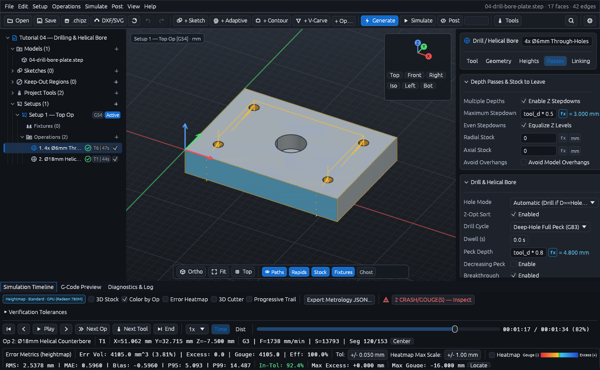
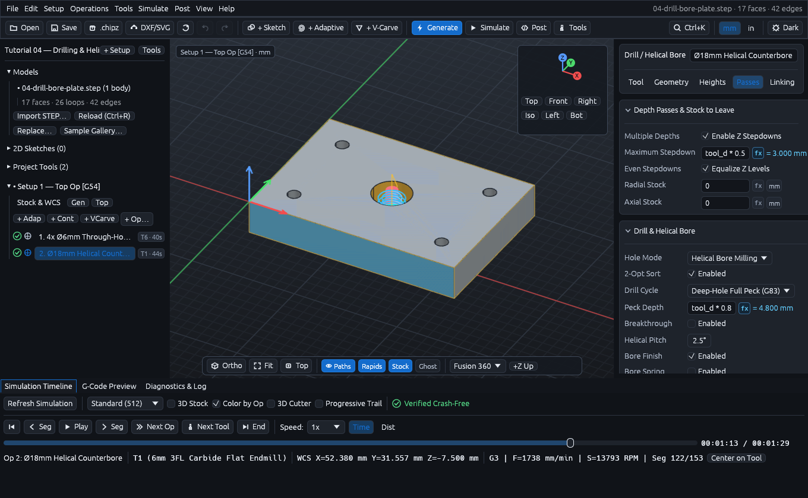
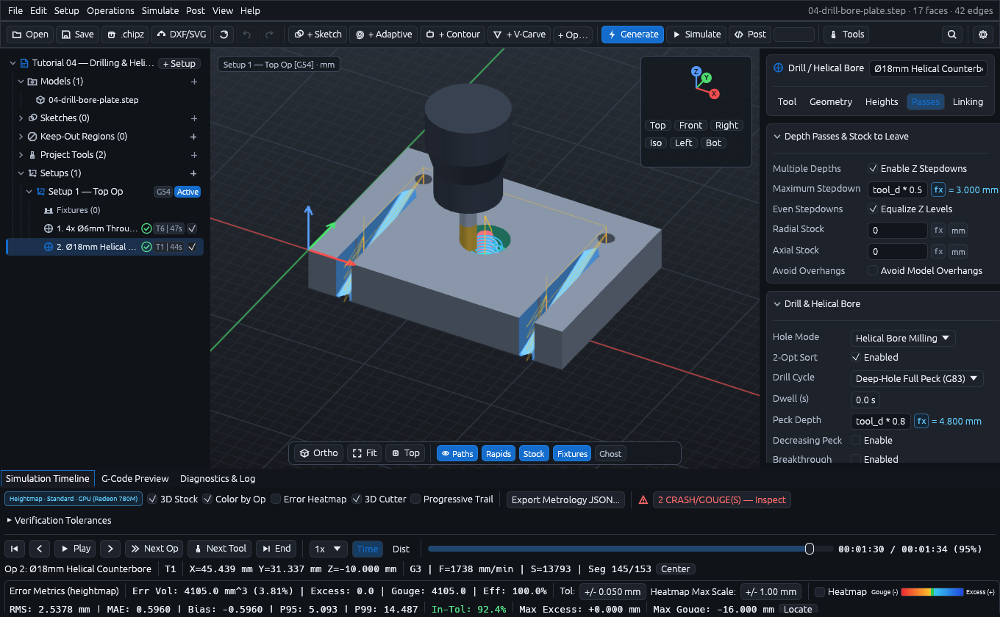
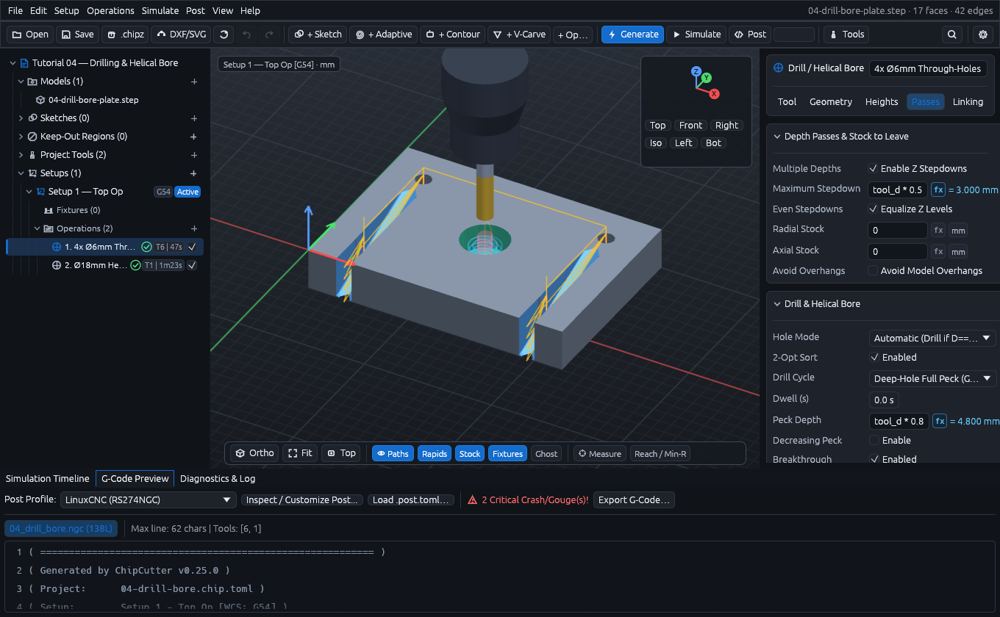

# Tutorial 04 — Drilling & Helical Bore Milling

## 1. Goal & What You'll Learn

ChipCutter's **Drilling & Helical Bore** strategy handles both axial drilling (`Spot`, `G81`, `G73` chip-break, `G83` deep peck) and oversized counterbores milled smoothly with a smaller flat endmill via multi-pitch **helical interpolation**.

In this tutorial you will start from an **empty project**, import a minimal hole plate (`100 × 70 × 16 mm` with 4× `Ø6 mm` corner through-holes and 1× `Ø18 mm` central blind counterbore), and learn how to:

- Batch-select matching 3D cylindrical holes in one click using **`+ Same Ø`** auto-expansion.
- Configure **Deep-Hole Full Peck (`G83`)**, **Chip-Break (`G73`)**, **2-Opt Sort** ordering, and **Tip Breakthrough** allowance on through-holes.
- Machine the oversized `Ø18 mm` blind counterbore using a `6 mm` flat endmill in **Helical Bore Milling** mode (`Helical Pitch`, `Bore Finish`, and `Bore Spring`).
- Compare **LinuxCNC** native canned drilling cycles (`G83`) against **GRBL** automatically expanded peck moves and split-by-tool `.nc` files.

---

## 2. Prerequisites & Starter Model

Start with an **empty project** and load the minimal hole plate included with this tutorial ([`04-drill-bore-plate.step`](assets/04-drill-bore-plate.step) — a pre-squared `100 × 70 × 16 mm` plate with 4× `Ø6.0 mm` corner through-holes and 1× `Ø18.0 mm × 10 mm` deep central blind counterbore):

- **From the Welcome Overlay or Menu:** Launch `cargo run --release -p chip-gui`, click **`Import 3D STEP Solid…`** in the **Welcome to ChipCutter** overlay (or **`File → Import STEP Model…`** in the **top menu bar**, or **`Import STEP…`** under **`Models`** in the left **CAM Browser**), and select `docs/tutorials/assets/04-drill-bore-plate.step`.
- **Or open directly from the terminal:**
  ```bash
  cargo run --release -p chip-gui -- docs/tutorials/assets/04-drill-bore-plate.step
  ```

In the left **CAM Browser**, click **`Stock & WCS`** under `Setup 1`, open the **`Stock`** tab in the right **Inspector**, and under **`Stock Offsets`** (with **`Symmetric XY`** / `Mirror ±X / ±Y` checked) set **`Side X Margin (±X)`** = `0 mm`, **`Side Y Margin (±Y)`** = `0 mm`, and **`Top Allowance (+Z)`** = `0 mm` to represent pre-squared `100 × 70 × 16 mm` stock.

---

## 3. Step-by-Step GUI Walkthrough

### Step 1 — Batch-Pick the 4× `Ø6 mm` Through-Holes (`Op 1 → Geometry`)

1. Add a drilling operation via **`Operations → + Drill / Helical Bore`** in the **top menu bar** (or **`+ Op… → Drill / Helical Bore`** under `Setup 1` in the left **CAM Browser**). In the right **Inspector**, open the **`Tool`** tab and select **`T6 — 6.0mm 118° Carbide Stub Drill`** in the **`Active Cutter`** dropdown under **`Cutter & Material Preset`**.
2. Open the **`Geometry`** tab in the right **Inspector**, confirm **`Cylindrical Holes`** is selected under **`Interactive 3D Pick Mode`**, click any one of the four corner `Ø6 mm` hole walls in the center **3D CAD Viewport**, and then click **`+ Same Ø`** under **`Auto-Expand`** in the **`Interactive 3D Pick Mode`** card to select all four matching holes automatically:



ChipCutter reads exact `f64` cylinder axes, diameters (`Ø6.000 mm`), Top Z, and Bottom Z directly from the B-Rep geometry (never from tessellated triangle meshes).

### Step 2 — Configure Peck Drilling & Tip Breakthrough (`Op 1 → Passes`)

Switch to the **`Passes`** tab in the right **Inspector**, configure the **`Drill & Helical Bore`** card, and press **`Ctrl+G`** (or click **`Generate`** in the **top toolbar**):



1. **`Hole Mode`:** Keep **`Automatic (Drill if D==Hole / Helical Bore if Endmill D<Hole)`** so `T6` (`Ø6.0 mm`) drills the `Ø6.0 mm` holes axially.
2. **`2-Opt Sort`:** Keep **`Enabled`** checked to optimize hole visitation order and minimize rapid travel around the plate perimeter.
3. **`Drill Cycle` & `Peck Depth`:** Select **`Deep-Hole Full Peck (G83)`** (or **`Chip-Breaking Partial Retract (G73)`** for shallower aluminum holes) **first** so **`Peck Depth`** is displayed below it, then set **`Peck Depth`** = `tool_d * 0.8` (`4.800 mm`).
4. **`Breakthrough` & `Extra Depth`:** Keep **`Breakthrough`** (`Enabled`) checked so **`Extra Depth`** is displayed, and set **`Extra Depth`** = `0.5 mm` so ChipCutter automatically adds the 118° drill-point cone length plus `0.5 mm`, ensuring the full `Ø6.0 mm` diameter clears out the bottom of the `16 mm` plate.

### Step 3 — Mill the Central `Ø18 mm` Blind Counterbore (`Op 2 → Passes`)

When a bore is wider than your drill bit (or you want a flat bottom instead of a 118° drill-point cone), use a center-cutting flat endmill in **`Helical Bore Milling`** mode:

1. Add a second **`Drill / Helical Bore`** operation via **`Operations → + Drill / Helical Bore`** in the **top menu bar** (or **`+ Op… → Drill / Helical Bore`** in the left **CAM Browser**). In the right **Inspector**, open the **`Tool`** tab and select **`T1 — 6mm 3FL Carbide Flat Endmill`** in **`Active Cutter`**.
2. Open the **`Geometry`** tab in the right **Inspector**, confirm **`Cylindrical Holes`** is selected under **`Interactive 3D Pick Mode`**, and click the central `Ø18 mm` counterbore wall (`10 mm` deep blind bore) in the **3D CAD Viewport**.
3. Switch to the **`Passes`** tab in the right **Inspector** (`Drill & Helical Bore` card), set **`Hole Mode`** = **`Helical Bore Milling`**, **uncheck `Breakthrough`** (`Enabled`) since this is a blind counterbore, verify **`Helical Pitch`** = `2.5°` and **`Bore Finish`** (`Enabled`) checked, and press **`Ctrl+G`**:



> [!TIP]
> Drilling also works identically on **Pure-2D** parametric **`Bolt Circle`** and **`Grid`** point patterns inside a `2D Sketch` layer (see the built-in **Engraved Nameplate (TrueType + Hershey)** sample via `--sample nameplate`).

---

## 4. Key Parameters Reference

| Parameter | Location | Purpose & Recommended Starting Values |
|---|---|---|
| **`Hole Mode`** | `Right Inspector → Passes → Drill & Helical Bore` | **`Automatic (Drill if D==Hole / Helical Bore if Endmill D<Hole)`**, **`Drilling Cycle`**, or **`Helical Bore Milling`**. |
| **`2-Opt Sort`** | `Right Inspector → Passes → Drill & Helical Bore` | Reorders holes via Nearest-Neighbor + 2-Opt to reduce wasted `G0` rapid travel. |
| **`Drill Cycle`** | `Right Inspector → Passes → Drill & Helical Bore` | **`Spot / Dwell (G82)`**, **`Simple Feed Out (G81)`** for shallow holes, **`Chip-Breaking Partial Retract (G73)`** for chip snapping, or **`Deep-Hole Full Peck (G83)`** for deep chip evacuation. |
| **`Peck Depth`** (`Q`) | `Right Inspector → Passes → Drill & Helical Bore` | Displayed when **`Drill Cycle`** is **`Chip-Breaking Partial Retract (G73)`** or **`Deep-Hole Full Peck (G83)`**. Start around **`0.5 × tool_d`**–**`1.0 × tool_d`**. |
| **`Breakthrough`** & **`Extra Depth`** | `Right Inspector → Passes → Drill & Helical Bore` | Check **`Breakthrough`** (`Enabled`) to reveal **`Extra Depth`** (`0.5–1.0 mm`) on through-holes; **always uncheck on blind holes!** |
| **`Helical Pitch`** | `Right Inspector → Passes → Drill & Helical Bore` | Helical ramp angle (`1.5°–3°` in metal, `4°–8°` in wood/plastic) when interpolating with a flat endmill. |
| **`Bore Finish`** / **`Bore Spring`** | `Right Inspector → Passes → Drill & Helical Bore` | Adds a full-circle floor/wall cleanup pass and optional zero-offset spring pass for accurate roundness. |

---

## 5. Generate (`Ctrl+G`) & 3D Simulation Verification

Press **`Ctrl+G`** (or click **`Generate`** in the **top toolbar**) and click **`Simulate`** in the **top toolbar** (opening the bottom **`Simulation Timeline`** tab), scrubbing near completion (`95%`):



Verify in the **3D CAD Viewport** machined stock:
- All four `Ø6 mm` corner holes pass cleanly through the `16 mm` plate.
- The central `Ø18 mm` blind counterbore stops cleanly at `-10.0 mm` with a flat bottom, and **`Verified Crash-Free`** in **`Simulation Timeline`** reports zero collisions or gouges.

---

## 6. Post-Processing (LinuxCNC vs. GRBL)

Click **`Post`** in the **top toolbar** (or select the bottom **`G-Code Preview`** tab) and select **`LinuxCNC (RS274NGC)`** from **`Post Profile:`**:



Compare how ChipCutter formats the exact same drilling & boring CL-data across controllers:
- **LinuxCNC (`linuxcnc.post.toml`):** Emits a single unified `.ngc` program (`Tools: [6, 1]`) with native canned peck cycles (`G98 G83 X… Y… Z… R… Q… F…` + `G80`) for `T6` and true multi-turn helical `G2`/`G3` arcs for `T1`.
- **GRBL 1.1 / FluidNC (`grbl.post.toml`):** Automatically **expands** every `G83` peck into explicit `G0`/`G1` moves (since standard GRBL does not support canned drill cycles) and splits `T6` and `T1` into separate `.nc` files for manual tool changes.

---

## 7. Headless CLI Equivalent (`chipcutter`)

Generate the minimal drill/bore plate and 2-operation project, validate, simulate, and compare LinuxCNC vs. GRBL G-code headlessly:

```bash
# 1. Generate the minimal 100x70x16mm drill/bore plate + 2-operation .chip.toml project
cargo run -p chip-cli -- generate-sample-step /tmp/04-drill-bore-plate.step --tutorial 04-drill-bore \
  --project-out /tmp/04-drill-bore.chip.toml

# 2. Validate, generate toolpaths, and verify zero crashes/gouges
cargo run -p chip-cli -- validate --generate /tmp/04-drill-bore.chip.toml
cargo run -p chip-cli -- simulate /tmp/04-drill-bore.chip.toml --resolution standard

# 3. Build LinuxCNC (single ATC file with native G83) and GRBL (expanded pecks + split files)
cargo run -p chip-cli -- build /tmp/04-drill-bore.chip.toml -o /tmp/drill_linuxcnc --post linuxcnc
cargo run -p chip-cli -- build /tmp/04-drill-bore.chip.toml -o /tmp/drill_grbl --post grbl
```

---

## Next Steps

- **Previous:** [Tutorial 03 — 2D Pocket (Multi-Island & Open-Shoulder)](03-2d-pocket.md)
- **Next:** [Tutorial 05 — 2D Adaptive Clearing & 2.5D Rest Machining](05-adaptive-rest-machining.md)
- **Index:** [All Tutorials](README.md)
