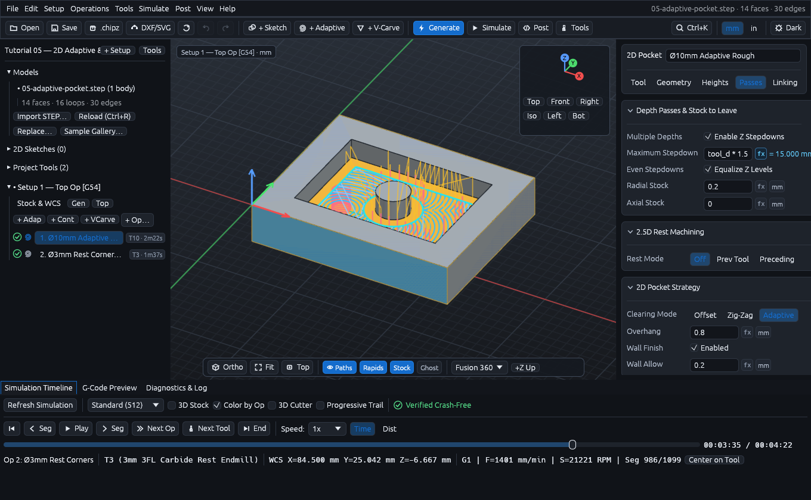
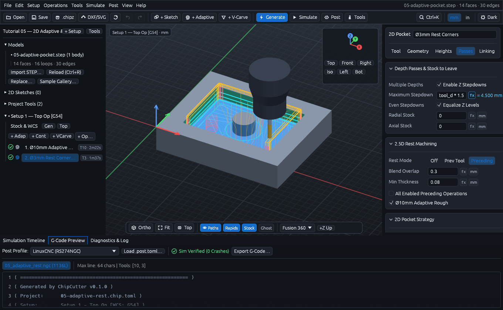

# Tutorial 05 — 2D Adaptive Clearing & 2.5D Rest Machining

## 1. Goal & What You'll Learn

Traditional offset pocketing takes shallow Z passes and suffers sudden full-width engagement spikes whenever the cutter enters an internal corner. **2D Adaptive Clearing** flips that approach: it takes **deep axial cuts** at a **constant, light radial load (`Optimal Load` `ae`)** using smooth trochoidal arcs, then pairs with **2.5D Rest Machining** so a smaller cutter removes *only* the leftover corner wedges without cutting empty air.

In this tutorial you will start from an **empty project**, import a minimal deep-pocket block (`100 × 80 × 20 mm`), and learn how to:

- Configure **2D Adaptive Clearing** (`Optimal Load`, `Cut Direction`, `Micro-Lift Z`, `Stay-Down` feed multiplier, and automatic **Radial Chip Thinning (`Chip Thinning`)**).
- Leave a controlled **`Radial Stock`** (`0.2 mm`) wall allowance while roughing a `10 mm`-deep sharp-corner pocket at full axial depth with a `Ø10 mm` endmill.
- Chain a smaller `Ø3 mm` endmill using **`Rest Mode: Preceding`** (`FromPrecedingOperations`) and see ChipCutter's topological DAG wave execution automatically target only the 4 uncut corner wedges + wall stock.
- Verify engagement cleanup in **3D Simulation (`Color by Op`)** and export verified **LinuxCNC / GRBL** G-code.

---

## 2. Prerequisites & Starter Model

Start with an **empty project** and load the minimal deep-pocket block included with this tutorial ([`05-adaptive-pocket.step`](assets/05-adaptive-pocket.step) — a pre-squared `100 × 80 × 20 mm` block containing only a single `10 mm`-deep sharp-corner pocket with a raised `Ø16 mm` central boss):

- **From the Welcome Overlay or Menu:** Launch `cargo run --release -p chip-gui`, click **Import 3D STEP Solid…**, and select `docs/tutorials/assets/05-adaptive-pocket.step`.
- **Or open directly from the terminal:**
  ```bash
  cargo run --release -p chip-gui -- docs/tutorials/assets/05-adaptive-pocket.step
  ```

In **`Stock & WCS → Stock`**, set **`Side X/Y Margin`** = `0 mm` and **`Top Allowance (+Z)`** = `0 mm` to match pre-squared `100 × 80 × 20 mm` stock.

---

## 3. Step-by-Step GUI Walkthrough

### Step 1 — Add a 2D Adaptive Roughing Operation (`Op 1 → Geometry`)

1. Click **`+ Adaptive`** in the top toolbar (or **`Operations → 2D Adaptive Clearing`**) to create **`1. Ø10mm Adaptive Rough`**.
2. In the **`Tool`** tab, choose a rigid `Ø10 mm` 3-flute flat endmill (`T10`, `22 mm` flute length — plenty of clearance for a full `10 mm` axial cut!).
3. Switch to the **`Geometry`** tab, click **`Planar Faces`**, and pick the recessed pocket floor (`Z = -10.000 mm`):


Check **Extracted 2.5D WCS Features**: ChipCutter automatically infers `Inferred Top Z = 0.000 mm`, `Inferred Bottom Z = -10.000 mm`, and `1 island(s)` for the central `Ø16 mm` boss.

### Step 2 — Tune Optimal Load, Micro-Lift, & Radial Chip Thinning (`Op 1 → Passes`)

Switch to the **`Passes`** tab and press **`Ctrl+G`** to inspect the **2D Adaptive Clearing** parameters and trochoidal clearing toolpath:



1. **Depth Passes & Stock to Leave:**
   - Set **`Radial Stock`** = `0.2 mm` so the roughing pass stays cleanly off the final walls.
   - Because radial engagement is light (`20%` of cutter diameter), `Maximum Stepdown` can safely take the entire `10 mm` cavity depth in a single Z level (`<= 1.5 × tool_d` in aluminum on a rigid spindle).
2. **2D Adaptive Clearing Card:**
   - **`Optimal Load`:** `2.0 mm` (`20%` of `Ø10 mm` cutter) caps maximum radial engagement even in tight corners.
   - **`Micro-Lift Z`:** Lifts the cutter slightly (`0.25 mm`) off the pocket floor during non-cutting stay-down repositioning arcs, preventing floor rub marks while avoiding slow full-Z retracts.
   - **`Stay-Down`:** Accelerates non-cutting back-linking moves (`2.0x–3.0x`) for fast cycle times.
   - **`Chip Thinning` (`RCT`):** Automatically boosts feedrate at low radial engagement (`ae < 50% D`) to preserve the target chip thickness (`hex`) and displays the live **Effective RCT-Compensated Feed** banner right inside the card.

Notice in the viewport that the `Ø10 mm` (`R5.0 mm`) rougher cannot reach all the way into the four sharp `90°` pocket corners—leaving four uncut triangular wedges.

### Step 3 — Chain `FromPrecedingOperations` 2.5D Rest Machining (`Op 2 → Passes`)

Instead of re-machining the entire pocket with a tiny tool, chain a second adaptive operation that subtracts `Op 1`'s swept material automatically:

1. Click **`+ Adaptive`** to add **`2. Ø3mm Rest Corners`** and select a **`Ø3 mm`** flat endmill (`T3`) in the **`Tool`** tab.
2. In **`Geometry`**, select the **exact same pocket floor** (`Planar Face`).
3. Switch to **`Passes`**:
   - Set **`Radial Stock`** = `0 mm` and **`Axial Stock`** = `0 mm`.
   - Under **`2.5D Rest Machining`**, click **`Preceding`** (`FromPrecedingOperations`) and select `1. Ø10mm Adaptive Rough` as the upstream source.
4. Press **`Ctrl+G`**:


Notice how `Op 2`'s toolpath appears **only** in the four uncut corner wedges and thin `0.2 mm` wall allowance—zero wasted air-cutting! Because ChipCutter tracks a topological **DAG**, editing `Op 1`'s tool diameter or `Radial Stock` automatically marks `Op 2` **`Dirty`** and executes them in dependency waves on the next `Ctrl+G`.

---

## 4. Key Parameters Reference

| Parameter | Location | Purpose & Recommended Starting Values |
|---|---|---|
| **Optimal Load (`ae`)** | `Passes → 2D Adaptive Clearing` | Maximum radial engagement maintained by trochoidal arcs. Start at **`0.15–0.25 × tool_d`** in aluminum and **`0.08–0.15 × tool_d`** in steel. |
| **Cut Direction** | `Passes → 2D Adaptive Clearing` | **`Climb`** (standard for metal), **`Conventional`**, or **`Both Ways`** (bi-directional adaptive cutting with minimal non-cutting links). |
| **Micro-Lift Z** | `Passes → 2D Adaptive Clearing` | Small axial lift (`0.15–0.35 mm`) during stay-down linking arcs so the cutter clears chips without full Z retracts. |
| **Stay-Down Multiplier** | `Passes → 2D Adaptive Clearing` | Feedrate multiplier (`2.0x–4.0x`) on non-cutting micro-lift linking arcs. |
| **Chip Thinning & Max Boost** | `Passes → 2D Adaptive Clearing` | Compensates for radial chip thinning when `ae < 0.5 × tool_d`, capped safely by **`Max Boost`** (`1.5x–2.5x`). |
| **Rest Mode (`Prev Tool` vs. `Preceding`)** | `Passes → 2.5D Rest Machining` | **`Prev Tool`** computes rest stock from a single virtual reference diameter; **`Preceding`** subtracts the exact swept 2D regions of selected upstream operations via DAG waves. |

---

## 5. Generate (`Ctrl+G`) & 3D Simulation Verification

Press **`Ctrl+G`** and open **`Simulation Timeline`** (`Simulate`) with **`3D Stock`** and **`Color by Op`** checked, scrubbing near completion (`98%`):


With **`Color by Op`** enabled, you can visually verify two distinct regions:
- The bulk interior cleared rapidly by `Op 1` (`Ø10 mm` Adaptive Rougher), and
- The crisp, sharpened corners and finished walls cleaned out by `Op 2` (`Ø3 mm` Rest Endmill)—with **`Verified Crash-Free`** confirming zero collisions or gouges.

---

## 6. Post-Processing (LinuxCNC & GRBL)

Switch to **`G-Code Preview`** (`LinuxCNC (RS274NGC)` shown below):



- **`LinuxCNC (RS274NGC)`** emits a single ATC `.ngc` program (`Tools: [10, 3]`) with `G64 P` continuous path blending so dense high-speed trochoidal arcs run smoothly without stuttering.
- **`GRBL 1.1 / FluidNC (Split by Tool)`** splits `T10` (Adaptive Rough) and `T3` (Rest Corners) into two sequential `.nc` files for manual tool changes.

---

## 7. Headless CLI Equivalent (`chipcutter`)

Generate the minimal adaptive pocket block and 2-operation DAG project, validate, simulate, and post-process headlessly:

```bash
# 1. Generate the minimal 100x80x20mm deep-pocket STEP solid + 2-op Adaptive/Rest project
cargo run -p chip-cli -- generate-sample-step /tmp/05-adaptive-pocket.step \
  --tutorial 05-adaptive-rest --project-out /tmp/05-adaptive-rest.chip.toml

# 2. Validate DAG dependencies, generate toolpaths, and verify zero crashes/gouges
cargo run -p chip-cli -- validate --generate /tmp/05-adaptive-rest.chip.toml
cargo run -p chip-cli -- simulate /tmp/05-adaptive-rest.chip.toml --resolution standard

# 3. Post-process for LinuxCNC (ATC) and GRBL (split by tool)
cargo run -p chip-cli -- build /tmp/05-adaptive-rest.chip.toml -o /tmp/adp_linuxcnc --post linuxcnc
cargo run -p chip-cli -- build /tmp/05-adaptive-rest.chip.toml -o /tmp/adp_grbl --post grbl
```

---

## Next Steps

- **Previous:** [Tutorial 04 — Drilling & Helical Bore Milling](04-drilling-helical-bore.md)
- **Next:** [Tutorial 06 — Edge Chamfering & 2D Curve Trace / Engraving](06-chamfer-curve-trace.md)
- **Index:** [All Tutorials](README.md)
