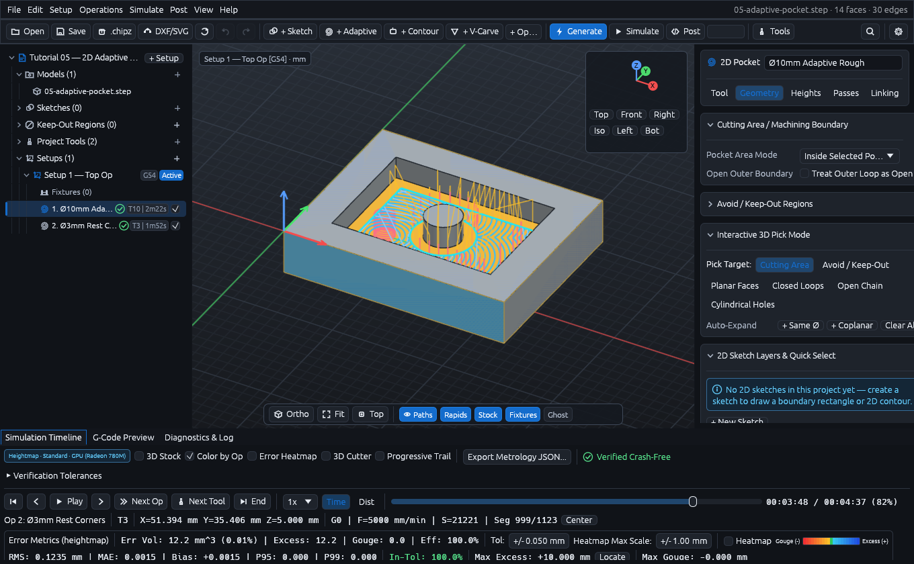
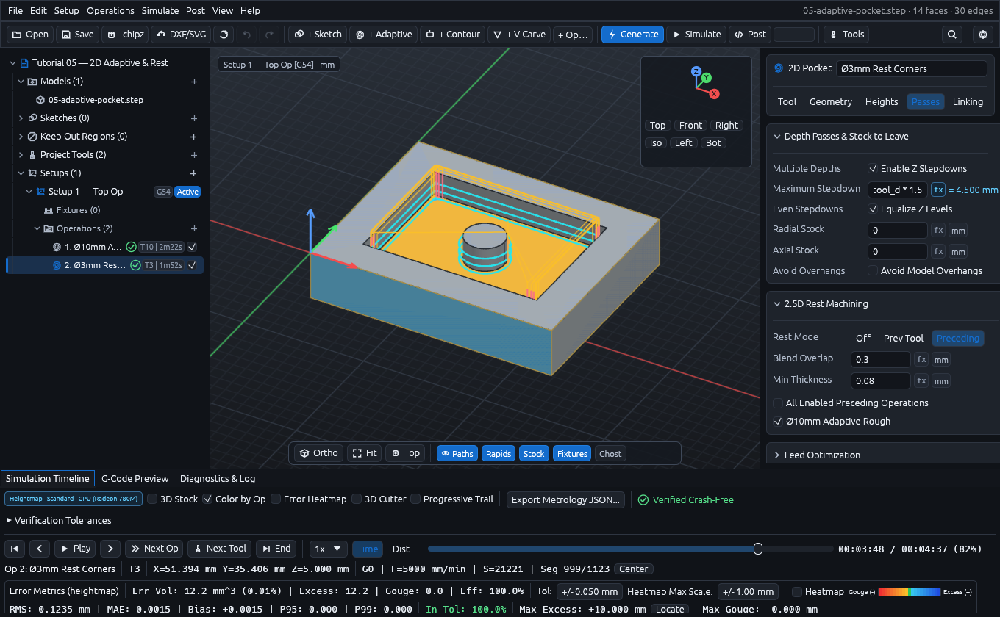
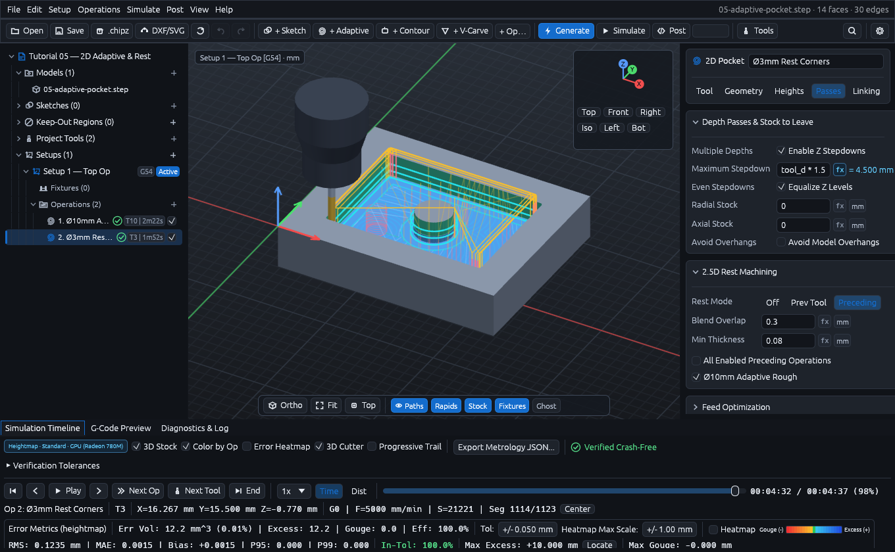

# Tutorial 05 — 2D Adaptive Clearing & 2.5D Rest Machining

## 1. Goal & What You'll Learn

Traditional offset pocketing takes shallow Z passes and suffers sudden full-width engagement spikes whenever the cutter enters an internal corner. **2D Adaptive Clearing** flips that approach: it takes **deep axial cuts** at a **constant, light radial load (`Optimal Load` `ae`)** using smooth trochoidal arcs, then pairs with **2.5D Rest Machining** so a smaller cutter removes *only* the leftover corner wedges without cutting empty air.

In this tutorial you will start from an **empty project**, import a minimal deep-pocket block (`100 × 80 × 20 mm`), and learn how to:

- Configure **2D Adaptive Clearing** (`Optimal Load`, `Cut Direction`, `Micro-Lift Z`, `Stay-Down` feed multiplier, and automatic **Radial Chip Thinning (`Chip Thinning`)**).
- Leave a controlled **`Radial Stock`** (`0.2 mm`) wall allowance while roughing a `10 mm`-deep sharp-corner pocket at full axial depth with a `Ø10 mm` endmill.
- Chain a smaller `Ø3 mm` endmill using **`Rest Mode: Preceding`** (`FromPrecedingOperations`) and see ChipCutter's topological DAG wave execution automatically target only the 4 uncut corner wedges + wall stock.
- Verify engagement cleanup in **3D Simulation (`Color by Op`)** and export verified **LinuxCNC / GRBL** G-code.

---

## 2. Prerequisites & Starter Model

Start with an **empty project** and load the minimal deep-pocket block included with this tutorial ([`05-adaptive-pocket.step`](assets/05-adaptive-pocket.step) — a pre-squared `100 × 80 × 20 mm` block containing only a single `10 mm`-deep sharp-corner pocket with a raised `Ø16 mm` central boss):

- **From the Welcome Overlay or Menu:** Launch ChipCutter (`chip-gui`), click **`Import 3D STEP Solid…`** in the **Welcome to ChipCutter** overlay (or **`File → Import STEP Model…`** in the **top menu bar**, or **`Import STEP…`** under **`Models`** in the left **CAM Browser**), and select `docs/tutorials/assets/05-adaptive-pocket.step`.
- **Or open directly from the terminal:**
  ```bash
  chip-gui docs/tutorials/assets/05-adaptive-pocket.step
  ```

In the left **CAM Browser**, click **`Stock & WCS`** under `Setup 1`, open the **`Stock`** tab in the right **Inspector**, and under **`Stock Offsets`** (with **`Symmetric XY`** / `Mirror ±X / ±Y` checked) set **`Side X Margin (±X)`** = `0 mm`, **`Side Y Margin (±Y)`** = `0 mm`, and **`Top Allowance (+Z)`** = `0 mm` to match pre-squared `100 × 80 × 20 mm` stock.

---

## 3. Step-by-Step GUI Walkthrough

### Step 1 — Add a 2D Adaptive Roughing Operation (`Op 1 → Geometry`)

1. Click **`+ Adaptive`** in the **top toolbar** (or **`Operations → + 2D Adaptive / Trochoidal Clearing`** in the **top menu bar**, or **`+ Adap`** under `Setup 1` in the left **CAM Browser**) to add the adaptive clearing operation.
2. In the right **Inspector**, open the **`Tool`** tab and open **`Active Cutter`** under **`Cutter & Material Preset`**:
   - If you opened the pre-seeded `--tutorial 05-adaptive-rest` project (or `--sample adaptive-rest`), select **`T10 — 10mm 3FL Carbide Flat Endmill`** (`22 mm` flute length — plenty of clearance for a full `10 mm` axial cut).
   - If you started from an empty project using the default 8-tool starter library, select **`T1 — 6mm 3FL Carbide Flat Endmill`** (or clone a custom machine in **Tool Library Manager** via **`Tools`** in the **top toolbar** and click **`+ New Cutter`** to define a `Ø10 mm` flat endmill).
3. Switch to the **`Geometry`** tab in the right **Inspector**, confirm **`Planar Faces`** is selected under **`Interactive 3D Pick Mode`**, and click the recessed pocket floor (`Z = -10.000 mm`) in the center **3D CAD Viewport**:



Check **`Extracted 2.5D WCS Features`** at the bottom of the **`Geometry`** tab: ChipCutter automatically infers `Inferred Top Z = 0.000 mm`, `Inferred Bottom Z = -10.000 mm`, and `1 island(s)` for the central `Ø16 mm` boss.

### Step 2 — Tune Optimal Load, Micro-Lift, & Radial Chip Thinning (`Op 1 → Passes`)

Switch to the **`Passes`** tab in the right **Inspector** and press **`Ctrl+G`** (or click **`Generate`** in the **top toolbar**) to inspect the **`2D Adaptive Clearing`** parameters and trochoidal clearing toolpath:


1. **`Depth Passes & Stock to Leave` card:**
   - Set **`Radial Stock`** = `0.2 mm` so the roughing pass stays cleanly off the final walls.
   - Because radial engagement is light (`20%` of cutter diameter), either uncheck **`Multiple Depths`** (`Enable Z Stepdowns`) to take the full `10 mm` cavity in one pass, or keep **`Multiple Depths`** checked so **`Maximum Stepdown`** is displayed and set it up to `10 mm` (`<= 1.5 × tool_d` for a `Ø10 mm` cutter in aluminum on a rigid spindle).
2. **`2D Pocket Strategy` & `2D Adaptive Clearing` cards:**
   - Confirm **`Clearing Mode`** is set to **`Adaptive`** under **`2D Pocket Strategy`** so the **`2D Adaptive Clearing`** card is displayed below it.
   - **`Optimal Load`:** `2.0 mm` (`20%` of a `Ø10 mm` cutter, or `1.2 mm` for a `Ø6 mm` cutter) caps maximum radial engagement even in tight corners.
   - **`Micro-Lift Z`:** Lifts the cutter slightly (`0.25 mm`) off the pocket floor during non-cutting stay-down repositioning arcs, preventing floor rub marks while avoiding slow full-Z retracts.
   - **`Stay-Down`:** Accelerates non-cutting back-linking moves (`2.0x–3.0x`) for fast cycle times.
   - **`Chip Thinning`:** Keep **`Chip Thinning`** (`Enabled`) checked so **`Max Boost`** and the live **Effective RCT-Compensated Feed** banner are displayed inside the card, boosting feedrate automatically at low radial engagement (`ae < 50% D`).

Notice in the **3D CAD Viewport** that the `Ø10 mm` (`R5.0 mm`) rougher cannot reach all the way into the four sharp `90°` pocket corners—leaving four uncut triangular wedges.

### Step 3 — Chain `FromPrecedingOperations` 2.5D Rest Machining (`Op 2 → Passes`)

Instead of re-machining the entire pocket with a tiny tool, chain a second adaptive operation that subtracts `Op 1`'s swept material automatically:

1. Click **`+ Adaptive`** in the **top toolbar** (or **`+ Adap`** in the left **CAM Browser**) to add the rest-machining operation, then in the right **Inspector** **`Tool`** tab select **`T3 — 1/8 in 2FL Carbide Flat`** (or `Ø3 mm` flat endmill) under **`Active Cutter`**.
2. In the right **Inspector** **`Geometry`** tab (`Planar Faces`), click the **exact same pocket floor** in the **3D CAD Viewport**.
3. Switch to the **`Passes`** tab in the right **Inspector**:
   - Under **`Depth Passes & Stock to Leave`**, set **`Radial Stock`** = `0 mm` and **`Axial Stock`** = `0 mm`.
   - Under **`2.5D Rest Machining`**, click **`Preceding`** on the **`Rest Mode`** row **first** so **`Blend Overlap`**, **`Min Thickness`**, and the **`All Enabled Preceding Operations`** checkbox appear below it. Leave **`All Enabled Preceding Operations`** checked (to automatically subtract `Op 1`), or uncheck it to reveal individual operation checkboxes and pick **`1. Ø10mm Adaptive Rough`** specifically.
4. Press **`Ctrl+G`** (or click **`Generate`** in the **top toolbar**):



Notice how `Op 2`'s toolpath appears **only** in the four uncut corner wedges and thin `0.2 mm` wall allowance—zero wasted air-cutting! Because ChipCutter tracks a topological **DAG**, editing `Op 1`'s tool diameter or `Radial Stock` automatically marks `Op 2` **`Dirty`** and executes them in dependency waves on the next `Ctrl+G`.

---

## 4. Key Parameters Reference

| Parameter | Location | Purpose & Recommended Starting Values |
|---|---|---|
| **`Optimal Load`** (`ae`) | `Right Inspector → Passes → 2D Adaptive Clearing` | Shown when **`Clearing Mode`** = **`Adaptive`**. Maximum radial engagement maintained by trochoidal arcs: **`0.15–0.25 × tool_d`** in aluminum, **`0.08–0.15 × tool_d`** in steel. |
| **`Cut Direction`** | `Right Inspector → Passes → 2D Adaptive Clearing` | **`Climb (Down-Milling)`** (standard for metal), **`Conventional (Up-Milling)`**, or **`Both Ways (Alternating)`**. |
| **`Micro-Lift Z`** | `Right Inspector → Passes → 2D Adaptive Clearing` | Small axial lift (`0.15–0.35 mm`) during stay-down linking arcs so the cutter clears chips without full Z retracts. |
| **`Stay-Down`** | `Right Inspector → Passes → 2D Adaptive Clearing` | Feedrate multiplier (`2.0x–4.0x`) on non-cutting micro-lift linking arcs. |
| **`Chip Thinning`** & **`Max Boost`** | `Right Inspector → Passes → 2D Adaptive Clearing` | Check **`Chip Thinning`** (`Enabled`) to reveal **`Max Boost`** (`1.5x–2.5x`) and compensate for radial chip thinning when `ae < 0.5 × tool_d`. |
| **`Rest Mode`** (`Off` / `Prev Tool` / `Preceding`) | `Right Inspector → Passes → 2.5D Rest Machining` | Selecting **`Prev Tool`** reveals **`Prev. Tool Ø`** and **`Prev. Radial Stock`**; selecting **`Preceding`** reveals **`All Enabled Preceding Operations`** (uncheck to pick specific upstream ops); both reveal **`Blend Overlap`** and **`Min Thickness`**. |

---

## 5. Generate (`Ctrl+G`) & 3D Simulation Verification

Press **`Ctrl+G`** (or click **`Generate`** in the **top toolbar**), click **`Simulate`** in the **top toolbar** (opening the bottom **`Simulation Timeline`** tab), confirm **`3D Stock`** and **`Color by Op`** are checked in the **`Simulation Timeline`** top bar, and scrub near completion (`98%`):



With **`Color by Op`** enabled, you can visually verify two distinct regions in the **3D CAD Viewport**:
- The bulk interior cleared rapidly by `Op 1` (`Ø10 mm` Adaptive Rougher), and
- The crisp, sharpened corners and finished walls cleaned out by `Op 2` (`Ø3 mm` Rest Endmill)—with **`Verified Crash-Free`** in **`Simulation Timeline`** confirming zero collisions or gouges.

---

## 6. Post-Processing (LinuxCNC & GRBL)

Click **`Post`** in the **top toolbar** (or select the bottom **`G-Code Preview`** tab) and choose **`LinuxCNC (RS274NGC)`** or **`GRBL 1.1 / FluidNC (Split by Tool)`** in **`Post Profile:`**:


- **`LinuxCNC (RS274NGC)`** emits a single ATC `.ngc` program (`Tools: [10, 3]`) with `G64 P` continuous path blending so dense high-speed trochoidal arcs run smoothly without stuttering.
- **`GRBL 1.1 / FluidNC (Split by Tool)`** splits `T10` (Adaptive Rough) and `T3` (Rest Corners) into two sequential `.nc` files for manual tool changes.

---

## 7. Headless CLI Equivalent (`chipcutter`)

Generate the minimal adaptive pocket block and 2-operation DAG project, validate, simulate, and post-process headlessly:

```bash
# 1. Generate the minimal 100x80x20mm deep-pocket STEP solid + 2-op Adaptive/Rest project
chipcutter generate-sample-step /tmp/05-adaptive-pocket.step \
  --tutorial 05-adaptive-rest --project-out /tmp/05-adaptive-rest.chip.toml

# 2. Validate DAG dependencies, generate toolpaths, and verify zero crashes/gouges
chipcutter validate --generate /tmp/05-adaptive-rest.chip.toml
chipcutter simulate /tmp/05-adaptive-rest.chip.toml --resolution standard

# 3. Post-process for LinuxCNC (ATC) and GRBL (split by tool)
chipcutter build /tmp/05-adaptive-rest.chip.toml -o /tmp/adp_linuxcnc --post linuxcnc
chipcutter build /tmp/05-adaptive-rest.chip.toml -o /tmp/adp_grbl --post grbl
```

---

## Next Steps

- **Previous:** [Tutorial 04 — Drilling & Helical Bore Milling](04-drilling-helical-bore.md)
- **Next:** [Tutorial 06 — Edge Chamfering & 2D Curve Trace / Engraving](06-chamfer-curve-trace.md)
- **Index:** [All Tutorials](README.md)
