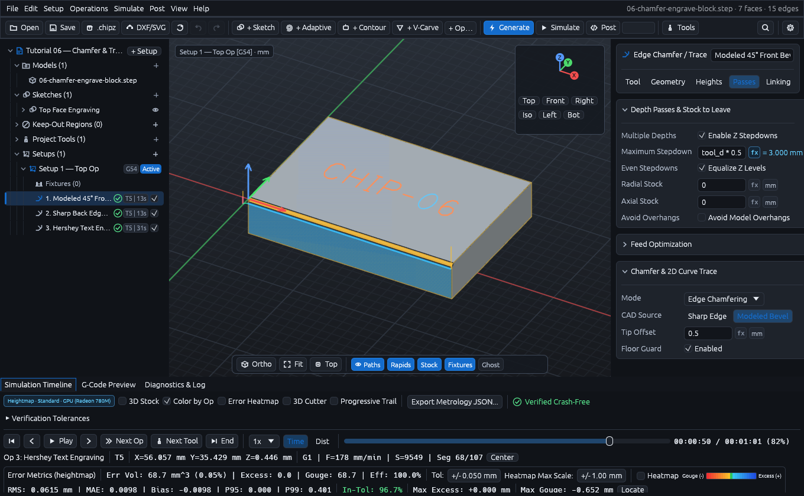
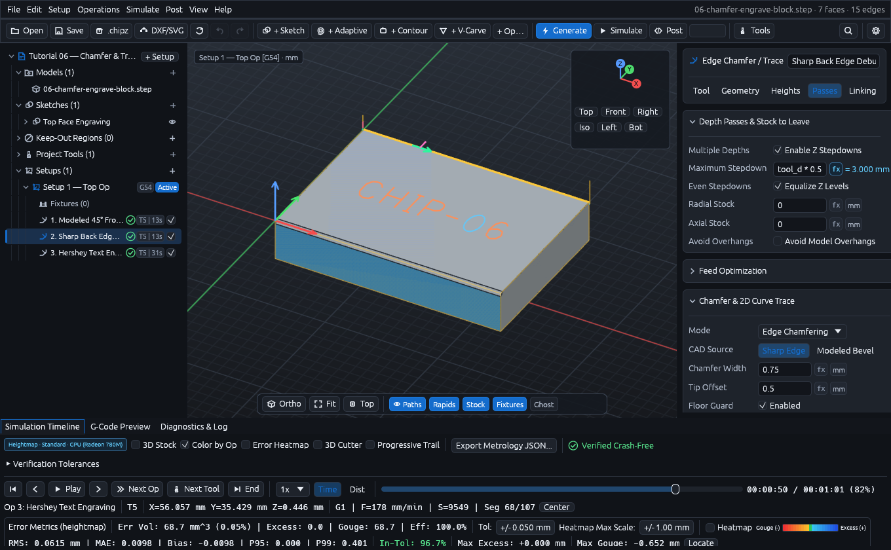
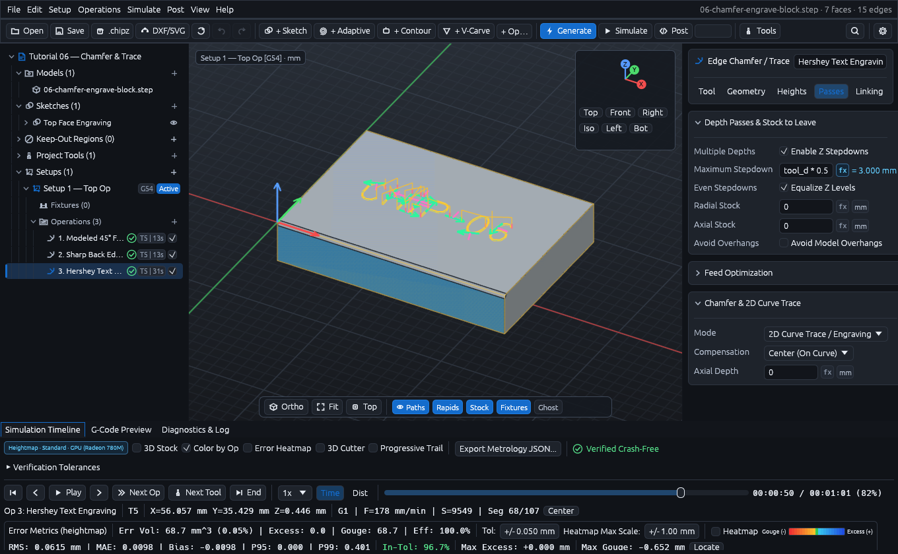
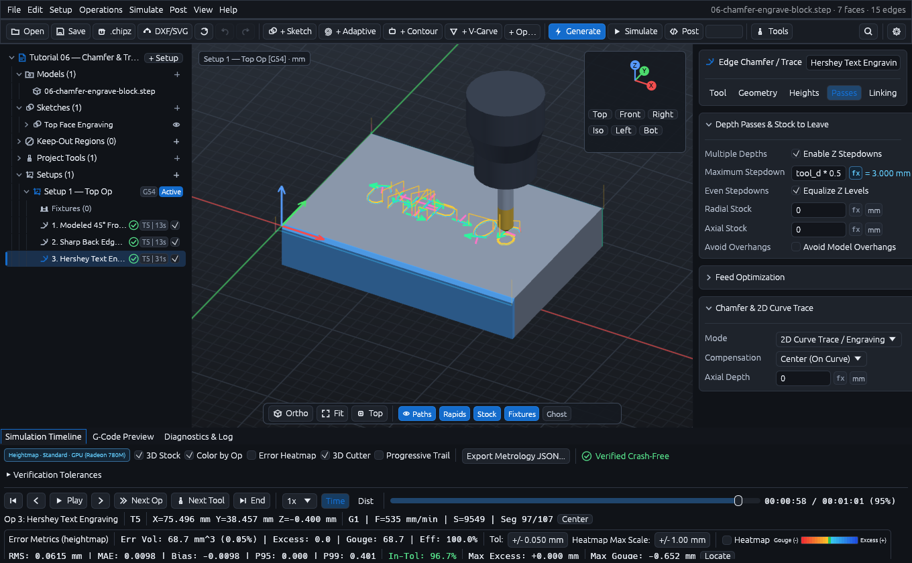
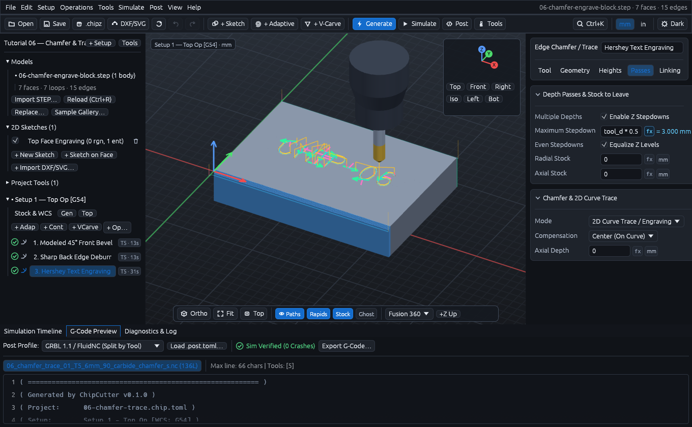

# Tutorial 06 — Edge Chamfering & 2D Curve Trace / Engraving

## 1. Goal & What You'll Learn

ChipCutter's **Chamfer / 2D Curve Trace** strategy serves two essential finishing tasks using tapered chamfer or engraving mills:

1. **Edge Chamfering:** Cutting exact bevels on both **modeled CAD bevel faces** (reading the exact bevel angle and width directly from the B-Rep) and **sharp unmodeled `90°` edges** (deburring edges that weren't chamfered in CAD) with automatic **`Tip Offset`** kinematics and **`Floor Guard`** safety checks.
2. **2D Curve Trace / Engraving:** Following 2D sketch curves or built-in single-line **Hershey** stroke fonts directly on centerline in one fast pass—ideal for serial numbers, part labels, and decorative grooves.

In this tutorial you will start from an **empty project**, import a minimal chamfer/engraving block (`100 × 70 × 18 mm`), and machine all three operations with a single **`T5` (`6mm 90° Carbide Chamfer / Spot Mill`)**.

---

## 2. Prerequisites & Starter Model

Start with an **empty project** and load the minimal chamfer block included with this tutorial ([`06-chamfer-engrave-block.step`](assets/06-chamfer-engrave-block.step) — a pre-squared `100 × 70 × 18 mm` block with a modeled `45° × 1.5 mm` front bevel, a sharp `90°` back edge, and a clean flat top face):

- **From the Welcome Overlay or Menu:** Launch ChipCutter (`chip-gui`), click **`Import 3D STEP Solid…`** in the **Welcome to ChipCutter** overlay (or **`File → Import STEP Model…`** in the **top menu bar**, or **`Import STEP…`** under **`Models`** in the left **CAM Browser**), and select `docs/tutorials/assets/06-chamfer-engrave-block.step`.
- **Or open directly from the terminal:**
  ```bash
  chip-gui docs/tutorials/assets/06-chamfer-engrave-block.step
  ```

In the left **CAM Browser**, click **`Stock & WCS`** under `Setup 1`, open the **`Stock`** tab in the right **Inspector**, and under **`Stock Offsets`** (with **`Symmetric XY`** / `Mirror ±X / ±Y` checked) set **`Side X Margin (±X)`** = `0 mm`, **`Side Y Margin (±Y)`** = `0 mm`, and **`Top Allowance (+Z)`** = `0 mm` to match the pre-squared `100 × 70 × 18 mm` billet.

---

## 3. Step-by-Step GUI Walkthrough

### Step 1 — Machine a Modeled `45°` CAD Bevel (`Op 1 → Passes`)

1. With `Setup 1` **`Active`** in the left **CAM Browser**, click **`+ Op… → Edge Chamfer / Trace`** in the **top toolbar** (or **`Operations → + Edge Chamfer / Trace`** in the **top menu bar**). In the right **Inspector**, open the **`Tool`** tab and select **`T5 — 6mm 90° Carbide Chamfer / Spot Mill`** in **`Active Cutter`** under **`Cutter & Material Preset`**.
2. Open the **`Geometry`** tab in the right **Inspector**, click **`Planar Faces`** under **`Interactive 3D Pick Mode`**, and click the sloped **`45° × 1.5 mm` front bevel face** of the block in the center **3D CAD Viewport**.
3. Switch to the **`Passes`** tab in the right **Inspector** and configure the **`Chamfer & 2D Curve Trace`** card in order:
   - First set **`Mode`** = **`Edge Chamfering`** so **`CAD Source`**, **`Tip Offset`**, and **`Floor Guard`** are displayed.
   - Under **`CAD Source`**, click **`Modeled Bevel`**.
   - Set **`Tip Offset`** = `0.5 mm` (drops the cutter tip `0.5 mm` past the lower chamfer edge so the angled cutting flutes—not the zero-SFM dead center tip—engage the metal!) and keep **`Floor Guard`** (`Enabled`) checked.
4. Press **`Ctrl+G`** (or click **`Generate`** in the **top toolbar**):



ChipCutter computes the exact radial and axial offset from `T5`'s included angle (`90°`), `tip_dia`, `Tip Offset`, and the B-Rep bevel face width (`1.5 mm`) automatically. *(Opening the **`Heights`** tab confirms this with a contextual banner: in **`Edge Chamfering`** mode, Z depth is derived automatically from the selected chamfer edge + **`Tip Offset`** in **`Passes`**.)*

### Step 2 — Deburr a Sharp Unmodeled `90°` Edge (`Op 2 → Passes`)

Most shop drawings leave minor edge breaks unmodeled in CAD ("break all sharp edges `0.5–0.75 mm`").

1. Add a second **`Edge Chamfer / Trace`** operation via **`+ Op… → Edge Chamfer / Trace`** in the **top toolbar** (or **`Operations → + Edge Chamfer / Trace`** in the **top menu bar**) and select **`T5 — 6mm 90° Carbide Chamfer / Spot Mill`** in the **`Tool`** tab.
2. Open the **`Geometry`** tab in the right **Inspector**, click **`Open Chain`** under **`Interactive 3D Pick Mode`**, and click the sharp back top edge (`Y = 70 mm, Z = 18 mm`) in the **3D CAD Viewport** twice (once for the start edge, once for the end edge on a single-edge chain).
3. Switch to the **`Passes`** tab in the right **Inspector** (`Chamfer & 2D Curve Trace` card):
   - First confirm **`Mode`** = **`Edge Chamfering`**, then under **`CAD Source`** click **`Sharp Edge`** so **`Chamfer Width`** appears below it.
   - Enter **`Chamfer Width`** = `0.75 mm`, **`Tip Offset`** = `0.5 mm`, and keep **`Floor Guard`** (`Enabled`) checked (on stepped parts, **`Floor Guard`** automatically checks for lower shelves underneath the edge and prevents the extended cutter tip from gouging into them!).
4. Press **`Ctrl+G`**:



### Step 3 — Engrave Single-Line Hershey Text (`Op 3 → Passes`)

1. Click **`+ Sketch`** in the **top toolbar** (or expand **`2D Sketches (0)`** in the left **CAM Browser** and click **`+ New Sketch`**) to add a `2D Sketch` layer on `Setup XY` (which lies right on the `Z = 18 mm` top face when WCS origin is at `Top Front-Left`).
2. In the right **Inspector** (**2D Sketch Layer**), click **`Text`** under **`Interactive Authoring Tools` → `Quick Insert at (0, 0):`** to add a text entity and open the **`TrueType & Hershey Typography`** card below:
   - Type `CHIP-06` in **`Text Content (multi-line):`**.
   - Open **`Font Family`** and select **`Hershey Simplex Sans (1-Line)`** (single-line stroke font — no double outlines!).
   - Set **`Cap Height`** = `12 mm`, **`Origin X`** = `50 mm`, **`Origin Y`** = `36 mm`, and set **`Alignment`** to **`Center`** / **`Middle`**.
3. Create the engraving operation either by clicking **`+ 1-Pass Trace`** under **`1-Click CAM Operation from Sketch:`** inside the **`Entities & Regions`** card, or via **`+ Op… → Edge Chamfer / Trace`** in the **top toolbar** (**`Operations → + Edge Chamfer / Trace`** in the **top menu bar**):
   - In the right **Inspector** **`Tool`** tab, select **`T5 — 6mm 90° Carbide Chamfer / Spot Mill`** in **`Active Cutter`**.
   - In the **`Geometry`** tab (if created from the menu), click **`+ All`** on your sketch row inside the **`2D Sketch Layers & Quick Select`** card.
   - In the **`Heights`** tab (`Z-Height Planes & Offsets` card), set **`Bottom Ref`** = **`Stock Top`** and **`Bottom Offset`** = `-0.4 mm` (`0.4 mm` engraving depth).
   - In the **`Passes`** tab (`Chamfer & 2D Curve Trace` card), first set **`Mode`** = **`2D Curve Trace / Engraving`** (which reveals **`Compensation`** and **`Axial Depth`**), then set **`Compensation`** = **`Center (On Curve)`**.
4. Press **`Ctrl+G`**:



Because Hershey fonts are true single-stroke vectors, every character cuts in **one crisp centerline pass**—typically 5–10× faster than pocketing outline text for part numbers and shop labels.

---

## 4. Key Parameters Reference

| Parameter | Location | Purpose & Recommended Starting Values |
|---|---|---|
| **`Mode`** | `Right Inspector → Passes → Chamfer & 2D Curve Trace` | **`Edge Chamfering`** (reveals **`CAD Source`**, **`Tip Offset`**, **`Floor Guard`**) or **`2D Curve Trace / Engraving`** (reveals **`Compensation`**, **`Axial Depth`**). |
| **`CAD Source`** | `Right Inspector → Passes → Chamfer & 2D Curve Trace` | Shown when **`Mode`** = **`Edge Chamfering`**. **`Modeled Bevel`** extracts width & angle directly from a sloped CAD bevel face; **`Sharp Edge`** reveals **`Chamfer Width`** to bevel a sharp `90°` edge. |
| **`Chamfer Width`** (`w`) | `Right Inspector → Passes → Chamfer & 2D Curve Trace` | Shown when **`CAD Source`** = **`Sharp Edge`**. Horizontal bevel width (`0.3–0.5 mm` for light deburring, `0.75–1.5 mm` for cosmetic chamfers). |
| **`Tip Offset`** | `Right Inspector → Passes → Chamfer & 2D Curve Trace` | Extra axial drop (`0.3–1.0 mm`) below the lower bevel edge so the fluted cone—never the fragile tip—cuts cleanly. |
| **`Floor Guard`** | `Right Inspector → Passes → Chamfer & 2D Curve Trace` | Detects adjacent lower floors below the chamfered edge and guards against tip collisions on stepped pockets/ledges. |
| **`Compensation`** & **`Axial Depth`** | `Right Inspector → Passes → Chamfer & 2D Curve Trace` | Shown when **`Mode`** = **`2D Curve Trace / Engraving`**. Use **`Center (On Curve)`** for single-line Hershey engraving; set **`Bottom Offset`** (`-0.2` to `-0.5 mm`) in **`Heights`** (or **`Axial Depth`**) to control groove width. |

---

## 5. Generate (`Ctrl+G`) & 3D Simulation Verification

Press **`Ctrl+G`** (or click **`Generate`** in the **top toolbar**; **`Diagnostics & Log`** logs wall-clock generation time alongside estimated CNC cycle time) and click **`Simulate`** in the **top toolbar** (opening the bottom **`Simulation Timeline`** tab), scrubbing near completion (`95%`):



Verify in the **3D CAD Viewport** machined stock:
- The modeled `45° × 1.5 mm` front bevel, sharp `0.75 mm` back deburr, and single-line `"CHIP-06"` serial engraving all cut cleanly with **`T5`**.
- Confirm **`Verified Crash-Free`** in **`Simulation Timeline`** with zero gouges into the top face or bevel wall.

---

## 6. Post-Processing (GRBL & LinuxCNC)

Click **`Post`** in the **top toolbar** (or select the bottom **`G-Code Preview`** tab) with **`GRBL 1.1 / FluidNC (Split by Tool)`** chosen in **`Post Profile:`**:



Because all three operations share **`T5` (`6mm 90° Chamfer Mill`)**, even GRBL split-by-tool emits a **single unified `.nc` file** (`Tools: [5]`, `Sim Verified (0 Crashes)`) with zero tool changes!

---

## 7. Headless CLI Equivalent (`chipcutter`)

Generate the minimal chamfer/engraving block and 3-operation project, validate, simulate, and post-process headlessly:

```bash
# 1. Generate the minimal 100x70x18mm chamfer/engrave block + 3-op .chip.toml project
chipcutter generate-sample-step /tmp/06-chamfer-engrave-block.step \
  --tutorial 06-chamfer-trace --project-out /tmp/06-chamfer-trace.chip.toml

# 2. Validate, generate toolpaths, and verify zero crashes/gouges
chipcutter validate --generate /tmp/06-chamfer-trace.chip.toml
chipcutter simulate /tmp/06-chamfer-trace.chip.toml --resolution standard

# 3. Post-process for GRBL and LinuxCNC
chipcutter build /tmp/06-chamfer-trace.chip.toml -o /tmp/chamfer_grbl --post grbl
chipcutter build /tmp/06-chamfer-trace.chip.toml -o /tmp/chamfer_linuxcnc --post linuxcnc
```

---

## Next Steps

- **Previous:** [Tutorial 05 — 2D Adaptive Clearing & 2.5D Rest Machining](05-adaptive-rest-machining.md)
- **Next:** [Tutorial 07 — 3D Medial-Axis V-Carving, Two-Tool Flat Clearance, & Mated V-Inlays](07-vcarve-inlays.md)
- **Index:** [All Tutorials](README.md)
