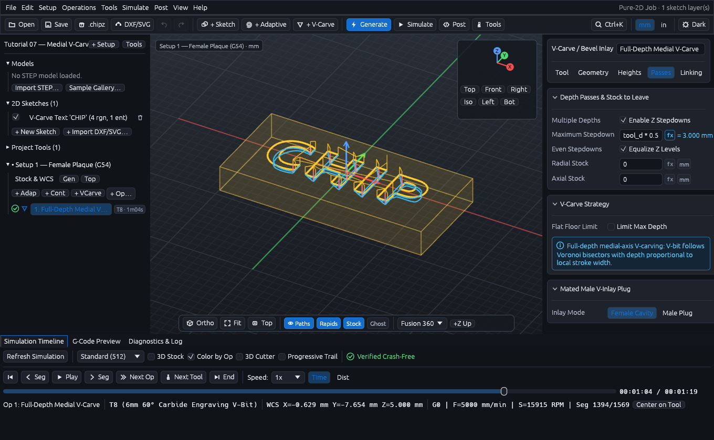
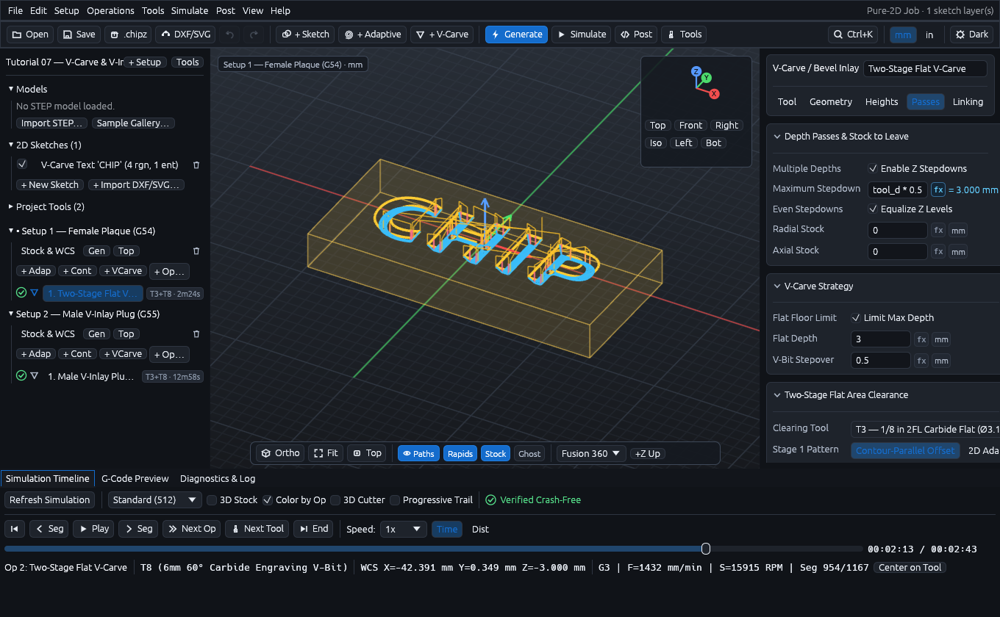
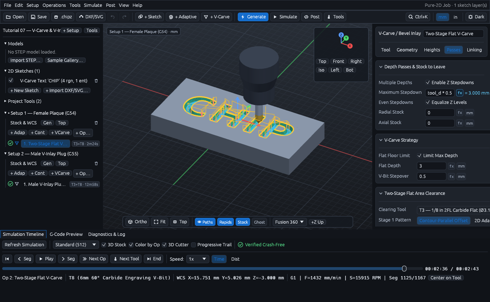
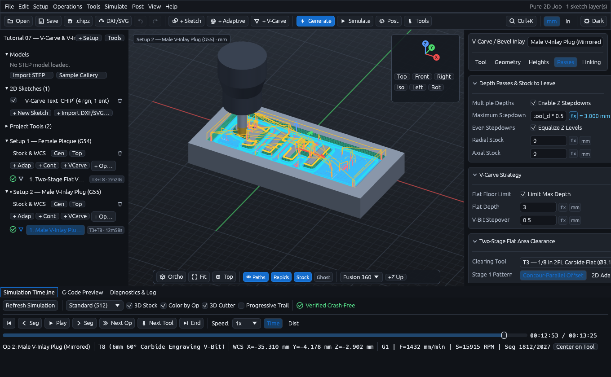
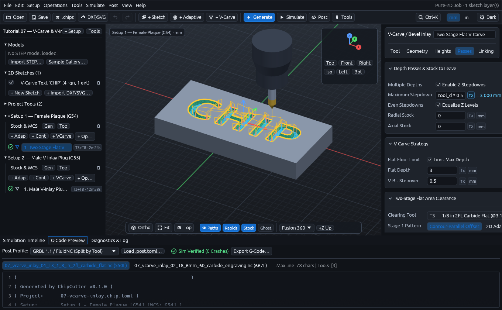

# Tutorial 07 — 3D Medial-Axis V-Carving, Two-Tool Flat Clearance, & Mated V-Inlays

## 1. Goal & What You'll Learn

**3D V-Carving** uses a sharp conical **V-Bit** (`T8`, `60°`) riding along the interior **Voronoi medial axis** of closed TrueType text or SVG artwork—automatically varying cutting depth `(X, Y, Z)` proportionally to stroke width and climbing smoothly into **razor-sharp 3D corners** that a cylindrical endmill can never cut.

In this tutorial you will start from an **empty Pure-2D project** (no 3D STEP model required!), author bold `"CHIP"` TrueType lettering, and learn how to:

- Generate **Full-Depth 3D Medial-Axis V-Carving** with simultaneous 3-axis corner climbs.
- Clamp wide letters to a clean flat floor (**`Flat Floor Limit`** / **`Flat Depth`**) and enable **Two-Stage Flat Area Clearance** (Stage 1 Flat Endmill bulk pocketing + Stage 2 Rest-Machined V-Bit bevels & tight corners).
- Create a second Setup (`G55`) to machine a mirrored **Mated Male V-Inlay Plug** (`Start Depth` bevel engagement + `Glue Gap` bottom clearance) that drops tightly into the female plaque.
- Verify sloped conical material removal in **3D Simulation** and see **GRBL** automatically split a single Two-Tool V-Carve operation into two `.nc` files (`T3` clearing + `T8` V-bit).

---

## 2. Prerequisites & Starter Pure-2D Setup

No external CAD file is needed:

1. Launch ChipCutter (`cargo run --release -p chip-gui`) and click **New Pure-2D Parametric Sketch** on the Welcome Overlay.
2. In **`Stock & WCS → Stock`**, select **`Fixed-Size Box Stock`** (`120 × 55 × 15 mm`, **`Center XY`**, **`Top Allowance = 0 mm`**) and set **WCS Origin** to **`Top Center`**.
3. Select the `2D Sketch` layer, add a **`Text`** entity (`Content = CHIP`, font **`Builtin Sans Bold (DejaVuSans-Bold)`**, `Cap Height = 24 mm`, centered at `X = 0, Y = 0`, `Letter Spacing = 1.5 mm`).

---

## 3. Step-by-Step GUI Walkthrough

### Step 1 — Full-Depth 3D Medial-Axis V-Carving (`Setup 1 → Op 1`)

1. Click **`+ V-Carve`** in the top toolbar (or **`Operations → 3D V-Carve`**) and confirm **`T8 — 6mm 60° Carbide Engraving V-Bit`** in the **`Tool`** tab.
2. In **`Geometry`**, select your `"CHIP"` sketch text (ChipCutter automatically classifies closed outer letter contours and counter-islands like the inside of `'P'`).
3. Switch to **`Passes`**, leave **`Limit Max Depth`** unchecked, and press **`Ctrl+G`**:



Look closely at the 3D toolpath: the V-bit plunges deeper along the wide stems of `'C'`, `'H'`, `'I'`, and `'P'` and climbs cleanly upward in 3D `(X, Y, Z)` right out to every crisp corner vertex.

### Step 2 — Clamp `Flat Depth` & Enable Two-Stage Flat Area Clearance

For large bold lettering, full-depth V-carving can cut unnecessarily deep (or through thin wood). Clamping **`Flat Depth`** and pairing a flat endmill speeds up roughing dramatically and leaves a smooth flat pocket floor:

1. In **`Passes → V-Carve Strategy`**, check **`Limit Max Depth`** and set **`Flat Depth`** = `3.0 mm`.
2. In **`Two-Stage Flat Area Clearance`** (which appears automatically when `Flat Depth` is enabled):
   - Set **`Clearing Tool`** = **`T3 — 1/8 in 2FL Carbide Flat`** (smaller than the stroke width so it fits inside the letters).
   - Keep **`Stage 1 Pattern`** = **`Offset`** (or `Adaptive`) and **`Blend Allowance`** = `0.15 mm`.
3. Press **`Ctrl+G`**:



ChipCutter generates both stages inside a single associative operation:
- **Stage 1 (`T3` Flat Endmill):** Pockets out the wide flat interiors down to `-3.0 mm` while staying safely inside the V-bit's sloped bevel margin.
- **Stage 2 (`T8` `60°` V-Bit):** Rest-machines only the angled `60°` sidewalls, tight corners, and narrow floor strips the flat endmill could not reach.

### Step 3 — Verify Female Cavity in 3D Simulation

Click **`Simulate`** (`Simulation Timeline` bottom tab) to run ChipCutter's **analytical 3D conical V-bit sweeper**:



Inspect the machined hardwood stock: crisp `60°` beveled walls, razor-sharp corners, completely flat `-3.0 mm` letter floors, intact `'P'` counter-island, and **`Verified Crash-Free`**.

### Step 4 — Generate a Mirrored Mated Male V-Inlay Plug (`Setup 2 [G55]`)

To create a contrasting wood inlay (for example, walnut `"CHIP"` inlaid into a maple plaque):

1. Click **`+ Setup`** in the CAM Browser to add **`Setup 2 — Male V-Inlay Plug (G55)`** with matching `120 × 55 × 15 mm` stock.
2. Add a **`3D V-Carve`** operation targeting the **exact same `"CHIP"` sketch** (`T8` `60° V-Bit` + `T3` `1/8 in` Clearing Tool, `Flat Depth = 3.0 mm`).
3. Scroll to **`Mated Male V-Inlay Plug`** in **`Passes`**, click **`Male Plug`**, and set:
   - **`Start Depth`** = `2.0 mm` — controls how deep the tapered male bevel seats into the `3.0 mm`-deep female cavity (`2.0 mm` wedge engagement leaves `1.0 mm` of bottom glue space inside the female pocket!).
   - **`Glue Gap`** = `1.0 mm` — extra clearance machined around the base of the male plug (`total plug height = Start Depth + Glue Gap = 3.0 mm`) so the plug seats tightly on its tapered `60°` walls and leaves a clean `1.0 mm` saw/flush-trim gap between the two boards before gluing.
   - **`Auto-Mirror X`** = enabled — automatically mirrors the artwork across `X = 0` so the flipped plug drops face-down into the female cavity in the correct reading orientation!
4. Press **`Ctrl+G`** and **`Simulate`** on `Setup 2`:



Notice the raised, mirrored `"CHIP"` prism standing proud of the cleared background pocket—ready to glue face-down into `Setup 1`, clamp, and flush-trim!

---

## 4. Key Parameters Reference

| Parameter | Location | Purpose & Recommended Starting Values |
|---|---|---|
| **Flat Floor Limit & Flat Depth** | `Passes → V-Carve Strategy` | Unchecked = full-depth Voronoi medial-axis carving; checked = clamps floor at **`Flat Depth`** (`2.0–4.0 mm` typical for signs & inlays). |
| **V-Bit Stepover** | `Passes → V-Carve Strategy` | Radial stepover used when the V-bit clears tight flat floor corners (`0.25–0.5 mm`). |
| **Clearing Tool & Stage 1 Pattern** | `Passes → Two-Stage Flat Area Clearance` | Optional flat endmill (`T3` `1/8 in` or `T1` `6 mm`) for fast Stage 1 bulk clearing before Stage 2 V-bit bevels. |
| **Blend Allowance** | `Passes → Two-Stage Flat Area Clearance` | Small radial margin (`0.1–0.2 mm`) keeping the Stage 1 flat endmill safely clear of the V-bit's finished bevel wall. |
| **Inlay Mode (`Female` vs. `Male Plug`)** | `Passes → Mated Male V-Inlay Plug` | **`Female Cavity`** carves into the plaque; **`Male Plug`** machines the complementary raised mirrored plug. |
| **Start Depth & Glue Gap** | `Passes → Mated Male V-Inlay Plug` | **`Start Depth`** (`1.5–2.5 mm`, always `< female Flat Depth`) sets bevel engagement; **`Glue Gap`** (`0.8–1.5 mm`) creates clamp/trim clearance. |
| **Auto-Mirror X** | `Passes → Mated Male V-Inlay Plug` | Automatically mirrors the male plug horizontally so inverted text reads correctly once glued into the female plaque. |

---

## 5. Post-Processing: GRBL Automatic Two-File Split vs. LinuxCNC ATC

Switch back to `Setup 1 [G54]` and open **`G-Code Preview`** with **`GRBL 1.1 / FluidNC (Split by Tool)`** selected:



- **GRBL 1.1 / FluidNC (`grbl.post.toml`):** Even though Stage 1 and Stage 2 live inside a **single** V-Carve operation, ChipCutter automatically partitions them into two sequential files (`..._01_T3_...nc` for Stage 1 flat clearing, followed by `..._02_T8_...nc` for Stage 2 `60°` V-bit bevels) so manual-tool-change routers can re-zero `Z` cleanly between tools.
- **LinuxCNC (`linuxcnc.post.toml`) / grblHAL ATC (`grblhal_atc.post.toml`):** Emits a single unified `.ngc` program containing `T3 M6 G43 H3` followed by `T8 M6 G43 H8`.

---

## 6. Headless CLI Equivalent (`chipcutter`)

Generate both the pure medial-axis and the two-setup V-Carve & Mated V-Inlay Pure-2D projects, simulate, and post-process headlessly:

```bash
# 1. Generate the Pure-2D Two-Stage V-Carve & Mated Male V-Inlay project (2 Setups: G54 + G55)
cargo run -p chip-cli -- generate-sample-step /tmp/07-vcarve-inlay.chip.toml \
  --tutorial 07-vcarve-inlay

# 2. Validate, generate toolpaths, and verify both Setups (0 crashes/gouges)
cargo run -p chip-cli -- validate --generate /tmp/07-vcarve-inlay.chip.toml
cargo run -p chip-cli -- simulate /tmp/07-vcarve-inlay.chip.toml --resolution standard

# 3. Build GRBL (auto-splits Stage 1 T3 + Stage 2 T8 files per Setup) and LinuxCNC ATC G-code
cargo run -p chip-cli -- build /tmp/07-vcarve-inlay.chip.toml -o /tmp/vcarve_grbl --post grbl
cargo run -p chip-cli -- build /tmp/07-vcarve-inlay.chip.toml -o /tmp/vcarve_linuxcnc --post linuxcnc
```

---

## Next Steps

- **Previous:** [Tutorial 06 — Edge Chamfering & 2D Curve Trace / Engraving](06-chamfer-curve-trace.md)
- **Index:** [All Tutorials](README.md) — you've completed every ChipCutter toolpath strategy tutorial!
