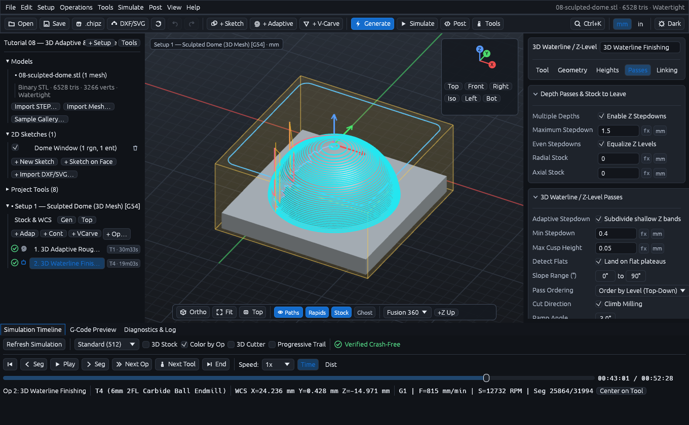
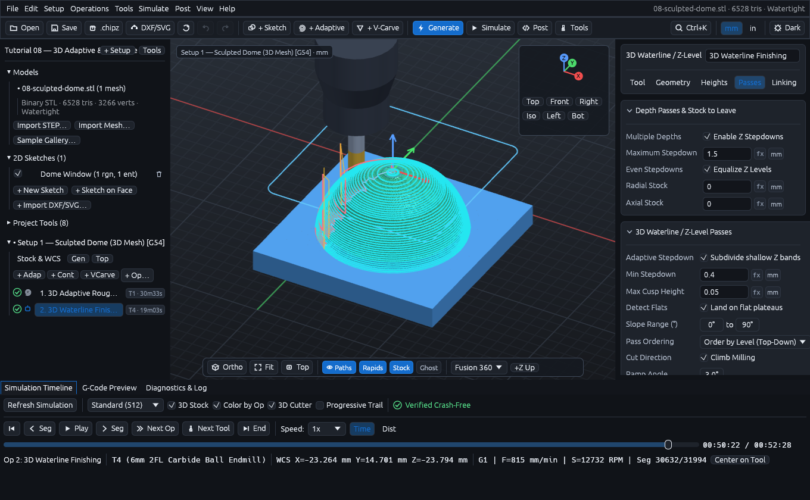
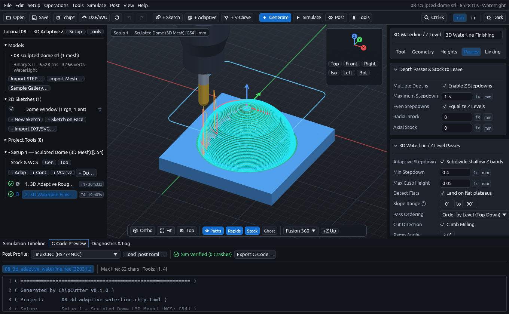

# Tutorial 08 — 3D Adaptive Roughing & Waterline / Z-Level Surfacing (`STL` / `OBJ` / `3MF`)

## 1. Goal & What You'll Learn

When machining sculpted 3D parts—organic molds, domes, enclosures, and contoured reliefs—2.5D pocketing cannot follow curved walls or varying Z heights. ChipCutter's exact `f64` **Drop-Cutter & Push-Cutter** 3-axis surface kernel machines triangle meshes (**STL**, **OBJ**, and **3MF**) directly into gouge-free toolpaths with zero viewport-mesh approximation.

In this tutorial you will start from a bare binary STL mesh ([`08-sculpted-dome.stl`](assets/08-sculpted-dome.stl) — an `R = 25 mm` hemispherical dome on a `70 × 70 × 8 mm` pedestal), and learn how to:

- Import a 3D mesh (`STL`/`OBJ`/`3MF`) and verify its **unit normalization**, triangle/vertex counts, and **watertightness diagnostics**.
- Draw a **2D `Setup XY` containment sketch** (`Dome Window`) to constrain 3D roughing strictly inside a chosen XY region.
- Rough bulk stock safely and rapidly with **3D Adaptive Roughing** (`Adaptive3D`) using coarse **`Rough Stepdown`**, sloped-terrace **`Fine Step-Up`**, **`Detect Flats`**, and controlled **`0.4 mm` radial / `0.25 mm` axial** stock-to-leave.
- Semi-finish and finish the sculpted dome with **3D Waterline / Z-Level** (`Waterline3D`) using **`Adaptive Stepdown`** (`Subdivide shallow Z bands`), **`Order by Level (Top-Down)`**, and **`0.0 mm`** stock-to-leave.
- Verify **0 collisions and 0 target-mesh gouges** in 3D Z-dexel simulation (`✓ Verified Crash-Free`) and post-process for **LinuxCNC (ATC)** and **GRBL (split by tool)**.

---

## 2. Prerequisites & Starter Model

Start with an **empty project** and load the watertight binary STL starter model included with this tutorial ([`08-sculpted-dome.stl`](assets/08-sculpted-dome.stl) — `70.000 × 70.000 × 33.000 mm`, `6,528 triangles`, `3,266 welded vertices`, `Watertight`):

- **From the Welcome Overlay or Browser:** Launch `cargo run --release -p chip-gui`, click **Import Mesh…** (or **`File → Import 3D Mesh (STL / OBJ / 3MF)…`**), and select `docs/tutorials/assets/08-sculpted-dome.stl`.
- **Or open directly from the terminal:**
  ```bash
  cargo run --release -p chip-gui -- docs/tutorials/assets/08-sculpted-dome.stl
  ```

---

## 3. Step-by-Step GUI Walkthrough

### Step 1 — Inspect Imported Mesh & Configure Setup Stock / WCS (`Setup 1 → Stock`)

1. Check the **Models** section in the left **CAM Browser** (and the top-right status bar): ChipCutter confirms `Binary STL · 6528 tris · 3266 verts · Watertight`. Because binary STL files are unitless, ChipCutter defaults to millimeters (`70.000 × 70.000 × 33.000 mm`), and you can override mesh units (`in`, `cm`, `m`) per model whenever needed.
2. Select **`Setup 1 → Stock & WCS`**:
   - In **`WCS & Post`**, set **WCS Origin** to **`Stock Box Point → Top Center`** (`Z = 0` sits on top of the billet, centered directly over the dome apex).
   - Switch to **`Stock`**, choose **`Relative Box Stock`**, and set **`Side X Margin (±X)`** = `2 mm`, **`Side Y Margin (±Y)`** = `2 mm`, **`Top Allowance (+Z)`** = `1 mm`, and **`Bottom Holding (-Z)`** = `0 mm` (producing a `74.000 × 74.000 × 34.000 mm` stock billet):


### Step 2 — Draw a 2D Containment Sketch & Rough with 3D Adaptive (`Op 1 → Passes`)

Before roughing, add a lightweight 2D containment boundary on the Setup XY plane so you can control exactly where the roughing cutter is allowed to travel:

1. Click **`+ New Sketch`** in the left **CAM Browser** (under **`2D Sketches`**) and name it **`Dome Window`**.
2. Add a centered **`Rectangle`** (`X = 0 mm`, `Y = 0 mm`, `Width = 68 mm`, `Height = 68 mm`, `Corner Radius = 4 mm`) enclosing the dome and pedestal top flange.
3. Click **`+ Op…` → `3D Adaptive Roughing`** (or **`Operations → 3D Adaptive Roughing`**) to add **`1. 3D Adaptive Roughing`**.
4. In **`Tool`**, select **`T1 — 6mm 3FL Carbide Flat Endmill`**.
5. In **`Geometry`**, select the **`Dome Window`** sketch layer.
6. In **`Heights`**, set **`Bottom Height`** to **`Model Top`** with offset **`-25.0 mm`** so roughing stops cleanly at the flat `Z = 8 mm` pedestal top flange (`33 mm - 25 mm = 8 mm`).
7. Switch to **`Passes`**:
   - Under **`Depth Passes & Stock to Leave`**, set **`Radial Stock`** = `0.4 mm` and **`Axial Stock`** = `0.25 mm` to leave a clean, uniform finishing allowance over the dome and pedestal.
   - Under **`3D Adaptive Roughing`**, set **`Optimal Load (ae)`** = `1.8 mm` (`30%` of cutter diameter), **`Rough Stepdown`** = `5 mm`, **`Fine Step-Up`** = `1.5 mm`, and check **`Detect Flats`** (`Land on flat plateaus`).
   - Scroll to **`3D Machining Boundary`**, set **`Boundary Source`** = **`Selected 2D Contours`**, **`Tool Containment`** = **`Tool Outside Boundary`**, and **`Boundary Offset`** = `0.5 mm`.
8. Press **`Ctrl+G`** to generate the constant-load 3D trochoidal roughing toolpath:


Notice how `Adaptive3D` clears coarse `5 mm` axial tiers first, then climbs upward in `1.5 mm` **`Fine Step-Up`** intermediate terraces to strip the stair-stepped stock smoothly off the curved hemisphere, and lands exactly on the horizontal pedestal plateau (`+0.25 mm` axial stock) thanks to **`Detect Flats`**.

### Step 3 — Finish the Dome with 3D Waterline / Z-Level (`Op 2 → Passes`)

With bulk stock cleared down to a thin `0.4 / 0.25 mm` skin, add a ball-endmill waterline operation to slice clean concentric Z-level contours across the dome:

1. Click **`+ Op…` → `3D Waterline / Z-Level`** to add **`2. 3D Waterline Finishing`**.
2. In **`Tool`**, select **`T4 — 6mm 2FL Carbide Ball Endmill`**.
3. In **`Heights`**, set **`Bottom Height`** to **`Model Top - 25.0 mm`**.
4. Switch to **`Passes`**:
   - Under **`Depth Passes & Stock to Leave`**, set **`Maximum Stepdown`** = `1.5 mm`, **`Radial Stock`** = `0 mm`, and **`Axial Stock`** = `0 mm`.
   - Under **`3D Waterline / Z-Level Passes`**:
     - Check **`Adaptive Stepdown`** (`Subdivide shallow Z bands`), set **`Min Stepdown`** = `0.4 mm`, and **`Max Cusp Height`** = `0.05 mm`.
     - Check **`Detect Flats`** (`Land on flat plateaus`).
     - Keep **`Slope Range (°)`** = `0°` to `90°` to finish the full dome in one operation (or narrow to `35°–90°` when pairing steep Waterline walls with shallow `Parallel3D` crests—covered in Tutorial 09).
     - Set **`Pass Ordering`** = **`Order by Level (Top-Down)`** and keep **`Cut Direction`** = **`Climb Milling`**.
   - Under **`3D Machining Boundary`**, set **`Boundary Source`** = **`Model Silhouette`**, **`Tool Containment`** = **`Tool Outside Boundary`**, and **`Boundary Offset`** = `0.5 mm`.
5. Press **`Ctrl+G`**:



Look closely at the contour spacing near the top of the hemisphere: on the steep lower flanks, Z levels step down at `1.5 mm`, while near the shallow dome apex **`Adaptive Stepdown`** automatically subdivides Z slices down toward `0.4 mm` so the residual scallop height stays below **`0.05 mm`** without wasting passes on steep walls.

---

## 4. Key Parameters Reference

| Parameter | Strategy & Card | Purpose & Recommended Starting Values |
|---|---|---|
| **Optimal Load (`ae`)** | `Adaptive3D → 3D Adaptive Roughing` | Maximum radial engagement maintained by trochoidal peels. Start at **`0.20–0.35 × tool_d`** (`1.5–2.0 mm` for a `Ø6 mm` endmill in aluminum). |
| **Rough Stepdown / Fine Step-Up** | `Adaptive3D → 3D Adaptive Roughing` | Coarse axial depth (`4–6 mm`) paired with intermediate upward terrace step-ups (`1.0–2.0 mm`) that eliminate heavy stair-steps before finishing. |
| **Detect Flats** | `Adaptive3D` & `Waterline3D` | Detects horizontal upward plateaus (`normal.z > 0.995`) directly from the mesh and injects exact Z levels (`plateau Z + Axial Stock`). |
| **Radial / Axial Stock** | `Depth Passes & Stock to Leave` | Roughing allowance (`0.3–0.5 mm` radial, `0.2–0.3 mm` axial for `Adaptive3D`; **`0.0 mm / 0.0 mm`** for finishing). |
| **Adaptive Stepdown & Max Cusp Height** | `Waterline3D → 3D Waterline / Z-Level Passes` | Automatically inserts extra Z-level contours across shallow slopes until cusp height stays within **`Max Cusp Height`** (`0.03–0.08 mm`), clamped by **`Min Stepdown`**. |
| **Pass Ordering** | `Waterline3D → 3D Waterline / Z-Level Passes` | **`Order by Level (Top-Down)`** completes each Z slice across the whole part before stepping down; **`Order by Depth / Island`** finishes each boss/pocket completely to minimize retracts. |
| **Boundary Source & Containment** | `3D Machining Boundary` | Constrains XY travel to **`Stock Bounds`**, **`Model Silhouette`**, or **`Selected 2D Contours`** (`Tool Inside`, `Center on`, or `Outside Boundary` + optional `Boundary Offset`). |

---

## 5. Generate (`Ctrl+G`) & 3D Simulation Verification

Press **`Ctrl+G`**, open the bottom **`Simulation Timeline`** tab, and check **`3D Stock`**, **`Color by Op`**, and **`3D Cutter`**, scrubbing to `96%`:



ChipCutter's 5-rule simulation oracle checks every move against both the evolving 3D heightmap stock and the exact `MeshBvh` target surface:
- Confirm the smooth spherical contour carved by `Op 2` (`T4` Ø6 mm Ball) inside the roughing envelope cleared by `Op 1` (`T1` Ø6 mm Flat).
- Verify the green **`✓ Verified Crash-Free`** badge confirming **zero rapid-into-stock collisions**, **zero shank/holder interference**, and **zero target-mesh gouges**.

---

## 6. Post-Processing (LinuxCNC & GRBL)

Switch to the bottom **`G-Code Preview`** tab with **`LinuxCNC (RS274NGC)`** selected:



- **`LinuxCNC (RS274NGC)`** (`linuxcnc`): Emits a single ATC `.ngc` file (`Tools: [1, 4]`, `✓ Sim Verified (0 Crashes)`) with `M6` tool change and `G43 H` length compensation transitioning from `T1` (`3D Adaptive Roughing`) to `T4` (`3D Waterline Finishing`).
- **`GRBL 1.1 / FluidNC (Split by Tool)`** (`grbl`): Automatically splits the setup into two sequential `.nc` programs (`01_T1` for `Adaptive3D`, `02_T4` for `Waterline3D`) with strict 80-character line guards for manual-tool-change machines.

---

## 7. Headless CLI Equivalent (`chipcutter`)

Generate the starter Sculpted Dome STL mesh and 2-operation `Adaptive3D` + `Waterline3D` project, inspect watertightness, validate, simulate, and post-process headlessly:

```bash
# 1. Generate the starter Sculpted Dome STL + seeded 2-op Adaptive3D/Waterline3D project
cargo run -p chip-cli -- generate-sample-step /tmp/08-sculpted-dome.stl \
  --tutorial 08-3d-adaptive-waterline --project-out /tmp/08-adaptive-waterline.chip.toml

# 2. Inspect mesh triangle count, bounding box, and watertightness
cargo run -p chip-cli -- inspect /tmp/08-sculpted-dome.stl

# 3. Validate, generate toolpaths, and verify 0 crashes/gouges headlessly
cargo run -p chip-cli -- validate --generate /tmp/08-adaptive-waterline.chip.toml
cargo run -p chip-cli -- simulate /tmp/08-adaptive-waterline.chip.toml --resolution standard

# 4. Post-process for LinuxCNC (single ATC .ngc) and GRBL (2 split .nc files: T1 + T4)
cargo run -p chip-cli -- build /tmp/08-adaptive-waterline.chip.toml -o /tmp/dome_linuxcnc --post linuxcnc
cargo run -p chip-cli -- build /tmp/08-adaptive-waterline.chip.toml -o /tmp/dome_grbl --post grbl
```

---

## Next Steps

- **Previous:** [Tutorial 07 — 3D Medial-Axis V-Carving, Two-Tool Flat Clearance, & Mated V-Inlays](07-vcarve-inlays.md)
- **Next:** [Tutorial 09 — 3D Surface Finishing: Parallel Raster, Constant-Scallop, 3D Rest, & Pencil Cleanup](09-3d-surface-finishing.md)
- **Index:** [All Tutorials](README.md)
