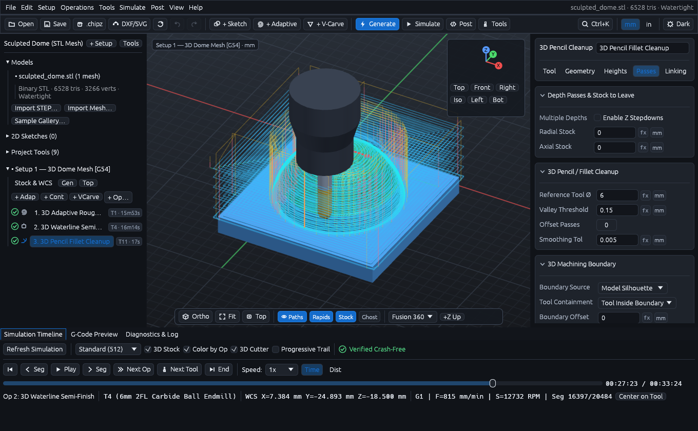
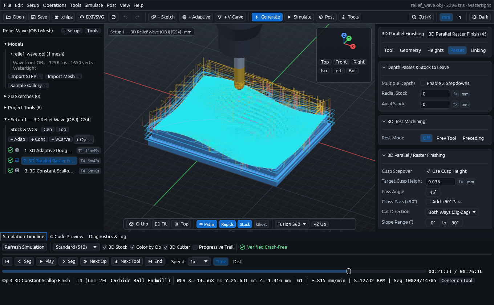

# Tutorial 08 — 3D Mesh Surfacing (`STL` / `OBJ` / `3MF`): Adaptive Roughing, Parallel, Constant-Scallop, & Pencil Cleanup

## 1. Goal & What You'll Learn

In this tutorial you will machine sculpted 3D triangle meshes (**STL**, **OBJ**, and **3MF**) from rough stock to mirror-smooth finished contours using ChipCutter's exact `f64` Drop-Cutter & Push-Cutter surface kernel:

- Importing triangle meshes (`STL`/`OBJ`/`3MF`) with unit normalization and watertightness diagnostics.
- Roughing bulk stock fast with **3D Adaptive Clearing** (`OperationKind::Adaptive3D`) + intermediate flat-step detection.
- Finishing sculpted surfaces with **3D Waterline / Z-Level** (`Waterline3D`), **3D Parallel Raster** (`Parallel3D`), and **3D Constant-Scallop** (`Scallop3D`) with cusp-height stepover control.
- Isolating remaining concave valley creases with **3D Pencil Cleanup** (`Pencil3D`) and verifying zero target gouges in 3D simulation.

---

## 2. Prerequisites & Starter Project

You can either launch ChipCutter's pre-seeded **Sculpted Dome (STL)** or **Relief Wave (OBJ)** samples directly, or start from the minimal starter STL in [`assets/08-sculpted-dome.stl`](assets/08-sculpted-dome.stl):

```bash
# Launch the 3-operation Sculpted Dome STL sample (Adaptive3D + Waterline3D + Pencil3D):
cargo run --release -p chip-gui -- --sample mesh-dome

# Or launch the Relief Wave OBJ sample (Adaptive3D + Parallel3D + Scallop3D):
cargo run --release -p chip-gui -- --sample mesh-wave

# Or open the bare starter mesh in an empty workspace:
cargo run --release -p chip-gui -- docs/tutorials/assets/08-sculpted-dome.stl
```

---

## 3. Step-by-Step GUI Walkthrough

1. **Import & Inspect the Mesh:**
   - Use **File → Import 3D Mesh (STL / OBJ / 3MF)…** (or drag-and-drop [`08-sculpted-dome.stl`](assets/08-sculpted-dome.stl)).
   - Check the **Models** section in the left **CAM Browser** (and top-right status bar): ChipCutter reports triangle/vertex counts and watertightness (`Watertight`).
2. **Configure Setup Stock & WCS (`Setup 1`):**
   - Select **Setup 1** in the Browser and review **Stock** (`Relative Box` with `1.0 mm` top/side allowance) and **WCS** (`Stock Top Front-Left` or `Top Center`).
3. **Add Op 1 — 3D Adaptive Roughing:**
   - Click **`+ Op…` → `3D Adaptive Roughing`** and assign a `Ø6 mm Flat Endmill` (`T1`).
   - On the **Passes** tab, enable **Detect Flat Areas**, leave `0.4 mm` radial / `0.25 mm` axial stock-to-leave for finishing, and set `Optimal Load = 1.8 mm` (`30%` of cutter diameter).
4. **Add Op 2 — 3D Finishing (`Parallel3D`, `Scallop3D`, or `Waterline3D`):**
   - Click **`+ Op…` → `3D Parallel Finishing`** (best for gentle reliefs and shallow crests) or **`3D Constant-Scallop`** (uniform cusp height across variable steep/shallow slopes) and assign a `Ø6 mm Ball Endmill` (`T4`).
   - Enable **Use Target Cusp Height** (`0.05 mm`) so ChipCutter analytically computes the exact stepover from the ball radius.
   - Set **Radial Stock = 0** and **Axial Stock = 0**.
5. **Add Op 3 — 3D Pencil Cleanup (Optional Concave Fillets):**
   - Click **`+ Op…` → `3D Pencil Cleanup`** with a smaller `Ø3 mm Ball Endmill` (`T11`) and set `Prev. Tool Ø = 6 mm` to trace only the concave dome-to-pedestal valley left behind by the `Ø6 mm` ball cutter.





---

## 4. Key Parameters Reference

| Strategy | Parameter | Safe Starting Value | Purpose |
|---|---|---|---|
| `Adaptive3D` | `Optimal Load` | `0.25–0.35 * tool_d` | Keeps radial tool engagement constant during high-speed roughing |
| `Adaptive3D` | `Stock to Leave (R / Z)` | `0.4 mm / 0.25 mm` | Reserves clean material for ball-nose finishing |
| `Parallel3D` | `Use Target Cusp Height` | `0.03–0.06 mm` | Analytically computes scanline stepover for ball/bull-nose cutters |
| `Parallel3D` | `Cross Finish (+90°)` | Optional | Adds a perpendicular second pass to erase directional cusps |
| `Scallop3D` | `Target Cusp Height` | `0.04–0.06 mm` | Geodesic surface-projected iso-contours maintaining uniform cusp height |
| `Pencil3D` | `Num Offset Passes` | `0–2` | Traces concave valley creases plus optional parallel cleanup shoulders |

---

## 5. Generate (`Ctrl+G`) & 3D Simulation Verification

1. Press **`Ctrl+G`** (or click **Generate**). All operations evaluate exact `f64` Drop-Cutter/Push-Cutter contacts in parallel across CPU cores.
2. Open the bottom **Simulation Timeline** tab and click **Refresh Simulation**.
3. Verify the green **`✓ Verified Crash-Free`** badge — ChipCutter's 5-rule verifier checks every rapid move, shank/holder clearance, and ball/bull-nose target-mesh gouge (`<= 0.02 mm`) directly against the loaded `MeshBvh`.

---

## 6. Post-Processing (GRBL & LinuxCNC)

- Open **G-Code Preview** (or **Post → Export G-Code…**):
  - **LinuxCNC (`linuxcnc`):** Emits a single ATC `.ngc` program with `M6` tool changes and `G43 H` length offsets across `T1`, `T4`, and `T11`.
  - **Grbl 1.1 / FluidNC (`grbl`):** Automatically splits multi-tool operations into numbered per-tool `.nc` files (`01_T1`, `02_T4`, `03_T11`) with strict 80-character line guards.

---

## 7. Headless CLI Equivalent (`chipcutter`)

```bash
# 1. Generate the starter Sculpted Dome STL + seeded 3-operation project
cargo run -p chip-cli -- generate-sample-step /tmp/dome.stl \
  --tutorial 08-mesh-surfacing --project-out /tmp/dome.chip.toml

# 2. Inspect mesh triangle count, bounding box, and watertightness
cargo run -p chip-cli -- inspect /tmp/dome.stl

# 3. Validate, generate toolpaths, and verify 0 crashes/gouges headlessly
cargo run -p chip-cli -- validate --generate /tmp/dome.chip.toml
cargo run -p chip-cli -- simulate /tmp/dome.chip.toml --resolution standard

# 4. Build verified G-code for LinuxCNC or GRBL
cargo run -p chip-cli -- build /tmp/dome.chip.toml -o /tmp/out_dome --post linuxcnc
```
