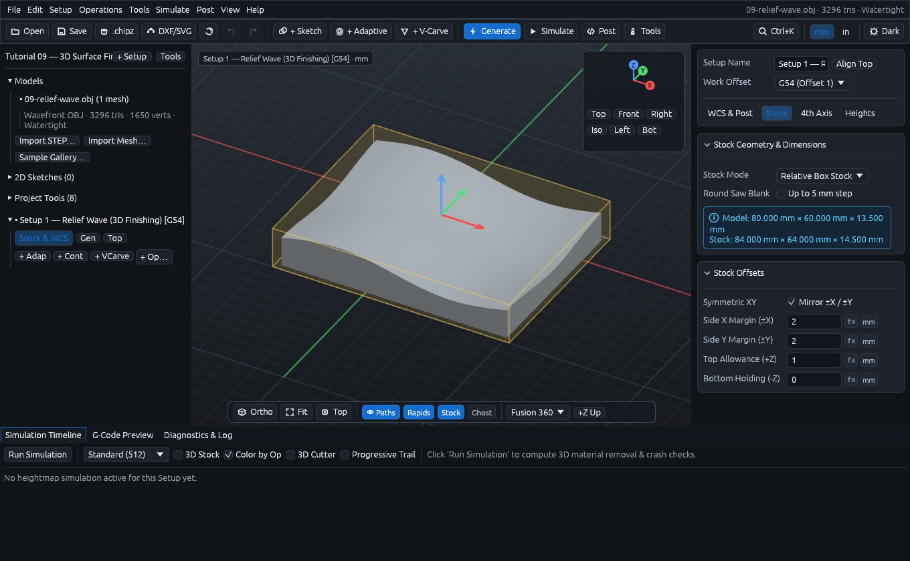
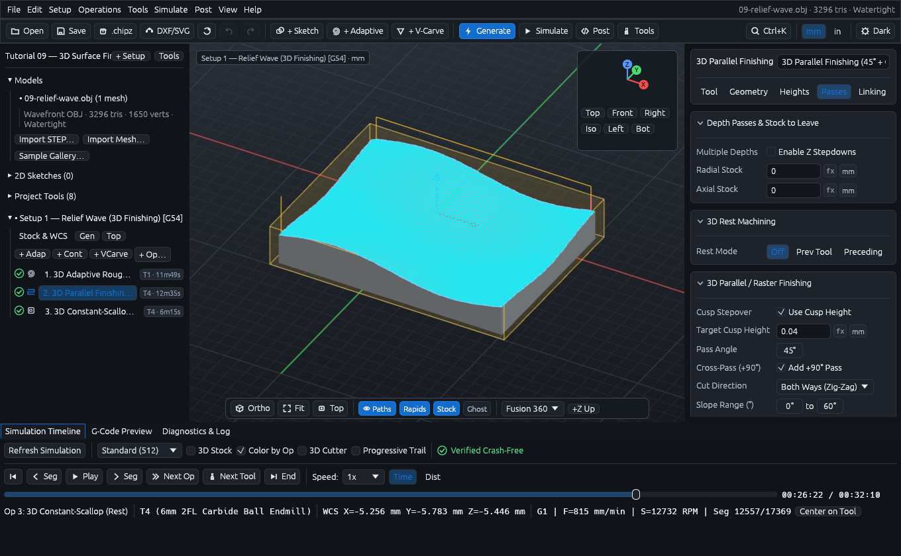
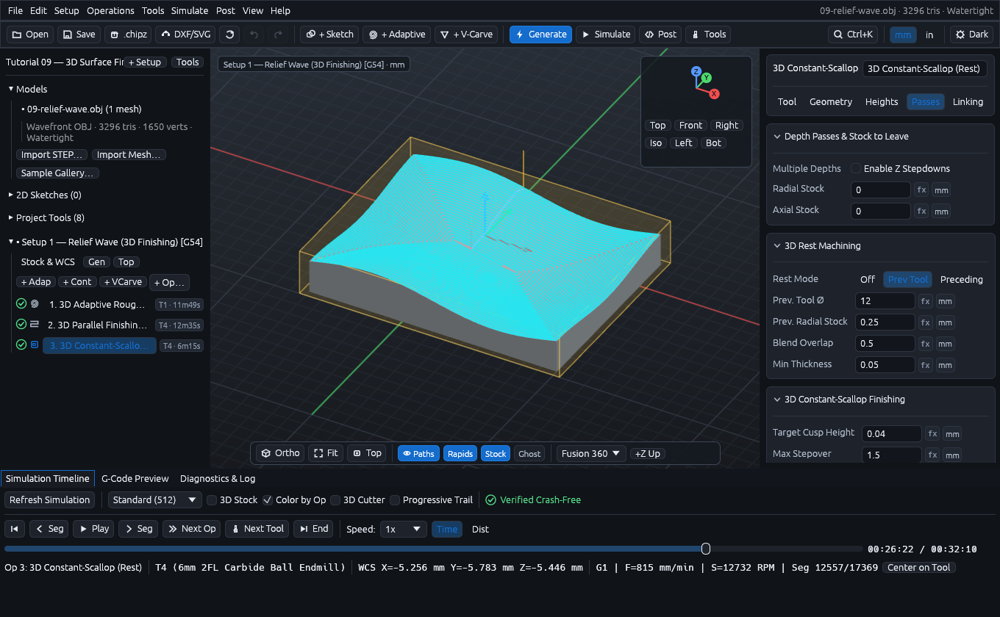
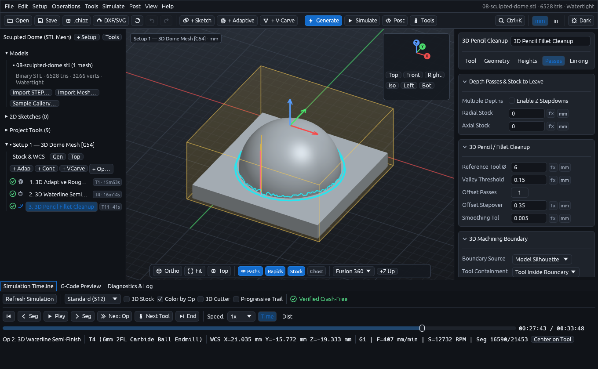
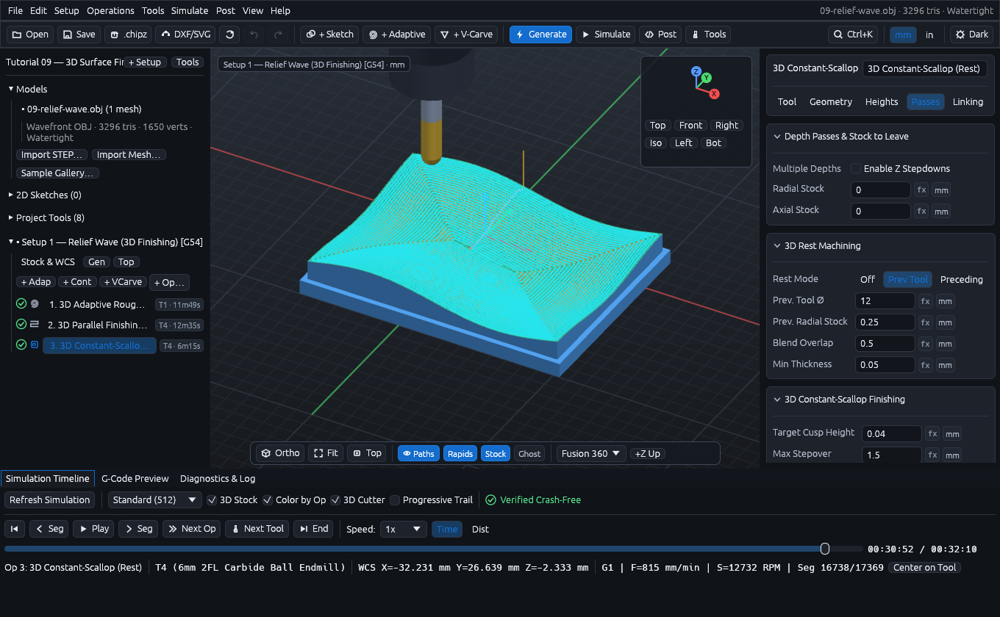

# Tutorial 09 — 3D Surface Finishing: Parallel Raster, Constant-Scallop, 3D Rest, & Pencil Cleanup

## 1. Goal & What You'll Learn

**3D Waterline / Z-Level** (Tutorial 08) excels on steep walls, but on shallow organic reliefs, smooth waves, and tight concave fillets, horizontal Z-slices spread too far apart or miss small-radius creases. ChipCutter provides three specialized 3D surface finishing strategies—**`Parallel3D`**, **`Scallop3D`**, and **`Pencil3D`**—plus analytical **3D Rest Machining** to achieve uniform surface quality across every slope angle and corner radius.

In this tutorial you will machine a sculpted sinusoidal Wavefront `.obj` relief ([`09-relief-wave.obj`](assets/09-relief-wave.obj)) and pair it with the Sculpted Dome STL ([`08-sculpted-dome.stl`](assets/08-sculpted-dome.stl)) to master:

- **3D Parallel / Raster Finishing (`Parallel3D`):** Cusp-height-driven stepover (`0.04 mm`), angled `45°` scanlines, perpendicular **`Cross-Pass (+90°)`**, and **`Slope Range (0°–60°)`** shallow-surface filtering.
- **3D Constant-Scallop Finishing (`Scallop3D`):** Geodesic iso-contours maintaining uniform 3D scallop height across varying slopes with **`Inside -> Out`** ordering, **`Min / Max Stepover`** clamps, and analytical **`3D Rest Machining`** (`Prev Tool` / `FromPreviousTool`).
- **3D Pencil / Fillet Cleanup (`Pencil3D`):** Detecting bi-tangent concave valleys left behind by a larger ball endmill (`Reference Tool Ø = 6 mm`) and tracing clean crease + lateral **`Offset Passes`** with a smaller `T11` `Ø3 mm` ball cutter.
- Verifying the finished sculpted surface in **3D Z-dexel simulation** (`✓ Verified Crash-Free`) and exporting verified **LinuxCNC / GRBL** G-code.

---

## 2. Prerequisites & Starter Models

This tutorial uses two watertight starter meshes included in `docs/tutorials/assets/`:

1. **[`09-relief-wave.obj`](assets/09-relief-wave.obj)** — Sculpted sinusoidal Wavefront OBJ relief (`80.000 × 60.000 × 13.500 mm`, `3,296 triangles`, `1,650 welded vertices`, `Watertight`, native `# units: mm`).
2. **[`08-sculpted-dome.stl`](assets/08-sculpted-dome.stl)** — Watertight hemispherical dome on square pedestal (`70.000 × 70.000 × 33.000 mm`) used in Step 4 to demonstrate concave fillet cleanup with **`Pencil3D`**.

Launch ChipCutter directly with the Relief Wave mesh (or click **Import Mesh…** in an empty project):

```bash
cargo run --release -p chip-gui -- docs/tutorials/assets/09-relief-wave.obj
```

---

## 3. Step-by-Step GUI Walkthrough

### Step 1 — Import the Relief Wave OBJ & Rough Bulk Stock (`Setup 1` & `Op 1`)

1. Inspect **`Models`** in the left **CAM Browser**: ChipCutter reads the OBJ unit tag and reports `Wavefront OBJ · 3296 tris · 1650 verts · Watertight`.
2. In **`Setup 1 → Stock & WCS`**, set **WCS Origin** to **`Top Center`** and configure **`Relative Box Stock`** with `Side X/Y Margin = 2 mm` and `Top Allowance (+Z) = 1 mm` (`84.000 × 64.000 × 14.500 mm` stock):



3. Add **`Op 1: 3D Adaptive Roughing`** (`+ Op… → 3D Adaptive Roughing`) with **`T1 — 6mm 3FL Carbide Flat Endmill`**, **`Bottom Height`** = `Model Top - 9.0 mm`, **`Radial Stock`** = `0.4 mm`, **`Axial Stock`** = `0.25 mm`, **`Optimal Load (ae)`** = `1.5 mm`, **`Rough Stepdown`** = `4 mm`, and **`Fine Step-Up`** = `2 mm` to strip the bulk stock down to a thin roughing skin.

### Step 2 — Shallow Surface Finishing with `3D Parallel Finishing` (`Op 2 → Passes`)

**3D Parallel Finishing** drapes evenly spaced 2D scanlines directly onto the mesh using exact `f64` Drop-Cutter contact evaluation—ideal for gentle reliefs, smooth wave crests, and shallow slopes:

1. Click **`+ Op…` → `3D Parallel Finishing`** to add **`2. 3D Parallel Finishing (45° + Cross)`**.
2. In **`Tool`**, select **`T4 — 6mm 2FL Carbide Ball Endmill`**.
3. In **`Heights`**, set **`Bottom Height`** = `Model Top - 10.0 mm`.
4. Switch to **`Passes`**:
   - Set **`Radial Stock`** = `0 mm` and **`Axial Stock`** = `0 mm`.
   - Under **`3D Parallel / Raster Finishing`**:
     - Check **`Cusp Stepover`** (`Use Cusp Height`) and set **`Target Cusp Height`** = `0.04 mm`—ChipCutter analytically derives the exact raster stepover from the ball cutter's `R = 3.0 mm` spherical radius.
     - Set **`Pass Angle`** = `45°` so passes sweep diagonally across both X and Y wave gradients instead of riding straight along a single ridge.
     - Check **`Cross-Pass (+90°)`** (`Add +90° Pass`) to append a perpendicular `135°` finishing sweep that erases directional cusps.
     - Keep **`Cut Direction`** = **`Both Ways (Zig-Zag)`** and set **`Slope Range (°)`** = `0°` to `60°` so raster passes cover the entire sculpted wave face while skipping the vertical `90°` outer skirt walls.
   - Under **`3D Machining Boundary`**, keep **`Model Silhouette`** + **`Tool Center on Boundary`**.
5. Press **`Ctrl+G`**:



### Step 3 — Uniform Scallop Height & `3D Rest Machining` with `Scallop3D` (`Op 3 → Passes`)

Whereas parallel scanlines project a fixed horizontal XY grid (which stretches apart on steeper slopes), **3D Constant-Scallop** advances geodesic 3D iso-contours across the true surface arc length—automatically tightening XY spacing wherever the surface slopes steeper. Combining it with **`3D Rest Machining`** restricts finishing strictly to areas where a larger reference cutter left excess residual stock:

1. Click **`+ Op…` → `3D Constant-Scallop`** to add **`3. 3D Constant-Scallop (Rest)`** using **`T4 — 6mm 2FL Carbide Ball Endmill`** (`Bottom Height = Model Top - 10.0 mm`, `Radial/Axial Stock = 0 mm`).
2. Switch to **`Passes`**:
   - Under **`3D Rest Machining`**, click **`Prev Tool`** (`FromPreviousTool`) and set:
     - **`Prev. Tool Ø`** = `12 mm` (virtual larger reference ball cutter),
     - **`Prev. Radial Stock`** = `0.25 mm`,
     - **`Blend Overlap`** = `0.5 mm` (smoothly feathers entry/exit beyond the residual boundary),
     - **`Min Thickness`** = `0.05 mm` (ignores negligible film below `50 µm`).
   - Under **`3D Constant-Scallop Finishing`**:
     - Set **`Target Cusp Height`** = `0.04 mm`,
     - Clamp **`Max Stepover`** = `1.5 mm` and **`Min Stepover`** = `0.25 mm`,
     - Check **`Ordering`** → **`Inside -> Out`** (radiates smoothly from interior peaks outward) and **`Cut Direction`** → **`Climb Milling`**.
3. Press **`Ctrl+G`**:



Notice how the cyan iso-contours follow the silhouette smoothly from the interior outward with uniform 3D cusp spacing—and how the **`3D Rest Machining`** card lets you swap seamlessly between **`Off`** (full surface), **`Prev Tool`** (analytical morphological comparison against a virtual larger ball), and **`Preceding`** (upstream DAG operations).

### Step 4 — Concave Valley & Fillet Cleanup with `3D Pencil Cleanup` (`Pencil3D`)

Whenever a larger ball endmill (e.g., `Ø6 mm`, `R = 3 mm`) finishes a sculpted part that meets a flat floor or tight internal corner, it leaves an unmachined `R3 mm` fillet ribbon along the crease. **`3D Pencil Cleanup`** detects those bi-tangent concave valleys analytically and traces only the crease with a smaller ball cutter—zero wasted passes over already-finished open faces!

To see `Pencil3D` in action on a sharp dome-to-pedestal fillet:

1. Open the Sculpted Dome sample (`cargo run --release -p chip-gui -- --sample mesh-dome`) or add **`+ Op…` → `3D Pencil Cleanup`** to your Tutorial 08 project on [`08-sculpted-dome.stl`](assets/08-sculpted-dome.stl).
2. In **`Tool`**, assign a smaller **`T11 — 3mm 2FL Carbide Ball Endmill`**.
3. In **`Heights`**, set **`Bottom Height`** = `Model Top - 25.0 mm`.
4. Switch to **`Passes`** (`Radial/Axial Stock = 0 mm`):
   - Under **`3D Pencil / Fillet Cleanup`**:
     - **`Reference Tool Ø`** = `6 mm` (matches the `T4` `Ø6 mm` ball endmill used in the previous finishing op),
     - **`Valley Threshold`** = `0.15 mm` (minimum residual fillet thickness `z_drop(Ø6) - z_drop(Ø3)` required to trigger a valley pass),
     - **`Offset Passes`** = `1` (adds one lateral cleanup shoulder pass on each side of the detected bi-tangent valley centerline to blend the fillet cleanly into the dome and pedestal),
     - **`Offset Stepover`** = `0.35 mm`,
     - **`Smoothing Tol`** = `0.005 mm`.
   - Under **`3D Machining Boundary`**, keep **`Model Silhouette`** + **`Tool Inside Boundary`**.
5. Press **`Ctrl+G`**:



Look at the viewport: **`Pencil3D`** isolates the exact circular concave valley ring where the hemisphere meets the flat pedestal flange—leaving the already-finished upper dome untouched and cutting total cleanup time to under a minute!

---

## 4. Key Parameters Reference

| Parameter | Strategy & Card | Purpose & Recommended Starting Values |
|---|---|---|
| **Use Cusp Height & Target Cusp Height** | `Parallel3D → 3D Parallel / Raster Finishing` | Analytically computes scanline spacing from cutter ball/corner radius (`0.02–0.05 mm` for fine finishing). |
| **Pass Angle & Cross-Pass (+90°)** | `Parallel3D → 3D Parallel / Raster Finishing` | Rotates scanlines (`0°`, `45°`, `90°`) to avoid riding parallel to ridges; **`Cross-Pass (+90°)`** adds a perpendicular second pass. |
| **Slope Range (°)** | `Parallel3D` & `Scallop3D` | Restricts finishing by surface tilt (`0°–45°` or `0°–60°` for shallow raster finishing paired with steep `Waterline3D` walls). |
| **Min / Max Stepover** | `Scallop3D → 3D Constant-Scallop Finishing` | Clamps 3D geodesic arc-length stepover (`Min = 0.15–0.3 mm`, `Max = 1.0–2.0 mm`) so tight ridges don't over-densify and flats stay crisp. |
| **Ordering (`Inside -> Out`)** | `Scallop3D → 3D Constant-Scallop Finishing` | Unchecked = outside-in from boundary; checked = **`Inside -> Out`** radiating smoothly from peaks outward. |
| **3D Rest Machining (`Prev Tool`)** | `3D Rest Machining` (`Adaptive3D`, `Parallel3D`, `Scallop3D`) | Computes an analytical morphological residual stock mask against **`Prev. Tool Ø`** + **`Prev. Radial Stock`**, skipping regions below **`Min Thickness`** with **`Blend Overlap`** feathering. |
| **Reference Tool Ø & Valley Threshold** | `Pencil3D → 3D Pencil / Fillet Cleanup` | Compares Drop-Cutter heights between **`Reference Tool Ø`** and the active smaller ball cutter; traces concave creases exceeding **`Valley Threshold`** (`0.08–0.20 mm`). |
| **Offset Passes & Offset Stepover** | `Pencil3D → 3D Pencil / Fillet Cleanup` | `0` = single bi-tangent centerline pass; `1–2` adds parallel shoulder passes spaced by **`Offset Stepover`** (`0.25–0.45 mm`) for wide blend fillets. |

---

## 5. Generate (`Ctrl+G`) & 3D Simulation Verification

Back on the **Relief Wave** project (`09-relief-wave.obj`), press **`Ctrl+G`**, open **`Simulation Timeline`**, check **`3D Stock`**, **`Color by Op`**, and **`3D Cutter`**, and scrub to `96%`:



Inspect the smooth undulating wave contours across the full `80 × 60 mm` relief surface and confirm the green **`✓ Verified Crash-Free`** badge—proving every 3D Drop-Cutter pass, stay-down surface link, and retract clears the stock and respects target-mesh gouge limits (`<= 0.02 mm`).

---

## 6. Post-Processing (LinuxCNC & GRBL)

Open **`G-Code Preview`** (or **`Post → Export G-Code…`**):

- **`LinuxCNC (RS274NGC)` (`linuxcnc`):** Emits a single unified ATC `.ngc` program (`Tools: [1, 4]`, or `[1, 4, 11]` when adding a `T11` `Pencil3D` op) with `G64 P` continuous path blending so dense 3D chord-decimated finishing curves run at full feedrate without motion-planner stuttering.
- **`GRBL 1.1 / FluidNC (Split by Tool)` (`grbl`):** Automatically splits the roughing (`T1` Flat) and ball-nose finishing (`T4` Ball, and `T11` Ball if used) into numbered per-tool `.nc` files (`01_T1`, `02_T4`) so manual-tool-change routers can re-probe `Z0` cleanly between cutters.

---

## 7. Headless CLI Equivalent (`chipcutter`)

Generate the starter Relief Wave OBJ mesh and 3-operation `Adaptive3D` + `Parallel3D` + `Scallop3D` finishing project, inspect the mesh, validate, simulate, and post-process headlessly:

```bash
# 1. Generate the starter Relief Wave OBJ + seeded 3-op surface finishing project
cargo run -p chip-cli -- generate-sample-step /tmp/09-relief-wave.obj \
  --tutorial 09-3d-surface-finishing --project-out /tmp/09-surface-finishing.chip.toml

# 2. Inspect OBJ triangle count, unit detection, bounding box, and watertightness
cargo run -p chip-cli -- inspect /tmp/09-relief-wave.obj

# 3. Validate, generate toolpaths, and verify 0 crashes/gouges headlessly
cargo run -p chip-cli -- validate --generate /tmp/09-surface-finishing.chip.toml
cargo run -p chip-cli -- simulate /tmp/09-surface-finishing.chip.toml --resolution standard

# 4. Post-process for LinuxCNC (ATC) and GRBL (2 split .nc files: T1 + T4)
cargo run -p chip-cli -- build /tmp/09-surface-finishing.chip.toml -o /tmp/wave_linuxcnc --post linuxcnc
cargo run -p chip-cli -- build /tmp/09-surface-finishing.chip.toml -o /tmp/wave_grbl --post grbl
```

---

## Next Steps

- **Previous:** [Tutorial 08 — 3D Adaptive Roughing & Waterline / Z-Level Surfacing](08-3d-adaptive-waterline.md)
- **Next:** [Tutorial 10 — 4th-Axis Rotary Wrapping & Surfacing (`Z+X+A` & `Z+Y+B`)](10-rotary-wrapping-surfacing.md)
- **Index:** [All Tutorials](README.md)
