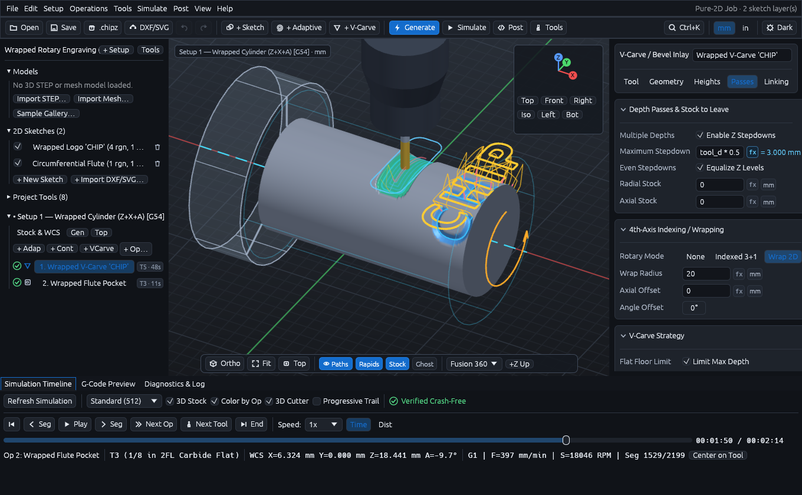
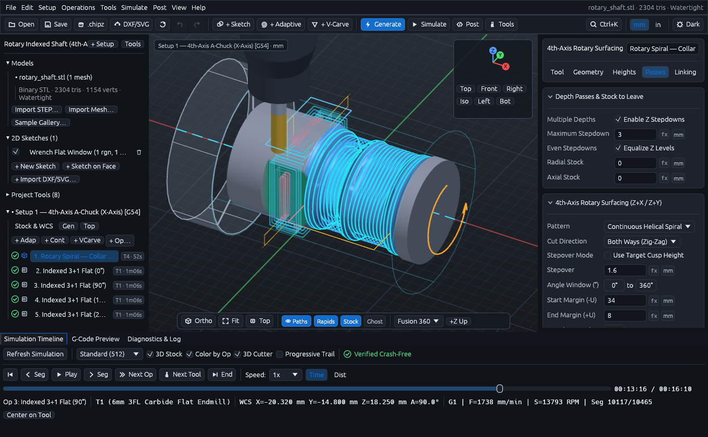

# Tutorial 09 — 4th-Axis Rotary Milling: `Z+X+A` Cylindrical Wrapping, Continuous Spiral Surfacing, & Indexed `3+1` Multi-Face Flats

## 1. Goal & What You'll Learn

This tutorial covers two practical 4th-axis rotary workflows supported by both dedicated 4-axis controllers (`LinuxCNC`, `grblHAL`) and 3-axis CNC routers using a swapped rotary axis (`grbl_rotary_wrap`):

- Configuring Setup-level **4th-Axis Rotary Kinematics** (`X/A`, `Y/B`, `Z/C`, chuck keep-out cylinder, clearance radius, and `G93` inverse-time post profiles).
- **2-Linear + Rotary Cylindrical Wrapping (`WrapCylinder`):** Wrapping 2D Sketch/DXF/SVG V-carving and pockets onto a `Ø40 mm` cylinder while strictly locking the cross-axis (`Y = 0`).
- **Continuous 2-Linear + Rotary 3D Surfacing (`Rotary2Linear`):** Carving a turned collar groove and sculpted 3-lobe cam with a single continuous helical spiral (`Z+X+A`).
- **Indexed `3+1` Positional Multi-Face Milling:** Indexing to `0° / 90° / 180° / 270°` (or using **Align to Selected 3D Face**) with automatic safe clearance-radius retracts between faces.

---

## 2. Prerequisites & Starter Projects

Launch either built-in 4th-axis showcase directly from the CLI or **Sample Gallery**:

```bash
# Part A — Wrapped Rotary Engraving (Z+X+A, Pure-2D cylinder with V-Carve "CHIP" + Flute Pocket):
cargo run --release -p chip-gui -- --sample rotary-wrap

# Part B — Rotary Indexed Shaft (4th-Axis A, Continuous Spiral + 4× Indexed 3+1 Wrench Flats):
cargo run --release -p chip-gui -- --sample rotary-shaft

# Or open the bare rotary shaft STL in an empty workspace:
cargo run --release -p chip-gui -- docs/tutorials/assets/09-rotary-shaft.stl
```

---

## 3. Step-by-Step GUI Walkthrough

### Part A — Wrapping 2D Artwork onto a Cylinder (`--sample rotary-wrap`)

1. **Configure Setup Rotary Kinematics (`Setup 1 → Rotary` tab):**
   - Set **Stock** to `Fixed Cylinder` (`Axis = X`, `Diameter = 40 mm`, `Length = 80 mm`) and **WCS Origin** to `Stock Volumetric Center` (`Y = 0, Z = 0` on the rotary centerline).
   - On the **Rotary** tab, set **Rotary Mode = `2-Linear + Rotary (Z+X / Z+Y)`**, **Rotary Axis = `X-Axis (A)`**, **Clearance Radial Offset = `10 mm`**, and **Post Profile = `linuxcnc_4axis`** (or `grbl_rotary_wrap` for 3-axis swapped-Y rotary hardware).
2. **Author or Import 2D Sketches:**
   - Create a 2D `Setup XY` sketch containing bold TrueType `"CHIP"` text rotated `90°` so it wraps circumferentially around the barrel (`Y` maps to circumference `s = R · θ`), plus a rounded circumferential flute rectangle.
3. **Enable `Wrap 2D` on Each Operation (`Passes → 4th-Axis Indexing / Wrapping`):**
   - Select **Op 1 (`Wrapped V-Carve 'CHIP'`)** and **Op 2 (`Wrapped Flute Pocket`)**.
   - On the **Passes** tab under **4th-Axis Indexing / Wrapping**, choose **Rotary Mode = `Wrap 2D`**, set **Wrap Radius = `20 mm`** (or expression `rotary_radius`), and keep **Heights Top = `StockTop + 0`** / **Bottom = `StockTop - 2.5 mm`**.



### Part B — Continuous Spiral Surfacing + 4-Sided Indexed `3+1` Flats (`--sample rotary-shaft`)

1. **Continuous Rotary Spiral (`Op 1: 4th-Axis Rotary Surfacing`):**
   - Add **`+ Op…` → `4th-Axis Rotary Surfacing`** with a `Ø6 mm Ball Endmill` (`T4`).
   - Choose **Pattern = `Continuous Helical Spiral`**, **Stepover = `1.6 mm`**, enable **Multiple Depths (`3.0 mm`)**, and set **Start Margin (-U) = `34 mm`** / **End Margin (+U) = `8 mm`** to isolate the reduced central groove and 3-lobe cam while staying well clear of the chuck.
2. **4-Sided Indexed `3+1` Flats (`Ops 2–5`):**
   - Add four `2D Pocket` operations targeting the `Wrench Flat Window` sketch with a `Ø6 mm Flat Endmill` (`T1`), stepping down from `StockTop + 0.5 mm` to `StockTop - 6.0 mm` (`Z = 15.0 mm`).
   - On each operation's **Passes → 4th-Axis Indexing / Wrapping** card, select **`Indexed 3+1`** and click the **`0°`**, **`90°`**, **`180°`**, and **`270°`** quick-index buttons (for arbitrary angled planar CAD faces on STEP solids, click the face in 3D and click **Align to Selected 3D Face**).



---

## 4. Key Parameters Reference

| Section | Parameter | Recommended Value | Notes |
|---|---|---|---|
| Setup → Rotary | `Clearance Radial Offset` | `10–12 mm` above stock OD | All `G0` index rotations happen at or above this clearance cylinder |
| Setup → Rotary | `Chuck Length / Diameter` | Match physical 3-jaw chuck | Visualized in 3D and enforced by `CylindricalStock` collision checks |
| `WrapCylinder` | `Wrap Radius` | `rotary_radius` (`20 mm`) | Flat `Z = 0` maps onto this radius; `Z < 0` cuts radially inward |
| `Rotary2Linear` | `Pattern` | `Continuous Helical Spiral` | Zero mid-air inter-layer unwinding; includes `360°` end cleanup rings |
| `Indexed3Plus1` | `Quick Index` / `Align Face` | `0° / 90° / 180° / 270°` | Prepends safe clearance retract + `G0 A<angle>` before cutting |

---

## 5. Generate (`Ctrl+G`) & Cylindrical 3D Simulation

1. Press **`Ctrl+G`** to generate all wrapped, spiral, and indexed toolpaths — notice the 3D viewport renders every path wrapped around the cylinder and positioned on all 4 indexed faces.
2. Open **Simulation Timeline** and press **`Space`** to play:
   - The polar **`CylindricalStock`** mesh and wrapped toolpaths rotate in lockstep beneath the live 3D cutter while the HUD displays live `A=<deg>°` angle readouts and animates `M6` tool changes smoothly (`T5 → T3` / `T4 → T1`).
   - Confirm **`✓ Verified Crash-Free`** (`0` rapid crashes, `0` chuck/holder collisions, `0` target STL gouges).

---

## 6. Post-Processing (`linuxcnc_4axis`, `grblhal_4axis`, & `grbl_rotary_wrap`)

- **`linuxcnc_4axis` / `grblhal_4axis`:** Emits synchronized `G93` inverse-time feedrates (`G93 G1 X... Z... A... F<1/min>`) for constant surface feed, restores `G94` for rapids/indexing, and emits safe clearance retracts before every `A90.000` / `A180.000` / `A270.000` index move.
- **`grbl_rotary_wrap` (3-Axis Swapped-Axis Rotary):** Automatically maps rotary angle `A` onto linear `Y` (`Y = R · θ` arc length) with **zero `A` words** so standard 3-axis GRBL controllers can run wrapped rotary engraving and continuous spiral surfacing cleanly.

---

## 7. Headless CLI Equivalent (`chipcutter`)

```bash
# 1. Generate the Rotary Indexed Shaft STL + 5-op project and Wrapped Engraving project
cargo run -p chip-cli -- generate-sample-step /tmp/rotary_shaft.stl \
  --tutorial 09-rotary-shaft --project-out /tmp/rotary_shaft.chip.toml
cargo run -p chip-cli -- generate-sample-step /tmp/rotary_wrap.chip.toml \
  --tutorial 09-rotary-wrap

# 2. Validate, simulate on CylindricalStock, and post-process
cargo run -p chip-cli -- simulate /tmp/rotary_shaft.chip.toml --resolution standard
cargo run -p chip-cli -- build /tmp/rotary_shaft.chip.toml -o /tmp/out_4ax --post linuxcnc_4axis
cargo run -p chip-cli -- build /tmp/rotary_wrap.chip.toml -o /tmp/out_wrap --post grbl_rotary_wrap
```
