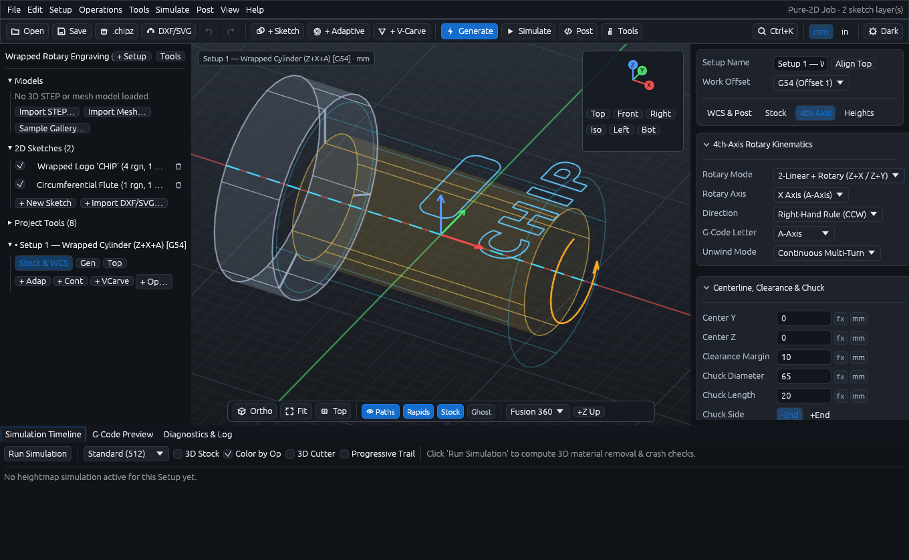
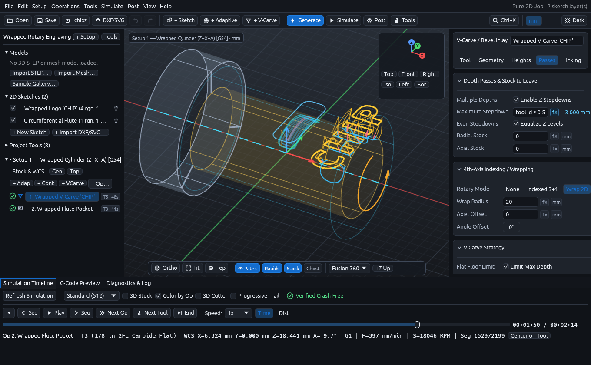
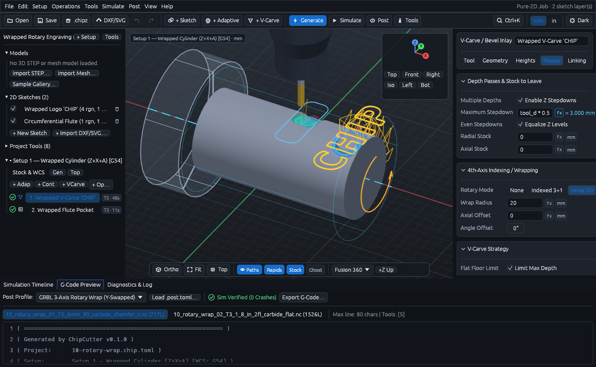

# Tutorial 10 — 4th-Axis Rotary Wrapping & Surfacing (`Z+X+A` / `Z+Y+B`)

## 1. Goal & What You'll Learn

A rotary 4th axis mounted along a CNC router's `X` bed (`A`-axis) or `Y` bed (`B`-axis) lets you carve cylindrical logos, circumferential flutes, turned collars, and sculpted cams—even on 3-axis GRBL machines using a swapped rotary stepper driver!

In this tutorial you will master ChipCutter's **2-Linear + Rotary (`Z+X+A` & `Z+Y+B`)** workflows from Setup kinematics through verified G-code:

- Configuring the **`Setup → 4th Axis`** tab: `Rotary Mode`, `X Axis (A-Axis)` vs. `Y Axis (B-Axis)`, `Direction` polarity (`Right-Hand Rule (CCW)` vs. `Inverted (CW)`), `Unwind Mode`, `Clearance Margin`, and 3D chuck keep-out collision envelope.
- **Cylindrical 2D Wrapping (`WrapCylinder`):** Wrapping 2D Sketch/DXF/SVG **V-Carving**, **2D Pockets**, and **2D Contours** onto a `Ø40 mm` cylindrical blank while strictly locking the perpendicular cross-axis (`Y = 0` on `X/A`, or `X = 0` on `Y/B`).
- **Centerline-Locked 3D Rotary Surfacing (`Rotary2Linear`):** Comparing **`Continuous Helical Spiral`** (`0°..360°`) against **`Axial Parallel (Index & Sweep)`** over a targeted partial angular sector (`-60°` to `+60°`) on a sculpted shaft mesh.
- Verifying material removal and `M6` tool changes on ChipCutter's polar **`CylindricalStock`** simulator, and contrasting **`grbl_rotary_wrap`** (3-axis Y-swapped, zero `A` words) against **`linuxcnc_4axis`** (`G93` inverse-time `X Z A F`).

---

## 2. Prerequisites & Starter Projects

Launch either pre-seeded rotary showcase directly, or open the starter rotary shaft STL ([`assets/09-rotary-shaft.stl`](assets/09-rotary-shaft.stl)) in a fresh workspace:

```bash
# Part A — Wrapped Rotary Engraving (Pure-2D Ø40×80 mm cylinder, V-Carve "CHIP" + Flute Pocket):
cargo run --release -p chip-gui -- --sample rotary-wrap

# Part B — Generate the Axial Parallel + Continuous Spiral project on 09-rotary-shaft.stl:
cargo run -p chip-cli -- generate-sample-step /tmp/10-rotary-shaft.stl \
  --tutorial 10-rotary-axial --project-out /tmp/10-rotary-axial.chip.toml
cargo run --release -p chip-gui -- /tmp/10-rotary-axial.chip.toml

# Or open the bare rotary shaft mesh in an empty project:
cargo run --release -p chip-gui -- docs/tutorials/assets/09-rotary-shaft.stl
```

---

## 3. Step-by-Step GUI Walkthrough

### Step 1 — Configure Setup Rotary Kinematics (`Setup 1 → 4th Axis` tab)

1. Select **`Stock & WCS`** under **`Setup 1`** in the left browser.
2. On the **`Stock`** tab, choose **`Fixed Cylinder`**, set **`Axis = X`**, **`Diameter = 40 mm`** (for Part A wrapping) or **`42 mm`** (for Part B shaft surfacing), and **`Length = 80 mm`**. On **`WCS & Post`**, set **`Origin`** to **`Stock Volumetric Center`** so `Y = 0, Z = 0` lies dead-center on the rotary spindle axis, and pick **`Post Profile = linuxcnc_4axis`** (or **`grbl_rotary_wrap`** for 3-axis swapped-axis hardware).
3. Switch to the **`4th Axis`** tab:
   - **`Rotary Mode`:** `2-Linear + Rotary (Z+X / Z+Y)`
   - **`Rotary Axis`:** `X Axis (A-Axis)` (if your rotary unit mounts parallel to your Y rails, switch to **`Y Axis (B-Axis)`** and click **`Align Cylindrical Stock to Rotary Axis`**—ChipCutter automatically locks `X = 0` and wraps `X` arc length onto `B` instead!)
   - **`Direction`:** `Right-Hand Rule (CCW)` (switch to `Inverted (CW)` if your rotary chuck turns clockwise for positive `+A` commands)
   - **`Unwind Mode`:** `Continuous Multi-Turn` (prevents unnecessary mid-job unwinding on multi-revolution spirals)
   - **`Clearance Margin`:** `10 mm` above stock OD (`R_clearance = 30 mm`), **`Chuck Diameter`:** `65 mm`, **`Chuck Length`:** `20 mm`, **`Chuck Side`:** `-End`.



Inspect the 3D viewport gizmo before adding any operations: the golden cylinder is your raw stock, the outer cyan cage marks the safe clearance radius, the metallic collar on `-X` is the chuck keep-out zone enforced by simulation, and the orange arc arrow verifies positive rotation polarity.

### Step 2 — Wrap 2D V-Carve, Pocket, & Contour Operations (`Wrap 2D`)

1. Author or import your 2D artwork on **`Setup XY`** sketches (`+ Sketch` or **`DXF/SVG`**):
   - **`Wrapped Logo 'CHIP'`:** Bold TrueType `"CHIP"` text (`14 mm` cap height) rotated **`90°`** so the lettering reads circumferentially around the barrel (`Y` maps to circumference `s = R · θ`, where a `Ø40 mm` cylinder has circumference `π × 40 ≈ 125.66 mm`).
   - **`Circumferential Flute`:** A `12 × 34 mm` rounded rectangle (`R = 4 mm`) centered at `X = -14 mm, Y = 0 mm`.
2. Add **`Op 1: Wrapped V-Carve 'CHIP'`** (`V-Carve` using `T5` `90°` Chamfer/V-Bit) and **`Op 2: Wrapped Flute Pocket`** (`2D Pocket` using `T3` `1/8 in` Flat Endmill). You can wrap **`2D Contour`** profiles the exact same way.
3. On each operation's **`Heights`** tab, set **`Top = StockTop + 0`** and **`Bottom = StockTop - 2.5 mm`** (`-1.8 mm` for the flute pocket).
4. On the **`Passes`** tab, expand **`4th-Axis Indexing / Wrapping`**:
   - Click **`Wrap 2D`**.
   - Set **`Wrap Radius`** = **`20 mm`** (or expression **`rotary_radius`** so changing stock diameter updates the wrap radius automatically).
   - Leave **`Axial Offset = 0 mm`** and **`Angle Offset = 0°`** (adjust `Angle Offset` to clock artwork cleanly around the circumference).
5. Press **`Ctrl+G`**:



Notice how ChipCutter maps every planar `(X, Y, Z)` point directly onto the `R = 20 mm` cylinder while holding the cross-axis strictly at **`Y = 0.000 mm`**—turning planar V-Carve depth climbs and helical pocket entries into smooth `Z+X+A` cylindrical paths.

### Step 3 — Verify Wrapped Simulation & `M6` Tool Changes (`CylindricalStock`)

Open the **`Simulation Timeline`** tab, enable **`3D Stock`**, **`Color by Op`**, and **`3D Cutter`**, and press **`Space`** (or scrub to ~90%):


Watch the polar stock mesh rotate in lockstep beneath the live 3D cutter:
- The HUD readout displays live **`WCS X=9.669 mm  Y=0.000 mm  Z=18.200 mm  A=36.2°`**, proving `Y` remains locked dead-center on the rotary axis.
- Between `Op 1` (`T5`) and `Op 2` (`T3`), the 3D cutter swaps cleanly at the clearance cylinder.
- The status badge reports **`✓ Verified Crash-Free`** (`0` rapid crashes, `0` chuck/holder collisions).

### Step 4 — 3D Rotary Surfacing: `Continuous Spiral` vs. `Axial Parallel` + Partial Sector

Now open the **Tutorial 10 Axial Parallel & Spiral** project (`/tmp/10-rotary-axial.chip.toml` on `09-rotary-shaft.stl`) to compare both **`OperationKind::Rotary2Linear`** patterns on a 3D shaft mesh (`Ø40 × 80 mm` with a turned central collar groove and 3-lobe cam):

1. **`Op 1 — Rotary Continuous Spiral (360°)`:**
   - Uses `T4` (`Ø6 mm` Ball Endmill), **`Pattern = Continuous Helical Spiral`**, **`Stepover = 1.6 mm`**, **`Multiple Depths = 3.0 mm`**, **`Angle Window = 0° to 360°`**, and **`Start Margin (-U) = 34 mm` / `End Margin (+U) = 8 mm`** to stay clear of the chuck and the front wrenching flats.
   - Because `Continuous Spiral` advances axially in one uninterrupted helix per radial depth layer, there are **zero inter-layer unwinding retracts**.
2. **`Op 2 — Rotary Axial Parallel (-60°..+60°)`:**
   - Add a second **`4th-Axis Rotary Surfacing`** operation with `T4` (`Ø6 mm` Ball Endmill) and disable **`Multiple Depths`** for a finishing pass.
   - Switch **`Pattern`** to **`Axial Parallel (Index & Sweep)`** with **`Cut Direction = Both Ways (Zig-Zag)`** and **`Stepover = 1.2 mm`**.
   - Narrow **`Angle Window (°)`** to **`-60°` to `60°`** to target a single `120°` cam-lobe sector lengthwise without re-machining the back of the shaft.
   - Press **`Ctrl+G`** and isolate `Op 2`:


In **`Axial Parallel`** mode, the chuck indexes cleanly in small circumferential steps while the spindle sweeps back and forth along `X`—ideal for wood grain alignment, long flutes, or localized angular patches (`Start°..End°`).

---

## 4. Key Parameters Reference

| Section | Parameter | Recommended Starting Value | Purpose & Notes |
|---|---|---|---|
| `Setup → 4th Axis` | `Rotary Axis` | `X Axis (A-Axis)` or `Y Axis (B-Axis)` | Match physical chuck alignment; `X/A` locks `Y=0`, `Y/B` locks `X=0` |
| `Setup → 4th Axis` | `Direction` | `Right-Hand Rule (CCW)` | Switch to `Inverted (CW)` if your hardware rotates opposite ISO right-hand rule |
| `Setup → 4th Axis` | `Clearance Margin` | `10 – 12 mm` above stock OD | All `G0` rotary positioning moves occur at or above this clearance cylinder |
| `Setup → 4th Axis` | `Chuck Diameter / Length` | Match physical 3-jaw/4-jaw chuck | Enforced as a hard collision keep-out zone in `CylindricalStock` simulation |
| `Wrap 2D` | `Wrap Radius` | `rotary_radius` (`20 mm`) | Planar `Z = 0` maps onto this cylinder radius; negative `Z` cuts radially inward |
| `Wrap 2D` | `Angle Offset` | `0°` (adjustable `-360°..360°`) | Clocks wrapped 2D sketches circumferentially around the cylinder |
| `Rotary2Linear` | `Pattern` | `Continuous Helical Spiral` / `Axial Parallel` | Spiral gives uninterrupted 360° cuts; Axial Parallel sweeps lengthwise lanes |
| `Rotary2Linear` | `Angle Window (°)` | `0°..360°` (or partial e.g. `-60°..60°`) | Restricts surfacing to a specific angular sector around the shaft |
| `Rotary2Linear` | `Start / End Margin` | `>= chuck clearance` | Keeps the cutter safely outside the chuck jaws (`-U`) and tailstock (`+U`) |

---

## 5. Generate (`Ctrl+G`) & Cylindrical 3D Simulation

1. Press **`Ctrl+G`** to regenerate all operations in parallel via `rayon`.
2. Click **`Simulate`** (`Standard (512)`) and confirm **`✓ Verified Crash-Free`** on both the wrapped cylinder project and the `ContinuousSpiral + AxialParallel` shaft project:
   - **`RapidIntoStock`:** `0` crashes (`G0` moves always retract to the clearance cylinder before indexing).
   - **`TargetModelGouge`:** `0` gouges across the collar groove and 3-lobe cam (`<= 0.02 mm`).
   - **`HolderCollision`:** `0` chuck or tool-holder collisions.

---

## 6. Post-Processing (`grbl_rotary_wrap` vs. `linuxcnc_4axis`)

Open **`G-Code Preview`** and switch **`Post Profile`** to **`GRBL 3-Axis Rotary Wrap (Y-Swapped)`** (`grbl_rotary_wrap`):



- **`grbl_rotary_wrap` (3-Axis Swapped-Axis Rotary):** Unplug your router's `Y` motor, plug the rotary axis into the `Y` driver calibrated to surface millimeters (`steps/mm` at the wrap radius), and post directly! ChipCutter converts every rotary angle `θ` to linear arc length `Y = R · θ`, emits **zero `A` words**, and splits multi-tool jobs cleanly into sequential per-tool `.nc` files (`T5` then `T3`).
- **`linuxcnc_4axis` / `grblhal_4axis` (Dedicated 4-Axis Controllers):** Emits true `A`-axis coordinates with automatic **`G93` inverse-time feedrates** (`G93 G1 X... Z... A... F<1/min>`) so constant surface speed is maintained as cutting radius varies, restoring **`G94`** cleanly before every `G0` rapid.

---

## 7. Headless CLI Equivalent (`chipcutter`)

Generate, validate, simulate on `CylindricalStock`, and post-process both Tutorial 10 projects directly from the terminal:

```bash
# 1. Generate the Wrapped Rotary Engraving project (Pure-2D Ø40×80 mm cylinder)
cargo run -p chip-cli -- generate-sample-step /tmp/10-rotary-wrap.chip.toml \
  --tutorial 10-rotary-wrap

# 2. Generate the Rotary Shaft STL + Continuous Spiral & Axial Parallel (-60°..+60°) project
cargo run -p chip-cli -- generate-sample-step /tmp/10-rotary-shaft.stl \
  --tutorial 10-rotary-axial --project-out /tmp/10-rotary-axial.chip.toml

# 3. Validate, run CylindricalStock verification, and post-process for GRBL Wrap & LinuxCNC 4-Axis
cargo run -p chip-cli -- validate --generate /tmp/10-rotary-wrap.chip.toml
cargo run -p chip-cli -- simulate /tmp/10-rotary-wrap.chip.toml --resolution standard
cargo run -p chip-cli -- build /tmp/10-rotary-wrap.chip.toml -o /tmp/out_10_wrap --post grbl_rotary_wrap

cargo run -p chip-cli -- validate --generate /tmp/10-rotary-axial.chip.toml
cargo run -p chip-cli -- simulate /tmp/10-rotary-axial.chip.toml --resolution standard
cargo run -p chip-cli -- build /tmp/10-rotary-axial.chip.toml -o /tmp/out_10_axial_lcnc --post linuxcnc_4axis
cargo run -p chip-cli -- build /tmp/10-rotary-axial.chip.toml -o /tmp/out_10_axial_wrap --post grbl_rotary_wrap
```

---

## Next Steps

- **Previous:** [Tutorial 09 — 3D Surface Finishing: Parallel Raster, Constant-Scallop, 3D Rest, & Pencil Cleanup](09-3d-surface-finishing.md)
- **Next:** [Tutorial 11 — Indexed `3+1` Multi-Face Milling](11-indexed-3plus1-milling.md)
- **Index:** [All Tutorials](README.md)
