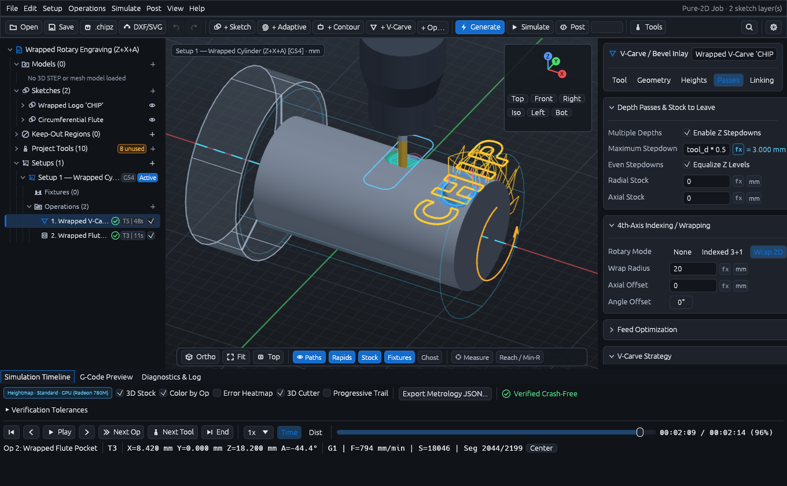
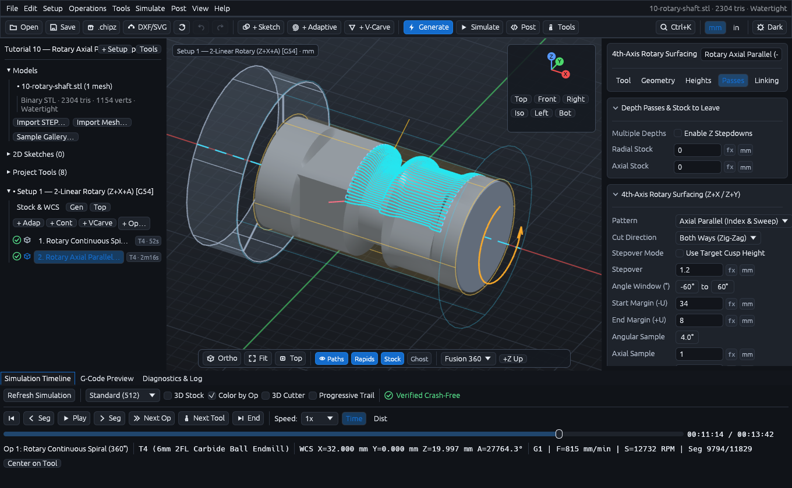

# Tutorial 10 — 4th-Axis Rotary Wrapping & Surfacing (`Z+X+A` / `Z+Y+B`)

## 1. Goal & What You'll Learn

A rotary 4th axis mounted along a CNC router's `X` bed (`A`-axis) or `Y` bed (`B`-axis) lets you carve cylindrical logos, circumferential flutes, turned collars, and sculpted cams—even on 3-axis GRBL machines using a swapped rotary stepper driver!

In this tutorial you will master ChipCutter's **2-Linear + Rotary (`Z+X+A` & `Z+Y+B`)** workflows from Setup kinematics through verified G-code:

- Configuring the **`Setup → 4th Axis`** tab: `Rotary Mode`, `X Axis (A-Axis)` vs. `Y Axis (B-Axis)`, `Direction` polarity (`Right-Hand Rule (CCW)` vs. `Inverted (CW)`), `Unwind Mode`, `Clearance Margin`, and 3D chuck keep-out collision envelope.
- **Cylindrical 2D Wrapping (`WrapCylinder`):** Wrapping 2D Sketch/DXF/SVG **V-Carving**, **2D Pockets**, and **2D Contours** onto a `Ø40 mm` cylindrical blank while strictly locking the perpendicular cross-axis (`Y = 0` on `X/A`, or `X = 0` on `Y/B`).
- **Centerline-Locked 3D Rotary Surfacing (`Rotary2Linear`):** Comparing **`Continuous Helical Spiral`** (`0°..360°`) against **`Axial Parallel (Index & Sweep)`** over a targeted partial angular sector (`-60°` to `+60°`) on a sculpted shaft mesh.
- Verifying material removal and `M6` tool changes on ChipCutter's polar **`CylindricalStock`** simulator, and contrasting **`grbl_rotary_wrap`** (3-axis Y-swapped, zero `A` words) against **`linuxcnc_4axis`** (`G93` inverse-time `X Z A F`).

---

## 2. Prerequisites & Starter Projects

Launch either pre-seeded rotary showcase directly, or open the starter rotary shaft STL ([`assets/09-rotary-shaft.stl`](assets/09-rotary-shaft.stl)) in a fresh workspace:

```bash
# Part A — Wrapped Rotary Engraving (Pure-2D Ø40×80 mm cylinder, V-Carve "CHIP" + Flute Pocket):
cargo run --release -p chip-gui -- --sample rotary-wrap

# Part B — Generate the Axial Parallel + Continuous Spiral project on 09-rotary-shaft.stl:
cargo run -p chip-cli -- generate-sample-step /tmp/10-rotary-shaft.stl \
  --tutorial 10-rotary-axial --project-out /tmp/10-rotary-axial.chip.toml
cargo run --release -p chip-gui -- /tmp/10-rotary-axial.chip.toml

# Or open the bare rotary shaft mesh in an empty project:
cargo run --release -p chip-gui -- docs/tutorials/assets/09-rotary-shaft.stl
```

---

## 3. Step-by-Step GUI Walkthrough

### Step 1 — Configure Setup Rotary Kinematics (`Setup 1 → 4th Axis` tab)

1. In the left **CAM Browser**, click **`Stock & WCS`** under **`Setup 1`**.
2. Switch to the **`Stock`** tab in the right **Inspector**: under **`Stock Geometry & Dimensions`**, change **`Stock Mode`** to **`Fixed Cylindrical Stock`** **first** so **`Bar Axis`**, **`Bar Diameter`**, and **`Bar Length`** appear below it, then set **`Bar Axis`** = **`WCS X Axis`**, **`Bar Diameter`** = `40 mm` (for Part A wrapping) or `42 mm` (for Part B shaft surfacing), and **`Bar Length`** = `80 mm`.
3. Switch to the **`WCS & Post`** tab in the right **Inspector**:
   - Under **`WCS Origin (X0 Y0 Z0)`**, select **`Origin Reference`** = **`Stock 27-Pt`**, set **`Z Level:`** = **`Mid-Z`**, and click **`C`** in the **`Center Y`** row (so **`Active Anchor`** reads `Mid-Z Center`, placing `Y = 0, Z = 0` dead-center on the rotary spindle axis).
   - Under **`Post-Processor & Output`**, set **`Post Profile`** = **`LinuxCNC 4-Axis (XYZA / G93) (linuxcnc_4axis)`** (or **`GRBL 3-Axis Rotary Wrap (Y-Swapped) (grbl_rotary_wrap)`** for 3-axis swapped-axis hardware).
4. Switch to the **`4th Axis`** tab in the right **Inspector**:
   - Under **`4th-Axis Rotary Kinematics`**, **first** change **`Rotary Mode`** from `Disabled (3-Axis)` to **`2-Linear + Rotary (Z+X / Z+Y)`** so **`Rotary Axis`**, **`Direction`**, **`G-Code Letter`**, **`Unwind Mode`**, and the **`Centerline, Clearance & Chuck`** card appear below it (enabling **`4th Axis`** here is also what makes the **`4th-Axis Indexing / Wrapping`** card appear in Operation **`Passes`** tabs!).
   - **`Rotary Axis`:** **`X Axis (A-Axis)`** (if your rotary unit mounts parallel to your Y rails, switch to **`Y Axis (B-Axis)`** and click **`Align Cylindrical Stock to Rotary Axis`** inside **`Centerline, Clearance & Chuck`**—ChipCutter automatically locks `X = 0` and wraps `X` arc length onto `B` instead!).
   - **`Direction`:** **`Right-Hand Rule (CCW)`** (switch to **`Inverted (CW)`** if your rotary chuck turns clockwise for positive `+A` commands).
   - **`Unwind Mode`:** **`Continuous Multi-Turn`** (prevents unnecessary mid-job unwinding on multi-revolution spirals).
   - Under **`Centerline, Clearance & Chuck`**, set **`Clearance Margin`** = `10 mm` above stock OD (`R_clearance = 30 mm`), **`Chuck Diameter`** = `65 mm`, **`Chuck Length`** = `20 mm`, and **`Chuck Side`** = **`-End`**.


Inspect the **3D CAD Viewport** gizmo before adding any operations: the golden cylinder is your raw stock, the outer cyan cage marks the safe clearance radius, the metallic collar on `-X` is the chuck keep-out zone enforced by simulation, and the orange arc arrow verifies positive rotation polarity.

### Step 2 — Wrap 2D V-Carve, Pocket, & Contour Operations (`Wrap 2D`)

1. Author or import your 2D artwork on **`Setup XY`** sketches (**`+ Sketch`** or **`DXF/SVG`** in the **top toolbar**):
   - **`Wrapped Logo 'CHIP'`:** Bold TrueType `"CHIP"` text (`Cap Height = 14 mm`, `Orientation` rotated **`90°`**) so the lettering reads circumferentially around the barrel (`Y` maps to circumference `s = R · θ`, where a `Ø40 mm` cylinder has circumference `π × 40 ≈ 125.66 mm`).
   - **`Circumferential Flute`:** A `12 × 34 mm` rounded rectangle (`Fillet R = 4 mm`) centered at `Position X = -14 mm, Position Y = 0 mm`.
2. Add **`Op 1: Wrapped V-Carve 'CHIP'`** via **`+ V-Carve`** in the **top toolbar** (assigning **`T5 — 6mm 90° Carbide Chamfer / Spot Mill`** in the **`Tool`** tab) and **`Op 2: Wrapped Flute Pocket`** via **`+ Op… → 2D Pocket`** in the left **CAM Browser** (assigning **`T3 — 1/8 in 2FL Carbide Flat`** in **`Tool`**). You can wrap **`2D Contour / Profile`** operations the exact same way.
3. On each operation's **`Heights`** tab in the right **Inspector** (`Z-Height Planes & Offsets` card), set **`Top Ref`** = **`Stock Top`** with **`Top Offset`** = `0 mm`, and **`Bottom Ref`** = **`Stock Top`** with **`Bottom Offset`** = `-2.5 mm` (`-1.8 mm` for the flute pocket).
4. On the **`Passes`** tab in the right **Inspector**, locate the **`4th-Axis Indexing / Wrapping`** card (visible because Setup 1's **`4th Axis`** is enabled):
   - **First** click **`Wrap 2D`** on the **`Rotary Mode`** row so **`Wrap Radius`**, **`Axial Offset`**, and **`Angle Offset`** appear below it.
   - Set **`Wrap Radius`** = **`20 mm`** (or expression **`rotary_radius`** so changing stock diameter updates the wrap radius automatically).
   - Leave **`Axial Offset`** = `0 mm` and **`Angle Offset`** = `0°` (adjust **`Angle Offset`** to clock artwork cleanly around the circumference).
5. Press **`Ctrl+G`** (or click **`Generate`** in the **top toolbar**):


Notice how ChipCutter maps every planar `(X, Y, Z)` point directly onto the `R = 20 mm` cylinder while holding the cross-axis strictly at **`Y = 0.000 mm`**—turning planar V-Carve depth climbs and helical pocket entries into smooth `Z+X+A` cylindrical paths.

### Step 3 — Verify Wrapped Simulation & `M6` Tool Changes (`CylindricalStock`)

Click **`Simulate`** in the **top toolbar** (opening the bottom **`Simulation Timeline`** tab), confirm **`3D Stock`**, **`Color by Op`**, and **`3D Cutter`** are checked in the **`Simulation Timeline`** top bar, and press **`Space`** (or click **`Play`** / scrub to ~90%):



Watch the polar stock mesh rotate in lockstep beneath the live 3D cutter in the **3D CAD Viewport**:
- The **`Simulation Timeline`** HUD readout displays live **`WCS X=9.669 mm  Y=0.000 mm  Z=18.200 mm  A=36.2°`**, proving `Y` remains locked dead-center on the rotary axis.
- Between `Op 1` (`T5`) and `Op 2` (`T3`), the 3D cutter swaps cleanly at the clearance cylinder.
- The status badge in **`Simulation Timeline`** reports **`Verified Crash-Free`** (`0` rapid crashes, `0` chuck/holder collisions).

### Step 4 — 3D Rotary Surfacing: `Continuous Helical Spiral` vs. `Axial Parallel (Index & Sweep)` + Partial Sector

Now open the **Tutorial 10 Axial Parallel & Spiral** project (`/tmp/10-rotary-axial.chip.toml` on `09-rotary-shaft.stl`) to compare both **`4th-Axis Rotary Surfacing`** patterns on a 3D shaft mesh (`Ø40 × 80 mm` with a turned central collar groove and 3-lobe cam):

1. **`Op 1 — Rotary Continuous Spiral (360°)`:**
   - Uses **`T4 — 6mm 2FL Carbide Ball Endmill`**. In the right **Inspector** **`Passes`** tab: under **`Depth Passes & Stock to Leave`**, keep **`Multiple Depths`** (`Enable Z Stepdowns`) checked so **`Maximum Stepdown`** (`3.0 mm`) is visible; under **`4th-Axis Rotary Surfacing (Z+X / Z+Y)`**, set **`Pattern`** = **`Continuous Helical Spiral`**, leave **`Stepover Mode`** (`Use Target Cusp Height`) unchecked so **`Stepover`** (`1.6 mm`) is visible, keep **`Angle Window (°)`** = `0°` to `360°`, and set **`Start Margin (-U)`** = `34 mm` and **`End Margin (+U)`** = `8 mm` to stay clear of the chuck and the front wrenching flats.
   - Because `Continuous Helical Spiral` advances axially in one uninterrupted helix per radial depth layer, there are **zero inter-layer unwinding retracts**.
2. **`Op 2 — Rotary Axial Parallel (-60°..+60°)`:**
   - Add a second **`4th-Axis Rotary Surfacing`** operation via **`+ Op… → 4th-Axis Rotary Surfacing`** in the left **CAM Browser** (or **`Operations → + 4th-Axis Rotary Surfacing`** in the **top menu bar**), assign **`T4 — 6mm 2FL Carbide Ball Endmill`** in the **`Tool`** tab, and on the **`Passes`** tab uncheck **`Multiple Depths`** (`Enable Z Stepdowns`) under **`Depth Passes & Stock to Leave`** for a finishing pass.
   - Under **`4th-Axis Rotary Surfacing (Z+X / Z+Y)`**, switch **`Pattern`** to **`Axial Parallel (Index & Sweep)`** with **`Cut Direction`** = **`Both Ways (Zig-Zag)`** and **`Stepover`** = `1.2 mm` (with **`Use Target Cusp Height`** unchecked).
   - Narrow **`Angle Window (°)`** to **`-60°`** to **`60°`** to target a single `120°` cam-lobe sector lengthwise without re-machining the back of the shaft.
   - Press **`Ctrl+G`** and select `Op 2` in the left **CAM Browser**:



In **`Axial Parallel (Index & Sweep)`** mode, the chuck indexes cleanly in small circumferential steps while the spindle sweeps back and forth along `X`—ideal for wood grain alignment, long flutes, or localized angular patches (`Angle Window (°)`).

---

## 4. Key Parameters Reference

| Location | Parameter | Recommended Starting Value | Purpose & Notes |
|---|---|---|---|
| `Right Inspector → Setup → 4th Axis → 4th-Axis Rotary Kinematics` | **`Rotary Axis`** | **`X Axis (A-Axis)`** or **`Y Axis (B-Axis)`** | Shown after enabling **`Rotary Mode`**; `X/A` locks `Y=0`, `Y/B` locks `X=0` |
| `Right Inspector → Setup → 4th Axis → 4th-Axis Rotary Kinematics` | **`Direction`** | **`Right-Hand Rule (CCW)`** | Switch to **`Inverted (CW)`** if your hardware rotates opposite ISO right-hand rule |
| `Right Inspector → Setup → 4th Axis → Centerline, Clearance & Chuck` | **`Clearance Margin`** | `10 – 12 mm` above stock OD | All `G0` rotary positioning moves occur at or above this clearance cylinder |
| `Right Inspector → Setup → 4th Axis → Centerline, Clearance & Chuck` | **`Chuck Diameter`** / **`Chuck Length`** | Match physical 3-jaw/4-jaw chuck | Enforced as a hard collision keep-out zone in `CylindricalStock` simulation |
| `Right Inspector → Passes → 4th-Axis Indexing / Wrapping` | **`Wrap Radius`** | `rotary_radius` (`20 mm`) | Shown after clicking **`Wrap 2D`**; planar `Z = 0` maps onto this radius |
| `Right Inspector → Passes → 4th-Axis Indexing / Wrapping` | **`Angle Offset`** | `0°` (adjustable `-360°..360°`) | Shown after clicking **`Wrap 2D`**; clocks wrapped 2D sketches around the cylinder |
| `Right Inspector → Passes → 4th-Axis Rotary Surfacing (Z+X / Z+Y)` | **`Pattern`** | **`Continuous Helical Spiral`** / **`Axial Parallel (Index & Sweep)`** | Spiral gives uninterrupted 360° cuts; Axial Parallel sweeps lengthwise lanes |
| `Right Inspector → Passes → 4th-Axis Rotary Surfacing (Z+X / Z+Y)` | **`Angle Window (°)`** | `0°` to `360°` (or partial e.g. `-60°` to `60°`) | Restricts surfacing to a specific angular sector around the shaft |
| `Right Inspector → Passes → 4th-Axis Rotary Surfacing (Z+X / Z+Y)` | **`Start Margin (-U)`** / **`End Margin (+U)`** | `>= chuck clearance` | Keeps the cutter safely outside the chuck jaws (`-U`) and tailstock (`+U`) |

---

## 5. Generate (`Ctrl+G`) & Cylindrical 3D Simulation

1. Press **`Ctrl+G`** (or click **`Generate`** in the **top toolbar**) to regenerate all operations in parallel via `rayon`.
2. Click **`Simulate`** in the **top toolbar** (selecting **`Standard (512)`** in the bottom **`Simulation Timeline`** resolution dropdown) and confirm **`Verified Crash-Free`** on both the wrapped cylinder project and the `Continuous Helical Spiral` + `Axial Parallel` shaft project:
   - **`Rapid-into-Stock Crash`:** `0` crashes (`G0` moves always retract to the clearance cylinder before indexing).
   - **`Target Model Gouge`:** `0` gouges across the collar groove and 3-lobe cam (`<= 0.02 mm`).
   - **`Holder / Collet Collision`:** `0` chuck or tool-holder collisions.

---

## 6. Post-Processing (`grbl_rotary_wrap` vs. `linuxcnc_4axis`)

Click **`Post`** in the **top toolbar** (or select the bottom **`G-Code Preview`** tab) and switch **`Post Profile:`** to **`GRBL 3-Axis Rotary Wrap (Y-Swapped)`** (`grbl_rotary_wrap`):


- **`grbl_rotary_wrap` (3-Axis Swapped-Axis Rotary):** Unplug your router's `Y` motor, plug the rotary axis into the `Y` driver calibrated to surface millimeters (`steps/mm` at the wrap radius), and post directly! ChipCutter converts every rotary angle `θ` to linear arc length `Y = R · θ`, emits **zero `A` words**, and splits multi-tool jobs cleanly into sequential per-tool `.nc` files (`T5` then `T3`).
- **`linuxcnc_4axis` / `grblhal_4axis` (Dedicated 4-Axis Controllers):** Emits true `A`-axis coordinates with automatic **`G93` inverse-time feedrates** (`G93 G1 X... Z... A... F<1/min>`) so constant surface speed is maintained as cutting radius varies, restoring **`G94`** cleanly before every `G0` rapid.

---

## 7. Headless CLI Equivalent (`chipcutter`)

Generate, validate, simulate on `CylindricalStock`, and post-process both Tutorial 10 projects directly from the terminal:

```bash
# 1. Generate the Wrapped Rotary Engraving project (Pure-2D Ø40×80 mm cylinder)
cargo run -p chip-cli -- generate-sample-step /tmp/10-rotary-wrap.chip.toml \
  --tutorial 10-rotary-wrap

# 2. Generate the Rotary Shaft STL + Continuous Spiral & Axial Parallel (-60°..+60°) project
cargo run -p chip-cli -- generate-sample-step /tmp/10-rotary-shaft.stl \
  --tutorial 10-rotary-axial --project-out /tmp/10-rotary-axial.chip.toml

# 3. Validate, run CylindricalStock verification, and post-process for GRBL Wrap & LinuxCNC 4-Axis
cargo run -p chip-cli -- validate --generate /tmp/10-rotary-wrap.chip.toml
cargo run -p chip-cli -- simulate /tmp/10-rotary-wrap.chip.toml --resolution standard
cargo run -p chip-cli -- build /tmp/10-rotary-wrap.chip.toml -o /tmp/out_10_wrap --post grbl_rotary_wrap

cargo run -p chip-cli -- validate --generate /tmp/10-rotary-axial.chip.toml
cargo run -p chip-cli -- simulate /tmp/10-rotary-axial.chip.toml --resolution standard
cargo run -p chip-cli -- build /tmp/10-rotary-axial.chip.toml -o /tmp/out_10_axial_lcnc --post linuxcnc_4axis
cargo run -p chip-cli -- build /tmp/10-rotary-axial.chip.toml -o /tmp/out_10_axial_wrap --post grbl_rotary_wrap
```

---

## Next Steps

- **Previous:** [Tutorial 09 — 3D Surface Finishing: Parallel Raster, Constant-Scallop, 3D Rest, & Pencil Cleanup](09-3d-surface-finishing.md)
- **Next:** [Tutorial 11 — Indexed `3+1` Multi-Face Milling](11-indexed-3plus1-milling.md)
- **Index:** [All Tutorials](README.md)
