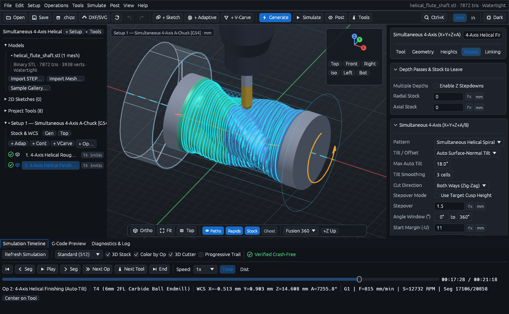
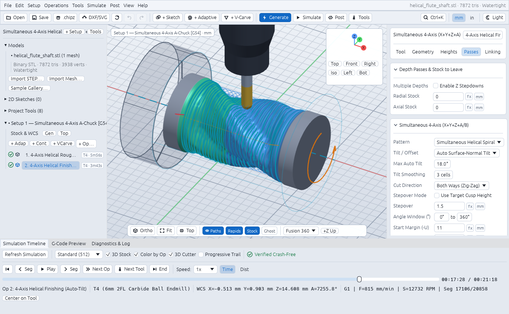

# Tutorial 10 — Simultaneous 4-Axis Milling (`X + Y + Z + A/B`): Off-Centerline Auto-Tilt & Helical Flutes

## 1. Goal & What You'll Learn

When machining deep helical flutes, twisted cam flanks, or sculpted impeller channels, locking the cutter dead-center over the rotary axis drags the zero-RPM ball tip and limits flank clearance. In this tutorial you will use **Simultaneous 4-Axis Milling (`OperationKind::Rotary4AxisSim`)** driving **`X`, `Y`, `Z`, and `A` (or `B`) simultaneously**:

- Configuring a **Simultaneous 4-Axis (`X+Y+Z+Rotary`)** Setup.
- Using **`Auto Surface-Normal Tilt`** with multi-pass tilt smoothing (`Tilt Smoothing`) to shift the cross-axis (`Y` on `X/A`, or `X` on `Y/B`) off centerline so the cutter's side/ball periphery engages steep helical flanks cleanly.
- Comparing **`Auto Surface-Normal Tilt`** against **`Fixed Lateral Offset`** and **`Simultaneous Helical Spiral`** vs. **`Axial / Helical Flowline`**.
- Verifying off-centerline shank/holder clearance and target-model gouge freedom in `CylindricalStock`, and inspecting simultaneous `G93` `X Y Z A F` G-code on `linuxcnc_4axis` and `grblhal_4axis`.

---

## 2. Prerequisites & Starter Project

Launch the built-in **Simultaneous 4-Axis Helical Flute** sample directly, or open the starter 3-start helical shaft STL ([`assets/10-helical-flute-shaft.stl`](assets/10-helical-flute-shaft.stl)):

```bash
# Launch the pre-seeded 2-op Simultaneous 4-Axis Helical Flute sample:
cargo run --release -p chip-gui -- --sample rotary-4axis

# Or launch in Daylight Light theme:
cargo run --release -p chip-gui -- --sample rotary-4axis --theme light

# Or open the bare starter STL in an empty workspace:
cargo run --release -p chip-gui -- docs/tutorials/assets/10-helical-flute-shaft.stl
```

---

## 3. Step-by-Step GUI Walkthrough

1. **Verify Simultaneous 4-Axis Setup (`Setup 1 → Rotary` tab):**
   - Confirm **Rotary Mode = `Simultaneous 4-Axis (X+Y+Z+Rotary)`** and **Rotary Axis = `X-Axis (A)`**. (Note: ChipCutter's validator automatically flags an error if you try to run `Simultaneous 4-Axis` on a `2-Linear + Rotary` or `Indexed 3+1` Setup.)
   - Confirm `Fixed Cylinder` stock (`Ø42 × 80 mm`) and `Clearance Radial Offset = 12 mm`.
2. **Op 1 — Simultaneous 4-Axis Helical Roughing:**
   - Add **`+ Op…` → `Simultaneous 4-Axis (X+Y+Z+A)`** with a `Ø6 mm Ball Endmill` (`T4`).
   - Enable **Multiple Depths (`3.0 mm` stepdown)** and leave `0.25 mm` radial & axial stock-to-leave.
   - Set **Pattern = `Simultaneous Helical Spiral`**, **Tilt / Offset = `Auto Surface-Normal Tilt`**, **Max Auto Tilt = `16°`**, **Tilt Smoothing = `3 cells`**, **Stepover = `2.6 mm`**, and **Start/End Margins = `11 mm`** to focus cleanly on the 3-start helical flute section.
3. **Op 2 — Simultaneous 4-Axis Helical Finishing:**
   - Duplicate Op 1 (`Ctrl+D`), disable **Multiple Depths**, set **Radial / Axial Stock = `0`**, refine **Stepover = `1.5 mm`**, and raise **Max Auto Tilt = `18°`**.
   - At every `(u, θ)` station, ChipCutter computes the smoothed off-centerline `Y(u, θ)` shift from the local circumferential flute slope and runs exact `f64` off-centerline Drop-Cutter contact checks on the rotated `MeshBvh`.





---

## 4. Key Parameters Reference

| Parameter | Safe Starting Value | Purpose |
|---|---|---|
| `Pattern` | `Simultaneous Helical Spiral` | Continuous 4-axis helix (`Helical Flowline` runs lengthwise lanes) |
| `Tilt / Offset` | `Auto Surface-Normal Tilt` | Shifts cross-axis `Y` (`X/A`) or `X` (`Y/B`) off centerline toward local flank normals |
| `Max Auto Tilt` | `12° – 20°` | Caps maximum off-centerline lateral tilt angle to preserve rigidity |
| `Tilt Smoothing` | `3 – 5 cells` | Multi-pass smoothing keeping simultaneous `Y` and `A` acceleration smooth |
| `Lateral Offset` | `2.0 – 3.5 mm` | Explicit constant cross-axis offset when using `Fixed Lateral Offset` mode |
| `Start / End Margin` | `>= chuck clearance` | Keeps cutter outside rotary chuck & tailstock zones |

---

## 5. Generate (`Ctrl+G`) & Off-Centerline 4-Axis Simulation

1. Press **`Ctrl+G`** to generate both roughing and finishing simultaneous 4-axis toolpaths.
2. Open **Simulation Timeline** and scrub or press **`Space`**:
   - Watch the live HUD coordinates: **`X`**, **`Y`**, **`Z`**, and **`A`** all update smoothly together (`Y ≠ 0`) as the 3-start helical flutes are carved from the `Ø42 mm` bar!
   - Confirm **`✓ Verified Crash-Free`**: `CylindricalStock` checks off-centerline cutter flanks, tool holder clearance, chuck clearance, and STL target gouges (`<= 0.02 mm`) across the entire polar envelope.

---

## 6. Post-Processing (`linuxcnc_4axis` & `grblhal_4axis`)

- Open **G-Code Preview** and switch between **`linuxcnc_4axis`** and **`grblhal_4axis`**:
  - Notice `G93` inverse-time mode is enabled automatically before every simultaneous cutting block, emitting `X... Y... Z... A... F<1/min>` so true workpiece-surface cutting velocity stays constant even as effective radius and `Y` offset vary continuously along the helical flutes.
  - Before any `G0` rapid retract or positioning move, ChipCutter cleanly restores `G94` units-per-minute feed mode.

---

## 7. Headless CLI Equivalent (`chipcutter`)

```bash
# 1. Generate the starter Helical Flute STL + seeded 2-op Simultaneous 4-Axis project
cargo run -p chip-cli -- generate-sample-step /tmp/helical_flute.stl \
  --tutorial 10-simultaneous-4axis --project-out /tmp/helical_flute.chip.toml

# 2. Validate, run cylindrical 4-axis verification, and build G93 G-code
cargo run -p chip-cli -- validate --generate /tmp/helical_flute.chip.toml
cargo run -p chip-cli -- simulate /tmp/helical_flute.chip.toml --resolution standard
cargo run -p chip-cli -- build /tmp/helical_flute.chip.toml -o /tmp/out_4ax_sim --post grblhal_4axis
```
