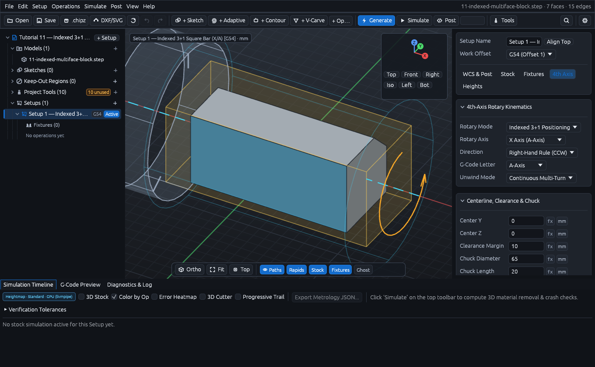
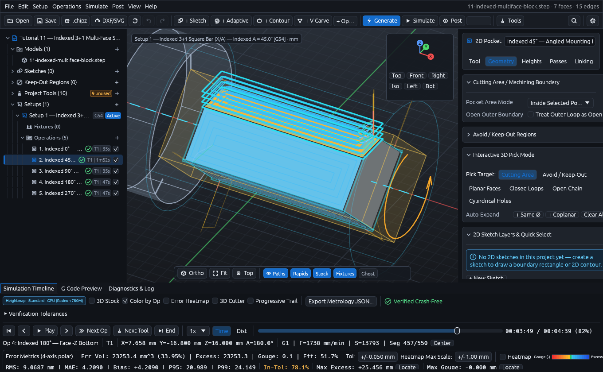
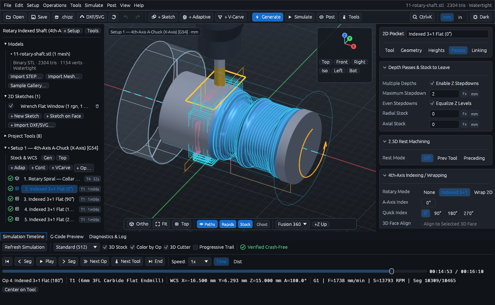

# Tutorial 11 — Indexed `3+1` Multi-Face Milling: Cardinal Flats & Prismatic STEP Face Alignment

## 1. Goal & What You'll Learn

Re-clamping a part four or five times in a bench vise introduces alignment stack-up errors and wastes setup time. With **Indexed `3+1` Positioning (`OperationRotaryMode::Indexed3Plus1`)**, your 4th axis rotates the workpiece to a fixed angle at safe clearance radius, locks in place, and lets you run standard 2.5D milling strategies (`2D Pocket`, `2D Contour`, `Drilling / Helical Bore`, `Edge Chamfer`) straight down along `+Z`—all in a **single chucking**.

In this tutorial you will practice two real-world `3+1` workflows:

- **Part A — Prismatic Multi-Face STEP Block (`11-indexed-multiface-block.step`):** Chucking square `90 × 36 × 36 mm` bar stock on `X/A`, clicking planar B-Rep faces in 3D, and using **`Align to Selected 3D Face`** (powered by `compute_index_angle_for_normal`) to compute exact **`0°`, `45°`, `90°`, `180°`, and `270°`** index angles—including a non-cardinal **`45°` angled mounting bevel**!
- **Part B — Cardinal `0° / 90° / 180° / 270°` Wrench Flats on a Cylindrical Shaft (`09-rotary-shaft.stl`):** Combining **`Quick Index`** (`0°/90°/180°/270°`) 2D pockets with continuous rotary spiral surfacing on the same shaft.
- Verifying safe clearance-radius retracts between every face rotation in **`CylindricalStock`** and inspecting clean `G0 Z` + `G0 A<angle>` index blocks in **`linuxcnc_4axis`** G-code.

---

## 2. Prerequisites & Starter Projects

Open the included prismatic multi-face STEP fixture ([`assets/11-indexed-multiface-block.step`](assets/11-indexed-multiface-block.step) — a `70 × 32 × 32 mm` block aligned along `X` with four cardinal faces plus a generous `45°` beveled mounting facet) or generate the seeded projects via `chipcutter`:

```bash
# Part A — Open the bare 11-indexed-multiface-block.step in an empty workspace:
chip-gui docs/tutorials/assets/11-indexed-multiface-block.step

# Or generate & open the complete 5-face Indexed 3+1 STEP project (0° / 45° / 90° / 180° / 270°):
chipcutter generate-sample-step /tmp/11-indexed-multiface-block.step \
  --tutorial 11-indexed-step --project-out /tmp/11-indexed-step.chip.toml
chip-gui /tmp/11-indexed-step.chip.toml

# Part B — Launch the Rotary Indexed Shaft showcase (Continuous Spiral + 4× Cardinal Wrench Flats):
chip-gui --sample rotary-shaft
```

---

## 3. Step-by-Step GUI Walkthrough

### Step 1 — Chuck Square Bar Stock in an `Indexed 3+1` Setup (`Setup 1 → 4th Axis`)

1. Import **`docs/tutorials/assets/11-indexed-multiface-block.step`** via **`Import 3D STEP Solid…`** on the **Welcome to ChipCutter** overlay (or **`File → Import STEP Model…`** in the **top menu bar**, or **`Import STEP…`** under **`Models`** in the left **CAM Browser**). The solid measures `70 × 32 × 32 mm` (`X ∈ [-35, +35], Y ∈ [-16, +16], Z ∈ [-16, +16]`).
2. In the left **CAM Browser**, click **`Stock & WCS`** under `Setup 1`:
   - On the **`WCS & Post`** tab in the right **Inspector**: under **`WCS Origin (X0 Y0 Z0)`**, select **`Origin Reference`** = **`Stock 27-Pt`**, set **`Z Level:`** = **`Mid-Z`**, and click **`C`** in the **`Center Y`** row (so **`Active Anchor`** reads `Mid-Z Center`, centering `X=0, Y=0, Z=0` on the rotary axis). Under **`Post-Processor & Output`**, set **`Post Profile`** = **`LinuxCNC 4-Axis (XYZA / G93) (linuxcnc_4axis)`**.
   - On the **`Stock`** tab in the right **Inspector**: under **`Stock Geometry & Dimensions`**, change **`Stock Mode`** to **`Fixed-Size Box Stock`** **first** so **`Width (WCS X)`**, **`Depth (WCS Y)`**, and **`Height (WCS Z)`** appear below it, then enter `90 mm`, `36 mm`, and `36 mm`. Under **`Stock Offsets`**, confirm **`XY Alignment`** = **`Centered in XY`** and set **`Z Alignment`** = **`Centered in Z`** (or **`Offset from Top (+Z)`** with **`Top Allowance (+Z)`** = `2 mm`; when 4th-axis rotary is already enabled before switching to **`Fixed-Size Box Stock`**, ChipCutter auto-defaults **`Z Alignment`** to **`Centered in Z`** so the rectangular bar centers cleanly on the rotary axis!). The extra `10 mm` of bar length on `-X` keeps the cutter safely clear of the chuck jaws while leaving `2 mm` of machining stock on all four cardinal sides.
3. Switch to the **`4th Axis`** tab in the right **Inspector**:
   - Under **`4th-Axis Rotary Kinematics`**, **first** change **`Rotary Mode`** from `Disabled (3-Axis)` to **`Indexed 3+1 Positioning`** so **`Rotary Axis`**, **`Direction`**, **`G-Code Letter`**, **`Unwind Mode`**, and the **`Centerline, Clearance & Chuck`** card appear below it (enabling **`4th Axis`** here is also what makes the **`4th-Axis Indexing / Wrapping`** card appear in Operation **`Passes`** tabs!).
   - Set **`Rotary Axis`** = **`X Axis (A-Axis)`** and **`Direction`** = **`Right-Hand Rule (CCW)`**.
   - Under **`Centerline, Clearance & Chuck`**, set **`Clearance Margin`** = `10 mm` above the square bar's outer corner radius (`R_corner = √(18² + 18²) ≈ 25.46 mm` -> `R_clearance ≈ 35.46 mm` so rotating a square bar never clips the retracted tool!), **`Chuck Diameter`** = `65 mm`, **`Chuck Length`** = `20 mm`, and **`Chuck Side`** = **`-End`**.



### Step 2 — Align an Operation to an Angled `45°` 3D STEP Face (`Align to Selected 3D Face`)

1. With `Setup 1` **`Active`** in the left **CAM Browser**, click **`+ Op… → 2D Pocket`** in the **top toolbar** (or **`Operations → + 2D Pocket`** in the **top menu bar**). In the right **Inspector** **`Tool`** tab (`Active Cutter`), select **`T1 — 6mm 3FL Carbide Flat Endmill`**.
2. Open the **`Geometry`** tab in the right **Inspector**, confirm **`Planar Faces`** is selected under **`Interactive 3D Pick Mode`**, click the **`45°` beveled planar facet** on the upper-back corner of the STEP block in the center **3D CAD Viewport** to add it to **`Selected Entities`**, and then click **`Done`** on the top-center viewport guidance bar (or press **`Esc`**) to exit geometry-pick mode.
3. To enable **`3D Face Align`** on the **`Passes`** tab (which reads the active viewport inspection face): click the **`45°` beveled planar facet** once in the **3D CAD Viewport** while in normal inspect mode (the right **Inspector** briefly switches to **`B-Rep Entity Inspector`** showing that face), then click your pocket operation again in the left **CAM Browser**.
4. Switch to the **`Passes`** tab in the right **Inspector**:
   - Under **`Depth Passes & Stock to Leave`**, keep **`Multiple Depths`** (`Enable Z Stepdowns`) checked so **`Maximum Stepdown`** (`2.5 mm`) and **`Even Stepdowns`** (`Equalize Z Levels`) are displayed.
   - Under **`4th-Axis Indexing / Wrapping`**, **first** click **`Indexed 3+1`** on the **`Rotary Mode`** row so **`A-Axis Index`**, **`Quick Index`** (`0°`, `90°`, `180°`, `270°`), and **`3D Face Align`** appear below it.
   - Under **`3D Face Align`**, the button is now enabled and reads **`Align to Face (45.0°)`** (when no planar face is selected in inspect mode, it appears disabled as **`Align to Selected 3D Face`**). Click **`Align to Face (45.0°)`** to evaluate the face's exact B-Rep normal `(0, +1/√2, +1/√2)` against your Setup's rotary axis & polarity and set **`A-Axis Index`** = `45°` automatically!
5. Press **`Ctrl+G`** (or click **`Generate`** in the **top toolbar**):



Look at the **3D CAD Viewport**: with **`Auto-rotate view to index angle`** enabled inside **`4th-Axis Indexing / Wrapping`** (and **`Settings → Viewport`**), ChipCutter automatically rotates the 3D model, raw setup stock wireframe, Z-height planes, and live **`[Geometry]`** boundary preview upright under `+Z` whenever you focus an **`Indexed 3+1`** operation (displaying an `Indexed A = 45.0°` badge in the viewport HUD). On **`Ctrl+G`**, ChipCutter constructs the exact rotated virtual Setup (`build_indexed_virtual_setup`), computes multi-depth `2D Pocket` passes parallel to the `45°` bevel, enforces mandatory **rotary chuck keep-out safety** against the chuck envelope configured in `Setup → 4th Axis`, and prepends a safe clearance-radius rapid retract before rotating `A` to `45°`.

### Step 3 — Machine All Five Faces (`0°`, `45°`, `90°`, `180°`, `270°`) in One Chucking

Repeat Step 2 for the four cardinal planar faces using either **`Quick Index`** (`0°`, `90°`, `180°`, `270°`) or **`3D Face Align`** inside **`4th-Axis Indexing / Wrapping`**:

- **`Op 1 (0°)`:** Select the `+Z` top face (`Z = +16 mm`) -> **`A-Axis Index = 0°`** (`2.0 mm` stepdown).
- **`Op 2 (45°)`:** Select the `(+Y, +Z)` angled mounting bevel -> **`A-Axis Index = 45°`** (`2.5 mm` stepdown).
- **`Op 3 (90°)`:** Select the `+Y` side face (`Y = +16 mm`) -> **`A-Axis Index = 90°`** (`2.0 mm` stepdown).
- **`Op 4 (180°)`:** Select the `-Z` bottom face (`Z = -16 mm`) -> **`A-Axis Index = 180°`** (`2.0 mm` stepdown).
- **`Op 5 (270°)`:** Select the `-Y` side face (`Y = -16 mm`) -> **`A-Axis Index = 270°`** (`2.0 mm` stepdown).

Press **`Ctrl+G`** with **`View → Show All Operations in Active Setup`** checked in the **top menu bar**:


Every operation's toolpath wraps cleanly onto its target face around the prismatic solid, and `validate_project` automatically validates every face normal and Z-height hierarchy inside each operation's rotated `3+1` frame.

### Step 4 — Part B: Cardinal `0° / 90° / 180° / 270°` Wrench Flats on a Cylindrical Shaft (`--sample rotary-shaft`)

You can also mix **`Indexed 3+1`** operations with **`4th-Axis Rotary Surfacing`** inside a single Setup! Open `--sample rotary-shaft` (or generate via `--tutorial 11-indexed-shaft` on `09-rotary-shaft.stl`):

1. **`Op 1`** runs **`Continuous Helical Spiral`** surfacing (`T4` `Ø6 mm` Ball Endmill) over the central collar groove and 3-lobe cam—with its axial `-U / +U` span, **`Axial Source`**, **`Axial Containment`**, signed **`Start Margin (-U)`** / **`End Margin (+U)`**, and angular sector (`Start Angle (°)` / `End Angle (°)` / `Angular Presets`) configured in **`Geometry → 4th-Axis Rotary Cutting Area (-U / +U)`** (with live 3D cylindrical sector + chuck-guard preview) and radial `R_max` / `R_min` bounds shown live in **`Heights`**.
2. **`Ops 2–5`** target a single **`Wrench Flat Window`** 2D sketch (`18 × 36 mm` rectangle over `X ∈ [-24.5, -6.5]`) with `T1` (`Ø6 mm` Flat Endmill), cutting `6.0 mm` deep from `Top Ref = Stock Top` (`Top Offset = 0.5 mm`) in `2.0 mm` stepdowns at **`0°`**, **`90°`**, **`180°`**, and **`270°`** using the **`Quick Index`** buttons inside **`Passes → 4th-Axis Indexing / Wrapping`** (automatically guarded by the Setup's mandatory rotary chuck keep-out).
3. Click **`Simulate`** in the **top toolbar** (opening the bottom **`Simulation Timeline`** tab) and scrub to ~92%:



Watch the live **`Simulation Timeline`** HUD report **`Op 4: Indexed 3+1 Flat (180°) | WCS X=-16.500 mm Y=6.293 mm Z=15.000 mm A=180.0°`** alongside **`Verified Crash-Free`**—proving all four flats, the spiral cam, and the `T4 → T1` tool change clear the stock and chuck cleanly.

---

## 4. Key Parameters Reference

| Location | Parameter | Recommended Value | Purpose & Safety Notes |
|---|---|---|---|
| `Right Inspector → Setup → Stock → Stock Geometry & Dimensions` | **`Fixed-Size Box Stock`** | Part `Y/Z` + `4 mm`, `X` + `20 mm` | Set **`Top Allowance (+Z)`** = `2 mm` under **`Stock Offsets`** to center in Z; extra `-X` stickout clears the chuck |
| `Right Inspector → Setup → 4th Axis → Centerline, Clearance & Chuck` | **`Clearance Margin`** & **`Chuck`** | `>= 10 mm` above stock corner radius | Shown after enabling **`Rotary Mode`**; for `36 × 36 mm` square stock, `R_corner = 25.46 mm` -> `R_clearance = 35.46 mm`; chuck geometry enforces mandatory keep-out safety across **`Indexed 3+1`** and rotary surfacing ops |
| `Right Inspector → Geometry → 4th-Axis Rotary Cutting Area (-U / +U)` | **`Axial Source`**, **`Axial Containment`**, **`Start/End Margin`**, & **`Start/End Angle`** | Used on mixed **`4th-Axis Rotary Surfacing`** ops | Bounds rotary surfacing axially and angularly with live 3D cylindrical sector + chuck-guard preview; **`Heights`** shows live `R_max` / `R_min` radial bounds |
| `Right Inspector → Passes → 4th-Axis Indexing / Wrapping` | **`Rotary Mode`** | **`Indexed 3+1`** | Card shown when Setup **`4th Axis`** is enabled; click **`Indexed 3+1`** to reveal angle & align controls |
| `Right Inspector → Passes → 4th-Axis Indexing / Wrapping` | **`Quick Index`** | **`0°`** / **`90°`** / **`180°`** / **`270°`** | One-click cardinal face indexing for 4-sided blocks and wrench flats |
| `Right Inspector → Passes → 4th-Axis Indexing / Wrapping` | **`3D Face Align`** (`Align to Selected 3D Face` / `Align to Face (<angle>°)`) | Any planar STEP face | Click a planar face in the **3D CAD Viewport** in inspect mode first to enable the button and compute exact `deg ∈ [0, 360)` |

---

## 5. Generate (`Ctrl+G`) & Cylindrical 3D Simulation

1. Press **`Ctrl+G`** (or click **`Generate`** in the **top toolbar**; **`Diagnostics & Log`** logs wall-clock generation time alongside estimated CNC cycle time) and click **`Simulate`** in the **top toolbar** (opening the bottom **`Simulation Timeline`** tab; configure Detail Level or **`Smooth Skinned Surfaces (Mesh Skinning)`** via the compact status chip or **`Edit → Settings…` → `Simulation`**, `Ctrl+,`) on either project.
2. Confirm **`3D Stock`**, **`Color by Op`**, and **`3D Cutter`** are checked in **`Simulation Timeline`** and verify **`Verified Crash-Free`**:
   - On the square bar STEP job, `CylindricalStock` initializes the exact square bar cross-section (`90 × 36 × 36 mm`) and carves all five indexed faces cleanly into the finished chamfered prism while leaving unmachined chucking stubs on both ends.
   - Zero `Rapid-into-Stock Crash`, zero `Target Model Gouge`, and zero `Holder / Collet Collision` diagnostics are reported.

---

## 6. Post-Processing (`linuxcnc_4axis` & `grblhal_4axis`)

Click **`Post`** in the **top toolbar** (or select the bottom **`G-Code Preview`** tab) with **`LinuxCNC 4-Axis (XYZA / G93)`** (`linuxcnc_4axis`) selected in **`Post Profile:`**:


Inspect the transitions between indexed operations in the generated `.ngc` program:
1. Before every angular index, ChipCutter emits an explicit rapid retract above the clearance cylinder (`G0 Z35.456`) in **`G94`** feed mode.
2. Only once retracted does the post emit the pure rotational index block (`G0 A45.000`, `G0 A90.000`, `G0 A180.000`, `G0 A270.000`).
3. Once indexed, standard `X / Y / Z` milling passes run along the newly aligned `+Z` spindle axis with full `G2`/`G3` arc preservation.

---

## 7. Headless CLI Equivalent (`chipcutter`)

Generate, validate, simulate, and post-process both the 5-face prismatic STEP job and the 4-flat rotary shaft job headlessly:

```bash
# 1. Generate 11-indexed-multiface-block.step + 5-op Indexed 3+1 project (0°/45°/90°/180°/270°)
chipcutter generate-sample-step /tmp/11-indexed-multiface-block.step \
  --tutorial 11-indexed-step --project-out /tmp/11-indexed-step.chip.toml

# 2. Generate 11-rotary-shaft.stl + 5-op Spiral + 4× Cardinal Wrench Flats project
chipcutter generate-sample-step /tmp/11-rotary-shaft.stl \
  --tutorial 11-indexed-shaft --project-out /tmp/11-indexed-shaft.chip.toml

# 3. Validate, verify crash-free in CylindricalStock, and build LinuxCNC 4-Axis G-code
chipcutter validate --generate /tmp/11-indexed-step.chip.toml
chipcutter simulate /tmp/11-indexed-step.chip.toml --resolution standard
chipcutter build /tmp/11-indexed-step.chip.toml -o /tmp/out_11_step --post linuxcnc_4axis

chipcutter validate --generate /tmp/11-indexed-shaft.chip.toml
chipcutter simulate /tmp/11-indexed-shaft.chip.toml --resolution standard
chipcutter build /tmp/11-indexed-shaft.chip.toml -o /tmp/out_11_shaft --post linuxcnc_4axis
```

---

## Next Steps

- **Previous:** [Tutorial 10 — 4th-Axis Rotary Wrapping & Surfacing](10-rotary-wrapping-surfacing.md)
- **Next:** [Tutorial 12 — Simultaneous 4-Axis Milling (`X+Y+Z+A/B`)](12-simultaneous-4axis-milling.md)
- **Index:** [All Tutorials](README.md)
